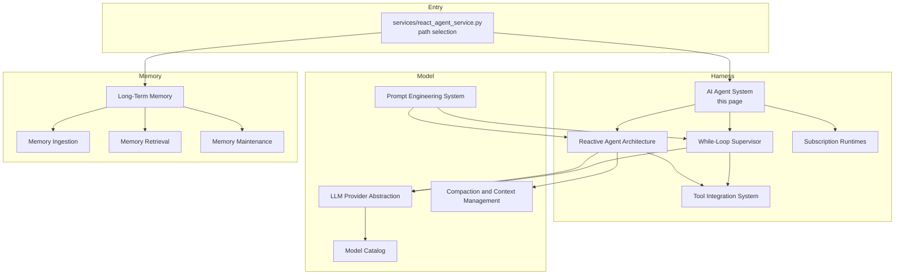
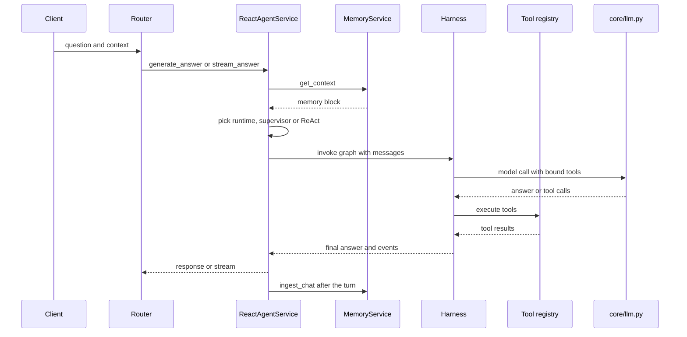
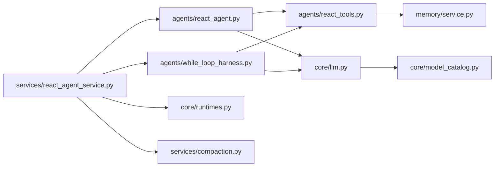

# AI agent system

This folder covers the part of the backend that turns a chat turn into model calls, tool calls and stored memory. `services/react_agent_service.py` picks an execution path, the graphs in `agents/` do the loop, `agents/react_tools.py` decides what the model can call, and `core/llm.py` builds the client. The prompt, catalog, compaction and memory pages explain the pieces around that loop.

Key capabilities:
- Two LangGraph harnesses, the ReAct agent and the while-loop supervisor, plus four subscription runtimes.
- One tool registry shared by both graphs, with credentials injected per request.
- Eight API providers and a model catalog that lists what each one offers.
- Prompt modules with explicit JSON contracts for the planner and the memory extractor.
- A token budget for long chats, long tool output and injected memory.
- A durable memory system with separate write, read and maintenance paths.

## Repository layout

The pages in this folder follow the code boundaries. The harness pages sit on `agents/`, the model pages on `core/` and `prompts/`, and the memory pages on `memory/`.

## Pages in this folder

| Page | What it covers |
| --- | --- |
| AI Agent System | This folder map and the path selection between harnesses. |
| Reactive Agent Architecture | `AgentState`, the `agent` and `tool_execution` nodes, graph caching and streamed events. |
| While-Loop Supervisor | The four supervisor nodes, five subagent roles, tool partitions and the quality gate. |
| Tool Integration System | `build_agent_tools`, the tool inventory, input bounds and memory tool behaviour. |
| Subscription Runtimes | The Claude Agent SDK, `codex exec`, the ACP client and Antigravity install and login. |
| LLM Provider Abstraction | `PROVIDER_CONFIGS`, secret resolution, the client cache and the per-request model headers. |
| Model Catalog | models.dev loading, endpoint listing per API format and `model_info`. |
| Prompt Engineering System | Every prompt module used by the agent, its inputs and its output contract. |
| Compaction and Context Management | Chat summaries, in-run tool trimming and memory context packing. |
| Long-Term Memory | The three stores, the service surface and the boundaries between write and read paths. |
| Memory Ingestion | Chat extraction, the memory gate, reconciliation and the writer transaction. |
| Memory Retrieval | Query planning, hybrid search, scoring, context assembly and graph expansion. |
| Memory Maintenance | Scheduled decay, dedup, promotion, repair, and the document and profile ingestion paths. |

## How the folder fits together

A request arrives at a router, which calls `ReactAgentService`. The service resolves the runtime pick, decides between the ReAct agent and the supervisor, assembles memory context, and invokes a compiled graph. The graph calls the model through `core/llm.py`, runs tools from the registry, and returns an answer. After the answer, a background task ingests the turn into memory.

## Shared concepts

- `StructuredTool` is the only tool type. Each entry has a name, a description, a coroutine and a Pydantic `args_schema`.
- `add_messages` is the reducer on both agent states. Nodes return `{"messages": [...]}` and LangGraph appends.
- `EventCallback` is `Callable[[dict[str, Any]], Awaitable[None]]`. The same event names are used by the ReAct agent, the supervisor and the runtimes.
- `LoopGuard` stops a run that repeats itself. The ReAct agent rebuilds it from message history, the supervisor keeps one per subagent.
- `build_agent_tools(context)` is the single entry point for the tool list, so both graphs offer the same names and schemas.
- `get_default_llm()` returns the request-scoped client when one is set, otherwise the process default.

## Dependencies

The folder depends on `langgraph>=1.0.1`, `langchain>=0.3.27`, `pydantic>=2.9.0`, the LangChain provider packages, and the store clients used by memory. The subscription path also needs the vendor binaries on `PATH`.

## Troubleshooting

- The wrong harness ran: check `_SUPERVISOR_REQUEST_RE` in `services/react_agent_service.py`. Words such as `open`, `click` or `browse` select the supervisor.
- A provider is missing: the name must be a key in `PROVIDER_CONFIGS`, not just a model name.
- A tool is missing from the list: check the context keys and the `client_id` filter in `build_agent_tools`.
- A long chat loses old facts: read the compaction page before raising the budget, because the summary may be the cause.
- A memory claim is not found: check the gate decision first, then the search index, then run store repair.

## Appendix

### Source files

- `services/react_agent_service.py`
- `agents/react_agent.py`
- `agents/while_loop_harness.py`
- `agents/react_tools.py`
- `core/llm.py`
- `core/runtimes.py`
- `memory/service.py`
