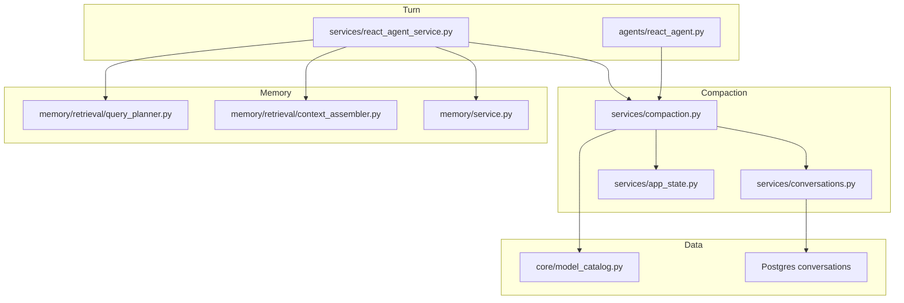
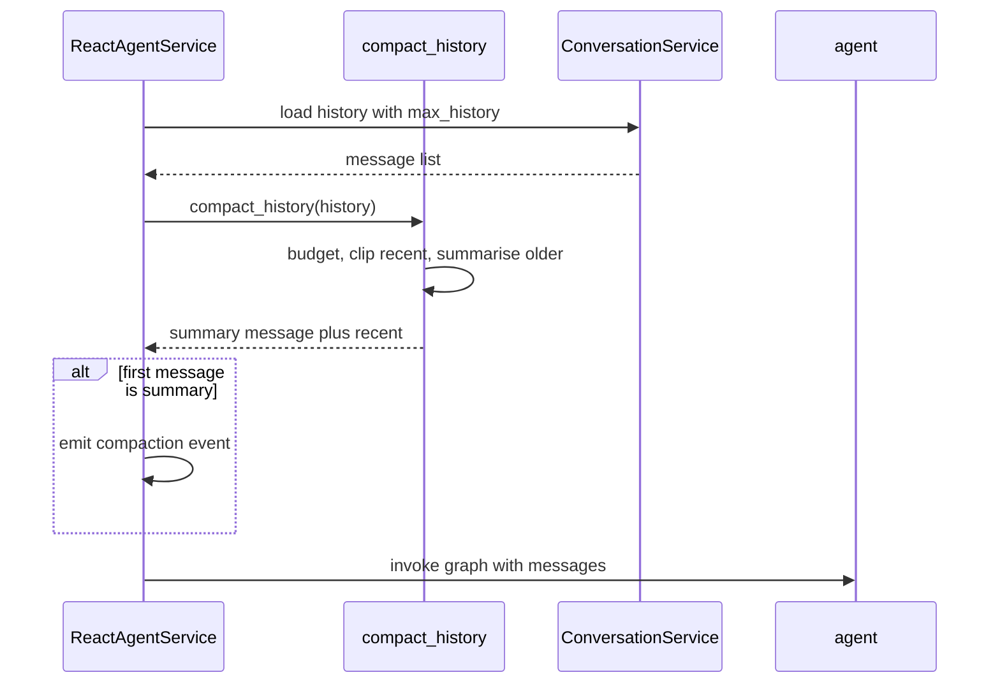
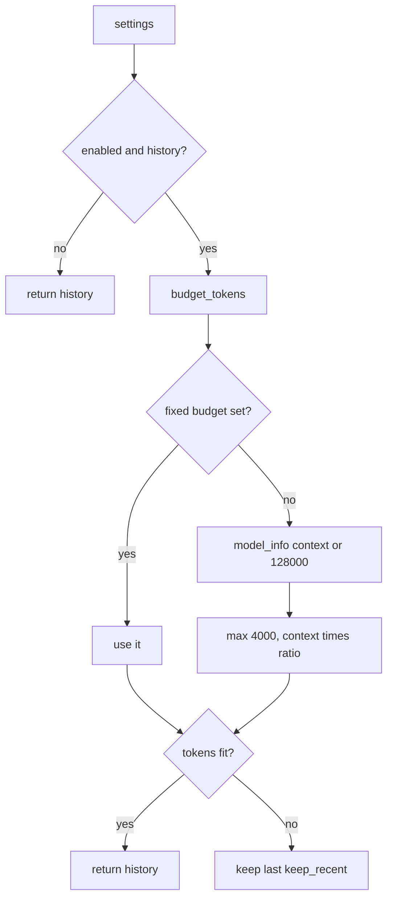
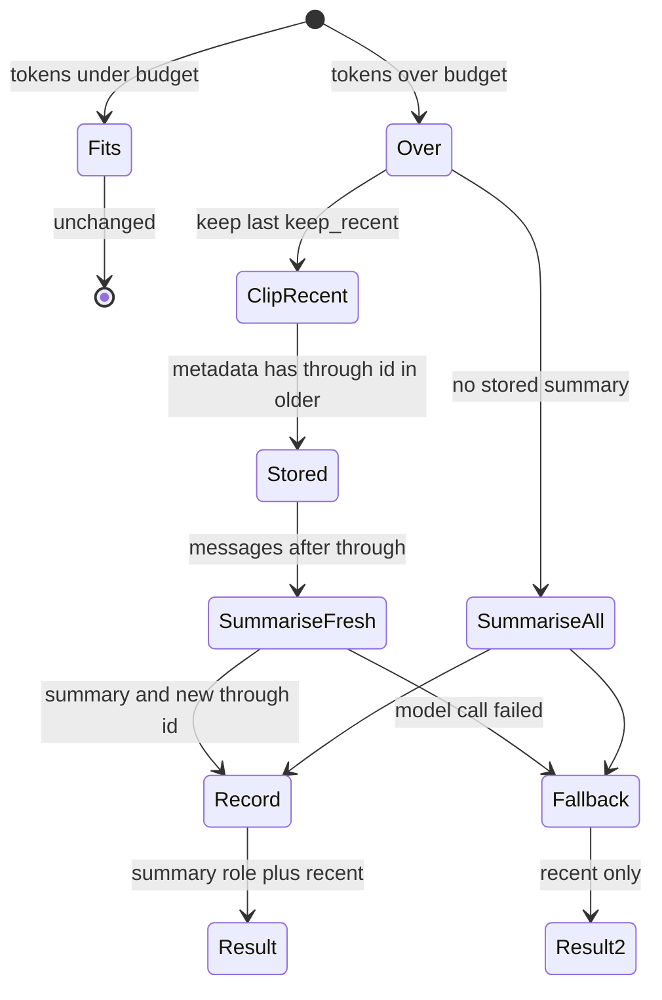
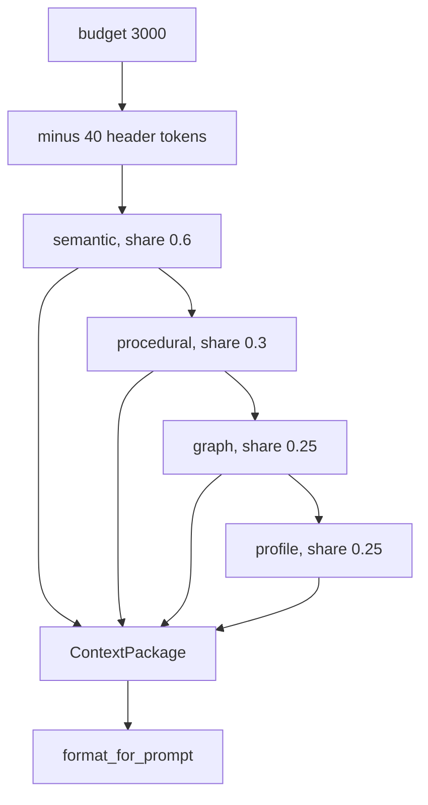
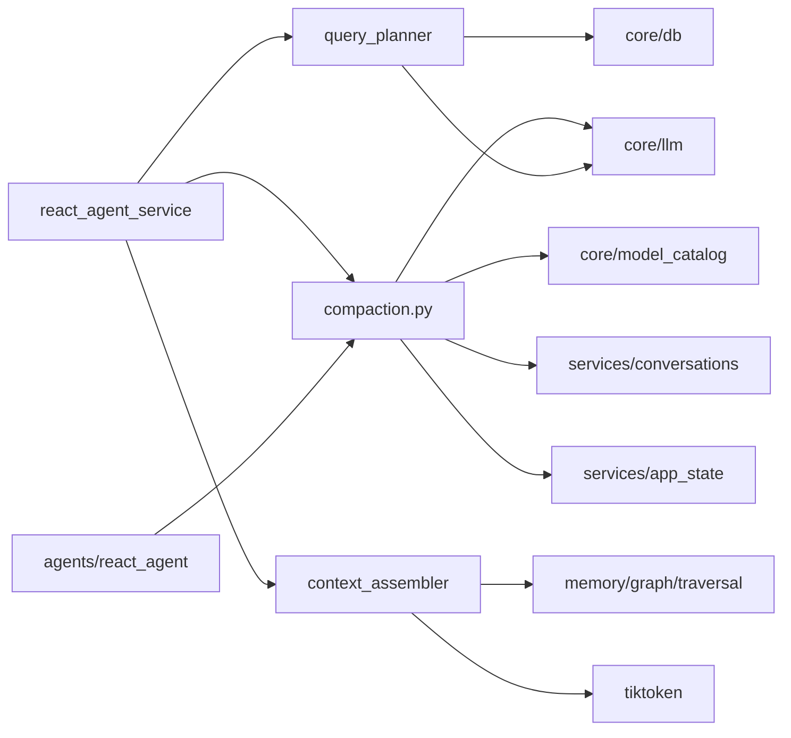

# Compaction and context management

Long chats and long agent runs both need a token budget. `services/compaction.py` keeps recent chat turns verbatim and folds older ones into a stored summary, then trims old tool results during a run. `memory/retrieval/query_planner.py` and `memory/retrieval/context_assembler.py` decide what durable memory to retrieve and how to pack it into a fixed block.

Key capabilities:
- A budget taken from `trigger_ratio` of the model context window, or from `budget_tokens`.
- `keep_recent` turns kept word for word, default 8.
- A summary stored on the conversation and extended on later turns.
- In-run trimming of old tool messages.
- Memory context packed by section with a fixed priority.

## Repository layout

## Building blocks

- `services/compaction.py`: `DEFAULTS`, `estimate_tokens`, `budget_tokens`, `compact_history`, `summary_preamble` and `trim_tool_outputs`.
- `services/react_agent_service.py`: calls `compact_history` before a turn, emits a `compaction` event, and builds the memory prompt with a 1200 token budget.
- `memory/retrieval/query_planner.py`: `QueryPlan`, `QueryPlanner.plan`, `aplan`, entity caching and relationship lookup.
- `memory/retrieval/context_assembler.py`: `ContextAssembler.assemble` and `format_for_prompt`.

## How it fits together

`_prepare_conversation` loads history with a limit from the compaction settings, passes it through `compact_history`, and hands the result to the agent. When the first message has role `summary`, the service emits a `compaction` event so the work log can show that older turns were folded.

## Budget settings

Settings live in `AppSetting` key `chat.compaction` and are edited from the console under Settings, Model. `load_settings` starts from `DEFAULTS` and copies only known keys, so an unknown field cannot leak into the budget logic.

| Setting | Default | Effect |
| --- | --- | --- |
| `enabled` | `True` | Skips compaction entirely when false. |
| `trigger_ratio` | `0.5` | Fraction of the model context window used as budget. |
| `budget_tokens` | `None` | Fixed budget, overrides the ratio. |
| `keep_recent` | `8` | Messages always kept verbatim, minimum 2. |
| `max_history` | `400` | Messages loaded per conversation. |

`budget_tokens()` returns `budget_tokens` when set. Otherwise it reads the default model's provider and model name, asks `model_info` for `context`, falls back to `FALLBACK_CONTEXT` of 128000, and returns `max(4000, int(context * trigger_ratio))`.

`estimate_tokens` is `len(text) // 4 + 1`, and `_tokens` adds four tokens per message for role and framing overhead. This is deliberately cheap. It may overestimate or underestimate a specific tokenizer, but it is stable and runs on every turn.

## Summary storage

`compact_history` splits history into `recent = history[-keep_n:]` and `older = history[:-keep_n]`. Recent messages are clipped to at most 60 percent of the budget spread across them, with a floor of 500 tokens each. If `older` is empty, only the clipped recent list is returned.

The summary is incremental. The code reads `conversation.metadata.compaction`, which stores `summary`, `through_message_id`, `messages_summarised` and `at`. If that `through_message_id` is still in the older list, the stored summary is reused and only messages after it are summarised again. Otherwise all older messages are summarised from scratch.

The summary prompt asks for third person bullet notes under facts, actions and results, decisions, and open threads, under 900 words, keeping numbers, names, URLs, ids and paths. `_transcript` caps each message at 6000 characters, keeping the first and last halves around an ellipsis marker.

On a summarisation failure the code logs and returns the clipped recent messages without a summary, rather than failing the turn. The returned list starts with `{"role": "summary", "content": ..., "compaction": info}`.

`summary_preamble` wraps that content for the model as notes about earlier turns. `_build_react_messages` turns a summary role into a system message with that preamble, and the runtime turn path does the same.

## In-run tool trimming

Chat compaction handles turns. A single long agent run can still grow without a new user message. `trim_tool_outputs(messages, budget, keep_last=4, head=1500)` runs inside the agent node before each model call.

It indexes the `ToolMessage` entries, leaves the newest four alone, and replaces any older result longer than 3000 characters with its first 1500 characters plus a cut note. It recomputes the total after each replacement and stops as soon as the budget fits. The replacement keeps `tool_call_id` and `name`, so the provider still accepts the conversation.

## Memory query planning

`QueryPlanner` builds one plan per turn. The default is heuristic and performs no LLM call. `aplan` also detects first person pronouns and history words, looks up known entities and resolves phrases such as "my sister".

Entity names come from active `EntityORM` rows, limited to 5000, plus aliases and first names of at least three characters. The cache lives for 60 seconds and at most five names are returned. Relationship lookup finds up to four names, and any mention sets `needs_graph_traversal`.

`include_history` is set for phrases such as before, used to or a month name, so replaced facts remain valid answers. The LLM planner is opt-in through `MEMORY_LLM_PLANNER=1` and falls back to heuristics on a parse failure.

## Packing memory context

`ContextAssembler` has a default budget of 3000 tokens and counts with `tiktoken` `cl100k_base`. It subtracts 40 tokens for up to four section headers, then fills sections in priority order: semantic facts, procedural preferences, graph context, profile.

The `take` helper rejects a line when it exceeds the remaining budget or the section's share of the total. Shares are 0.6 semantic, 0.3 procedural, 0.25 graph and 0.25 profile, checked against a shared `remaining` counter, so a tight budget drops lower sections first. Duplicate claim ids are skipped.

`format_for_prompt` renders up to four sections: `## About the user`, `## How the user wants you to respond`, `## Relevant memories` with confidence suffixes, and `## Related memories`. `total_tokens_estimate` is measured on the rendered text, not on the sum of item estimates.

`_build_memory_prompt` in the agent service uses `MemoryService().get_context` with a 1200 token budget, formats it, and returns the claim ids that went in so the answer can be checked for which memories it used. `_build_memory_query` searches with the question when it has six or more words. A shorter follow-up borrows up to 300 characters of the previous user message so pronouns resolve.

## Dependencies

`compaction.py` imports the model client lazily inside `_summarise`, so the module loads before provider packages are configured. The assembler holds one `tiktoken` encoder. The planner imports SQLAlchemy and the memory ORM inside its lookup helpers.

## Performance

- Token estimates use characters divided by four, not a full tokenizer, so the check is cheap enough to run every turn.
- The summary is extended from `through_message_id` instead of regenerated, so later turns summarise only new older messages.
- Recent messages are clipped before summarisation, which bounds the summary input.
- `trim_tool_outputs` stops as soon as the total fits, and only rewrites tool messages, not user or assistant text.
- The query planner is heuristic by default. The LLM planner costs one call and is opt-in.
- Entity names are cached for 60 seconds, and the assembler counts tokens on rendered text once per section.

## Troubleshooting

- A long chat still hits a context error: the model context is unknown, so the budget used 128000 while the real window is smaller. Set `budget_tokens` explicitly.
- Old facts disappear from answers: they were folded into the summary and the summary omitted them. Raise `keep_recent` or `budget_tokens`, or check the summary output.
- Compaction runs every turn: the recent messages alone exceed the budget, so the fresh list is still too large. Lower `keep_recent` or raise the budget.
- A tool result is truncated mid-JSON: `trim_tool_outputs` cut an old result at 1500 characters. Ask for smaller tool output, or raise `head`.
- Memory context is empty: retrieval failed. Check Postgres and the memory indexes.
- A summary is stale after an edit: `through_message_id` still points into the older list. Clear the compaction metadata on the conversation to force a fresh summary.

## Appendix

### Implementation examples

- Budget calculation, `budget_tokens`.
- Chat compaction, `compact_history`.
- Summary prompt, `_SUMMARY_PROMPT`.
- Tool trimming, `trim_tool_outputs`.
- Heuristic plan, `_heuristic_plan` and `aplan`.
- Context formatting, `ContextAssembler.format_for_prompt`.

### Source files

- `services/compaction.py`
- `memory/retrieval/context_assembler.py`
- `services/react_agent_service.py`
- `memory/retrieval/query_planner.py`
