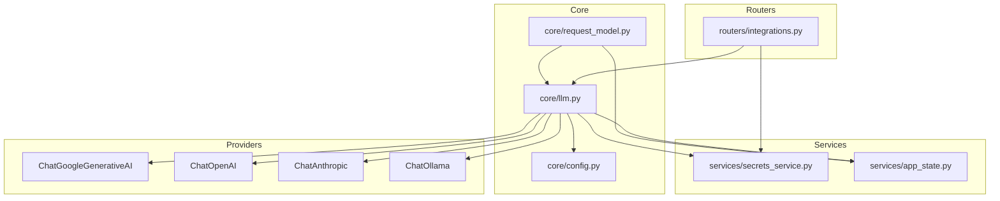
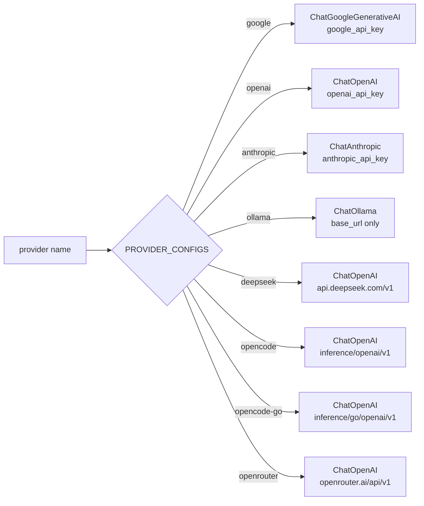
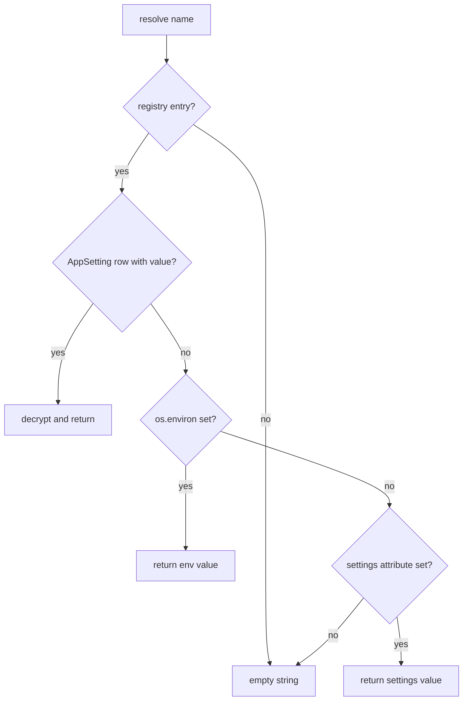
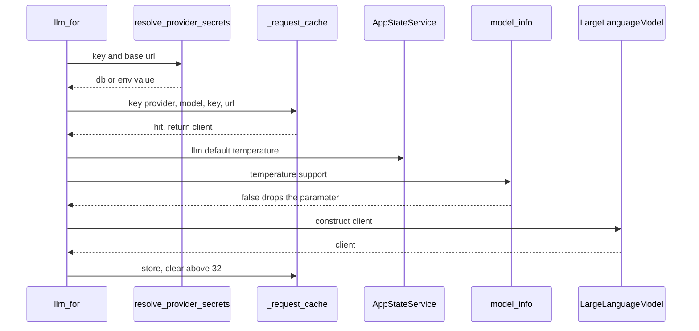
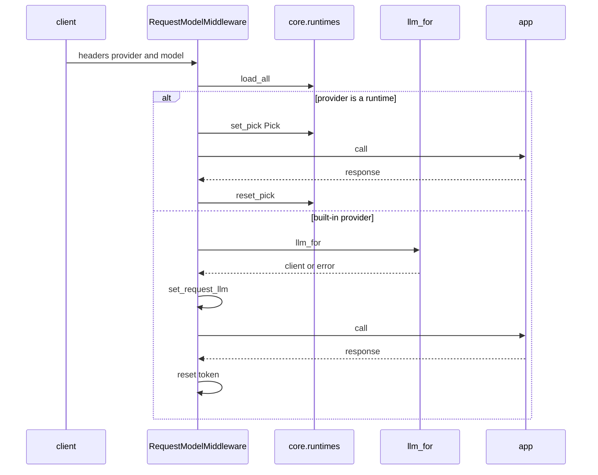
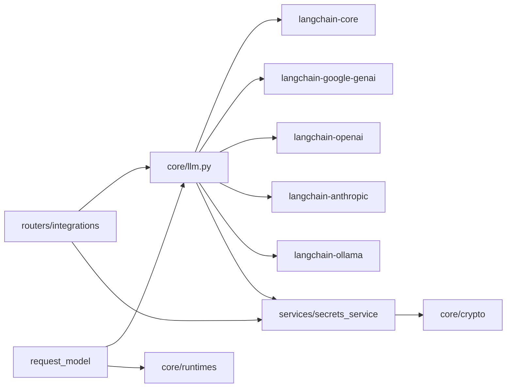

# LLM provider abstraction

`core/llm.py` is the only place that knows how to build a model client. `PROVIDER_CONFIGS` maps eight provider names to LangChain chat classes, key variables, base URLs and default models. `LargeLanguageModel` wraps a client, `resolve_provider_secrets` finds credentials, and `llm_for` caches one client per provider, model, key and endpoint.

Key capabilities:
- Eight providers on four LangChain classes.
- Secrets resolved from the database first, then the environment, then settings.
- One cached client per distinct provider, model, key and base URL.
- A default model stored in `AppSetting` and a per-request pick sent as headers.
- Two import-safe proxies, `llm` and `_model`, that follow a reload.

## Repository layout

## Building blocks

- `core/llm.py`: `PROVIDER_CONFIGS`, `LargeLanguageModel`, `_PROVIDER_TO_SECRET`, `PROVIDER_TO_BASE_URL`, `resolve_provider_secrets`, `llm_for`, `_build_default`, `get_default_llm`, `reload_default_llm`, `set_request_llm`, and the `llm` and `_model` proxies.
- `services/secrets_service.py`: `SECRET_REGISTRY`, `SecretsService.resolve`, `resolve_sync`, `get_raw`, `set`, `clear` and `list_status`.
- `routers/integrations.py`: the `/llm` routes and the secret routes that rebuild the default after a change.
- `core/request_model.py`: `RequestModelMiddleware`, which reads `x-agentic-provider` and `x-agentic-model` and scopes a client to one request.

## Provider table

| Name | Class | Key env | Default model | Base URL |
| --- | --- | --- | --- | --- |
| `google` | `ChatGoogleGenerativeAI` | `GOOGLE_API_KEY` | `gemini-4-hydrogen` | `google_base_url` |
| `openai` | `ChatOpenAI` | `OPENAI_API_KEY` | `gpt-5-mini` | `openai_base_url` |
| `anthropic` | `ChatAnthropic` | `ANTHROPIC_API_KEY` | `claude-4-sonnet` | `anthropic_base_url` |
| `ollama` | `ChatOllama` | none | `llama3` | `OLLAMA_BASE_URL` |
| `deepseek` | `ChatOpenAI` | `DEEPSEEK_API_KEY` | `deepseek-chat` | fixed `https://api.deepseek.com/v1` |
| `opencode` | `ChatOpenAI` | `OPENCODE_API_KEY` | `claude-sonnet-5` | fixed `https://opencode.ai/inference/openai/v1` |
| `opencode-go` | `ChatOpenAI` | `OPENCODE_API_KEY` | `minimax-m2.7` | fixed `https://opencode.ai/inference/go/openai/v1` |
| `openrouter` | `ChatOpenAI` | `OPENROUTER_API_KEY` | `mistralai/mistral-7b-instruct` | fixed `https://openrouter.ai/api/v1` |

`param_map` translates generic argument names into the keyword each class expects, so `api_key` becomes `google_api_key` or `openai_api_key`. DeepSeek, OpenCode and OpenRouter reuse `ChatOpenAI` with a fixed URL and therefore speak the OpenAI format. Ollama is the only provider with no key. It needs a base URL instead.

## Secret resolution

`resolve_provider_secrets(provider)` asks `SecretsService.resolve` for the key name and the base URL name. `resolve` checks the encrypted `AppSetting` row, then `os.environ`, then the settings attribute, and returns an empty string instead of raising. A key entered in the settings UI therefore wins over `.env`, and clearing it falls back.

`mask` shows the first three and last four characters when a value is longer than eight characters, and dots otherwise. `list_status` reports `db_set`, `env_set`, `source` and `masked`, which the settings UI uses to show where a key came from.

## How it fits together

`LargeLanguageModel.__init__` lowercases the provider, looks up the config, and picks `model_name` or the provider default. It raises `ValueError` when neither exists. It adds `temperature` only when the value is not `None`. For providers with a key it takes the argument or `os.getenv(api_key_env)`. Base URL precedence is the explicit argument, then `base_url_override`, then `base_url_env`. Constructor errors are wrapped in a `RuntimeError` that names the provider, model and cause.

`llm_for` uses `get_settings().default_llm_temperature` unless the saved `llm.default` setting carries a temperature. It then asks `model_info` whether the model rejects that parameter. The cache key is `(provider, model, api_key, base_url)`, so a changed key or endpoint builds a new client. Above 32 entries the cache is cleared wholesale.

## The default model and its proxies

`_build_default` is the synchronous path used at import time and as a fallback. It reads settings for provider, model and temperature, resolves secrets with `resolve_sync` (environment and settings only, no database), and constructs the client. `get_default_llm()` returns the request-scoped client when one is set, then lazily builds and keeps the global default.

`reload_default_llm` is the async path. It reads `AppSetting` key `llm.default`, resolves the provider, resolves secrets from the database, clears the client cache, and rebuilds. If the override cannot build, it logs and falls back to environment defaults. `__getattr__` makes `llm` and `_model` proxies, so a module that captured them at import time still reaches the current default.

## Per-request model

`RequestModelMiddleware` is plain ASGI rather than `BaseHTTPMiddleware`, so the context variable stays set while a streaming response body is generated. It reads the raw headers `x-agentic-provider` and `x-agentic-model`. If either is missing, the request passes through unchanged.

When the provider is a subscription runtime, the middleware does not build a client. It checks `enabled`, sets a pick, and resets it in `finally`. A disabled runtime gets a 400 with "turned off. Turn it on in Settings -> Subscriptions." A failed `llm_for` gets a 400 with `Can't use <provider>/<model>: <reason>`.

## Settings routes

`routers/integrations.py` exposes the model settings. `GET /llm/model` returns the effective model, provider flags and the environment default. `PUT /llm/model` requires at least one of provider, model or temperature, merges the payload into `llm.default`, saves it, and calls `reload_default_llm`. `DELETE` removes the key and reloads. The `/llm/chat-title` routes do the same for `llm.chat_title`.

`_llm_env_status` resolves each provider's secret and reports a boolean, so `opencode` and `opencode-go` both reflect `opencode_api_key`, and `ollama` reflects `ollama_base_url`. Secret `PUT` and `DELETE` routes also reload the default, because changing the active key must rebuild it.

## Dependencies

`core/crypto` supplies `encrypt`, `decrypt` and `CryptoNotConfigured`. Without encryption, `get_raw` logs a warning and returns `None`, so resolution falls through to the environment instead of crashing.

## Performance

- `llm_for` caches clients by provider, model, key and base URL, so a repeated pick costs a dictionary lookup.
- The cache is cleared above 32 entries, which bounds memory and connection pools.
- `reload_default_llm` clears the cache only when the default changes.
- The request middleware resets its context token and runtime pick in `finally`, so a streamed response cannot leak a pick into the next request.

## Troubleshooting

- Symptom: `API key for 'openai' not found`. Cause: no database row, no environment variable and no settings value. Fix: add the key in Settings or `.env`.
- Symptom: `Base URL for 'ollama' not found`. Cause: Ollama has no key variable and requires `OLLAMA_BASE_URL`. Fix: set the URL in Settings.
- Symptom: a saved model override is ignored. Cause: `reload_default_llm` failed and fell back to environment defaults. Fix: read the server log for the fallback warning.
- Symptom: `Can't use openrouter/qwen`. Cause: `llm_for` raised, often because of a bad model id or a missing key. Fix: verify the model in the catalog and the key.
- Symptom: a client uses an old key after a settings change. Cause: the secret route did not reload the default. Fix: save the key through the settings route, or call `reload_default_llm`.

## Appendix

### Implementation examples

- Provider lookup and error wrapping, `LargeLanguageModel.__init__`.
- Database then environment resolution, `resolve_provider_secrets` and `SecretsService.resolve`.
- Cached build, `llm_for`.
- Default rebuild, `reload_default_llm`.
- Header scoping, `RequestModelMiddleware`.
- Settings writes, `llm_set` and `llm_clear`.

### Source files

- `core/llm.py`
- `services/secrets_service.py`
- `routers/integrations.py`
- `core/request_model.py`
