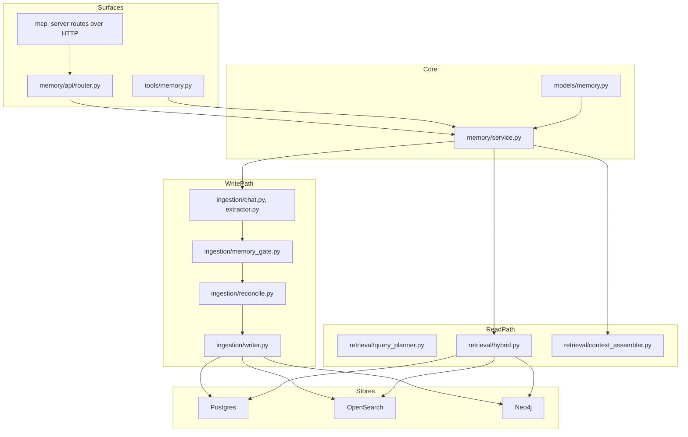
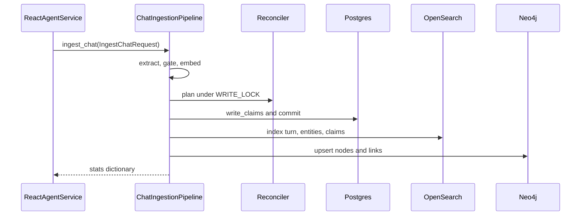
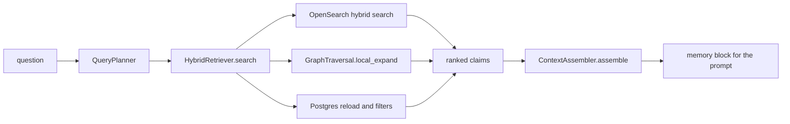
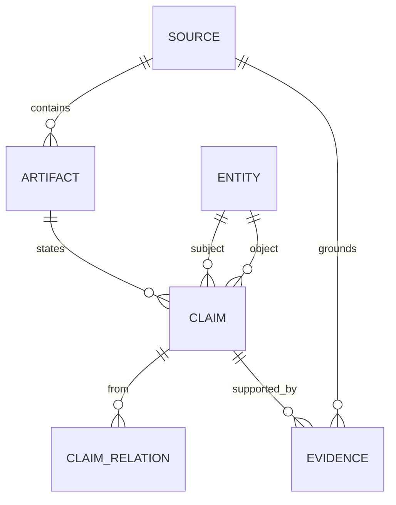
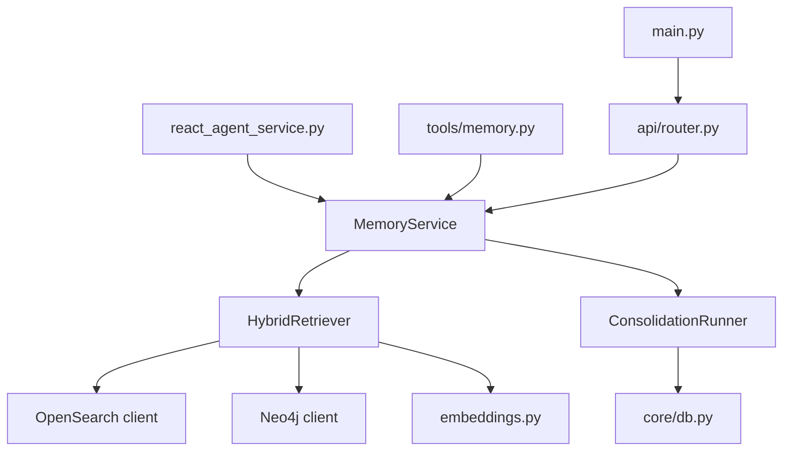

# Long-term memory

Long-term memory keeps durable facts about the user between conversations. Postgres is the record. OpenSearch holds the vectors and the BM25 index, Neo4j holds the entity graph. The shared writer queues both index writes until after the Postgres commit, so a failed transaction leaves no orphan search document or graph node. The document and Gmail paths write their mirrors inline instead.

`memory/api/router.py` is mounted by `main.py` at `/api/memory`. `MemoryService` in `memory/service.py` owns every path in: ingestion, search, context assembly, graph expansion, forgetting and maintenance. The agent tools in `tools/memory.py` call the same service, so MCP clients and the side panel read one memory.

Key capabilities:
- Chat turn ingestion with extraction, gating, reconciliation and post-commit indexing.
- Hybrid retrieval over cosine similarity, BM25 and graph neighbours.
- An entity graph for relationship questions and multi-hop expansion.
- Scheduled decay, deduplication, promotion, repair and entity resolution.
- Document, Gmail and profile ingestion through the same entity and claim tables.

## Repository layout

## Building blocks

- `memory/service.py`: `MemoryService` builds the retriever, assembler, planner, traversal, consolidation runner and pipelines in `__init__`. `get_context` is the per-turn method the chat service calls.
- `memory/api/router.py`: search, context, document facts, explain, profile, tool endpoints, store, update, confirm, forget, clear, feedback, mark-used, graph, timeline, ingestion and maintenance routes.
- `models/memory.py`: `MemoryTier`, `MemorySegment`, `ClaimStatus`, `SourceType`, `MemoryClass`, `EvidenceType`, `ClaimRelationType`, plus `TIER_DECAY_RATE` and `SEGMENT_DECAY_RATE`.
- `memory/ingestion/`: `extractor.py` calls the LLM, `memory_gate.py` decides, `reconcile.py` compares with stored facts, `writer.py` commits and queues index writes.
- `memory/retrieval/`: `hybrid.py` fetches candidates, `scoring.py` ranks, `context_assembler.py` packs the token budget, `query_planner.py` reads intent.
- `memory/maintenance/`: four rhythms in `consolidation.py`, plus the engines they call.
- `memory/graph/`: `operations.py` for dual writes, `traversal.py` for expansion and profile queries, `entity_resolution.py` for merges.

## How it fits together

A turn enters through `ReactAgentService._queue_memory_ingestion`. It marks used memories, then calls `MemoryService.ingest_chat` in a background task. Ingestion ends with `SideEffects.run()` after the Postgres session closes, which is the boundary between the record and the indexes.

Reads run the planner, procedural lookup and profile lookup concurrently, search, optionally expand the graph, then hand everything to the assembler. It renders sections in priority order: about the user, response preferences, relevant memories, related memories.

## Shared concepts

A source is where text came from. An artifact is the text itself, such as a chat turn, a document chunk or a summary. An entity is a person, organisation or other named object. A claim is one fact, with a tier, a segment and a status. Evidence links a claim to every source that stated it. Claim relations record `SUPERSEDES`, `CONTRADICTS` and `SUPPORTS`.

## Page boundaries

The child pages split the system by path:

- Memory Ingestion covers turn filtering, extraction, the gate, reconciliation and the writer transaction.
- Memory Retrieval covers planning, hybrid search, scoring, context packing and graph expansion.
- Memory Maintenance covers scheduled engines, store repair, and the document and profile ingestion paths that repair cleans up.

## Dependencies

Memory depends on the three store clients, the shared LLM in `core/llm.py`, and settings in `core/config.py`. The backend mounts the router, the chat service and agent tools call `MemoryService`, and the MCP server reaches the same routes over HTTP.

Pinned packages: `neo4j>=5.20`, `opensearch-py>=2.6`, `tiktoken>=0.7`, `apscheduler>=3.10`. Embeddings use Google or OpenAI when a key exists, otherwise the local hashing embedder.

## Performance

- `memory/embeddings.py` batches documents 64 at a time and builds the client lazily.
- `get_context` defaults to a 3000 token budget. The assembler reserves four headers and shares the rest across sections.
- `HybridRetriever.search` asks for `max(top_k * 3, 15)` candidates and drops weak hits below `MIN_RELEVANCE` (0.22) and `RELATIVE_CUTOFF` (0.4).
- Maintenance pages through claims 500 at a time. Dedup scans at most 20000 claims per pass.
- `reconcile.WRITE_LOCK` serialises writers inside one process. Two backend processes can still race.

## Troubleshooting

- Micro reflection never runs on a schedule: `main.py` registers only hourly, nightly and weekly jobs, although the README lists micro_reflection beside them. Call `POST /api/memory/maintenance/run`.
- Stale claims vanish sooner than the README says: `nightly` calls `archive_stale(older_than_days=14)`, while the engine default is 30. Read the caller, not the default.
- A rolled-back document import still leaves searchable facts: the README says every index write follows the commit, but `ingestion/document.py` and `ingestion/gmail.py` write OpenSearch and Neo4j inline. Run store repair.
- Search finds nothing after an embedding provider switch: vectors from different providers share one `knn_vector` field and are not comparable. Re-ingest or call `POST /api/memory/clear`.
- A claim appears twice: the write path may have missed a duplicate, or a document import bypassed reconciliation. Check the dedup pass and the source type.

## Appendix

### Implementation examples

- `MemoryService.forget(ForgetRequest(pattern="bakery"))` marks claims deleted, removes their documents and nodes, and rewrites source chat turns to `[forgotten]`.
- `POST /api/memory/maintenance/run` queues `micro_reflection`, `hourly`, `nightly` or `weekly` as a background task.
- `MemoryService.get_context(query, token_budget=3000)` returns the packed context package used by a chat turn.

### Source files

- `memory/README.md`
- `memory/service.py`
- `memory/api/router.py`
- `models/memory.py`
- `main.py`
