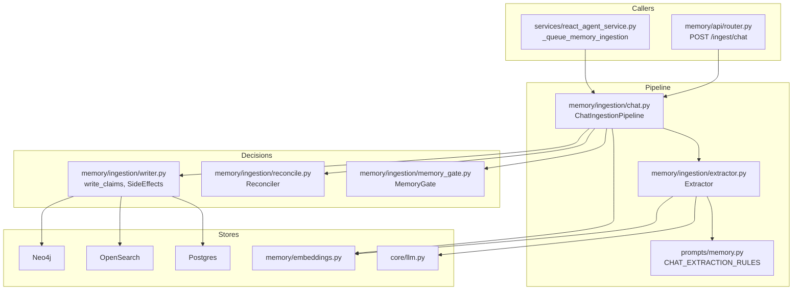
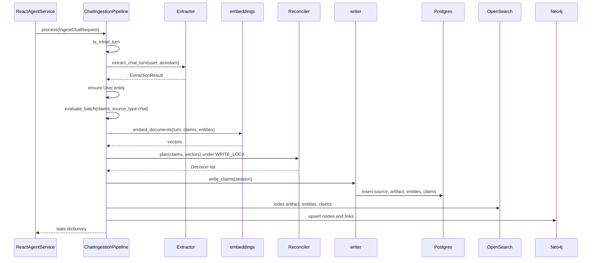
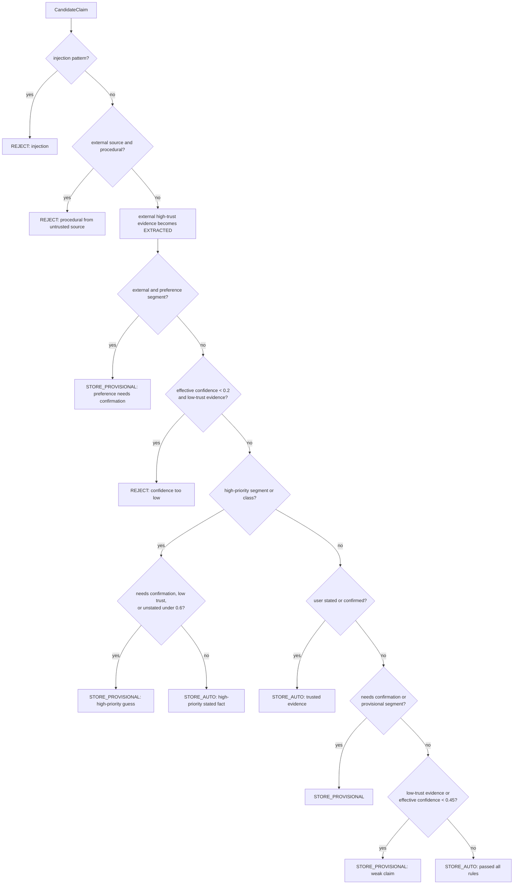
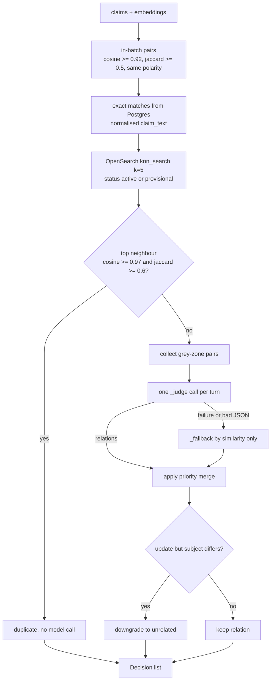
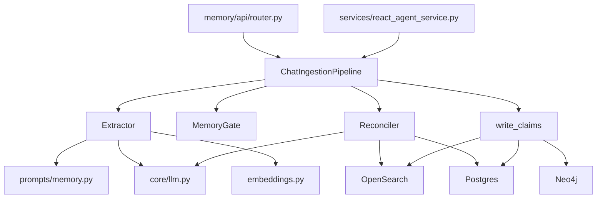

# Memory ingestion

`memory/ingestion/chat.py` turns one user and assistant exchange into stored memory. It runs after the answer, in a background task started by `ReactAgentService._queue_memory_ingestion`. The pipeline skips small talk, extracts facts from the user message only, embeds the turn and its facts in one batch, gates and reconciles each claim, writes Postgres, and only then touches OpenSearch and Neo4j.

Two filters decide what becomes a row. `memory/ingestion/memory_gate.py` decides whether a candidate may be stored and at what confidence. `memory/ingestion/reconcile.py` compares it with nearby stored claims and decides whether it is a duplicate, an update, a contradiction or unrelated. `memory/ingestion/writer.py` applies those decisions inside one Postgres transaction and queues the search and graph writes for after the commit.

Key capabilities:
- Courtesy detection before any model call.
- Long-message extraction in up to three overlapping windows.
- Assistant text used as reference context, never as a source of facts.
- Rules-first gating with no model call, then one reconcile call per turn.
- Duplicate reinforcement instead of duplicate rows.
- Supersede with effective dates, including late-arriving history.
- Post-commit indexing with per-operation failure counts.

## Repository layout

## Building blocks

- `memory/ingestion/chat.py`: `ChatIngestionPipeline.process` is the entry point. Module-level `_extractor`, `_gate` and `_reconciler` singletons avoid rebuilding objects per turn. `is_trivial_turn` holds the courtesy regex.
- `memory/ingestion/extractor.py`: `Extractor.extract_chat_turn` builds the windowed prompt, calls `llm.ainvoke`, parses JSON, normalises entities and claims, and adds a name claim when the model only recorded an alias. `EXTRACTOR_VERSION` is `"2.1.0"` and `_CHUNK` is 4000.
- `memory/embeddings.py`: `embed_documents` and `embed_query`, both async. `EMBEDDING_DIM` is 768 and `_BATCH` is 64. `HashingEmbedder` is the keyless fallback.
- `prompts/memory.py`: `EXTRACTION_SYSTEM_PROMPT` defines the schema. `CHAT_EXTRACTION_RULES` overrides it for chat.
- `memory_gate.py`: `MemoryGate.evaluate` returns a `GateResult` with `decision`, `reason`, `adjusted_confidence` and `adjusted_importance`.
- `reconcile.py`: `Reconciler.plan(claims, embeddings)` returns one `Decision` per claim. `Decision` holds `duplicate_of`, `supersedes` and `contradicts`.
- `writer.py`: `write_claims` consumes `ClaimInput` values and returns `WriteStats` plus the row that now carries each fact. `SideEffects` collects OpenSearch and Neo4j operations so they run only after the session commits.

## How it fits together

`process` has four phases: skip check, extraction, gating plus embedding, then a locked reconciliation and write. The lock covers both the reconcile plan and the Postgres write, so two fast turns cannot each miss the other's claims.

The background caller retries once, 15 seconds later, when the result contains `extraction_failed`. It keeps the task in `_BACKGROUND_TASKS` so garbage collection cannot cancel it mid-run.

## Turn filtering

`is_trivial_turn` returns true for empty text, text shorter than three characters, and anything matching the `_COURTESY` regex: thanks, ok, cool, got it, yes, no, hi, bye, good morning, lol, perfect, done. A skipped turn returns a dictionary with `"skipped": "trivial turn"` and zero counts. No LLM call, no rows.

The check is deliberately blunt. A two character "no" is a courtesy match, so a bare correction is dropped before extraction. Corrections need enough words to clear the filter.

## Extraction

The extractor receives the user message and the assistant reply. Only the user message goes in the extraction block. The assistant reply is truncated to 1500 characters and labelled context only, which lets the model resolve "yes, that one" without turning the assistant's explanations into facts.

A message longer than 4000 characters is split into up to three windows of 4000 characters with a 200 character step, extracted window by window, then merged. Entities are deduped by canonical name and claims by normalised text. A JSON parse failure returns `ExtractionResult(failed=True)` and writes nothing.

Normalisation is mostly cleanup. Subject names in `_USER_SYNONYMS` become `User`. An entity named `User` keeps the model's original name as an alias. Entities named assistant, ai, bot or chatbot are removed, along with claims whose subject is one of those. Claims are skipped when parsing fails or when the object name is already contained in the subject name, which drops tautologies such as "Talk on Async Rust is about Async Rust".

`_ensure_name_claim` adds a `core_identity` claim, "User's name is X.", only when a name alias appears verbatim in the user message and no name claim was extracted. It sets confidence 0.95, importance 0.9 and `EvidenceType.USER_STATED`. It needs a `User` entity in the result to work. When the model omitted that entity entirely, the pipeline's later `User` insertion does not revisit the claim.

Source trust is `min(trust_level / 10.0, 1.0)`. Chat extraction passes the default trust level 9, so `source_trust` is 0.9, and the stored `SourceORM` row uses `trust_level=9`.

## Gate decisions

The gate returns one of three values. `STORE_AUTO` writes an active row. `STORE_PROVISIONAL` writes a provisional row, which is excluded from normal retrieval unless the request asks for provisional claims. `REJECT` drops the claim, and the chat pipeline counts it in `claims_rejected`.

Two numbers run through every branch. `effective_conf` is `claim.confidence * (0.5 + 0.5 * source_trust)`, so a low-trust source halves the confidence. `_cap` limits the stored value to 0.95 unless the evidence type is `USER_CONFIRMED`, which alone can reach 1.0.

Source type matters as much as evidence type. `_USER_SOURCES` is `{"chat", "manual"}`. Every other label, including `email`, `document`, `resume_pdf`, `linkedin_profile` and `google_profile`, is external. An external source cannot create a procedural claim, cannot keep a `USER_STATED` label, and cannot auto-store a preference.

Injection detection uses `_STRONG_INJECTION` for all sources: ignore previous instructions, disregard prior rules, forget everything, reveal the system prompt, jailbreak, developer mode. `_WEAK_INJECTION` adds new instructions, system prompt, you are now, act as, override and disregard, but only for external sources. A user who says "act as a strict reviewer" is setting a preference, not attacking the system.

## Reconciliation

The reconciler looks for three kinds of neighbour: claims in the same batch, exact text matches in Postgres, and the five nearest active or provisional claims in OpenSearch. Similarity comes from the kNN `_cosine` field. Word overlap comes from `jaccard`, which strips a fixed stop list and compares content word sets.

Thresholds live at the top of `reconcile.py`: `NEIGHBOURS = 5`, `NEIGHBOUR_MIN_SIM = 0.60`, `FAST_DUPLICATE_SIM = 0.97`, `FALLBACK_DUPLICATE_SIM = 0.92`. `FALLBACK_UPDATE_SIM = 0.75` is defined but not read anywhere, so the fallback path only ever produces duplicates or unrelated.

`same_polarity` delegates to `memory.maintenance.dedup._negated`, so "takes the shuttle" and "no longer takes the shuttle" never count as duplicates. The subject check prevents a claim about an event from retiring the user's link to that event: "The talk is on Jan 14" does not supersede "User is giving a talk on Jan 14".

The judge prompt is `RECONCILE_SYSTEM_PROMPT` in `prompts/memory.py`. It defines four relations and demands one decision per pair. If the call fails or returns the wrong shape, `_judge` returns an empty map and `_fallback` runs. That fallback deliberately never supersedes. A missed update is fixed by the next mention. A wrong supersede silently loses a fact.

## Applying decisions

`write_claims` handles each item in order. A duplicate reinforces the target row. A new claim gets active or provisional status, an evidence row, a search document and a graph node. Supersede and contradiction decisions run after the insert.

For an update, the writer compares effective dates. If both claims have a `valid_from`, it compares dates, using day granularity when either date is midnight. Otherwise it compares the incoming observation time with the stored `created_at`. When the incoming fact is older, it is stored as superseded history and the stored claim keeps its status. When the incoming fact is newer, the stored claim becomes superseded and gets `valid_to` set to the new fact's start, or to now.

Contradictions keep both rows. The new claim is created with `contradiction_count = len(decision.contradicts)`, and each stored opposite gets `contradiction_count + 1`. `_relate` writes a `ClaimRelationORM` row only when the same edge does not already exist, then queues the Neo4j relation.

Reinforcement is the cheap path. `_reinforce` increments `support_count`, raises confidence by 0.05 up to the ceiling, keeps the higher importance, adds an evidence row, updates the search document, and links the new source in Neo4j. A provisional claim becomes active when the new evidence is high trust or `support_count` reaches 2.

## Deferred index writes

After the `async with get_session()` block exits, the transaction has committed. `effects.run()` then runs each queued OpenSearch or Neo4j operation in order, counts failures, and returns the count. The stats dictionary adds `index_failures` when that count is non-zero, and `logger.info("Chat ingested: %s", out)` records the totals.

Index writes are sequential, not parallel. Failures are counted, not retried. The hourly maintenance pass starts with store repair, which is how a missed index write is fixed.

## Dependencies

No external package is pinned by the gate, reconciler or writer beyond SQLAlchemy, `langchain_core` messages and the standard library. The model is whatever `core/llm.py` resolves at runtime. The chat pipeline has no retry loop, no queue and no worker pool of its own.

## Performance

- Courtesy turns cost nothing. They return before extraction, embedding or any database call.
- Long turns are capped at three windows of 4000 characters with 200 characters of overlap. A 12000 character message is not fully covered.
- The assistant reply is truncated to 1500 characters in the prompt.
- Embeddings are batched 64 at a time inside `embed_documents`. A normal turn is one batch.
- Gate evaluation is linear in claims and costs no I/O.
- The judge is one LLM call per turn, not one per pair.
- Neighbour lookup is one kNN query per pending claim, run concurrently with `asyncio.gather`.
- The write lock is held across reconcile and the Postgres write, not across the index writes.

## Troubleshooting

- A short correction never reaches memory: `_COURTESY` matches "no", "yes", "ok" and similar strings, and `is_trivial_turn` also rejects anything under three characters. Phrase the correction as a sentence, or use `write_memory`.
- The user's name is missing: `_ensure_name_claim` needs a `User` entity in the extraction result, and the pipeline adds that entity only after extraction. Call `write_memory` with the name, or rephrase so the model emits the entity.
- Extraction fails and nothing is written: `_run` catches LLM and JSON errors and returns `ExtractionResult(failed=True)`. The chat service retries once after 15 seconds. A direct `POST /api/memory/ingest/chat` does not.
- Claims are stored but search cannot find them: an OpenSearch side effect failed after commit, reported in `index_failures`. Run the hourly maintenance pass, which starts with store repair.
- The assistant's suggestion becomes a user fact: prompt drift, or a model that ignores the chat rules. The prompt says the assistant block is context only, but nothing downstream checks the claim's origin. Correct the claim, then tighten `CHAT_EXTRACTION_RULES`.
- A changed preference does not replace the old one: the reconcile judge failed or returned an unexpected shape, so `_fallback` ran and it never supersedes. Check for `Reconcile judge failed` in the log. Resend the fact.
- A document preference becomes active without confirmation: the source label was `chat` or `manual` in the gate call. Every other label forces provisional for preferences. Pass the real source type.
- Two backend processes create duplicates: `WRITE_LOCK` is an in-process `asyncio.Lock`. Run one backend, or move the lock to a Postgres advisory lock.

## Appendix

### Implementation examples

- `is_trivial_turn("thanks!")` returns true. Reference: `memory/ingestion/chat.py:_COURTESY`.
- `Extractor.extract_chat_turn("I moved to Berlin", "...")` returns claims with `is_update` when the model follows the chat rules.
- `ChatIngestionPipeline.process` returns keys `entities`, `claims_auto`, `claims_provisional`, `claims_inserted`, `claims_reinforced`, `claims_superseded`, `contradictions`, `claims_rejected`. Reference: `writer.WriteStats.as_dict`.
- `MemoryGate().evaluate(cand, source_trust=0.4, source_type="email")` returns `STORE_PROVISIONAL` for a preference and `REJECT` for a procedural claim.
- `Reconciler().plan([cand], [vector])` returns `Decision(duplicate_of="<uuid>")` for an exact repeat.
- `SideEffects.run()` returns the number of failed operations and clears the queue.

### Source files

- `memory/ingestion/chat.py`
- `memory/ingestion/extractor.py`
- `memory/ingestion/memory_gate.py`
- `memory/ingestion/reconcile.py`
- `memory/ingestion/writer.py`
- `memory/embeddings.py`
- `prompts/memory.py`
