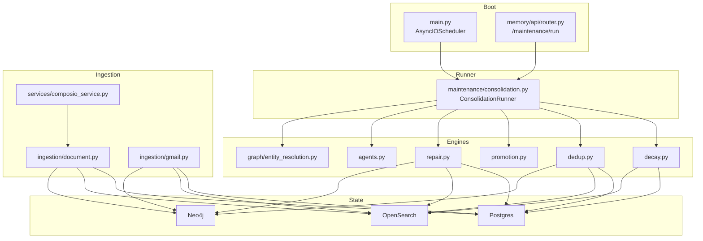
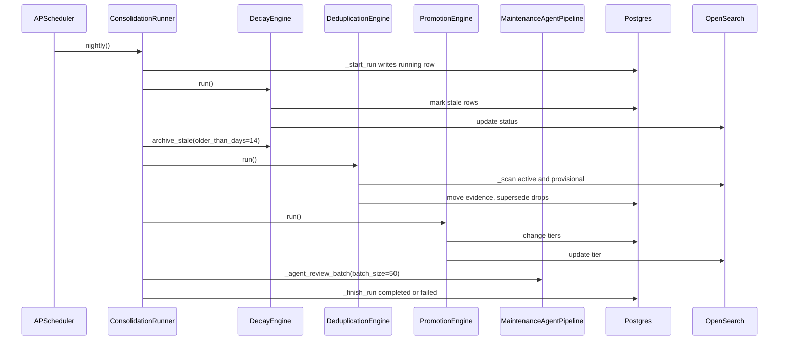
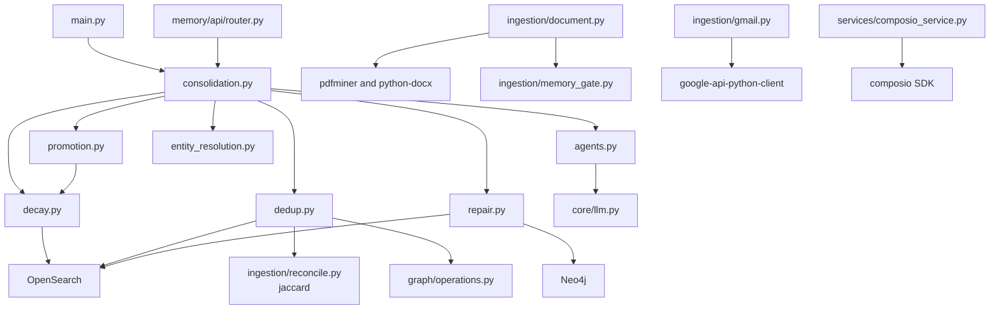

# Memory maintenance

`memory/maintenance/consolidation.py` runs the four upkeep rhythms: micro reflection, hourly, nightly and weekly. Each rhythm calls a small engine. `decay.py` marks claims stale, `dedup.py` merges near-identical claims, `promotion.py` moves tiers, `repair.py` reconciles the stores, `agents.py` reviews ambiguous claims, and `graph/entity_resolution.py` merges duplicate entities.

`main.py` starts APScheduler in the FastAPI lifespan and registers the hourly, nightly and weekly jobs. The API can trigger any rhythm through `POST /api/memory/maintenance/run`, which queues a FastAPI background task. Every run writes a `MaintenanceRunORM` row with status, counts, timestamps and an error string.

The same folder covers the ingestion paths beside chat. Uploaded documents and resumes, Gmail threads and Composio profiles share the extractor, the gate and the entity and claim tables, but they do not use the reconciler. The document and Gmail paths write search documents and graph nodes inline, before the Postgres transaction closes, which is why store repair exists.

Key capabilities:
- Decay on the same curve retrieval uses, so ranking and expiry agree.
- Archiving of claims that stayed stale and unused.
- Dedup with union-find grouping and a support-based keeper.
- Promotion and demotion by access, hits, confidence and support.
- Store repair that reindexes, removes orphans and copies status back.
- A curated review pipeline for provisional and stale claims.
- Document, Gmail and profile ingestion with their own trust levels.

## Repository layout

## Building blocks

- `consolidation.py`: `ConsolidationRunner.micro_reflection`, `hourly`, `nightly`, `weekly`. `_start_run` and `_finish_run` write `MaintenanceRunORM`. `_agent_review_batch` and `_generate_community_summaries` are internal helpers.
- `decay.py`: `_effective_weight` duplicates the retrieval decay formula. `_pages` yields claim rows in `claim_id` order, one session per page. `DecayEngine.run` marks stale, `archive_stale` archives.
- `dedup.py`: `_scan` pages OpenSearch with `search_after`, `_UnionFind` groups pairs, `_merge_cluster` moves evidence and retires dropped rows. `_negated` is also used by `reconcile.same_polarity`.
- `promotion.py`: threshold dictionaries `_PROMOTE_ST_TO_LT` and `_PROMOTE_LT_TO_PERM`, plus `_NEVER_DEMOTE_SEGMENTS`.
- `repair.py`: `StoreRepair.run` calls `_claims`, `_entities`, `_artifacts` and `_graph`. `_LIVE_CLAIM` is `("active", "provisional", "superseded", "stale")`.
- `agents.py`: `CuratorAgent`, `SkepticAgent`, `JudgeAgent` and `MaintenanceAgentPipeline.run_batch`. `AgentDecision` lists keep, archive, delete, promote, demote, merge and flag_review.
- `document.py`: `DocumentIngestionPipeline.ingest_bytes` and `ingest_text`, with PDF, DOCX and plain text extraction, resume section detection and chunking.
- `gmail.py`: `GmailIngestionPipeline.sync` and `_process_thread`, with a `gmail.readonly` client and per-direction trust.
- `composio_service.py`: account listing, toolkit views, auth config creation and `execute_toolkit_action`.

## How it fits together

The nightly job is the fullest pass. It decays, archives, dedups, promotes, then sends a batch of provisional and stale claims through the agent ladder. Weekly adds entity resolution and per-segment summaries before running the nightly work again.

The hourly job calls repair before dedup and promotion, so a claim missing from search is indexed before dedup scans. Weekly calls the resolver, generates summaries, then calls `nightly`, which creates its own maintenance run row. A weekly history therefore contains a nested nightly row.

## Schedules

`main.py` registers three jobs. There is no scheduler entry for micro reflection, even though `ConsolidationRunner.micro_reflection` exists and the README table lists it beside the others.

`micro_reflection` scans at most 500 provisional claims with `support_count >= 1` and `contradiction_count == 0`, flips them to active, and updates the search document. It is cheap enough to run after each turn, but nothing calls it automatically.

## Decay and archiving

Staleness uses the same weight as retrieval: `base_importance * exp(-lambda * days_since_last_use) * usage_mult * confidence`. `last_accessed_at` moves only when an answer used the claim, so retrieval alone does not keep a claim fresh. `lambda` is the larger of `TIER_DECAY_RATE[tier]` and `claim.decay_rate`. Permanent claims force zero.

| Tier | Rate per day |
| --- | --- |
| working | 0.15 |
| short_term | 0.03 |
| long_term | 0.005 |
| permanent | 0.0 |

| Segment | Rate per day |
| --- | --- |
| preferences_and_corrections | 0.0 |
| core_identity | 0.001 |
| skills_and_background | 0.002 |
| reflections_and_summaries | 0.002 |
| people_and_relationships | 0.003 |
| projects_and_goals | 0.01 |
| communications_and_commitments | 0.05 |
| contextual_incidents | 0.1 |

`DecayEngine.run` only considers rows that are active or provisional, not permanent and not user confirmed. A weight below `STALE_THRESHOLD` 0.05 sets status `stale` and updates the search document. `archive_stale` then moves rows whose `last_accessed_at` is older than the cutoff to `archived`. The caller in `nightly` passes 14 days, while the function default is 30.

## Deduplication

Dedup cleans up repeats that write-time reconciliation missed. It scans the search index, not Postgres, so claims without an embedding are skipped. A pair merges only when cosine similarity is at least 0.95, Jaccard word overlap is at least 0.6, and both texts agree on negation. The scan pages 500 hits at a time, stops at 20000 claims, and computes similarity in blocks of 1000 rows. Pairs that qualify are grouped with union-find, sorted by support, user confirmation and creation time, and merged into the first keeper.

`_merge_cluster` moves `EvidenceORM` rows to the keeper, adds support and access counts, takes the maximum confidence and importance, and makes the keeper active if any dropped row was active. Dropped rows become `superseded`. It updates the keeper's search document, links the moved sources in Neo4j, marks each drop superseded in OpenSearch, and creates a `SUPERSEDES` relation in the graph.

The keeper rule is deliberate: most support first, then user confirmed, then newest. An older claim does not win on confidence alone. Corrections survive because negation must match and word overlap must be high.

## Promotion and demotion

`PromotionEngine.run` pages every active and provisional claim. `_evaluate_tier` applies fixed thresholds and returns the same tier when nothing qualifies.

Promotion to long-term needs confidence at least 0.55 plus either real use (access 3, hits 2) or two independent mentions. Promotion to permanent needs access 8, retrieval hits 5, confidence 0.75 and zero contradictions. `requires_user_confirmed` is false, so confirmation is not mandatory. When a claim reaches permanent with confidence at least 0.8, `run` also sets `user_confirmed` true.

Demotion only applies to long-term claims that are not user confirmed and not in `_NEVER_DEMOTE_SEGMENTS`: core identity, people, preferences and skills. Idle identity facts stay long-term because being idle does not make them less true.

## Store repair

Repair treats Postgres as the record. It fixes drift caused by a failed post-commit index write, or by a document or Gmail import that wrote mirrors before a rollback. `_claims` scans the search index, re-embeds and indexes missing live claims, deletes documents with no live row, and copies `status`, `tier` and `confidence` back from Postgres. `_entities` does the same for the entity index. `_artifacts` removes artifact documents whose rows are gone. `_graph` drops Entity nodes whose `entity_id` became a list, recreates missing entities from Postgres, relinks claims to them, creates missing Claim nodes with subject, object and source links, and deletes claim and entity nodes with no live row.

Claim reindexing batches 64 claims per embedding call. The scanned indices are `memory_claims`, `memory_entities` and `memory_artifacts`. The graph step runs a Cypher match to drop nodes whose `entity_id` became a list, a leftover from an old APOC combine merge, then recreates them from Postgres.

## Agent review

The agent ladder is cheap to expensive. Deterministic rules run first. The Curator proposes an action. The Skeptic challenges only destructive or high-stakes proposals. The Judge rules when both sides are confident and disagree.

The fast rules keep user-confirmed permanent preferences, archive stale claims with zero accesses, and promote claims with access at least 10, hits at least 7, zero contradictions and confidence at least 0.8. Everything else goes to the Curator, then the Skeptic when the proposal is archive, delete or a preference promotion, then the Judge when the two disagree with confidence at least 0.6.

`run_batch` runs claims in worker threads with a semaphore of 4, because the agent methods call the synchronous `llm.invoke`. That keeps the nightly review from blocking the chat event loop. `ConsolidationRunner._agent_review_batch` applies only two verdicts: `ARCHIVE` sets status archived, and `PROMOTE` makes a provisional claim active and a short-term claim long-term. `DELETE`, `DEMOTE`, `MERGE` and `FLAG_REVIEW` are returned by the pipeline but not applied here.

## Document and profile ingestion

The three non-chat paths share helpers from `chat.py` and the extractor. All reach memory through `MemoryService`: `ingest_document`, `ingest_profile`, `ingest_gmail`, `ingest_composio_linkedin_self` and `ingest_composio_aeroleads_linkedin`. The API queues the slow ones as background tasks under `/api/memory/ingest/*`.

A PDF is read with pdfminer, a DOCX with python-docx, and anything else as UTF-8 text. `_is_resume` overrides the source type to `RESUME_PDF` when the filename contains resume, cv or curriculum, or when the text has at least three resume section headers. An explicit `source_type_override` wins over all of it. A resume is split into sections and chunks of 800 characters with 100 characters of overlap. Other documents use chunks of 1200 with 200 characters of overlap.

Each chunk becomes an `ArtifactORM` with an `artifact_type` of `chunk_<section>`, a `char_start` found by searching for the first 80 characters, and `parser_version` `2.1.0`. The gate runs with the real source type, so a document preference is provisional and a document procedural claim is rejected. Profile sources, defined as `PROFILE_DOCUMENT`, `LINKEDIN_PROFILE`, `GOOGLE_PROFILE` and `RESUME_PDF`, store every kept claim at `long_term` tier.

Gmail sync lists up to `max_threads` threads, default 50. Each thread becomes one source row with `trust_level=4`, a four sentence summary artifact, and one artifact per non-empty message. Mail the user sent is `_OUTGOING_TRUST` 9, mail they received is `_INCOMING_TRUST` 4. The gate still treats `email` as external, so direction only changes `source_trust`, which scales effective confidence. The message date becomes `valid_from`.

Composio profiles use `get_composio_tools`, select a tool by required and preferred terms, and try several payload shapes before failing. A successful result can be ingested as a document with source `LINKEDIN_PROFILE`, which stores claims at long-term tier.

## Dependencies

Pinned packages: `apscheduler>=3.10`, `neo4j>=5.20`, `opensearch-py>=2.6`, `numpy`. The Composio SDK is imported lazily. No engine runs in a separate worker process. All work happens in the backend event loop except explicit `asyncio.to_thread` calls.

## Performance

- Maintenance pages by claim id with `MAX_BATCH` 500, so a pass covers the whole store instead of the first page each night.
- Dedup scans at most 20000 search hits and computes similarity in blocks of 1000 rows.
- The nightly agent review is capped at 50 claims per run, ordered oldest first, with 4 concurrent reviews.
- Repair scans indices 1000 documents at a time with `search_after`, falling back to one 10000 document page if the engine cannot sort on `_id`.
- Document chunks are processed sequentially. Each chunk costs one embedding call, one extraction call, and one search refresh per artifact and claim.
- Gmail processes threads sequentially and messages within a thread sequentially. `max_threads` caps the thread list, not the message count.

## Troubleshooting

- Provisional claims never become active on their own: micro reflection is not registered with the scheduler. Call `POST /api/memory/maintenance/run {"run_type": "micro_reflection"}` or add a job in `main.py`.
- Stale claims are archived after two weeks, not a month: `nightly` calls `archive_stale(older_than_days=14)` while the function default is 30. Pass a different value in `consolidation.py`.
- A claim the agents marked for deletion still exists: `_agent_review_batch` applies only `ARCHIVE` and `PROMOTE`. Delete through `POST /api/memory/forget`.
- Dedup merges a correction into the corrected fact: the pair passed the negation check, usually because the correction avoided a listed negation word. Rephrase with "no longer", "not" or "stopped", and restore the claim.
- Repair reports `graph_nodes_removed` every run: nodes with a list `entity_id` keep reappearing, usually from a repeated APOC merge path. Check that the merge uses `properties: 'discard'`.
- Promotion never promotes anything: `retrieval_hit_count` is zero because usage marking is failing. Check `MemoryService.mark_retrieval_used` calls from the chat service.
- Weekly runs appear twice in history: `weekly` calls `nightly`, which starts its own maintenance run. Read the nested row as the nightly pass.
- A scanned PDF ingests zero claims: the PDF has no text layer, so pdfminer returns an empty string. OCR the file first.
- A rolled-back document import leaves searchable facts: the document and Gmail paths write OpenSearch and Neo4j before the session commits. Run store repair. It deletes documents and nodes with no live row.
- Gmail sync skips replies: `_strip_quoted` drops every line starting with `>` and stops at a `--` signature line. Ingest the thread body through a document upload if quoted text matters.

## Appendix

### Implementation examples

- `ConsolidationRunner().nightly()` returns counts for reviewed, updated and archived claims.
- `DecayEngine().run()` returns `{"checked": n, "marked_stale": m}`.
- `DeduplicationEngine().run()` returns `{"checked": n, "duplicates_found": pairs, "merged": m}`.
- `PromotionEngine().run()` returns `{"promoted": n, "demoted": m}`.
- `StoreRepair().run()` returns counts for reindexed, unindexed, resynced and graph changes.
- `DocumentIngestionPipeline().ingest_bytes(data, "cv.pdf", "application/pdf")` returns an `IngestDocumentResult`.
- `GmailIngestionPipeline(user_email=user_email).sync(creds, max_threads=50)` returns a `GmailSyncResult`.

### Source files

- `memory/maintenance/consolidation.py`
- `memory/maintenance/decay.py`
- `memory/maintenance/dedup.py`
- `memory/maintenance/promotion.py`
- `memory/maintenance/repair.py`
- `memory/maintenance/agents.py`
- `memory/ingestion/document.py`
- `memory/ingestion/gmail.py`
- `main.py`
