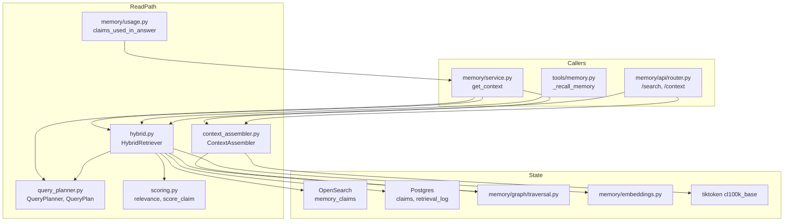
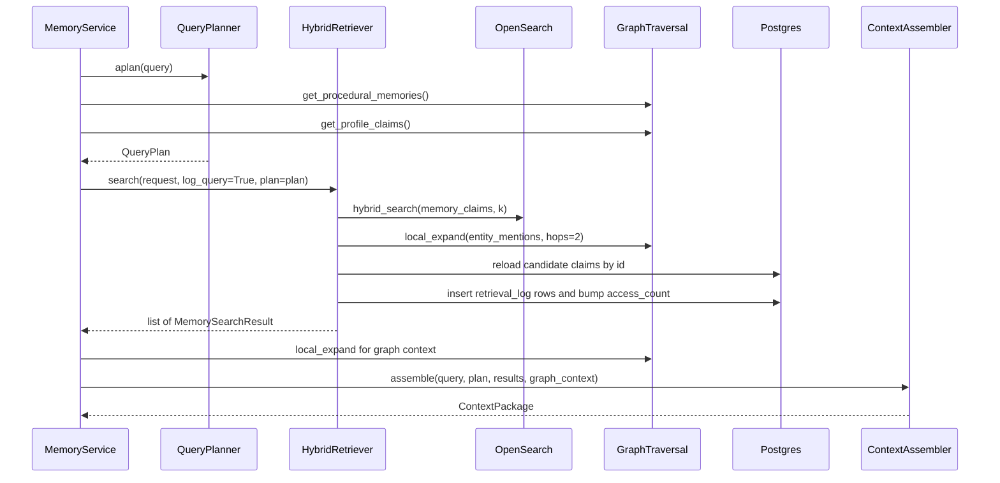
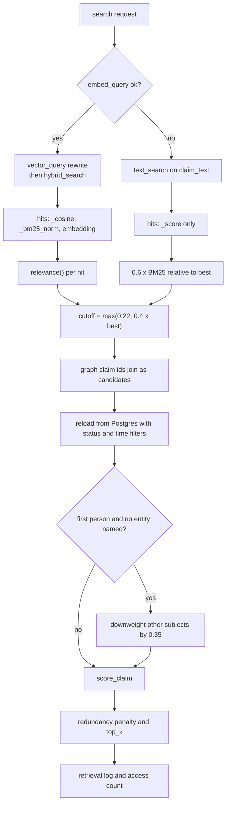
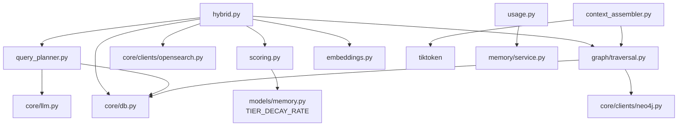

# Memory retrieval

`memory/retrieval/hybrid.py` turns a question into ranked claims. It runs vector and BM25 search inside OpenSearch, pulls graph neighbours for entities named in the question, merges the signals through `memory/retrieval/scoring.py`, penalises near-duplicates, and returns `MemorySearchResult` values. `memory/retrieval/query_planner.py` decides which filters and graph reads apply, and `memory/retrieval/context_assembler.py` packs the result into the prompt block.

The read path is used twice per turn. `MemoryService.get_context` calls it to build the injected memory block, and `tools.memory._recall_memory` calls it for the agent's `recall_memory` tool and the MCP memory tool. `memory/usage.py` then checks which injected claims the answer actually used, which is the signal promotion and decay read later.

Key capabilities:
- Status, tier, segment and class filters pushed into the search engine.
- A keyword question rewritten into a natural-language vector query.
- Graph candidates that search did not return.
- Relevance floors that drop weak matches instead of always returning `top_k`.
- A token-budgeted context block with fixed section priority.
- A lexical usage check that costs no model call.

## Repository layout



## Building blocks

- `query_planner.py`: `QueryPlan` is a dataclass with `query_type`, `entity_mentions`, `time_constraint`, the three `needs_*` flags, `preference_sensitive`, `suggested_segments`, `suggested_predicates`, `first_person` and `include_history`. `aplan` merges an optional LLM plan with heuristics, entity lookup and relationship lookup.
- `hybrid.py`: `HybridRetriever.search` accepts a `MemorySearchRequest`, optional `log_query`, optional prebuilt `plan`, optional `exclude_ids` and `min_relevance`. It returns a list of `MemorySearchResult`.
- `scoring.py`: `vector_relevance`, `relevance`, `_decay_weight`, `score_claim` and `apply_redundancy_penalty`.
- `context_assembler.py`: `ContextAssembler.assemble` packs sections against a total budget. `format_for_prompt` renders the final text.
- `usage.py`: `claims_used_in_answer` takes the answer and a list of `{"id", "text"}` dictionaries and returns the ids that appear used.
- `memory/graph/`: `operations.py` for dual writes, `traversal.py` for expansion, timelines and profile reads, `entity_resolution.py` for merges, and `core/clients/neo4j.py` for the driver and Cypher.

## How it fits together

`MemoryService.get_context` starts the planner, procedural lookup and profile lookup together. It then searches with the plan and, when the plan names entities, expands the graph for extra claims search missed.



The planner runs before the search whenever the caller did not pass a plan, but the two are independent. `search` starts the planner task and the query embedding at the same time, then awaits both. A graph read runs concurrently with the OpenSearch call.

## Planning

`QueryPlanner.aplan` uses heuristics by default. The LLM planner is opt-in through `MEMORY_LLM_PLANNER=1`, `true` or `yes`, and costs one model call per turn. After either plan, it sets `first_person` from the `_FIRST_PERSON` regex and `include_history` from the `_HISTORY` regex. It then appends entity mentions found by `_known_entity_mentions` and `_relationship_mentions`.

`_heuristic_plan` classifies by keyword. Email words set `EMAIL_SPECIFIC`, resume words set `PROFILE`, preference words set `PREFERENCE_SENSITIVE`, relational words set `RELATIONAL`, temporal words set `TEMPORAL`, project words set `PLANNING`, and question words set `FACTUAL_RECALL`. The suggested segments follow the classification.

`_known_entity_mentions` caches active entity names and aliases for 60 seconds in a class attribute. It also adds first names of length three or more when they differ from the canonical name, so "Ravi" matches "Ravi Rao". It skips names under three characters and the reserved names `user` and `assistant`, and returns at most five.

`_relationship_mentions` maps "my sister", "my boss", "my company" and similar phrases to entities linked by active claims containing the relation word. It returns at most four names, excluding `User`. A failure is logged at debug and returns an empty list, so planning never blocks the search.

## Candidate generation

The vector half may not use the raw query. `vector_query` rewrites queries of three words or fewer that do not end in a question mark into `What do I know about the user's {query}?`. The code comment records the reason: "editor" scored 0.19 against "Ada uses Zed", under the floor, while the rewritten form scored 0.47. BM25 still sees the original words.



Filters are built from the request and the plan. The status list always includes `active`, adds `provisional` when `include_provisional` is true, and adds `superseded` when the plan has `include_history`. Tier, segment and memory class filters are added when present. The filters are passed into the kNN clause and the BM25 bool filter, so excluded documents do not consume the `k` slots.

The search asks for `max(request.top_k * 3, 15)` candidates. Each hit carries `_cosine` from `OpenSearchClient.knn_search`, which converts the Lucene cosinesimil score with `2 * score - 1`, and `_bm25_norm` from `hybrid_search`, which divides by the top BM25 score in the result set.

Graph claims become candidates even when search missed them. `GraphTraversal.local_expand` runs with two hops. For graph ids not already in the result set, the retriever fetches up to 30 documents with `mget`, keeps those with an embedding and an allowed status, and scores them with BM25 zero. This is how "my sister's company" reaches facts about the company.

## Scoring

Relevance is `0.75 * vector + weight * lexical`, where the lexical weight is 0.25 when vector relevance is above zero and 0.08 otherwise. BM25 alone therefore cannot lift a claim above `MIN_RELEVANCE` (0.22). The comment in `scoring.py` records the case that motivated the cap: a shared word such as "use" admitted Fedora for "which Rust runtime do I use".

Vector relevance rescales cosine similarity from `COS_FLOOR` 0.58 to `COS_CEIL` 0.85 onto 0 to 1. Those values are calibrated for `gemini-embedding-2`. The calibration note says unrelated claims that only share "User ..." sit at 0.55 to 0.62, and direct answers at 0.70 to 0.92.

The final score is:

```text
0.60 * relevance
+ 0.10 * graph
+ 0.10 * time
+ 0.10 * importance
+ 0.05 * trust
+ 0.05 * usage
- 0.10 * conflict
```

`time` is `_decay_weight`: `base_importance * exp(-lambda * days_since_last_use) * usage_mult * confidence`, capped at 1. `lambda` is the larger of the tier decay rate and the claim's own `decay_rate`, and permanent claims force zero. `usage_mult` is `min(1 + 0.1 * retrieval_hit_count, 2)`. `usage` is `retrieval_hit_count / access_count`, capped at 1. `conflict` is `min(contradiction_count * 0.5, 1)`.

`apply_redundancy_penalty` sorts by score, then walks the list and multiplies any claim whose embedding cosine with a kept claim is at least 0.92 by 0.7. The result is re-sorted, so the top-k covers different facts rather than five paraphrases.

A first-person question with no named entity is assumed to be about the user. The retriever looks up active entities named `User`, and multiplies the relevance of any claim whose subject is someone else by 0.35. Claims that fall below the cutoff after that are dropped.

## Context assembly

`ContextAssembler` counts tokens with `tiktoken` encoding `cl100k_base`. It starts from `budget - 40` and renders each section as it will appear: bullets, confidence suffix and section headers included.

`take` rejects a line when it exceeds the remaining budget or the section's own share. The `spent` counter resets per section, while `remaining` is shared. Facts that answer the question go in first, then standing preferences, related memories and the profile. Repeats are removed through the `seen` set, so a claim never appears twice.

`format_for_prompt` emits a profile paragraph only when `profile_summary` is non-empty, then the three other sections. The `ContextPackage` also carries `total_tokens_estimate`, computed by rendering a preview and counting the result.

## The knowledge graph

Neo4j holds the entity graph. An Entity node carries `entity_id`, `entity_type`, `canonical_name`, `description`, `aliases`, `created_at` and `updated_at`. A Claim node carries `claim_id`, `claim_text`, `predicate`, `segment`, `confidence`, `created_at` and `updated_at`. A Source node carries only `source_id`.

Claim to entity edges are directional in name only. `link_claim_to_entity` takes a role of `SUBJECT` or `OBJECT`, interpolates it into the relationship type, and merges the edge. `get_claims_for_entity` matches either role with `[:SUBJECT|OBJECT]`. Claim to claim edges are `SUPERSEDES` and `CONTRADICTS`, both written by the reconciler through `_relate`.

`GraphTraversal.local_expand` takes entity names, not ids. For each name it calls `find_entity_by_name`, which matches a case-insensitive regex on `canonical_name` or an exact value in `aliases`, and takes the first match. It then expands the neighbourhood and collects claims. `expand_entity` runs a Cypher subquery with `MATCH path = (seed)-[*1..hops]-(neighbor)`, limited by the `limit` parameter.

Neighbour claims are capped at 6 neighbour entities and 15 claims each. Claim details always come from Postgres, filtered to active or provisional, so the graph never supplies claim text that Postgres has retired.

`GraphTraversal.timeline` queries Postgres, not Neo4j. It includes `superseded` claims because history is the point of a timeline, orders by `coalesce(valid_from, created_at)` ascending, and filters by entity, topic and date range. `get_procedural_memories` returns active claims whose `memory_class` is procedural or semantic and whose segment is `preferences_and_corrections`. `get_profile_claims` returns active claims in `core_identity` or `skills_and_background`, tier long_term or permanent, subject exactly the `User` entity.

## Usage signal

`memory/usage.py` decides which injected claims the answer used. A claim counts when at least half of its distinctive words, and at least two of them, appear in the answer. A single distinctive name longer than three characters also counts, and so does the acronym formed from a claim's capitalised names when it appears verbatim.

Procedural memories rarely share words with the answer they shape, so they mostly do not register. They are permanent and do not decay, so a miss costs nothing. `MemoryService.mark_retrieval_used` increments `retrieval_hit_count` and sets `last_accessed_at` to now. Retrieval alone only increments `access_count`, which is why a memory that is fetched but never used still fades.

## Dependencies



Pinned packages: `tiktoken>=0.7`, `opensearch-py>=2.6`, `neo4j>=5.20`, `numpy`. The planner's LLM path reuses whatever model `core/llm.py` resolves. The `neo4j` driver pool is 20 connections, and `create_constraints` runs four statements at startup.

## Performance

- Query embedding and the planner task start together. Graph expansion runs concurrently with the OpenSearch call.
- The candidate request is `max(top_k * 3, 15)`, and the final list is cut to `top_k` after scoring.
- Entity names for planning are cached for 60 seconds and capped at 5000 rows, which avoids a Postgres read per turn.
- The default context budget is 3000 tokens. The assembler reserves 40 tokens for four headers before packing.
- Retrieval logs one `RetrievalLogORM` row per returned claim and one update for all access counts.
- Graph expansion reads the seed and up to 6 neighbours at 15 claims each, then one Postgres query for the collected ids.
- Entity resolution compares pairs in Python. At the 2000 entity cap that is about two million pairs, which is why it runs weekly.

## Troubleshooting

- A one-word query like "editor" returns nothing: the rewrite only applies to queries of three words or fewer that do not end in a question mark, and the cosine floor still applies. Ask a full question, or lower `COS_FLOOR` if the embedding model changed.
- Results get worse after switching embedding providers: `COS_FLOOR` and `COS_CEIL` were calibrated for `gemini-embedding-2`, and OpenAI or hashing vectors occupy a different range. Recalibrate with a live probe, or re-ingest on one provider.
- A deleted or superseded claim appears in results: the search document status is stale. The Postgres reload filters statuses, but the candidate was fetched from OpenSearch first. Run store repair.
- The model answers with someone else's fact for "what is my birthday": `plan.first_person` was false, so the subject downweight did not run. Check the `_FIRST_PERSON` regex match on the phrasing.
- Graph expansion makes a query slower: `local_expand` runs two hops and issues per-neighbour claim queries. Pass a prebuilt plan without entity mentions, or lower the hop count.
- An entity is missing from expansion: `find_entity_by_name` builds a regex from the raw name, so a name containing regex characters does not match literally. Use an exact id through `graph_expand`.
- An entity relation type causes a Cypher error: `create_entity_relation` interpolates `rel_type` into the query. Use an uppercase identifier such as `WORKS_WITH`.
- A profile is empty while memory has facts: `get_profile_claims` requires tier long_term or permanent and subject exactly `User`. Confirm the claim or let promotion run.

## Appendix

### Implementation examples

- `HybridRetriever().search(MemorySearchRequest(query="preferred editor", top_k=8))` returns claims scored by relevance first.
- `QueryPlanner().aplan("where did I live before?")` sets `include_history=True`, so superseded claims join the status filter.
- `ContextAssembler(total_token_budget=3000).assemble(query, plan, results)` returns a `ContextPackage`.
- `claims_used_in_answer("Happy birthday, Maya! March 3", claims)` returns the birthday claim id.
- `await GraphTraversal().local_expand(["Ada"], hops=2, limit=50)` returns a `GraphExpandResult` with nodes, edges and claims.

### Source files

- `memory/retrieval/hybrid.py`
- `memory/retrieval/scoring.py`
- `memory/retrieval/query_planner.py`
- `memory/retrieval/context_assembler.py`
- `memory/usage.py`
- `memory/graph/operations.py`
- `memory/graph/traversal.py`
- `memory/graph/entity_resolution.py`
- `core/clients/neo4j.py`
