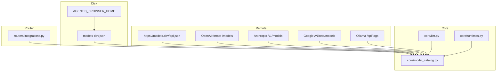
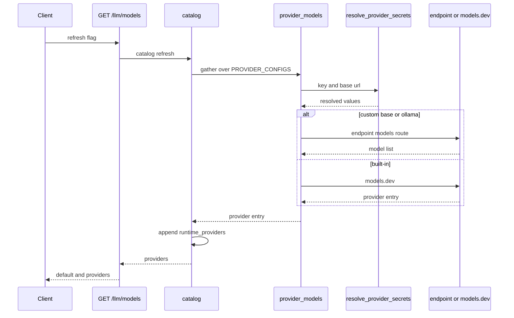
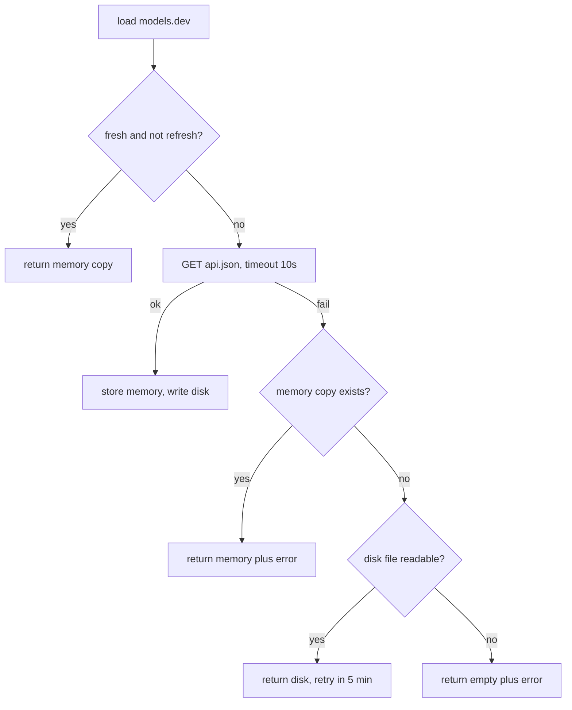
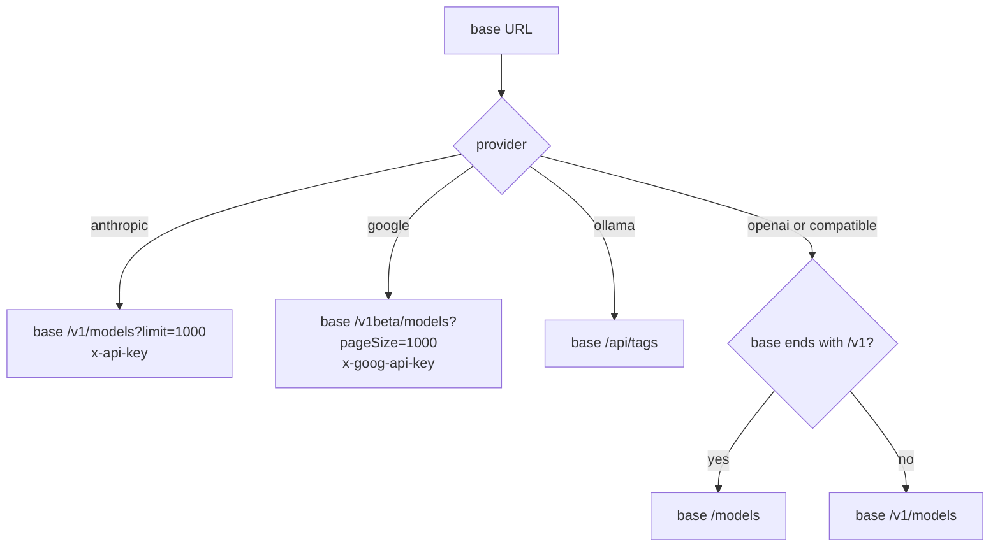
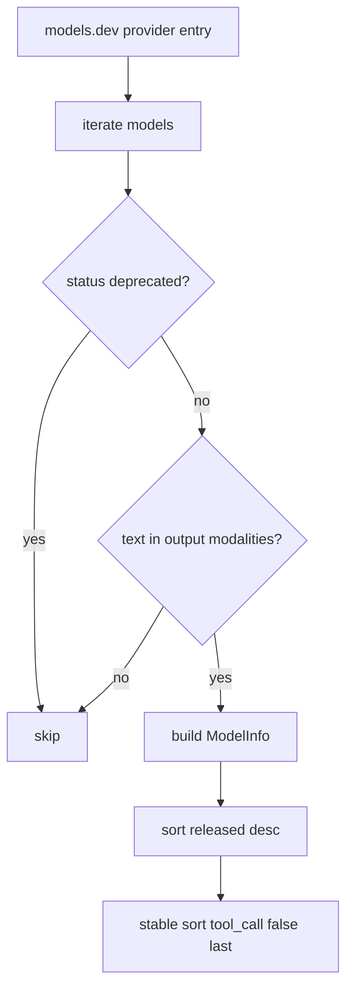
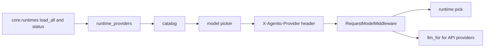
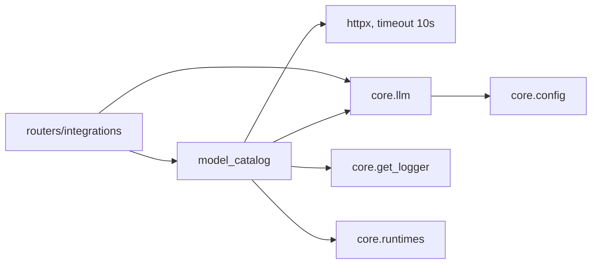

# Model catalog

`core/model_catalog.py` answers one question for the model pickers: which models does each provider offer? Built-in providers come from models.dev, cached in memory for six hours and on disk. A provider with a custom base URL lists that endpoint's models instead. Subscription runtimes are appended as extra entries.

Key capabilities:
- One catalog entry per provider with `configured`, `source`, `error` and `models`.
- Four endpoint formats: OpenAI, Anthropic, Google and Ollama.
- Filters for deprecated models and models that cannot output text.
- Sorting that puts the newest models first and tool-capable models ahead of the rest.
- `model_info` for one model, used to decide whether temperature is supported.

## Repository layout

## Building blocks

- `core/model_catalog.py`: `ModelInfo`, `_load_models_dev`, `_from_models_dev`, `_from_endpoint`, `provider_models`, `runtime_providers`, `catalog` and `model_info`.
- `core/llm.py`: `PROVIDER_CONFIGS` and `resolve_provider_secrets` supply the provider names, default models and credentials.
- `core/runtimes.py`: `load_all()` and `status()` provide subscription entries.
- `routers/integrations.py`: `GET /llm/models` returns the default and the full catalog.

## How it fits together

`GET /llm/models` calls `catalog(refresh)`, which gathers `provider_models` for every configured provider in parallel, then appends the subscription runtimes. Each provider either asks its endpoint or falls back to models.dev.

## Entry shape

`provider_models` returns a dictionary with fixed keys. `configured` means a key when the provider needs one, or a base URL for Ollama. `source` is `models.dev`, `endpoint` or `subscription`. `error` is a string when an endpoint was tried and failed, and stays `None` on success.

| Field | Meaning |
| --- | --- |
| `id` | Provider name, matching `PROVIDER_CONFIGS`. |
| `label` | Human name from `PROVIDER_LABELS`. |
| `configured` | Whether a key or base URL resolved. |
| `default_model` | The provider default from its config. |
| `base_url` | Custom endpoint, or `None`. |
| `custom_endpoint` | True when a custom base URL drives the listing. |
| `source` | `models.dev`, `endpoint` or `subscription`. |
| `error` | First line of an endpoint failure, if any. |
| `models` | `ModelInfo` objects, fields below. |

`ModelInfo` carries `id`, `name`, `context`, `tool_call`, `reasoning`, `temperature`, `released` and `input`. The picker uses `context` and `tool_call` to describe a model. `llm_for` uses `temperature` to drop an unsupported parameter.

## Loading models.dev

`_load_models_dev(refresh)` holds an `asyncio.Lock` while it checks the six hour TTL. A refresh bypasses the TTL. On a successful fetch it replaces the memory copy and writes a JSON cache file under `AGENTIC_BROWSER_HOME`, defaulting to `~/.agentic-browser/`. A failed fetch returns the memory copy with an error, or reads the disk copy and sets the timestamp so the next retry comes in five minutes.

An `OSError` while writing the disk cache is ignored, because a read-only home should not break the picker.

## Endpoint formats

A provider is treated as custom when `base_url` resolved and the provider is not Ollama. Ollama is always listed from its endpoint, even without a custom URL, because it is local.

| Provider | URL | Headers |
| --- | --- | --- |
| OpenAI format | `{base}/models` if base ends in `/v1`, else `{base}/v1/models` | `Authorization: Bearer <key>` when a key exists. |
| Anthropic | `{base}/v1/models?limit=1000` | `x-api-key`, `anthropic-version: 2023-06-01`. |
| Google | `{base}/v1beta/models?pageSize=1000` | `x-goog-api-key` when a key exists. |
| Ollama | `{base}/api/tags` | none. |

Response parsing differs per format. Ollama returns `models[].name`. Google returns `models[]`, and entries without `generateContent` in `supportedGenerationMethods` are skipped. The `models/` prefix is stripped from the id, `displayName` becomes the name, and `inputTokenLimit` becomes the context. OpenAI and Anthropic return `data[]` with `id` and an optional `display_name` or `name`. Results are sorted by id.

If an endpoint fails, the entry keeps the failure in `error`. For built-in providers the code then falls back to models.dev and keeps that error string. For Ollama it returns the endpoint error with an empty model list, because models.dev has no Ollama entry.

## Filtering and ordering

`_from_models_dev` reads one provider entry. It skips models whose `status` is `deprecated` and models whose output modalities do not include `text`. It maps `limit.context`, `tool_call`, `reasoning`, `temperature`, `release_date` and input modalities.

Two stable sorts produce the order the picker shows: newest first, and within that, models that can call tools ahead of those that cannot. Deprecated models never appear, so a saved model can be valid while missing from the list.

## Runtime providers

`runtime_providers` adds subscription runtimes as pseudo providers. Each entry has `source: "subscription"`, no base URL and no custom endpoint. `configured` is true only when the runtime is enabled and installed. `default_model` is the configured default or `default`. `error` carries the runtime's status note only while it is enabled.

These entries let the picker offer Claude, Codex and Antigravity plans beside API providers. The request middleware recognises them by id before it calls `llm_for`.

## Consumers

`routers/integrations.py` returns `{"default": effective, "providers": catalog}` from `GET /llm/models`, with an optional `refresh=true` query parameter. `model_info(provider, model)` scans the models.dev list for an exact id and is cached by the same six hour load, so it usually performs no network call. `services/compaction.py` uses the context window from `model_info` to size its token budget.

## Dependencies

The module imports `httpx` directly and uses one `AsyncClient` per fetch. It does not depend on the LangChain packages, so the catalog works even when a provider SDK cannot be imported. `core.runtimes` is imported lazily inside `runtime_providers` to avoid a cycle.

## Performance

- The models.dev response is cached for six hours in memory and on disk.
- The disk copy is stamped so a failed fetch retries in five minutes instead of hammering the network.
- `catalog` fetches providers concurrently with `asyncio.gather`.
- `model_info` reuses the cached list, so temperature checks do not add a request per model build.
- Endpoint listing uses a 10 second timeout per provider, so one slow endpoint delays only its own entry.

## Troubleshooting

- Every provider shows an empty list: models.dev is unreachable and no disk cache exists. Reconnect, or start Ollama so its endpoint entry appears.
- A custom endpoint shows `didn't list models`: the URL does not follow the provider's format. An OpenAI base usually ends in `/v1`.
- A model is missing from the list: it is deprecated in models.dev or cannot output text. Use the exact id with a custom endpoint, or pick a supported model.
- The picker shows an old catalog: the six hour TTL has not expired. Call `GET /llm/models?refresh=true`.
- A runtime entry shows `configured: false`: the runtime is disabled or not installed. Check the subscription status.
- A model rejects temperature: `model_info` reported `temperature: false`, so `llm_for` dropped the parameter. This is expected, not an error.

## Appendix

### Implementation examples

- Cache and fallback, `_load_models_dev`.
- models.dev mapping, `_from_models_dev`.
- Endpoint parsing, `_from_endpoint`.
- Provider entry, `provider_models`.
- Subscription entries, `runtime_providers`.
- Route wiring, `llm_models` in `routers/integrations.py`.

### Source files

- `core/model_catalog.py`
- `core/llm.py`
- `routers/integrations.py`
