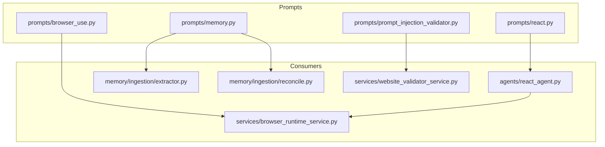
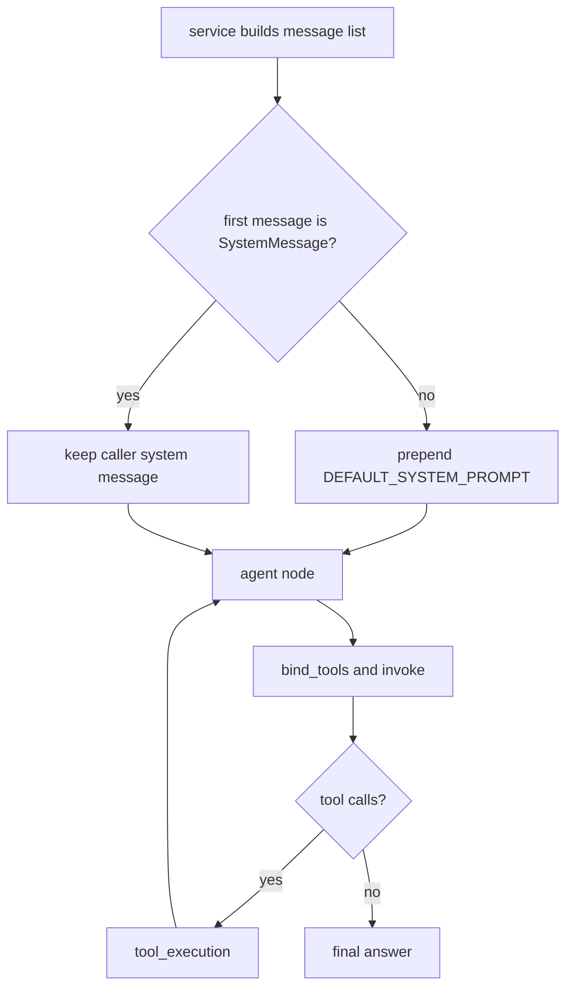
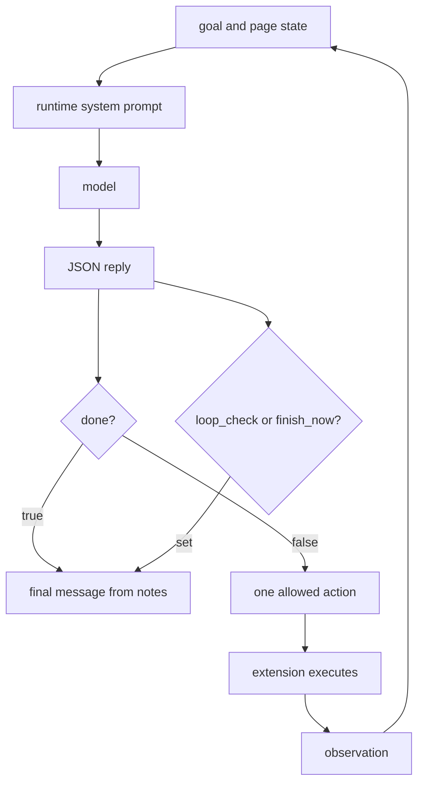
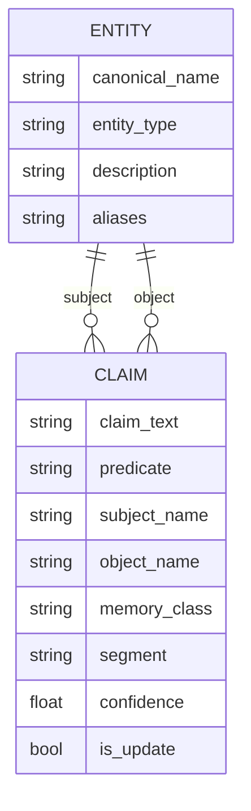
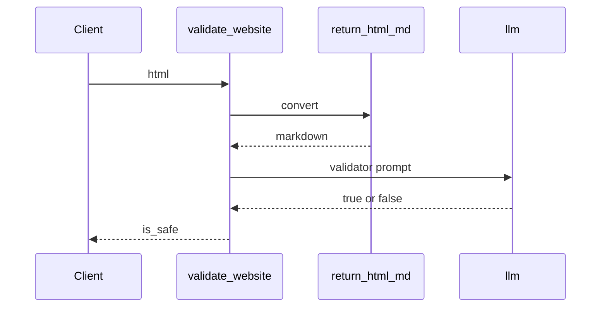
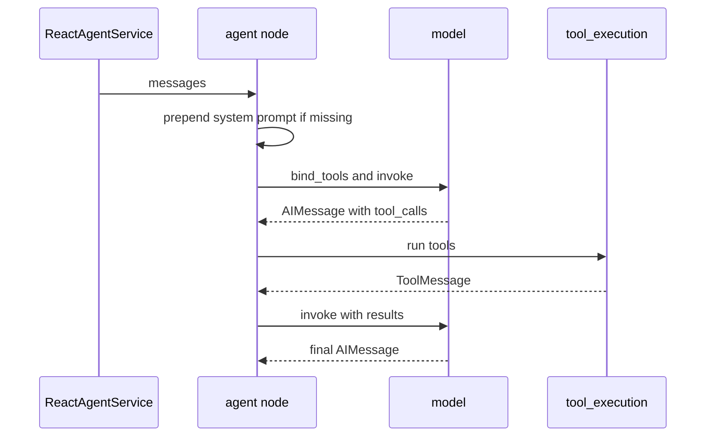
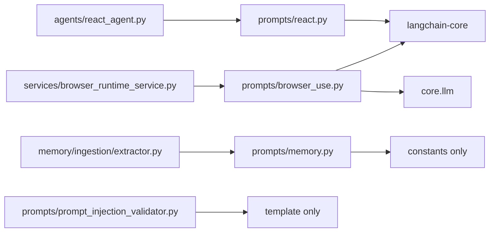

# Prompt engineering system

`prompts/` holds one module per prompt family. The agent uses `react.py` for the generic tool prompt, `browser_use.py` for browser plans, `memory.py` for extraction and reconciliation, and `prompt_injection_validator.py` for untrusted page text. Service answer prompts for websites, YouTube and GitHub live in the same folder and are covered in the prompts folder index.

Key capabilities:
- A default system prompt that states the memory, browser and credential policy for every ReAct turn.
- Two browser contracts: a full action plan and a single-step runtime loop.
- One fixed JSON schema for memory extraction, with chat rules layered on top.
- A one-word classifier for prompt injection in page markdown.
- Prompt modules that are plain constants where possible, so they import without provider packages.

## Repository layout

## Building blocks

- `prompts/react.py`: a `ChatPromptTemplate` with `{tools}` and `{question}`.
- `agents/react_agent.py`: `DEFAULT_SYSTEM_PROMPT`, built as a module-level `SystemMessage`.
- `prompts/browser_use.py`: `prompt_template_str`, `prompt`, `runtime_system_prompt_str`, `get_runtime_system_prompt` and `build_runtime_prompt_payload`.
- `prompts/memory.py`: `EXTRACTION_SYSTEM_PROMPT`, `CHAT_EXTRACTION_RULES` and `RECONCILE_SYSTEM_PROMPT`.
- `prompts/prompt_injection_validator.py`: `prompt_template`, a safe or unsafe classifier.

## The ReAct system prompt

`DEFAULT_SYSTEM_PROMPT` is the policy layer. It tells the model that memory is external durable state, not model memory. It names when to call `recall_memory`, `write_memory`, `recall_document_facts`, `browser_task`, `composio_apps` and `composio_action`. It forbids storing secrets, tokens, temporary page state and transient feelings. It also states that Google access tokens and PyJIIT sessions arrive automatically, so the model must never ask for them. For JIIT attendance it must call `pyjiit_agent` immediately and report an expired session rather than request a password.

The graph prepends `_system_message` only when the first message is not already a `SystemMessage`. A caller can therefore supply a different system prompt and keep it.

`prompts/react.py` is short by design. It tells the model it is a helpful assistant that answers from tools, lists the tools under a `TOOLS` header, and places the question under `here is the question:`. If the data is not available, the model should say so. The template is not a policy engine. Tool selection and stop rules live in `agents/react_agent.py` and the loop guard.

## Browser prompts

`prompt_template_str` asks for a JSON action plan from the DOM. It lists six DOM actions (`CLICK`, `TYPE`, `SCROLL`, `WAIT`, `SELECT`, `EXECUTE_SCRIPT`) and six tab actions (`OPEN_TAB`, `CLOSE_TAB`, `SWITCH_TAB`, `NAVIGATE`, `RELOAD_TAB`, `DUPLICATE_TAB`). The examples cover a DOM action, a tab open, a direct search URL and a combined open, wait, type and click flow.

The rules are specific. Prefer ids, then data attributes, then specific classes, then tag and type. Never run DOM actions on `chrome://` URLs. For a search, build the full search URL in `OPEN_TAB` instead of opening a blank tab and typing.

`runtime_system_prompt_str` is the tighter loop prompt. It plans exactly one safe action or finishes. The reply is JSON with `done`, `message`, `action`, `expected_state`, `verification`, `reason` and optional `notes`. The allowed types are `NAVIGATE`, `OPEN_TAB`, `CLICK`, `TYPE`, `KEY_PRESS`, `HOVER`, `SCROLL`, `WAIT` and `MEDIA_CONTROL`. The action object can carry `selector`, `text`, `role`, `value`, `url`, `active`, `key`, `command`, `direction`, `amount`, `ms` and a description.

The prompt tells the model to copy concrete facts into `notes`, because earlier pages are not visible later. It also tells the model to obey `session.loop_check` and `session.finish_now`. Those two keys are how the loop guard steers the next step.

`build_runtime_prompt_payload` serialises a dictionary with `goal`, `step`, `session`, `current_page`, `latest_result` and `extra_context`. It uses `json.dumps(..., ensure_ascii=True, default=str)` so a page object with unusual types still produces valid JSON.

## Memory prompts

`EXTRACTION_SYSTEM_PROMPT` defines a fixed JSON schema. Entities have `canonical_name`, `entity_type`, `description` and `aliases`. Claims have `claim_text`, `predicate`, `subject_name`, `object_name`, `memory_class`, `segment`, `confidence`, `base_importance`, `needs_confirmation`, `evidence_type`, `valid_from` and `is_update`. The response also has a short `summary`.

`CHAT_EXTRACTION_RULES` overrides the base prompt for chat turns. It extracts only from the user message, never from the assistant reply. It names the user entity `User`, writes claims in the third person, treats durable behaviour requests as `procedural` preferences, and marks moves or changes with `is_update`. Hypotheticals, questions and one-off reply instructions produce nothing.

`RECONCILE_SYSTEM_PROMPT` compares a new memory with similar stored ones and returns one decision per pair. The relations are `duplicate`, `update`, `contradicts` and `unrelated`. Removing a constraint counts as an update, which is how "no length limit" replaces "under 150 words".

## Injection validator

`prompt_injection_validator.py` asks whether markdown from a website contains instructions that try to make the model do something it should not. The output contract is one word: `true` for safe, `false` for a potential injection. The prompt includes the text between `---` markers and ends with `Is the text safe? (true/false)`.

`services/website_validator_service.py` converts HTML to markdown with `return_html_md`, builds a chain with `PromptTemplate` and the shared `llm`, and treats a stripped, lowercased `true` as safe. Any other answer, including an empty one, becomes unsafe.

## How prompts enter a run

The service builds the message list, the graph adds the system prompt when needed, and the model either answers or asks for tools. Tool results come back as `ToolMessage` entries and the loop repeats. Prompt changes therefore affect the first model call and every later call that carries the same system message.

## Dependencies

`prompts/memory.py` and the validator are pure strings, so they can be imported without provider packages. `browser_use.py` imports `LargeLanguageModel`, which pulls in the provider SDKs.

## Performance

- Prompt modules are constants, so building a chain does not re-render a large template per request.
- `build_runtime_prompt_payload` is one `json.dumps` call with `default=str`.
- The memory extractor shares one schema string between the batch and chat paths, with chat rules appended as an override.
- The validator is one short classification call. Run it before page text enters a larger prompt, not after.
- The browser prompt caps nothing itself. The service bounds the page snapshot, history and notes before it builds the payload.

## Troubleshooting

- The browser planner returns prose instead of JSON. Use a model that follows structured output, or retry with the runtime prompt and a lower temperature.
- The planner repeats a failed action. `session.loop_check` was not passed in the payload. Set it from the loop guard state.
- A search opens a blank tab. The model used `OPEN_TAB` without a search URL. The prompt requires the full URL, so inspect the plan.
- Memory extraction stores assistant trivia. The base prompt was used without `CHAT_EXTRACTION_RULES`. Append the chat rules for chat turns.
- The validator marks every page unsafe. The model ignored the one-word contract. Check that the response is exactly `true`, not a sentence that contains it.
- The default system prompt is missing. The first message was already a `SystemMessage`, so the graph kept it.

## Appendix

### Implementation examples

- ReAct template, `template` in `prompts/react.py`.
- Agent policy, `DEFAULT_SYSTEM_PROMPT` in `agents/react_agent.py`.
- Runtime contract, `runtime_system_prompt_str`.
- Runtime payload, `build_runtime_prompt_payload`.
- Memory schema, `EXTRACTION_SYSTEM_PROMPT`.
- Chat overrides, `CHAT_EXTRACTION_RULES`.
- Reconcile contract, `RECONCILE_SYSTEM_PROMPT`.
- Injection check, `services/website_validator_service.py`.

### Source files

- `prompts/react.py`
- `prompts/browser_use.py`
- `prompts/memory.py`
- `prompts/prompt_injection_validator.py`
- `agents/react_agent.py`
- `services/website_validator_service.py`
