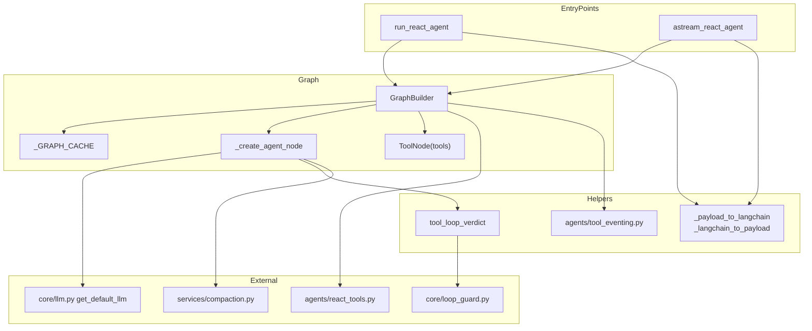
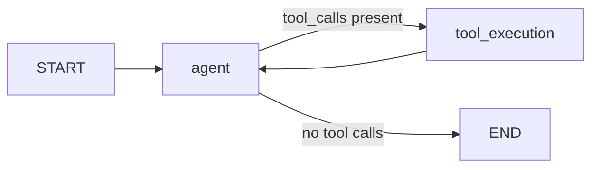
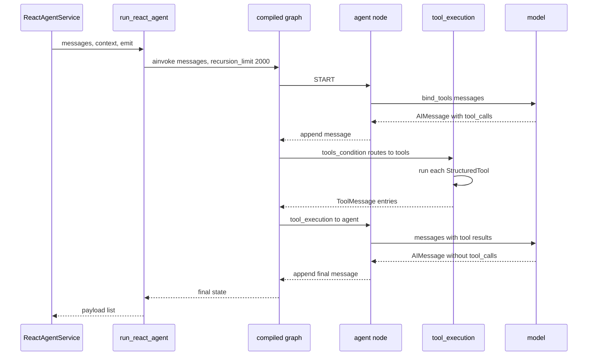
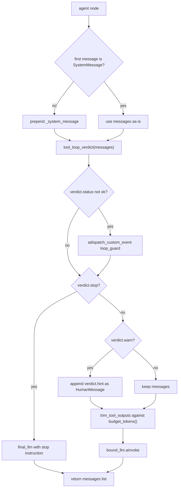
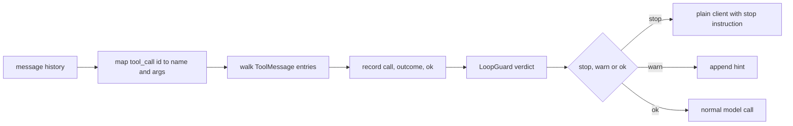
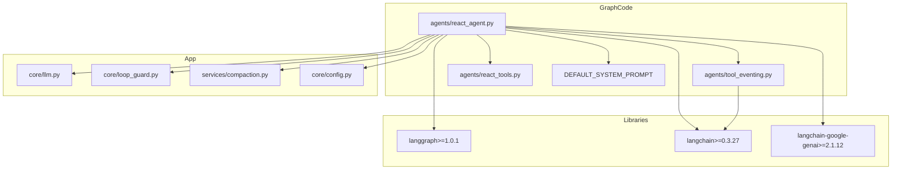

# Reactive agent architecture

`agents/react_agent.py` builds a LangGraph `StateGraph` with two working nodes. `agent` calls the model with tools bound, and `tool_execution` runs the requested tools through LangGraph's `ToolNode`. The graph loops between them until the model answers without a tool call. This is the default path for interactive chat and the inner loop for every supervisor subagent.

Key capabilities:
- A compiled graph cached per model signature.
- Tool binding with an `agent_turn` tag, so nested model calls stay out of the answer stream.
- Loop guard replay on every `agent` invocation.
- Token-budgeted trimming of old tool outputs before each model call.
- Two entry points, `run_react_agent` for a final message list and `astream_react_agent` for UI events.

## Repository layout

## Building blocks

- `AgentState`: a `TypedDict` with `messages: Annotated[Sequence[BaseMessage], add_messages]`.
- `DEFAULT_SYSTEM_PROMPT`: a module-level `SystemMessage` that names the memory, browser and Composio tools and forbids asking for credentials.
- `GraphBuilder(tools=None, context=None, emit=None, subagent_name="react", stream_thoughts=False)`: resolves the tool list, optionally instruments it, and compiles lazily.
- `_create_agent_node(tools, stream_thoughts)`: closes over a bound client and a plain client, both tagged `agent_turn`.
- `GraphBuilder.buildgraph`: wires `START`, `agent`, `tool_execution` and `END`.
- `instrument_tools`: the `agents/tool_eventing.py` wrapper that emits `subagent_tool_call`, `subagent_tool_result` or `subagent_tool_error`.

Tool selection has a fixed precedence. An explicit `tools` argument wins. Otherwise a non-empty `context` calls `build_agent_tools(context)`. Otherwise the module-level `AGENT_TOOLS` list is used. When `emit` is supplied, every tool is wrapped in a new `StructuredTool` with the same name, description and schema but a coroutine that emits events.

## Graph shape

`tools_condition` is the router. It inspects the last message and returns `"tools"` when it carries tool calls, otherwise the end sentinel. The graph adds the edge `tool_execution -> agent`, so the loop is explicit rather than recursive.

## How it fits together

## The agent node

`_create_agent_node` builds two clients. `bound_llm` is `client.bind_tools(tools).with_config(tags=["agent_turn"])`, used for normal turns. `final_llm` is `client.with_config(tags=["agent_turn"])` with no tools, used when the loop guard stops the run. When `stream_thoughts` is true and the client is a `ChatGoogleGenerativeAI`, the node copies it with `include_thoughts=True`. The copy is local, so other callers still receive plain content.

On a stop, the model is told: `Loop check: <reason> Stop calling tools. Answer now with what you have found, and say plainly what you could not find.` The answer is returned like any other assistant message, so the run ends with a usable reply instead of an exception.

`trim_tool_outputs` comes from `services/compaction.py` and is called with `await budget_tokens()`. It cuts old tool results to fit the model window before every normal turn, keeping the most recent context intact.

## Loop guard replay

`tool_loop_verdict(messages)` reconstructs a guard from the message list. It maps each `AIMessage.tool_calls` id to `(name, args)`, then walks `ToolMessage` entries and records `{"tool": name, "args": args}` against the normalised content. A tool message counts as a failure when its `status` attribute equals `"error"`. The guard is `LoopGuard(kind="tool call", patience=4, max_steps=env_max_steps("AGENT_MAX_TOOL_CALLS"))`.

Replaying instead of storing the guard on state means the verdict is deterministic for a given history and survives graph restarts. It also means the guard sees exactly what the model sees, including trimmed or restored messages.

## Message conversion

`_payload_to_langchain` accepts dictionaries with `role`, `content`, optional `name`, `tool_calls` and `tool_call_id`. A user message whose content is a list containing any non-text block is passed through untouched, which keeps images as image blocks. Everything else is flattened to text. String parts and `{"type": "text"}` parts survive, thinking and reasoning blocks are dropped.

`_langchain_to_payload` performs the reverse mapping for the API. It sets `role` from the message class, normalises content, copies `name`, serialises `tool_calls` through `model_dump`, `dict` or JSON, and preserves `tool_call_id` for tool messages.

## Streaming

`astream_react_agent` always constructs a fresh graph with `stream_thoughts=True`. It does not use the cache. It calls `graph.astream_events(..., version="v2", config={"recursion_limit": RECURSION_LIMIT})` and filters model events with `_is_agent_turn`, which requires the `agent_turn` tag and `metadata.langgraph_node == "agent"`. Tools that make nested model calls, such as the memory reconcile judge, therefore stay out of the answer stream.

`_split_chunk` separates a chunk into answer text and reasoning text. It understands plain strings, `{"type": "text"}`, `{"type": "thinking"}`, `{"type": "reasoning"}` and Anthropic-style `summary` lists. Reasoning is emitted live and again as one `thinking` block capped at 6000 characters at model end. Answer text is emitted live, and the service joins per-step text with blank lines.

Tool arguments and results are shortened by `_short`: 600 characters for arguments, 1500 by default for results, 300 for errors. A tool result with `status == "error"` becomes `subagent_tool_error` and includes the `error` key.

## Dependencies

`langgraph>=1.0.1` supplies `StateGraph`, `START`, `END`, `ToolNode` and `tools_condition`. `langchain_core` supplies messages, `StructuredTool` and `adispatch_custom_event`.

## Performance

The shared graph is cached in `_GRAPH_CACHE` by `(provider, model_name, temperature)`. A signature change clears the dictionary and stores the new graph, so the cache holds one entry. Every normal turn trims tool outputs against the model budget. `RECURSION_LIMIT` is 2000 graph steps. The loop guard is rebuilt per `agent` node, which costs one pass over the message list. Streaming uses `astream_events` v2 and builds a per-call graph because `stream_thoughts` is a graph-wide setting.

## Troubleshooting

- `GraphRecursionError`: the run reached 2000 graph steps. The loop guard should stop it first, so check that tool messages carry a usable `status`.
- The final answer refuses to use tools: the loop guard returned `stop`. Read the `loop_guard` event for the signal and reason.
- Reasoning text is missing: the provider is not Google, or the client is not a `ChatGoogleGenerativeAI`. Other providers send reasoning under different block types, or none.
- Duplicate or nested model output appears in the answer: a tool made its own model call without the `agent_turn` tag.
- Tool calls run against the wrong tool set: `GraphBuilder` fell back to `AGENT_TOOLS` because no context or explicit list was supplied. Pass context from the service.
- `Tool ... does not define a callable`: an instrumented tool had neither `coroutine` nor `func`. Build tools as `StructuredTool` with a coroutine.
- An image is dropped from a user message: the content list had only text parts after normalisation. Non-text blocks must stay at the top level of the message content.

## Appendix

### Implementation examples

- `run_react_agent(messages, context=None, emit=None, subagent_name="react")`: returns payloads, not LangChain objects.
- `astream_react_agent(messages, context=None, subagent_name="react")`: async generator of event dictionaries.
- `GraphBuilder(context=..., emit=..., subagent_name=...)()`: compiles or returns the cached graph.
- `tool_loop_verdict(messages)`: replays tool calls and results through `LoopGuard`.
- `instrument_tools(tools, subagent_name, emit)`: wraps each tool for call and result events.

### Source files

- `agents/react_agent.py`
- `agents/tool_eventing.py`
- `agents/react_tools.py`
