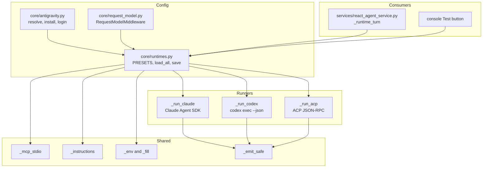
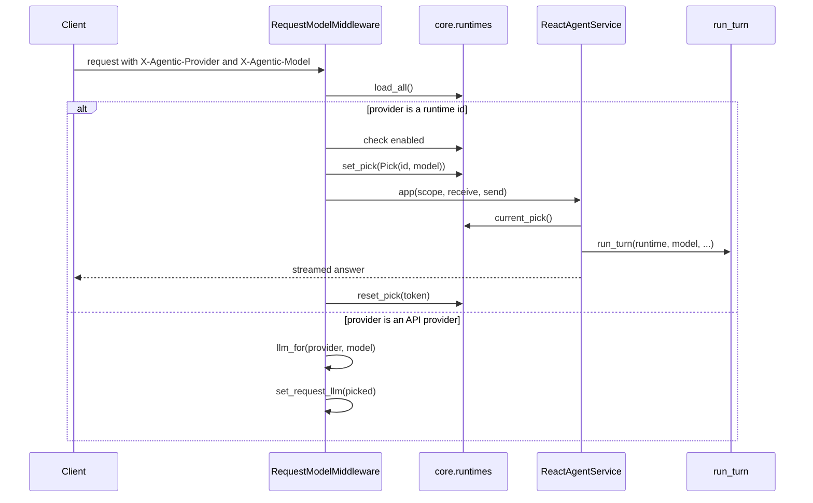
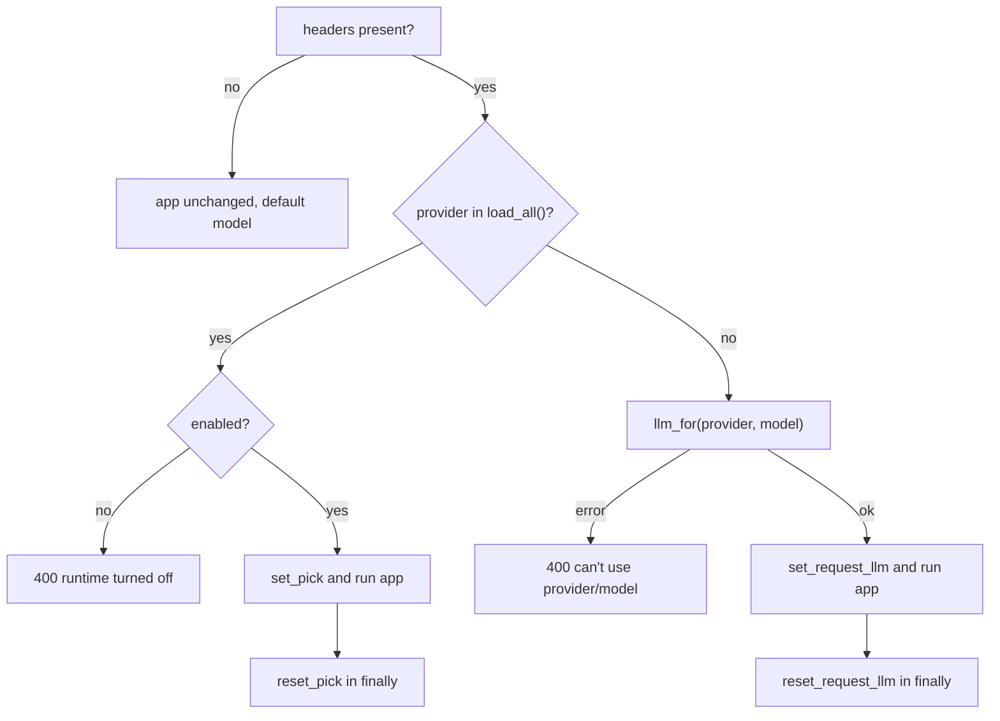
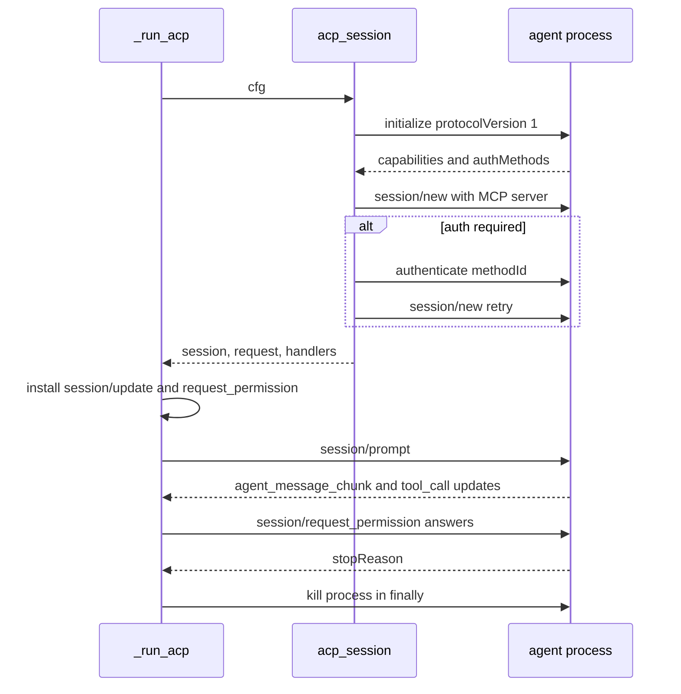
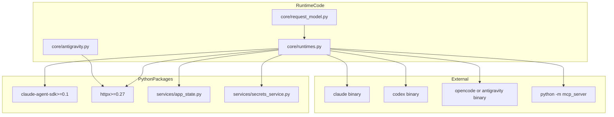

# Subscription runtimes

`core/runtimes.py` runs a chat turn on a vendor's own agent instead of an API key. Each runtime is driven the way its official tool expects. Claude uses the Claude Agent SDK, ChatGPT uses `codex exec --json`, and Antigravity, OpenCode and custom agents use the Agent Client Protocol. The user's existing login and plan apply because the runtime is the vendor's client, not a reimplementation.

A turn is stateless. The compacted conversation, retrieved memory, page markdown and attachment text all go into one prompt. The runtime gets this app's MCP server over stdio, so `browser_*` and `memory_*` tools work, and it cannot edit files. Codex runs any command in a read-only sandbox.

Key capabilities:
- Four presets plus custom ACP agents, stored under the `runtimes` app setting.
- Per-request selection through `X-Agentic-Provider` and `X-Agentic-Model`.
- A shared MCP server definition pointed at the local backend.
- Streaming of answer and thinking deltas through the same event callback as the built-in agents.
- A bounded turn timeout of 20 minutes.

## Repository layout

## Building blocks

- `PRESETS`: `claude` with kind `claude-sdk`, `codex` with kind `codex-exec`, and `antigravity` and `opencode` with kind `acp`.
- `BASE_FIELDS`: `enabled=False`, `allow_web=True`, `env={}`, `auth_method=""`, `profile_dir=""`, `extra_instructions=""`.
- `SETTING_KEY = "runtimes"`: the `AppSetting` row that stores overrides.
- `STATE_DIR`: `AGENTIC_BROWSER_HOME` or `~/.agentic-browser`. `WORKSPACE` is `STATE_DIR/runtime-workspace`, the empty working directory every agent gets.
- `TURN_TIMEOUT = 20 * 60`: the wall clock limit for one turn.
- `Pick(runtime, model)`: the per-request choice, held in a `ContextVar`.
- `RUNNERS`: maps `claude-sdk`, `codex-exec` and `acp` to their coroutines.

Preset details matter for setup messages. Claude's command is empty because the SDK finds `claude` on `PATH`, and its login hint says to run `claude` once in a terminal. Codex uses the `codex` command and asks for `codex login`. Antigravity's command is resolved from a source setting, and OpenCode uses `opencode acp` after `opencode auth login`.

## How it fits together

`RequestModelMiddleware` is plain ASGI, not `BaseHTTPMiddleware`, because the context variable must remain set while a `StreamingResponse` body is generated. It reads the two headers, and if the provider matches a runtime id it checks `enabled`, sets a `Pick`, runs the app, and resets the pick.

A runtime that is present but disabled produces a 400 with `<label> is turned off. Turn it on in Settings -> Subscriptions.` An unknown provider/model pair goes through `llm_for`, which raises and becomes a 400 with `Can't use provider/model: ...`.

## Settings and command resolution

`load_all` merges each preset with saved overrides and adds `id` and `builtin=True`. Saved entries whose id is not a preset become custom ACP agents with `kind="acp"`, empty args, one model and `builtin=False`. `save` accepts only `enabled`, `allow_web`, `command`, `args`, `env`, `models`, `default_model`, `auth_method`, `profile_dir`, `extra_instructions`, `label` and `source`.

`resolve_command` has three branches. Antigravity delegates to `core.antigravity.resolve(source, command)`. A `claude-sdk` runtime with an empty command returns `shutil.which("claude")`. Everything else expands `~`, accepts an executable file at that path, or falls back to `shutil.which`.

`status(cfg)` returns `installed`, `path`, `note` and a filled `login` hint. For Antigravity it adds a source-specific note and checks `logged_in(profile_dir)`, which looks for `antigravity-acp/antigravity-oauth-token` under the profile folder.

## Shared prompt and MCP setup

`_mcp_stdio` returns the command every runtime uses: `sys.executable -m mcp_server` with `AGENTIC_BROWSER_API_URL=http://127.0.0.1:<backend_port>` and `PYTHONPATH` set to the repo root. `_instructions` appends a paragraph naming `agentic/browser_*` and `agentic/memory_*`, plus any per-runtime `extra_instructions`.

`_env` copies `os.environ` and overlays the runtime's `env` map after `_fill`. `_image_parts` base64-encodes attachments. `_emit_safe` swallows callback exceptions so a broken stream listener cannot kill a turn.

## Claude Agent SDK

`_run_claude` imports `claude_agent_sdk` and maps a turn onto `ClaudeSDKClient`. Built-in tools are `WebSearch` and `WebFetch` when `allow_web` is true, otherwise none. `can_use_tool` allows names starting with `mcp__agentic__` and the enabled web tools. Everything else is denied with `<name> isn't available in Agentic Browser.`

`ClaudeAgentOptions` sets `strict_mcp_config=True`, `setting_sources=[]`, `include_partial_messages=True`, `cwd=WORKSPACE` and `cli_path=resolve_command(cfg)`. The prompt is one user message with text plus image blocks. Stream events produce `answer_delta` and `thinking_delta`, assistant blocks produce tool call events, tool results produce result events, and a `ResultMessage` with `is_error` raises.

## Codex exec

`_run_codex` builds an argument list around `codex exec --json --skip-git-repo-check --ephemeral -s read-only -C <workspace> -c approval_policy="never"`. It injects the MCP server through repeated `-c mcp_servers.agentic.*` values and toggles `tools.web_search`. A non-default model adds `-m`. Images are written to `WORKSPACE/.attach-<pid>-<n>.<ext>` and passed with `-i`, then removed in `finally`. The prompt plus instructions is written to stdin, and the process is started with `-` as the final argument.

The JSON stream is parsed line by line. `item.completed` with `agent_message` appends answer text and emits `answer_delta`. `reasoning` emits `thinking_delta`. `mcp_tool_call` emits call and result events. `web_search` and `command_execution` emit tool call events. `error` and `turn.failed` set the error string. The returned answer is the last non-empty agent message, because Codex narrates as it goes.

## ACP agents

`acp_session` spawns the command and speaks newline-delimited JSON-RPC over stdin and stdout. It sends `initialize` with `protocolVersion: 1` and client capabilities that disable file system and terminal access. It then sends `session/new` with the MCP server entry, or an empty list when `discover_only` is true. If the agent rejects the session for auth, it calls `authenticate` with the configured `auth_method` or the first advertised method and retries once.

Models are read from `session.models.availableModels`, or from a config option whose category or id is `model`. A turn sets the model with `session/set_config_option` or `session/set_model`, then sends `session/prompt` with text and, when the agent advertises image prompt support, image blocks.

Permission requests are answered by policy, not by a user prompt. A tool call is allowed when its JSON text contains `agentic`, `browser_` or `memory_`, or when its kind is `fetch`, `search` or `think` and `allow_web` is true. Otherwise the handler selects `reject_once` or `reject_always`. If no matching option exists, the outcome is `cancelled`.

`session/update` notifications map to events. `agent_message_chunk` becomes `answer_delta`, `agent_thought_chunk` becomes `thinking_delta`, `tool_call` becomes `subagent_tool_call`, and a completed or failed `tool_call_update` becomes `subagent_tool_result`. A `stopReason` of `refusal` with no answer raises `The agent refused this request.`

## Antigravity install and login

`core/antigravity.py` resolves four sources: `auto`, `managed`, `t3` and `custom`. Managed installs live in `STATE_DIR/tools/antigravity`. T3 Code's copy is read from `~/.t3/tools/antigravity-acp`. Downloads come from Google's public release manifest, must start with the allowed download prefix, and are verified against a 128 character SHA-512 before unpacking. Only `.tar.gz` releases are supported. The executable is extracted, chmod `0755`, recorded in its active-version file, and older managed versions are removed.

Login runs `<binary> acp --login --gemini-dir <profile> --app-data-dir antigravity-acp` with `SSH_CONNECTION` set so the runtime prints a link instead of opening a browser. `login_start` waits up to 30 seconds for a line starting with `https://`. `login_finish` writes the code to stdin and waits up to 60 seconds, then verifies the token file exists. `login_cancel` kills a waiting process.

## Dependencies

`claude-agent-sdk>=0.1` is pinned in `pyproject.toml`. The Codex and OpenCode binaries are not Python dependencies. They are resolved on `PATH` at runtime.

## Performance

`TURN_TIMEOUT` is 1200 seconds and wraps the whole runner with `asyncio.wait_for`. ACP requests default to 120 seconds, initialization and session creation to 90, authentication to 60, model selection to 30, and the prompt to the full `TURN_TIMEOUT`. Subprocess pipes use a 16 MB limit. Antigravity's manifest is cached for one hour, and installs serialize behind `_install_lock`. The console's Test button uses a 240 second timeout and a fixed prompt that asks for the single word `OK`.

## Troubleshooting

- `<label> is turned off`: `enabled` is false. The middleware rejects the request before any work.
- `isn't installed (command: ...)`: `resolve_command` found no executable. Set the command path or install the vendor CLI.
- Codex returns no answer: stderr is read and raised, capped at 600 characters. Common causes are a missing `codex login` or a rejected MCP config.
- An ACP agent exits during startup: pending futures are rejected with `The agent exited.` plus the tail of stderr.
- ACP tool calls are all denied: the permission policy only allows this app's MCP tools and web fetches or searches. A shell or file edit request is rejected by design.
- An Antigravity download fails its checksum: the archive did not match Google's manifest and was not installed.
- Antigravity login never completes: the runtime did not print a link within 30 seconds, or the code was not accepted within 60. Restart the login.

## Appendix

### Implementation examples

- `load_all()`: merged runtime map including custom ACP agents.
- `run_turn(runtime_id, model, system, prompt, images, emit)`: one stateless turn.
- `test_runtime(runtime_id)`: discovery, optional model save, tiny reply.
- `acp_session(cfg, discover_only=False)`: handshake and session creation.
- `antigravity.install_latest()`: download, SHA-512 check, unpack, activate.
- `RequestModelMiddleware.__call__`: header parsing, runtime pick, or `llm_for`.

### Source files

- `core/runtimes.py`
- `core/antigravity.py`
- `core/request_model.py`
