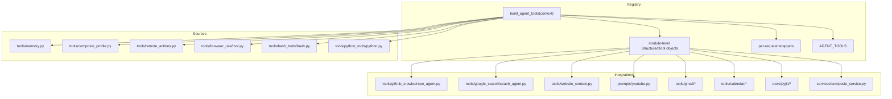
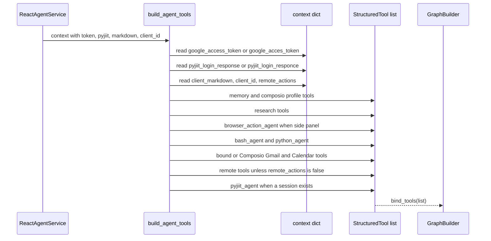
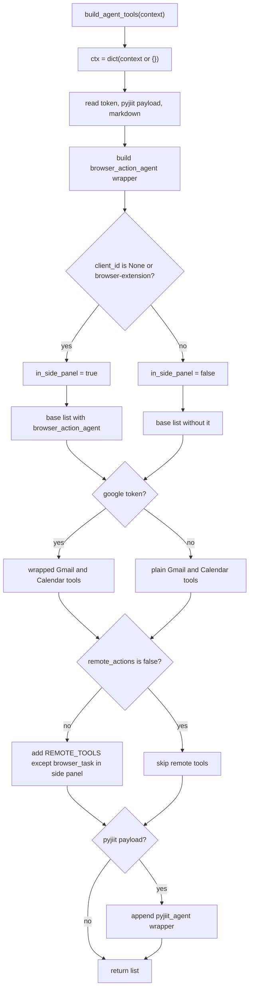
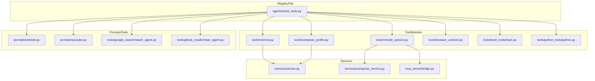

# Tool integration system

`agents/react_tools.py` is the catalogue of tools the built-in agents can call. It defines research tools, Google Workspace tools, a PyJIIT attendance tool, memory tools, two Composio profile tools and a per-request browser tool, then imports a bash tool and a Python tool. `build_agent_tools(context)` assembles the list for one request, injecting credentials and client-specific variants.

Every tool is a LangChain `StructuredTool` with a Pydantic input model. The registry does not implement the integrations. It presents them to the model with names, descriptions and argument schemas that match the downstream services.

Key capabilities:
- Context-aware assembly from a Google token, PyJIIT session, page markdown, client id and remote action permission.
- Composio fallback inside the Gmail and Calendar tools when no direct token is supplied.
- Typed inputs with explicit bounds on result counts.
- Memory tools that coerce model labels into the internal enums.
- One list shared by the ReAct agent and the supervisor partitions.

## Repository layout

## Building blocks

The registry has three layers.

- Module-level tools created at import: `github_agent`, `websearch_agent`, `website_agent`, `youtube_agent`, `gmail_agent`, `gmail_send_agent`, `gmail_list_unread_agent`, `gmail_mark_read_agent`, `calendar_agent`, `calendar_create_event_agent` and `pyjiit_agent`.
- Imported tool collections: `MEMORY_TOOLS` from `tools/memory.py`, `COMPOSIO_PROFILE_TOOLS` from `tools/composio_profile.py`, `REMOTE_TOOLS` from `tools/remote_actions.py`, plus `bash_agent` and `python_agent`.
- Request-built tools: `dynamic_browser_action_agent`, and credential-bound wrappers for Gmail, Calendar and PyJIIT.

`AGENT_TOOLS = build_agent_tools()` at module scope is the no-context list. It is what `GraphBuilder` falls back to when neither an explicit tool list nor a context is supplied.

## How it fits together

The context keys tolerate two historical spellings. `google_access_token` and `google_acces_token` are both read, as are `pyjiit_login_response` and `pyjiit_login_responce`. This is compatibility with existing callers, not a typo in the current code.

## Tool inventory

| Name | Input model | What it calls |
| --- | --- | --- |
| `github_agent` | `GitHubToolInput` | `run_github_repo_agent(url, question, chat_history)` |
| `websearch_agent` | `WebSearchToolInput` | `web_search_pipeline`, up to 10 results |
| `website_agent` | `WebsiteToolInput` | `markdown_fetcher` then a website QA chain |
| `youtube_agent` | `YouTubeToolInput` | a YouTube transcript QA chain |
| `gmail_agent` | `GmailToolInput` | Composio Gmail search, or `get_latest_emails` with a token |
| `gmail_send_email` | `GmailSendEmailInput` | Composio send, or `send_email` |
| `gmail_list_unread` | `GmailListUnreadInput` | Composio unread query, or `list_unread` |
| `gmail_mark_read` | `GmailMarkReadInput` | Composio modify, or `mark_read` |
| `calendar_agent` | `CalendarToolInput` | Composio event list, or `get_calendar_events` |
| `calendar_create_event` | `CalendarCreateEventInput` | Composio create, or `create_calendar_event` |
| `pyjiit_agent` | `PyjiitAttendanceInput` | `Webportal` attendance fetch |
| `browser_action_agent` | `BrowserActionInput` | `BrowserRuntimeService.start_session` |
| `recall_memory` | `RecallMemoryInput` | `MemoryService.search` |
| `write_memory` | `WriteMemoryInput` | `MemoryService.store_claim` |
| `recall_document_facts` | `RecallDocumentFactsInput` | `MemoryService.search_document_facts` |
| `composio_linkedin_me` | `ComposioLinkedInMeInput` | `ingest_composio_linkedin_self` |
| `composio_aeroleads_linkedin` | `ComposioAeroLeadsLinkedInInput` | `ingest_composio_aeroleads_linkedin` |
| `browser_task` | `BrowserTaskInput` | bridge `task.run` |
| `composio_apps` | `ComposioAppsInput` | connected accounts and toolkit actions |
| `composio_action` | `ComposioActionInput` | `execute_toolkit_action` |

`bash_agent` and `python_agent` come from `tools/bash_tools/bash.py` and `tools/python_tools/python.py` and are appended without a wrapper. Their schemas live in those modules.

## Input bounds

The schemas enforce limits before any service call. `WebSearchToolInput.max_results` is 1 to 10, `GmailToolInput.max_results` is 1 to 25, `GmailListUnreadInput.max_results` is 1 to 50, and `CalendarToolInput.max_results` is 1 to 25. `RecallMemoryInput.top_k` is 1 to 20, and `WriteMemoryInput.importance` and `confidence` are 0 to 1.

The Gmail and Calendar inputs also accept `access_token`, documented as a legacy direct OAuth token. When a request-level Google token is present, `build_agent_tools` closes over it and passes it as `_default_token`, so the model does not need to supply one.

## Memory tool behaviour

`tools/memory.py` maps loose model vocabulary onto internal enums. `_SEGMENT_ALIASES` accepts identity, preference, correction, project, relationship, skill, communication, context and reflection variants. `_CLASS_ALIASES` accepts the six memory classes. `_TIER_ALIASES` accepts working, short, long and permanent forms.

Defaults are inferred when the model omits a field. Segment defaults to `CONTEXTUAL`. Preferences become `PROCEDURAL`, people become `SOCIAL`, reflections become `REFLECTIVE`, and everything else becomes `SEMANTIC`. Preferences and procedural memories become `PERMANENT`. Identity, skills and people become `LONG_TERM`. The rest become `SHORT_TERM`.

`_recall_memory` formats each result as `[claim_id] score=... tier/segment confidence=...: claim_text`, and annotates superseded claims with the dates they held. `_write_memory` rejects empty content, stores with `predicate="IS"` and `user_confirmed=False` unless the caller supplies a predicate, and returns JSON with the new claim id, tier, segment and class. Errors are returned as text, not raised, so the agent can continue.

## Remote and profile tools

`tools/remote_actions.py` defines `browser_task`, `composio_apps` and `composio_action`. `browser_task` calls `manager.call("task.run", ...)` with a 900 second timeout and formats the answer, ending URL and trail. `composio_apps` lists active accounts grouped by toolkit, or up to 40 actions for one app, filtering by all words in `search`. `composio_action` runs one exact action slug and truncates the result to 12000 characters.

`tools/composio_profile.py` defines `composio_linkedin_me` and `composio_aeroleads_linkedin`. Both call `MemoryService` ingestion methods and take an `ingest` flag, defaulting to true. Failures return a sentence beginning `Unable to fetch` or `Unable to enrich`.

## Dependencies

`langchain-core` supplies `StructuredTool`, and `pydantic[email]>=2.9.0` supplies the schemas, including `EmailStr` and `HttpUrl`. The registry imports service modules at module load, so a broken optional integration import can fail the whole tool list.

## Performance

Tool count varies by context. The base list is memory tools, two Composio profile tools, four research tools, bash and Python, and optionally the browser tool. A Google token adds six wrapped tools. Remote tools add three. PyJIIT adds one. The supervisor partitions this list by name and prepends memory tools to each group, so the same `StructuredTool` object can appear in several groups. Result sizes are capped in the tools themselves: 10 web results with 320 character summaries, 40 Composio actions, 12000 characters for a Composio action result, and 900 seconds for a remote browser task.

## Troubleshooting

- A Gmail tool asks for a token: no request-level Google token was supplied, so the tool fell back to Composio and Composio has no active Gmail account.
- `Composio isn't set up`: `COMPOSIO_API_KEY` is missing. The tool returns this sentence rather than raising.
- Wrong tools in a client: check `client_id`. Any value other than `None` or `browser-extension` removes `browser_action_agent`, and `remote_actions=False` removes all three remote tools.
- `pyjiit_agent` is absent: no `pyjiit_login_response` or `pyjiit_login_responce` was passed in context.
- A memory is stored in the wrong segment: the model supplied a label outside `_SEGMENT_ALIASES`, so it defaulted to `CONTEXTUAL`. Send one of the documented names.
- Duplicate memories: `write_memory` relies on the memory service reconciliation path. Repeated facts may be merged or superseded rather than stored twice.
- A tool schema rejected a URL: `HttpUrl` requires a scheme. Pass `https://...`, not a bare hostname.

## Appendix

### Implementation examples

- `build_agent_tools(context=None)`: returns the ordered tool list for one request.
- `_websearch_tool(query, max_results=5)`: bounds results and returns `URL` plus `Summary` blocks.
- `_gmail_tool(...)`: Composio first when no token, direct Gmail API when a token exists.
- `_write_memory(...)`: coerces labels, stores a claim, returns JSON.
- `_composio_apps(app=None, search=None)`: lists connected apps or one app's actions.
- `_browser_task(goal, url=None)`: bridge call with a 900 second timeout.

### Source files

- `agents/react_tools.py`
- `tools/memory.py`
- `tools/remote_actions.py`
- `tools/composio_profile.py`
