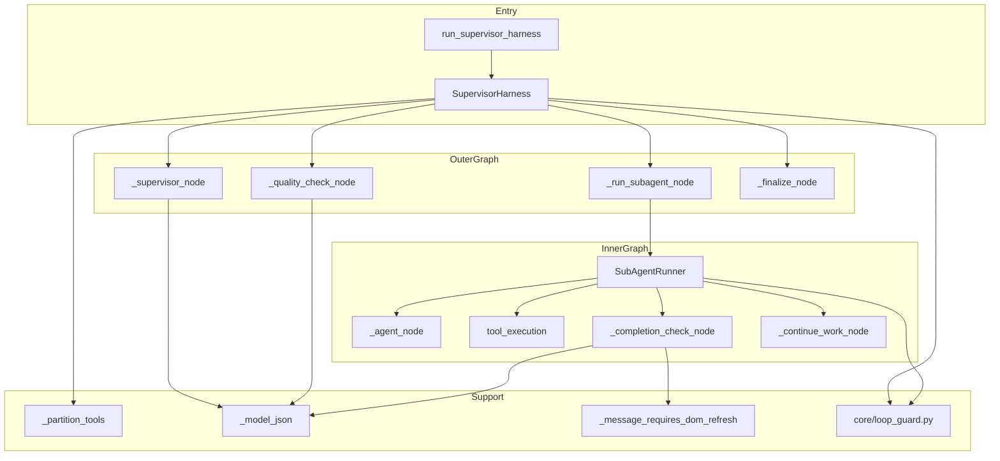
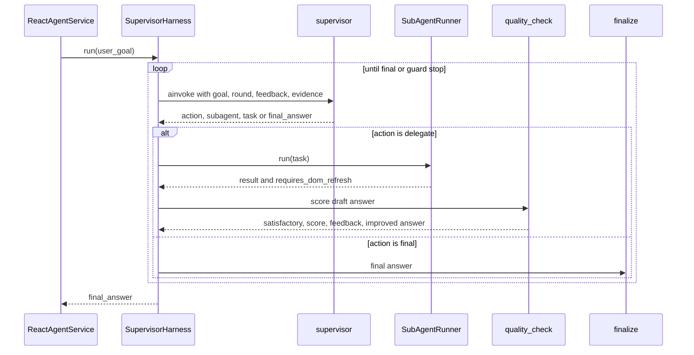
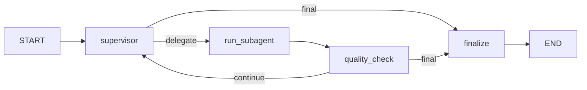
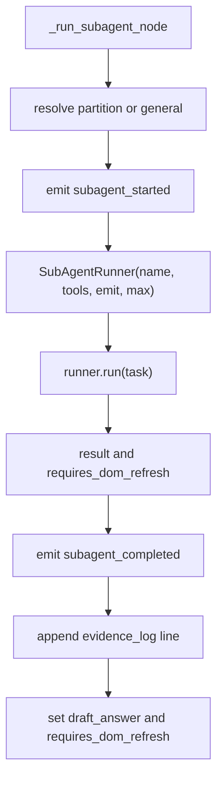
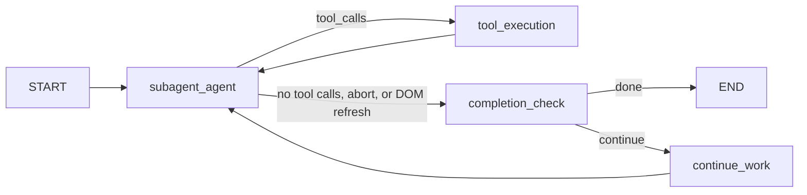
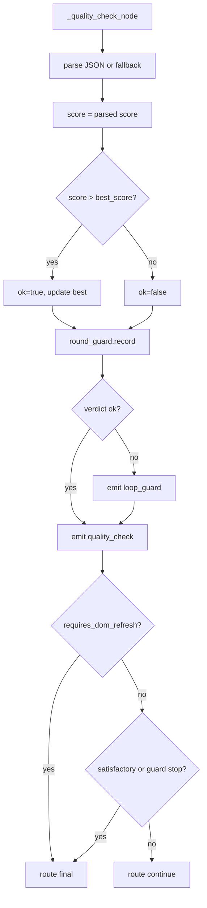
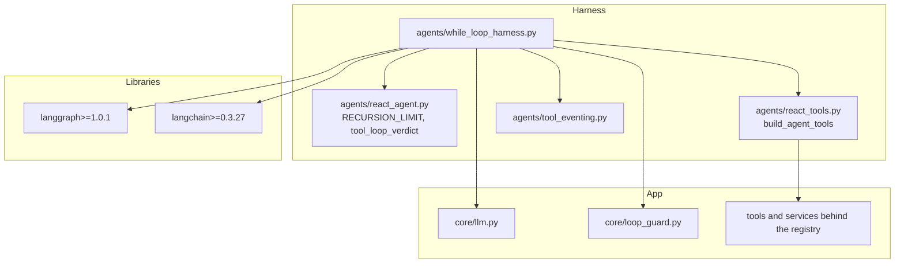

# While-loop supervisor

`agents/while_loop_harness.py` runs a two-level loop. The outer graph chooses a subagent or declares the work final, delegates to that subagent, scores the draft answer, and either loops or finalizes. The inner graph runs one subagent until a completion checker accepts its answer. Both loops use a `LoopGuard` and both emit events through the same callback the ReAct agent uses.

`ReactAgentService` selects this harness when the question looks like browser or multi-step work. The outer nodes are `supervisor`, `run_subagent`, `quality_check` and `finalize`. The harness also handles the case where a subagent planned a browser action and the page must be refreshed before the next planner step.

Key capabilities:
- Five subagent roles with fixed tool partitions.
- A model-scored quality gate with an improving-score progress rule.
- A per-subagent completion checker that can continue the loop with feedback.
- Detection of `requires_dom_refresh` in tool output, which ends the round early.
- Optional caps from `HARNESS_MAX_ROUNDS` and `HARNESS_MAX_SUBAGENT_ROUNDS`.

## Repository layout

## Building blocks

- `SupervisorState`: `user_goal`, `supervisor_iteration`, `max_supervisor_iterations`, `selected_subagent`, `supervisor_action`, `subagent_task`, `subagent_result`, `draft_answer`, `evidence_log`, `satisfactory`, `requires_dom_refresh`, `quality_feedback`, `final_answer`.
- `SubAgentState`: `messages`, `task`, `done`, `sub_iterations`, `max_sub_iterations`, `abort_tool_loop`, `abort_reason`, `requires_dom_refresh`, `completion_feedback`, `result`.
- `SupervisorHarness.__init__`: builds `self.tools = build_agent_tools(context)`, partitions them, creates two round guards, and compiles the graph.
- `SubAgentRunner`: builds its own graph, binds the model to its partition tools, and owns a round guard plus a tool loop verdict helper.
- `_partition_tools`: maps tool names to `research`, `browser`, `productivity`, `coding` and `general` groups.

Partition membership is name-based. `research` gets `websearch_agent`, `website_agent`, `youtube_agent` and `github_agent`. `browser` gets `browser_action_agent` and `browser_task`. `productivity` gets the Gmail, Calendar, Composio and PyJIIT tools. `coding` gets `bash_agent` and `python_agent`. Every group also gets `recall_memory`, `recall_document_facts` and `write_memory` prepended. `general` receives the full tool list. Names absent from the registry are skipped, so a disabled integration does not break the partition.

## How it fits together

`SupervisorHarness.run` resets the round guard and `_best_score` before invoking the graph, then returns `result["final_answer"]`. Both graph invocations use `RECURSION_LIMIT` from `react_agent.py` as the LangGraph step ceiling.

## The supervisor node

`_supervisor_node` increments `supervisor_iteration`, reads `evidence_log` and `quality_feedback`, and asks the model for JSON with `action`, `subagent`, `task`, `final_answer` and `reason`. The prompt lists the five allowed subagent names. A parse failure falls back to delegating the original goal to `general`, with `reason="Fallback due to parse error."`.

Before calling the model, the node checks `self._round_guard.verdict.stop`. If the guard has stopped the rounds, it forces `action="final"`. After parsing, it forces an unknown action back to `delegate` and an unknown subagent back to `general`. It emits `supervisor_iteration` with the round number, action, selected subagent and reason.

## The subagent node

`_run_subagent_node` creates a fresh `SubAgentRunner` for the selected partition and passes `max_sub_iterations`. It emits `subagent_started`, awaits `runner.run(task)`, emits `subagent_completed`, and appends one evidence line of the form `[<subagent>] <result truncated to 600>` or `[<subagent>] completed with empty result`.

The runner's system prompt describes it as `the '<name>' subagent in a while-loop harness`, tells it to keep iterating until the task is complete, and tells it when to use memory tools. Its tool calls go through `instrument_tools`, so the outer event stream sees every call.

## The subagent graph

`_agent_node` prepends the subagent system prompt when needed, calls `tool_loop_verdict(messages)`, and either invokes the tool-bound client or the plain client with a stop instruction. It emits `subagent_message` with the normalised content and, when the response has tool calls and the guard did not stop, emits `subagent_tool_calls`. The return value sets `abort_tool_loop` and `abort_reason` when the guard stopped.

`_route_after_agent` sends the run to `completion_check` when `abort_tool_loop` is set, when the latest message contains `requires_dom_refresh: true`, or when the latest message has no tool calls. Otherwise it routes to `tool_execution`.

`_completion_check_node` walks messages in reverse to find the latest assistant text and whether any message carries a DOM refresh flag. It then asks the model for `{"done": boolean, "feedback": string}`. A parse failure becomes `done=false` with `Need one more pass to ensure completion.`

The round guard records `"completion round"` against the sorted list of all tool message contents. `done` becomes true when the checker says so, when the round guard stops, when the tool loop was aborted, or when a DOM refresh is required. The emitted `subagent_completion_check` carries `done`, `feedback` and `sub_iterations`. If the round guard stopped, the guard reason is appended to the feedback. `_continue_work_node` sends that feedback back as a `HumanMessage` and the graph returns to the agent.

## Quality check and finalize

`_quality_check_node` asks for JSON with `satisfactory`, `score` from 0 to 10, `feedback` and `improved_answer`. A parse failure becomes `satisfactory=false`, `score=4`, a feedback line saying to run another loop, and the unchanged draft. Progress is defined as `score > self._best_score`. The best score only moves up.

The round guard records the selected subagent and task as the call and the draft answer as the outcome, with `ok=improved`. A non-ok verdict is emitted as a `loop_guard` event. The node returns the improved answer when the checker supplied one, otherwise the existing draft.

`_quality_route` gives `requires_dom_refresh` the highest priority, then `satisfactory`, then a guard stop. `_finalize_node` turns a DOM refresh into the literal message `Executing browser actions. Awaiting new page state...`. Otherwise it picks the first non-empty value among `final_answer`, `draft_answer`, `subagent_result` and `I could not produce a reliable answer.` It emits `answer_delta` and `final` with the iteration count and the satisfactory flag.

## DOM refresh detection

`_message_requires_dom_refresh` parses message content into a dictionary when possible and walks it for any key named `requires_dom_refresh` whose value is `True`. If parsing fails, it falls back to a substring check for `"requires_dom_refresh": true` or the Python-style variant.

This is how `browser_action_agent` tells the harness that an action was planned and the page must be observed before another planning step. The flag routes the subagent straight to `completion_check`, marks the round done, and makes `finalize` return `Executing browser actions. Awaiting new page state...`.

## Dependencies

## Performance

Both guards default to `patience=2` and `grace=1`, which is tighter than the browser runtime's five. A subagent round makes at least three model calls: the agent turn, the completion checker and, when continuing, the next agent turn. A supervisor round adds the supervisor call and the quality checker on top.

`evidence_log` grows by one line per delegation, and only the last six lines are sent to the supervisor. Each result is truncated to 600 characters. The recursion limit is 2000 graph steps.

## Troubleshooting

- The supervisor loops without improving: read the `quality_check` events. Scores that never exceed `best_score` trigger the round guard stop and force a final answer.
- Every round picks `general`: the model returned a subagent name outside the partition map, or the JSON failed to parse. Check the `supervisor_iteration` reason.
- The harness ends with `Executing browser actions. Awaiting new page state...`: a subagent planned an action. The caller must execute it and start a new turn with the fresh page.
- A subagent ignores its assigned tools: `_partition_tools` maps by exact name. A renamed tool falls into no partition and only appears in `general`.
- `model reply had no JSON object`: the checker or supervisor returned prose. The code falls back, but repeated failures mean the model needs a stricter prompt or lower temperature.
- The harness never reaches finalize: `quality_check` keeps returning `satisfactory=false` and the guard has not stopped. Lower `HARNESS_MAX_ROUNDS` or improve the subagent task wording.
- Evidence is empty in a later round: the subagent returned an empty string. The log records `completed with empty result` instead.

## Appendix

### Implementation examples

- `run_supervisor_harness(user_goal, context=None, emit=None, max_supervisor_iterations=None, max_subagent_iterations=None)`: returns the final answer string.
- `SupervisorHarness._supervisor_node(state)`: one JSON-planned round.
- `SubAgentRunner._completion_check_node(state)`: checker call plus round guard record.
- `_partition_tools(tools)`: five groups with memory tools prepended.
- `_message_requires_dom_refresh(message)`: recursive flag search with a string fallback.
- `_model_json(content)`: JSON extraction that accepts dictionaries, lists of text parts, fenced blocks and Python literals.

### Source files

- `agents/while_loop_harness.py`
- `agents/tool_eventing.py`
