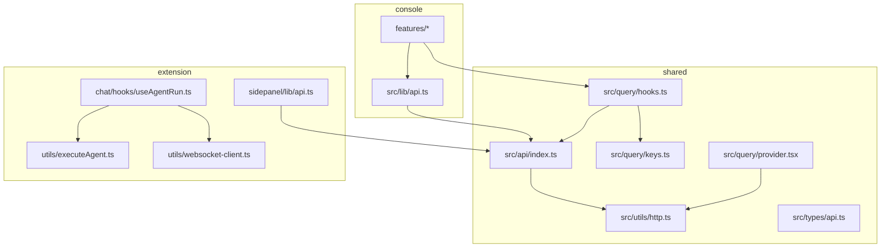
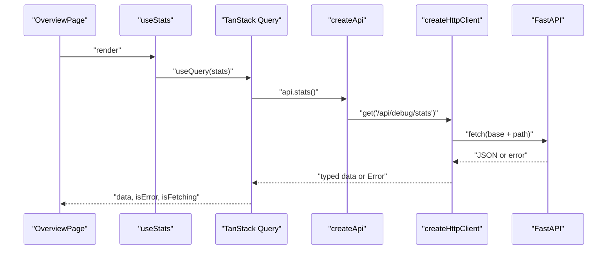
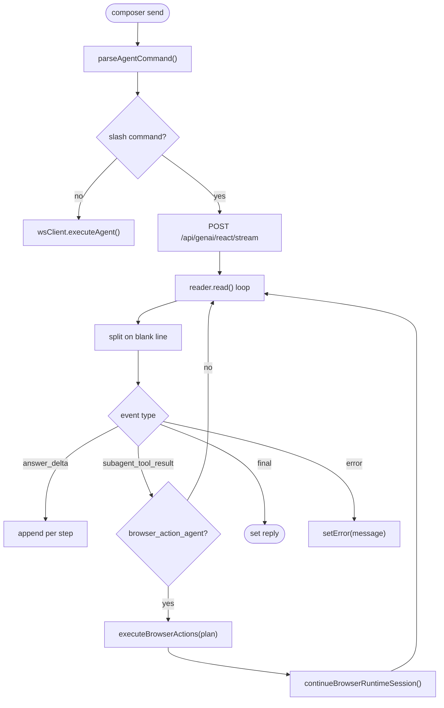
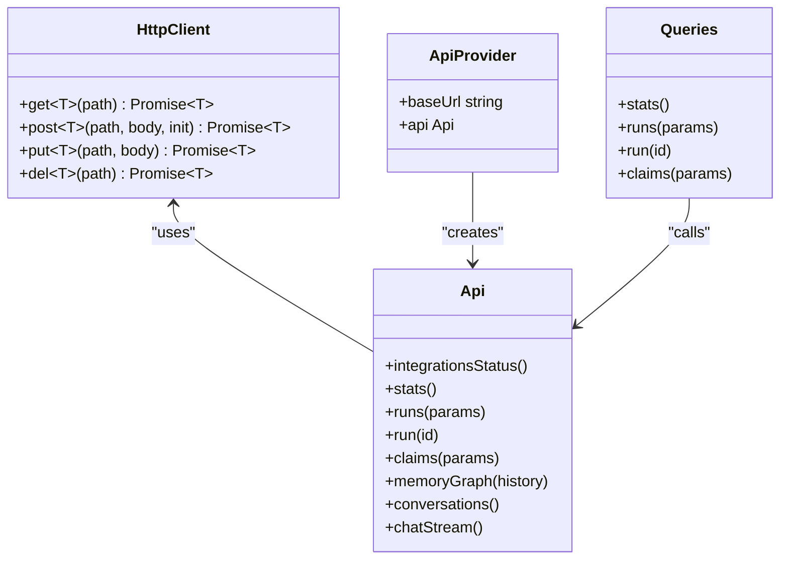
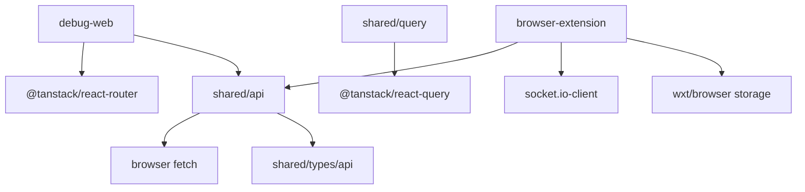

# API client libraries

There is no generated SDK. Two hand-written clients cover the backend: `clients/shared/src/utils/http.ts` is the fetch wrapper and endpoint catalog used by both the extension and the console, and `clients/debug-web/src/lib/api.ts` adds console-only memory ingestion and chat streaming. The extension also has a direct `executeAgent` module for streamed chat and browser runtime continuation.

The design keeps the base URL late-bound. Every client takes a resolver, so the extension can read `localStorage.baseUrl` per call and the console can inject its origin through React context.

Key capabilities:
- One typed API object for every route the clients use
- Base URL resolution per call
- JSON, multipart and form-encoded helpers
- Readable FastAPI error extraction
- TanStack Query keys scoped by base URL
- SSE consumption for chat and skills
- Browser runtime continuation in the extension

## Repository layout



## Building blocks

- `clients/shared/src/utils/http.ts`: `createHttpClient(resolveBaseUrl)` returns `get`, `post`, `put` and `del`; `createApi` returns roughly 70 endpoint functions. `readError` unwraps `detail` whether it is a string or an object.
- `clients/shared/src/api/index.ts`: re-exports types and the factory for `@agentic-browser/shared/api`.
- `clients/shared/src/types/api.ts`: response types for integrations, runs, claims, conversations, toolkits, runtimes, compaction, MCP and voice.
- `clients/shared/src/query/keys.ts`: keys shaped `["ab", base, ...]`, so caches never cross backends.
- `clients/shared/src/query/hooks.ts`: query option factories and hooks with polling intervals.
- `clients/shared/src/query/provider.tsx`: `ApiProvider` and `useApi()`.
- `clients/debug-web/src/lib/api.ts`: shared API plus profile ingestion, LinkedIn ingestion, `addMessage` and `chatStream`.
- `clients/browser-extension/entrypoints/sidepanel/lib/api.ts`: binds the shared API to `localStorage.baseUrl` or `http://localhost:5454`.
- `clients/browser-extension/entrypoints/utils/executeAgent.ts`: posts to `/api/genai/react/stream`, parses SSE, adds model headers, and drives runtime continuation.

## How it fits together

The console wraps its shell in `ApiProvider`, then pages call hooks. Hooks call the API object, which calls the fetch wrapper with the base URL from the provider.



The extension's chat path bypasses TanStack Query. `useAgentRun` calls `executeAgent`, which reads the SSE body with a `ReadableStream` reader and dispatches each `event:` / `data:` frame to a callback. When a frame contains a browser runtime step, the hook executes actions and calls `continueBrowserRuntimeSession` until the runtime is done.



## Error handling

`readError` tries JSON first. If `detail` is a string it returns it. If it is an object it prefers `detail.message`, then `detail.code`, then `JSON.stringify`. If the body is not JSON it returns raw text, and if that fails it returns `status statusText`.

The SSE path is different: HTTP errors throw with the server text, while in-stream failures arrive as an `error` event. The extension's `cleanError()` rewrites upstream HTML error pages into short messages.

There are no retries in the shared client. Polling hooks refetch on an interval, which acts as a soft retry for read paths.



## Endpoint groups

| Group | Examples | Consumer |
| --- | --- | --- |
| Integrations | `/api/integrations/status`, `/llm/model`, `/runtimes`, `/secrets/{name}` | console settings |
| MCP | `/api/mcp/settings`, `/api/mcp/restart` | console MCP section |
| Debug | `/api/debug/stats`, `/runs`, `/runs/{id}`, `/memory/graph` | console overview, runs, memory |
| Memory | `/api/memory/forget`, `/confirm/{id}`, `/ingest/profile` | console memory page |
| Conversations | `/api/conversations`, messages, runs, tool calls | console chat and run detail |
| Chat | `/api/genai/react/stream` | extension and console chat |
| Voice | `/api/voice/models`, `/transcribe`, `/speak` | side panel mic and read-aloud |
| Upload | `/api/upload/` and `/api/upload/files/{name}` | attachments |

## Base URL resolution

| Client | Resolver | Default |
| --- | --- | --- |
| Extension API object | `localStorage.getItem("baseUrl")` | `http://localhost:5454` |
| Extension executeAgent | `browser.storage.local.baseUrl` | `VITE_API_URL` or `http://localhost:5454` |
| Extension stream UI | `import.meta.env.VITE_API_URL` | `http://localhost:5454` |
| Console API object | `""` (same origin) | Vite dev proxy or page origin |
| Console chatStream | relative `/api/...` | same origin |

## Streaming details

`chatStream` in the console is a minimal parser:

```ts
const reader = res.body?.getReader();
const decoder = new TextDecoder();
let buffer = "";
while (true) {
  const { done, value } = await reader.read();
  if (done) break;
  buffer += decoder.decode(value, { stream: true });
  const lines = buffer.split("\n");
  buffer = lines.pop() || "";
  for (const line of lines) {
    if (line.startsWith("data: ")) onEvent?.(JSON.parse(line.slice(6)));
  }
}
```

It ignores partial JSON in a `try` block. The server sends `event: <name>\ndata: <json>\n\n`, so the event name is dropped here; consumers read `data.event`. The extension's `executeAgent` keeps both fields.

## Dependencies



## Performance

- Stats and runs poll every 4 seconds. Run detail polls every 1.5 seconds while running.
- Timeseries and claims use 30 second intervals.
- `keepPreviousData` on the runs list prevents table flicker while paging.
- Cache keys include the base URL, so switching backends does not serve stale rows.
- SSE streams token deltas; the extension groups them by model step.

## Troubleshooting

- Requests go to the wrong host: check `localStorage.baseUrl` and `VITE_API_URL`. The stream UI uses the build-time value; the API object reads storage.
- CORS error in the extension: the backend only allows extension schemes and localhost. A custom origin needs `CORS_ORIGINS`.
- `Unexpected end of JSON input`: an endpoint returned an empty body, often a 500 with no detail.
- Console requests hit the Vite server: no proxy is configured. Serve the console from the backend origin or add a proxy.
- Chat stream never fires `final`: the connection dropped or the generator raised. Check the run trace.
- `WebSocket not connected`: Socket.IO is disabled by default. Normal chat uses HTTP.
- Upload returns 400: the file type is rejected or the file exceeds 10 MB.

## Appendix

### Implementation examples
- Typed call: `api.runs({status: "failed", limit: 50})`.
- Error unwrap: `readError(new Response('{"detail":"goal is required"}'))`.
- SSE: `chatStream(question, conversationId, onEvent)`.
- Runtime: `continueBrowserRuntimeSession(response, onEvent)`.
- Keys: `queryKeys.runs(base, params)`.

### Source files
- `clients/shared/src/utils/http.ts`
- `clients/shared/src/api/index.ts`
- `clients/shared/src/types/api.ts`
- `clients/shared/src/query/hooks.ts`
- `clients/shared/src/query/keys.ts`
- `clients/shared/src/query/provider.tsx`
- `clients/debug-web/src/lib/api.ts`
- `clients/browser-extension/entrypoints/sidepanel/lib/api.ts`
- `clients/browser-extension/entrypoints/utils/executeAgent.ts`
- `clients/browser-extension/entrypoints/utils/websocket-client.ts`
