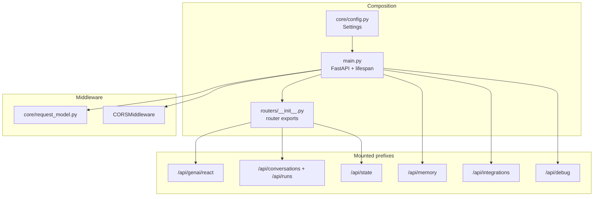
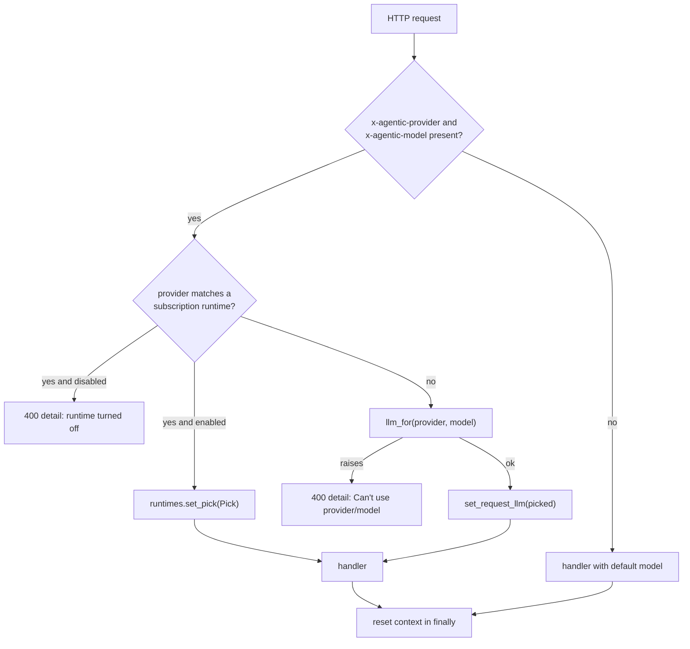
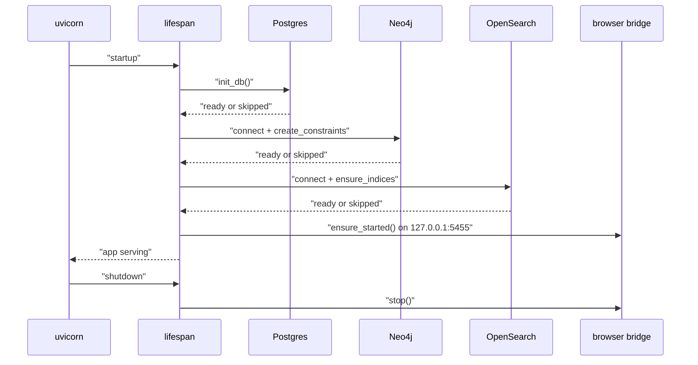
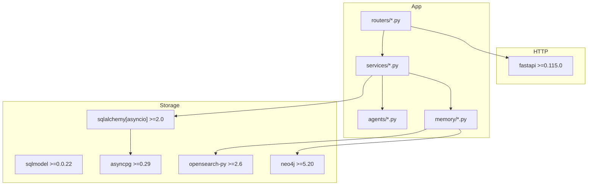

# API overview

The backend listens on `0.0.0.0:5454` by default (`main.py` `run()`, `core/config.py` `backend_port`). Every product route lives under `/api`, except `GET /`, which returns the app name and version. This page covers the conventions every route shares. The route groups themselves are documented on the child pages.

Key capabilities:
- One prefix per router, mounted in `main.py`
- Per-request provider and model selection through two headers
- `user_id` query scoping with a `"default"` fallback
- Consistent 400, 401, 404, 422 and 500 handling
- Server-sent events for streamed chat and streamed skill execution
- A browser-only CORS policy with an environment override

## Repository layout

`main.py` is the composition root. It builds the app, adds middleware, imports the routers from `routers/__init__.py`, plus `memory_router` and `mcp_settings_router`, and mounts each one.

The prefix table below is the full mount list from `main.py`. It is the fastest way to find which file owns a path.

| Prefix | Router module | Representative routes |
| --- | --- | --- |
| `/api/mcp` | `routers/mcp_settings.py` | `GET /settings`, `PUT /settings`, `POST /restart` |
| `/api/genai/health` | `routers/health.py` | `GET /` |
| `/api/genai/github` | `routers/github.py` | `POST /`, `POST /archive/{upload_id}` |
| `/api/genai/website` | `routers/website.py` | `POST /` |
| `/api/genai/youtube` | `routers/youtube.py` | `POST /` |
| `/api/google-search` | `routers/google_search.py` | `POST /` |
| `/api/gmail` | `routers/gmail.py` | `POST /unread`, `/latest`, `/mark_read`, `/send` |
| `/api/calendar` | `routers/calendar.py` | `POST /events`, `/create` |
| `/api/pyjiit` | `routers/pyjiit.py` | `POST /login`, `/semesters`, `/attendence` |
| `/api/genai/react` | `routers/react_agent.py` | `POST /`, `POST /stream` |
| `/api/validator` | `routers/website_validator.py` | `POST /validate-website` |
| `/api/agent` | `routers/browser_use.py` | `POST /generate-script` |
| `/api/upload` | `routers/file_upload.py` | `POST /`, `GET /files/{path}` |
| `/api/skills` | `routers/skills.py` | `GET /`, `POST /execute`, `POST /execute/stream` |
| `/api/auth` | `routers/auth.py` | Google and GitHub OAuth |
| `/api/state` | `routers/state.py` | sessions and key-value settings |
| `/api` | `routers/conversations.py` | conversations, runs, client context |
| `/api/voice` | `routers/voice.py` | speech to text and text to speech |
| `/api/memory` | `memory/api/router.py` | search, claims, graph, ingestion |
| `/api/browser/automation` | `routers/automation.py` | `POST /step` |
| `/api/browser/runtime` | `routers/browser_runtime.py` | `POST /start`, `POST /step` |
| `/api/debug` | `routers/debug.py` | stats, runs, memory inspection |
| `/api/integrations` | `routers/integrations.py` | LLM, secrets, Composio, runtimes |

## Building blocks

- `main.py`: `lifespan` connects Postgres, Neo4j and OpenSearch, starts the Telegram task and memory scheduler, and ensures the MCP bridge on `127.0.0.1:5455`. `run()` calls `uvicorn.run("main:app", host, port=5454, reload=True)`.
- `core/request_model.py`: `RequestModelMiddleware`, a plain ASGI middleware. It looks for `x-agentic-provider` and `x-agentic-model`, checks subscription runtimes first, then calls `llm_for(provider, model)` and binds the result with `set_request_llm`.
- `routers/react_agent.py`: `agent_bhai` for `POST /` and `agent_bhai_stream` for `POST /stream`. Both accept `CrawlerRequest` and resolve a Google token with `resolve_google_token_optional()`.
- `routers/conversations.py`: eleven routes for conversations, messages, client context and run traces.
- `models/requests/crawller.py`: `CrawlerRequest`, the chat input contract.
- `models/response/crawller.py`: `CrawllerResponse` with a single `answer` field.

## How it fits together

The middleware runs before routing. A bad model choice returns 400 without touching a handler. If both headers are absent the saved default model from `core/llm.py` is used, so existing clients keep working.

`RequestModelMiddleware` is added before CORS in `main.py` on purpose. CORS is the outer layer, so the 400 from the middleware still carries CORS headers and the extension can read the detail.

## Request conventions

- Identity is a `user_id` query parameter defaulting to `"default"` (`services/conversations.py`, `services/app_state.py`). There is no bearer auth on any route.
- Chat requests use `CrawlerRequest` on both the REST and stream endpoints. `question` is required. `chat_history`, `google_access_token`, `pyjiit_login_response`, `client_html`, `attached_file_path`, `conversation_id`, `client_id` and `client_context` are optional. The Google and PyJIIT fields accept legacy misspellings through `AliasChoices`.
- Model selection is per request. Send both `X-Agentic-Provider` and `X-Agentic-Model` to override the saved default. A single header is ignored.
- Uploads go through `/api/upload` and return `path` and `download_url`, which other routes accept as `attached_file_path`.
- Streaming routes return `text/event-stream` with `Cache-Control: no-cache`, `Connection: keep-alive` and `X-Accel-Buffering: no`.

## Errors

Validation errors are 422 from FastAPI. Handlers raise `HTTPException` for 400, 401, 404 and 500. Several routers catch broad exceptions and return 500 with `str(exc)` as the detail.

| Status | Typical cause |
| --- | --- |
| 400 | A required string is empty, a model header cannot be resolved, or a file type is rejected |
| 401 | A Google token is missing or needs reauth (`{"code": "needs_reauth", "provider": "google"}`) |
| 404 | A conversation, run, session or skill id does not exist |
| 413 | A GitHub archive upload exceeds 300 MB |
| 422 | The request body or a query bound failed Pydantic validation |
| 500 | An uncaught exception, often surfaced with its raw message |

Streaming failures are different. Once the SSE headers are sent the status is 200, and the error arrives as one `error` frame with `{"event": "error", "message": str(exc)}`.

## CORS

`CORSMiddleware` allows extension origins and localhost only:

- Regex: `^(chrome-extension|moz-extension)://[a-z0-9-]+$|^https?://(localhost|127\.0\.0\.1)(:\d+)?$`
- Extra origins: `CORS_ORIGINS` as a comma-separated list
- `allow_credentials=False`, all methods and all headers

`allow_origins` starts empty and only reads `CORS_ORIGINS`. A web page on a normal origin is rejected before it reaches a handler, which is what keeps a random site from reading or deleting memory through localhost.

## Startup and shutdown

`lifespan` is deliberately tolerant. A store that is down logs a warning and the app starts anyway.

The scheduler starts three consolidation jobs: hourly, nightly at 03:00, and weekly on Sunday at 04:00. A missing APScheduler install logs `Scheduler init skipped` and the HTTP routes still work.

## Dependencies

Routers depend on FastAPI and Pydantic at the edge, services in the middle, and SQLAlchemy or the memory clients at the bottom. Versions come from `pyproject.toml`.

## Performance

- The Postgres engine pool is 10 with `max_overflow=20` and `pool_pre_ping=True` (`core/db.py`).
- Each service method opens its own session, so there is no request-scoped session to reuse.
- Stream endpoints buffer events through an `asyncio.Queue` and one background task, so a slow client does not block the agent loop.
- Model header handling is per request and adds no round trip. The lookup is cached inside `core/llm.py`.

## Troubleshooting

- Browser call blocked by CORS: the page origin is not an extension scheme and not localhost. Add it to `CORS_ORIGINS`.
- A picked model is rejected with 400 before the handler runs: `llm_for(provider, model)` raised, or the subscription runtime is disabled. The body is `{"detail": "Can't use provider/model: ..."}`.
- A route returns 404 for a path in a router: prefix and decorator path are concatenated. `@router.post("/")` means the trailing slash is part of the URL.
- A handler returns 500 with a raw exception string: most routers catch `Exception` and use `str(exc)` as `detail`. Check the server log.
- `GET /` works but a path under `/api` 404s: check the mount prefix and the trailing slash. A reverse proxy that strips `/api` produces the same symptom.
- A streamed answer arrives all at once behind a proxy: SSE sets `X-Accel-Buffering: no` but a proxy can still buffer. Test against `127.0.0.1:5454` directly.

## Where to go next

Chat and skills live on [Agent system API](Agent%20System%20API), persistence on [Conversations and runs API](Conversations%20and%20Runs%20API), and browser planning on [Browser runtime API](Browser%20Runtime%20API). Settings are on [Integrations and settings API](Integrations%20and%20Settings%20API), OAuth on [Authentication and security](Authentication%20and%20Security), and the remaining tool routes on the pages listed in [API server](API%20Server).

## Appendix

### Implementation examples
- App factory: `FastAPI(title="Agentic Browser API", version="0.1.0", lifespan=lifespan)` in `main.py`, served by `run()` on port 5454.
- Model override: `RequestModelMiddleware.__call__` reads `PROVIDER_HEADER = b"x-agentic-provider"` and `MODEL_HEADER = b"x-agentic-model"` in `core/request_model.py`.
- SSE framing: `_sse_event` writes `event: <name>\ndata: <json>\n\n`.
- Default user: `DEFAULT_USER_ID = "default"` in `services/conversations.py` and `services/app_state.py`.
- Root route: `GET /` returns `{"name": app.title, "version": app.version}`.

### Source files
- `main.py`
- `core/request_model.py`
- `core/config.py`
- `routers/__init__.py`
