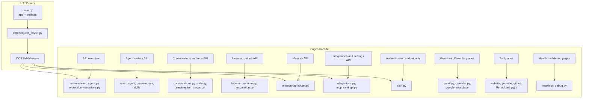
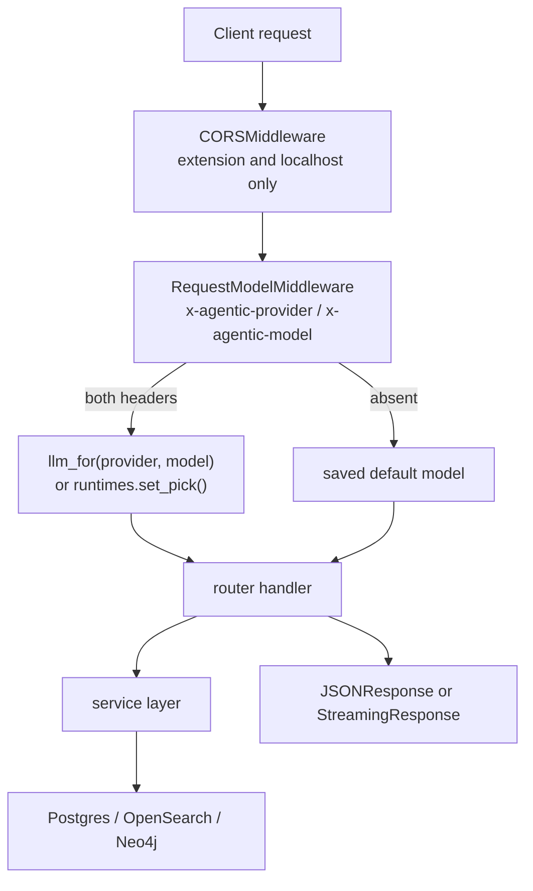
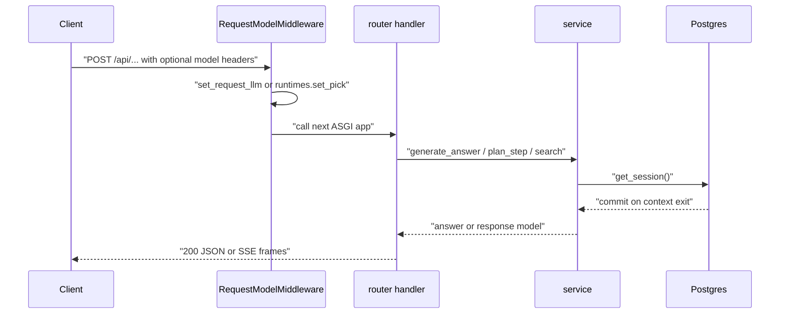
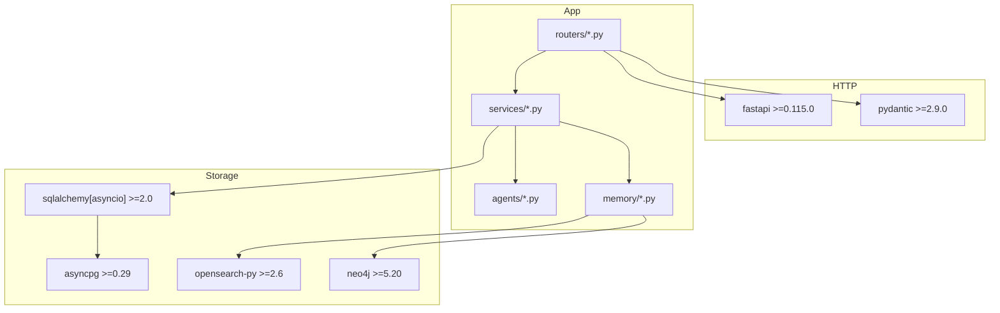

# API server

The backend is one FastAPI application built in `main.py`. Every route is a module in `routers/` (plus `memory/api/router.py` and `routers/mcp_settings.py`) mounted under an `/api/...` prefix. This folder documents those routes: method, path, request model, response shape, status codes and the handler that runs.

Start with [API overview](API%20Overview) for the conventions every route shares, then open the page for the route group you need.

Key capabilities:
- Ten route groups covering chat, conversations, browser runtime, memory, integrations, auth, Google Workspace, local tools, skills and the debug console
- A global middleware that can swap the model per request with two headers
- Server-sent events for streamed chat and streamed skill execution
- One error convention: `HTTPException` with a string or object `detail`
- No bearer auth, with identity carried by a `user_id` query parameter
- A browser-only CORS policy with an environment override

## Repository layout

`main.py` owns the app object, middleware order and `include_router` calls. Router modules declare paths relative to their mount prefix, so `/api/genai/react` plus `@router.post("/")` becomes `POST /api/genai/react/`.

The mount list is the fastest way to find which file owns a path.

| Prefix | Router module | Documented on |
| --- | --- | --- |
| `/api/genai/react` | `routers/react_agent.py` | [Agent system API](Agent%20System%20API) |
| `/api/agent` | `routers/browser_use.py` | [Agent system API](Agent%20System%20API) |
| `/api/skills` | `routers/skills.py` | [Agent system API](Agent%20System%20API) |
| `/api` | `routers/conversations.py` | [Conversations and runs API](Conversations%20and%20Runs%20API) |
| `/api/state` | `routers/state.py` | [Conversations and runs API](Conversations%20and%20Runs%20API) |
| `/api/browser/runtime` | `routers/browser_runtime.py` | [Browser runtime API](Browser%20Runtime%20API) |
| `/api/browser/automation` | `routers/automation.py` | [Browser runtime API](Browser%20Runtime%20API) |
| `/api/memory` | `memory/api/router.py` | [Memory API](Memory%20API) |
| `/api/integrations` | `routers/integrations.py` | [Integrations and settings API](Integrations%20and%20Settings%20API) |
| `/api/mcp` | `routers/mcp_settings.py` | [Integrations and settings API](Integrations%20and%20Settings%20API) |
| `/api/auth` | `routers/auth.py` | [Authentication and security](Authentication%20and%20Security) |
| `/api/gmail` | `routers/gmail.py` | [Gmail integration API](Gmail%20Integration%20API) |
| `/api/calendar` | `routers/calendar.py` | [Calendar integration API](Calendar%20Integration%20API) |
| `/api/google-search` | `routers/google_search.py` | [Search integration API](Search%20Integration%20API) |
| `/api/genai/github` | `routers/github.py` | [GitHub integration API](GitHub%20Integration%20API) |
| `/api/genai/youtube` | `routers/youtube.py` | [YouTube integration API](YouTube%20Integration%20API) |
| `/api/genai/website` | `routers/website.py` | [Website processing API](Website%20Processing%20API) |
| `/api/validator` | `routers/website_validator.py` | [Website processing API](Website%20Processing%20API) |
| `/api/pyjiit` | `routers/pyjiit.py` | [Academic portal API](Academic%20Portal%20API) |
| `/api/upload` | `routers/file_upload.py` | [File upload API](File%20Upload%20API) |
| `/api/genai/health` | `routers/health.py` | [Health and monitoring API](Health%20and%20Monitoring%20API) |
| `/api/debug` | `routers/debug.py` | [Debug and observability API](Debug%20and%20Observability%20API) |
| `/api/voice` | `routers/voice.py` | settings via [Integrations and settings API](Integrations%20and%20Settings%20API) |
| `/` | `main.py` | [API overview](API%20Overview) |

## Pages

| Page | What it covers |
| --- | --- |
| [API overview](API%20Overview) | base URL, 23 mounts, model headers, errors, CORS, startup, SSE conventions |
| [Agent system API](Agent%20System%20API) | chat, SSE stream, runner selection, script generation, skills |
| [Conversations and runs API](Conversations%20and%20Runs%20API) | conversations, messages, run traces, client context, key-value state |
| [Browser runtime API](Browser%20Runtime%20API) | one planned action per step, session lifecycle, blockers, loop guard |
| [Memory API](Memory%20API) | search, context, tools, claims, graph, feedback, ingestion, maintenance |
| [Integrations and settings API](Integrations%20and%20Settings%20API) | LLM defaults, secrets, Composio, OAuth clients, runtimes, MCP, infra |
| [Authentication and security](Authentication%20and%20Security) | Google and GitHub code exchange, encrypted token store, refresh, status, CORS posture |
| [Gmail integration API](Gmail%20Integration%20API) | unread, latest, mark read, send |
| [Calendar integration API](Calendar%20Integration%20API) | list upcoming events, create an event |
| [Search integration API](Search%20Integration%20API) | server-side web search through the Tavily pipeline |
| [GitHub integration API](GitHub%20Integration%20API) | repo agent, clone cache, private archive upload, read-only shell |
| [YouTube integration API](YouTube%20Integration%20API) | transcript fetch, cleanup, question answering, attachments |
| [Website processing API](Website%20Processing%20API) | page question answering and prompt injection validation |
| [Academic portal API](Academic%20Portal%20API) | PyJIIT login, semesters, attendance, wrapper surface |
| [File upload API](File%20Upload%20API) | multipart upload, download guard, attachment loading and limits |
| [Health and monitoring API](Health%20and%20Monitoring%20API) | static health route, startup checks, infra probe, other probes |
| [Debug and observability API](Debug%20and%20Observability%20API) | stats, timeseries, run detail, memory inspection, maintenance history |

## Shared concepts

Every router uses the same moving parts, so the child pages assume them.

- **Prefix mounting.** `main.py` calls `app.include_router(router, prefix=...)` once per module. `browser_use_router` is exported a second time as `agent_router` for `/api/agent`.
- **No bearer auth.** Identity is a `user_id` query parameter defaulting to `"default"` (`services/conversations.py`, `services/app_state.py`). OAuth tokens are resolved server side from `browser_credentials`.
- **Per-request model.** `RequestModelMiddleware` reads `X-Agentic-Provider` and `X-Agentic-Model` and binds the picked model with `set_request_llm` for the request, including streamed bodies.
- **Errors.** Validation errors are 422 from FastAPI. Handlers raise `HTTPException` for 400, 401, 404 and 500. Several routers catch broad exceptions and return 500 with `str(exc)`.
- **Streaming.** Chat and skill execution return `text/event-stream` with `Cache-Control: no-cache`, `Connection: keep-alive` and `X-Accel-Buffering: no`.

## How it fits together

The request model middleware is added before CORS so CORS wraps it and its 400 responses still carry CORS headers.

Handlers stay thin. They validate one or two fields, resolve an optional Google token with `resolve_google_token_optional()`, and delegate to a service. The service owns the database session, the agent call and the trace writes.

## Reading paths

- New to the backend: [API overview](API%20Overview), then [Agent system API](Agent%20System%20API) and [Conversations and runs API](Conversations%20and%20Runs%20API).
- Building a browser client: [Browser runtime API](Browser%20Runtime%20API) for the step loop, [Agent system API](Agent%20System%20API) for chat.
- Wiring a provider: [Integrations and settings API](Integrations%20and%20Settings%20API) for keys and default models, [Authentication and security](Authentication%20and%20Security) for OAuth.
- Adding a tool: start from the page for the closest existing route, then follow the service and tool files listed in its appendix.

## Dependencies

Versions come from `pyproject.toml`. Provider SDKs (`langchain-openai`, `langchain-anthropic`, `langchain-google-genai`, `langchain-ollama`) sit behind `core/llm.py`, so a router never imports one directly.

## Troubleshooting

- A whole prefix 404s: check the mount table and the trailing slash. A reverse proxy that strips `/api` produces the same symptom.
- Browser call blocked by CORS: the page origin is not an extension scheme and not localhost. Add it to `CORS_ORIGINS`.
- A model header is ignored: both `X-Agentic-Provider` and `X-Agentic-Model` are required. One header alone falls back to the saved default.
- A request returns 500 with a raw exception string: most routers catch `Exception` and use `str(exc)`. Check the server log for the traceback.
- A streamed answer arrives all at once behind a proxy: SSE sets `X-Accel-Buffering: no`, but a proxy can still buffer. Test against `127.0.0.1:5454` directly.
- Health is 200 but chat fails: the process is alive while a store or model is down. Use [Health and monitoring API](Health%20and%20Monitoring%20API) and [Debug and observability API](Debug%20and%20Observability%20API).
- A run id from chat 404s in the console: the run row was never created, so the `conversation` SSE frame carried no id. Fall back to the conversation routes.

## Appendix

### Implementation examples
- App factory: `FastAPI(title="Agentic Browser API", version="0.1.0", lifespan=lifespan)` in `main.py`, served by `run()` on port 5454.
- Middleware order: `app.add_middleware(RequestModelMiddleware)` before `app.add_middleware(CORSMiddleware, ...)`.
- CORS regex: `^(chrome-extension|moz-extension)://[a-z0-9-]+$|^https?://(localhost|127\.0\.0\.1)(:\d+)?$`.
- Default user: `DEFAULT_USER_ID = "default"` in `services/conversations.py` and `services/app_state.py`.
- Root route: `GET /` returns `{"name": app.title, "version": app.version}`.

### Source files
- `main.py`
- `routers/__init__.py`
- `core/request_model.py`
- `core/config.py`
