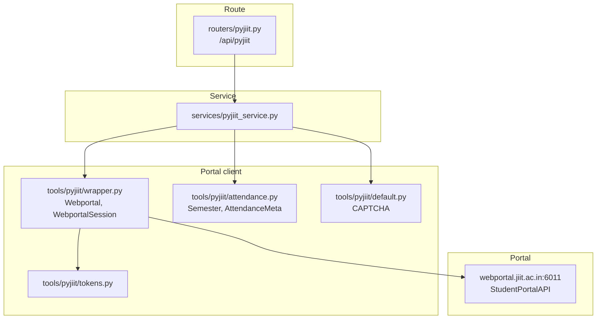
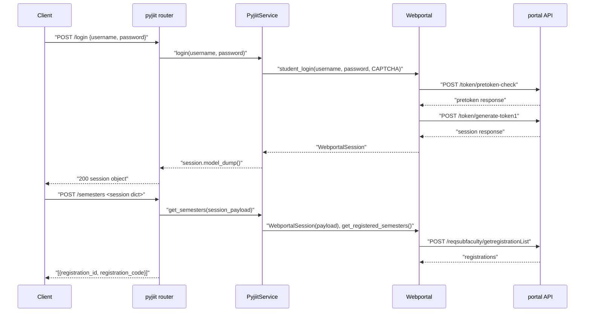
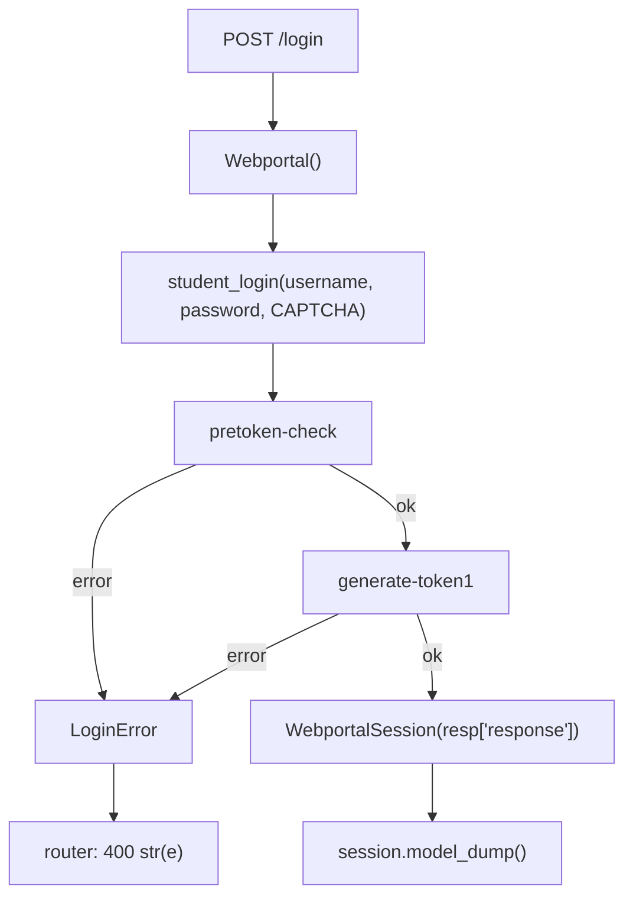
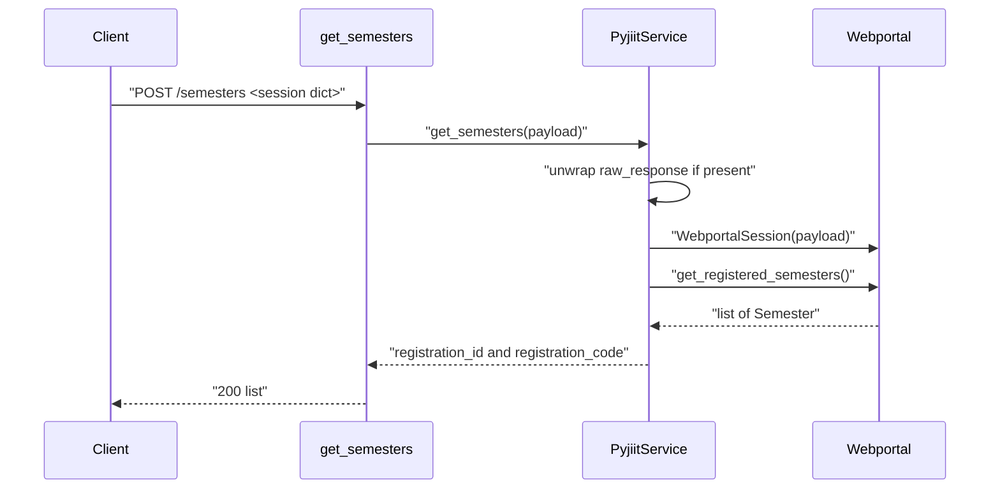
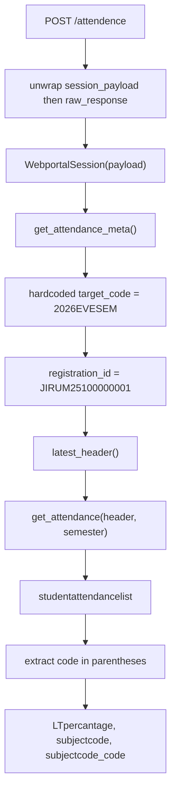
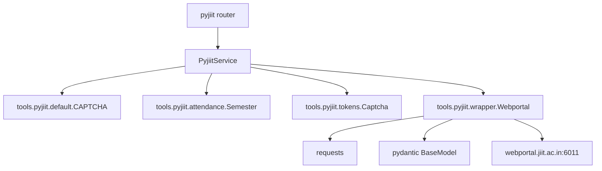

# Academic portal API

The academic portal routes proxy the JIIT Webportal. They log in with a username and password, list the registered semesters for that session, and fetch attendance for a fixed semester. The routes are mounted at `/api/pyjiit` from `routers/pyjiit.py`, and the HTTP client is `tools/pyjiit/wrapper.py`.

The portal is a third-party service at `https://webportal.jiit.ac.in:6011/StudentPortalAPI`. There is no OAuth and no API key. The session is a token plus a set of registration fields returned by the login call.

Key capabilities:
- Two-step portal login with a bundled sample captcha
- A typed `WebportalSession` built from the login response
- Registered semester listing
- Attendance for the hardcoded `2026EVESEM` semester
- A wrapper that also exposes exams, marks, grade cards, fees and subject choices, even though no route calls them

## Repository layout

## Building blocks

- `routers/pyjiit.py`: `BasicAuthRequest`, `SemesterReq`, `AttendanceReq`, `get_pyjiit_service`, and three handlers: `login`, `get_semesters`, `attendence`.
- `services/pyjiit_service.py`: `PyjiitService.login`, `get_semesters`, `get_attendance`.
- `tools/pyjiit/wrapper.py`: `WebportalSession`, `Webportal`, `authenticated`, and the endpoint methods.
- `tools/pyjiit/attendance.py`: `AttendanceHeader`, `Semester`, `AttendanceMeta`.
- `tools/pyjiit/default.py`: `CAPTCHA`, a sample `Captcha` with `captcha`, `hidden` and `image` fields.
- `tools/pyjiit/tokens.py`: `Captcha`.

Request models as declared:

| Model | Fields | Used by |
| --- | --- | --- |
| `BasicAuthRequest` | `username`, `password` | `/login` |
| `SemesterReq` | `username`, `password`, `registration_id`, `registration_code` | declared, not used by a route |
| `AttendanceReq` | `session_payload`, `registration_code` | declared, not used by a route |

`/semesters` and `/attendence` take a bare `Dict[str, Any]` body, not a named model, because they forward whatever login returned. `AttendanceReq` documents the intended shape but the handler does not use it.

## How it fits together

`PyjiitService` owns the wrapper calls. The route handlers stay thin and translate exceptions into HTTP status codes.

## Login

`POST /api/pyjiit/login` takes `{"username": "...", "password": "..."}`.

`PyjiitService.login` builds `Webportal()`, calls `student_login(username, password, DEFAULT_CAPTCHA)`, and returns `session.model_dump()`. Login failures return 400, not 500, and the detail is `str(e)`. The service logs the exception first.

`Webportal.student_login` makes two portal calls:

1. `POST /token/pretoken-check` with a serialized payload of `username`, `usertype: "S"` and the captcha payload.
2. `POST /token/generate-token1` with the response from step 1, `Modulename: "STUDENTMODULE"` and `passwordotpvalue` set to the password.

The second response becomes the `WebportalSession`. The session model requires `raw_response`, `regdata`, `institute`, `instituteid`, `memberid`, `userid`, `token`, `expiry`, `clientid`, `membertype` and `name`. The constructor reads `regdata["institutelist"][0]`, `regdata["token"]`, `regdata["memberid"]` and the optional identity fields.

`expiry` is decoded from the token's JWT payload `exp` claim. If the token is not shaped like a JWT, the expiry falls back to `datetime.now()`. `get_headers()` returns `Authorization: Bearer <token>` plus a generated `LocalName`.

The captcha is the sample `CAPTCHA` from `tools/pyjiit/default.py`. There is no captcha fetch or solve step on the login route, so a portal that starts rejecting the sample will reject the login.

## Semesters

`POST /api/pyjiit/semesters` takes the login session as the request body. It is a bare object, not wrapped in a key.

`PyjiitService.get_semesters` unwraps a `raw_response` key when present, builds `WebportalSession(payload)`, creates `Webportal(session=session)`, and calls `get_registered_semesters()`. The wrapper posts `instituteid` and `studentid` to `/reqsubfaculty/getregistrationList` and maps each row with `Semester.from_json`, which reads `registrationid` and `registrationcode`.

The route returns a list of `{"registration_id": ..., "registration_code": ...}`. A failure returns 500 with `str(e)`.

## Attendance

`POST /api/pyjiit/attendence` takes the session as the request body and an optional `registration_code` query parameter. The route name is spelled `/attendence` on purpose. The router docstring says it matches the user's spelling.

The service accepts either a bare session dict, a `{"session_payload": {...}}` wrapper, or a dict with `raw_response`. It builds `WebportalSession`, calls `get_attendance_meta()` to get the header list and semester list, and then ignores the requested registration code.

The current implementation always uses `target_code = "2026EVESEM"` and looks up `JIRUM25100000001` in a hardcoded map. It builds a `Semester`, takes `meta.latest_header()` (the first header), and calls `get_attendance(header, semester)`.

The portal response is `{"currentSem": ..., "studentattendancelist": [...]}`. The service keeps three fields per row:

| Field | Source |
| --- | --- |
| `LTpercantage` | `item["LTpercantage"]` |
| `subjectcode` | subject name with the trailing `(CODE)` removed |
| `subjectcode_code` | the code inside the trailing parentheses |

The misspelled `LTpercantage` comes from the portal and is passed through unchanged.

## Error handling

| Endpoint | Failure status | Detail |
| --- | --- | --- |
| `/login` | 400 | `str(e)` from the login error |
| `/semesters` | 500 | `str(e)` from the session or portal call |
| `/attendence` | 500 | `str(e)` from the session, meta or attendance call |
| any | 422 | Body does not match the expected shape |

## Dependencies

External packages: `fastapi>=0.115.0`, `pydantic>=2.9.0` and `requests>=2.32.3`.

The wrapper methods outside these three routes have no HTTP surface. They cover student bank info, captcha fetch, registered subjects, exam events and schedules, marks, grade cards and SGPA, fees, fines and subject choices.

## Performance

- `/login` performs a live portal login on every call. There is no session cache in the router.
- `/semesters` and `/attendence` rebuild a `WebportalSession` from the posted payload, so they do not need a server-side session store.
- Each route makes at least one portal HTTP call. Attendance makes two: metadata and the attendance detail.
- Portal calls use the `requests` defaults in `Webportal.__hit`. There is no explicit timeout in the wrapper, so a hung portal can hold the request open.
- Portal calls are synchronous inside async handlers, so they occupy the event loop while they run.

## Troubleshooting

- `/login` returns 400 with a captcha or login error: the sample captcha was rejected or the credentials are wrong. The route cannot fetch a fresh captcha.
- `/semesters` returns 500 with a session error: the login response was wrapped differently. The service unwraps a `raw_response` key if present, so pass either the full `/login` response or that raw dict.
- `/attendence` ignores the `registration_code` query: the service hardcodes `2026EVESEM`. The query parameter is accepted but not read.
- Attendance returns an empty list: the portal response had no `studentattendancelist`, or the latest header did not match the hardcoded semester.
- A `KeyError: 'regdata'` or `KeyError: 'institutelist'`: the payload is not a login response. Pass the object returned by `/login`.
- `NotLoggedIn` from the wrapper: `Webportal` was constructed without a session and an authenticated method was called.
- The token expiry looks wrong: `WebportalSession` decodes the JWT `exp` claim and falls back to now when decoding fails. The wrapper disables the expiry check because the portal returns wrong expiry times.

## Appendix

### Implementation examples
- Login: `Webportal().student_login(username, password, DEFAULT_CAPTCHA)`.
- Session dump: `session.model_dump()` in `PyjiitService.login`.
- Semester mapping: `{"registration_id": s.registration_id, "registration_code": s.registration_code}`.
- Attendance target: `target_code = "2026EVESEM"` and `registration_id = "JIRUM25100000001"`.
- Subject split: `re.search(r"\(([^)]+)\)\s*$", subj)` then `re.sub(r"\s*\([^)]*\)\s*$", "", subj)`.
- Auth header: `{"Authorization": f"Bearer {self.token}", "LocalName": generate_local_name()}`.

### Source files
- `routers/pyjiit.py`
- `services/pyjiit_service.py`
- `tools/pyjiit/wrapper.py`
- `tools/pyjiit/attendance.py`
- `tools/pyjiit/default.py`
