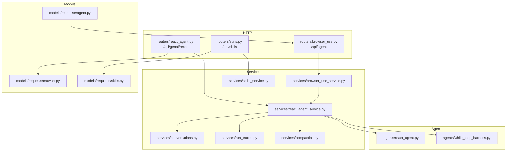
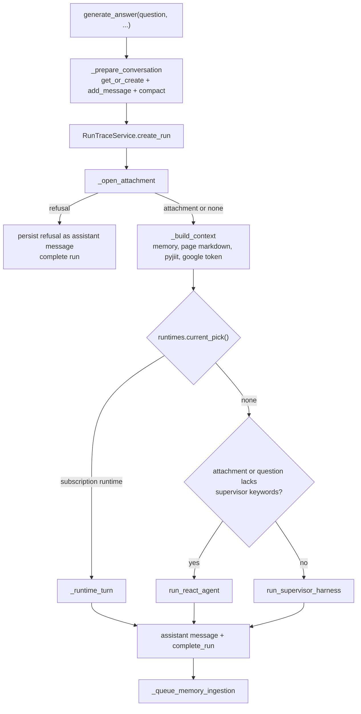
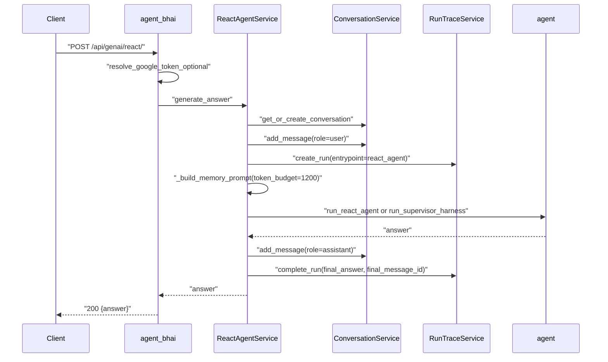
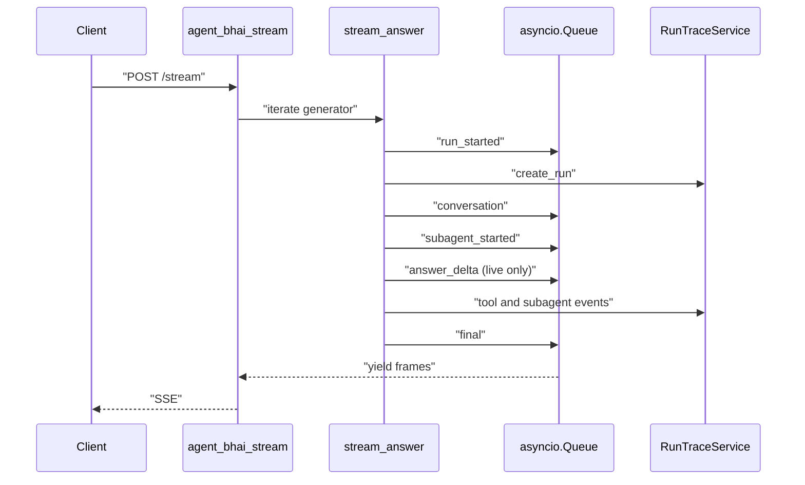

# Agent system API

These routes turn a user question into an agent run. The chat route accepts a question plus optional page HTML and attachments, picks a planner (subscription runtime, ReAct agent or supervisor harness), records the run, and returns an answer either as JSON or as a stream of SSE frames.

Chat is mounted at `/api/genai/react`, script generation at `/api/agent`, and skills at `/api/skills`. Conversation and run records are documented on [Conversations and runs API](Conversations%20and%20Runs%20API). One-step planning is documented on [Browser runtime API](Browser%20Runtime%20API).

Key capabilities:
- REST and SSE chat with the same request model
- Model choice per request, including subscription runtimes
- Prompt construction with durable memory, compaction summaries and page markdown
- Run trace creation, assistant message persistence and post-turn memory ingestion
- Skill execution that wraps a `SKILL.md` in an agent prompt
- Script generation that returns one planned browser action

## Repository layout

## Building blocks

- `routers/react_agent.py`: `agent_bhai` (`POST /`) and `agent_bhai_stream` (`POST /stream`), plus `_sse_event`. The service is injected through `get_react_agent_service`.
- `models/requests/crawller.py`: `CrawlerRequest` with `question`, `chat_history`, `google_access_token`, `pyjiit_login_response`, `client_html`, `attached_file_path`, `conversation_id`, `client_id` and `client_context`. The Google and PyJIIT fields accept legacy misspellings through `AliasChoices`.
- `models/response/crawller.py`: `CrawllerResponse`, one field `answer`.
- `services/react_agent_service.py`: the orchestration layer. `generate_answer` returns a string. `stream_answer` is an async generator of event dicts.
- `routers/browser_use.py`: `generate_script`, which validates `goal` and calls `AgentService.generate_script`.
- `services/browser_use_service.py`: builds a `PageSnapshot` from posted DOM data, calls `BrowserRuntimeService.start_session` with `max_steps=8`, and returns `ok`, `message`, `reason`, `runtime_step` and `action_plan`.
- `routers/skills.py`: `get_skills`, `execute_skill`, `execute_skill_stream` and `_build_skill_execution_prompt`.
- `services/skills_service.py`: `list_all_skills`, `get_skill_content_by_name`, `get_skill_metadata_by_name`. Skills are read from `skills/` and `.agents/skills`, one folder per skill with a `SKILL.md` and optional YAML frontmatter.

## How it fits together

`generate_answer` does five things in order: prepare the conversation and trace, open any attachment, assemble context, pick a runner, then persist the answer and queue memory ingestion. The runner choice is the branch that matters.

The supervisor decision is a regex, not a classifier. `_SUPERVISOR_REQUEST_RE` matches words such as `browse`, `click`, `navigate`, `open`, `fill`, `plan`, `subagent`, `workflow`, `multi-step` and `use the page`. A question with none of those goes to the ReAct agent. An attachment also forces the ReAct path because the supervisor passes plain text between subagents.

On an exception inside `generate_answer`, the service logs, marks the run failed with `complete_run(status="failed", error=...)` when a trace exists, and returns the fixed string `I apologize, but I encountered an error processing your question. Please try again.` The HTTP status is still 200.

## Chat endpoints

### POST /api/genai/react/

Handler `agent_bhai`. Auth: none. Google access is resolved server side. Body: `CrawlerRequest`. Response: `CrawllerResponse`.

| Field | Notes |
| --- | --- |
| `question` | required; empty string returns 400 `question is required` |
| `chat_history`, `client_html`, `attached_file_path` | optional transcript, raw page HTML and uploaded file path |
| `google_access_token`, `pyjiit_login_response` | optional; the legacy misspellings `google_acces_token` and `pyjiit_login_responce` are accepted |
| `conversation_id`, `client_context` | server creates a conversation when the id is omitted; context is stored as a snapshot |
| `client_id` | default `browser-extension`, stored on messages and runs |

Statuses: 200 for a string answer, 400 when `question` is empty, 422 for a body mismatch, 500 when the service catch is escaped. `chat_history` is ignored when the server has stored history for the conversation.

### POST /api/genai/react/stream

Handler `agent_bhai_stream`. Same body, returns `text/event-stream`. The route validates `question` before the generator starts, so an empty question is a real 400. Errors after that point arrive as an `error` frame.

`_sse_event(event_name, payload)` writes `event: <name>` plus `data: <json>` and a blank line, so a delta frame is `event: answer_delta` with `{"event": "answer_delta", "delta": "..."}`.

The stream emits `conversation` early with `conversation_id`, `run_id` and `title`, so the client can switch from a local placeholder session to the server id. Answer text is emitted per model step as `answer_delta`. Step text is joined with blank lines into the final answer. Token-level deltas are sent to the client but not written to the trace.

Event names produced by `ReactAgentService.stream_answer` and the agents behind it: `run_started`, `conversation`, `compaction`, `subagent_started`, `thinking_delta`, `answer_delta`, `subagent_completed`, `tool_started` and related tool events, `final`, and `error`.

Streaming failure handling is inside the generator. Any exception becomes one `error` frame with `{"event": "error", "message": str(exc)}`, and the HTTP status stays 200 because headers were already sent.

## Script endpoint

### POST /api/agent/generate-script

Handler `generate_script` in `routers/browser_use.py`. Body `GenerateScriptRequest`: `goal` (required), `target_url`, `dom_structure`, `constraints`. Response `GenerateScriptResponse`:

- `ok`: `step.status != "failed"`.
- `action_plan`: `{"actions": [action]}` when a step action exists.
- `runtime_step`: the full `BrowserRuntimeStepResponse` dump.
- `message`, `reason` and `error`: planner text, guard reason and caught service error.
- `problems` and `raw_response`: declared but not populated by this path.

Status codes: 200 for a step, including a blocked step and a caught service error. 400 when `goal` is missing, 422 for a body mismatch, 500 when the route itself raises.

The service builds a `PageSnapshot` with `build_page_snapshot_from_dom`, starts a runtime session with `max_steps=8`, and stores `target_url`, `constraints` and `source: "generate_script_api"` in the session context. `ok` only reflects `status != "failed"`, so a blocked step still returns `ok: true`.

## Skills endpoints

| Method | Path | Handler | Body | Response |
| --- | --- | --- | --- | --- |
| GET | `/api/skills/` | `get_skills` | none | `{"skills": [{id, name, description}]}` |
| POST | `/api/skills/execute` | `execute_skill` | `ExecuteSkillRequest` | `{"answer": str}` |
| POST | `/api/skills/execute/stream` | `execute_skill_stream` | `ExecuteSkillRequest` | SSE frames |

`ExecuteSkillRequest` fields: `skill_name`, `prompt`, `chat_history`, `google_access_token`, `pyjiit_login_response`, `client_html`, `attached_file_path`, `conversation_id`, `client_id` (default `browser-extension`) and `client_context`.

Skill discovery scans `skills/` and `.agents/skills`, takes folders that contain `SKILL.md`, and reads optional YAML frontmatter for `name` and `description`. The folder name is the id. The first directory in the list wins for duplicate ids because `list_all_skills` keeps a `seen_ids` set.

Execution builds one prompt: the `SKILL.md` body between `=== SKILL INSTRUCTIONS START ===` and `=== SKILL INSTRUCTIONS END ===`, execution notes naming the skill directory and `uploads/generated` as the output folder, then the user's prompt. That combined text is passed to `ReactAgentService.generate_answer` as the question.

Status codes: 404 when the skill name is unknown (`Skill '<name>' not found.`), 500 on any other failure. The list route returns 500 `Failed to list skills.` if the directory scan raises.

## Dependencies

The chat service sits on `core/llm.py` for the model client, `agents/react_agent.py` and `agents/while_loop_harness.py` for the two runners, `memory/service.py` and `memory/retrieval/context_assembler.py` for recall, `services/attachments.py`, `services/compaction.py`, `core/runtimes.py` and `services/run_traces.py`. Script generation goes through `BrowserRuntimeService`. Skills read `skills/` and `.agents/skills`. Traces land in Postgres.

External packages used directly here: `fastapi>=0.115.0`, `pydantic>=2.9.0`, `langchain-core` through the agent modules, and `sqlalchemy[asyncio]>=2.0` below the trace service.

## Performance

- `_build_memory_prompt` uses a 1200 token budget. Memory retrieval failures are logged and skipped, so chat still runs without memory.
- The history load reads up to `max_history` messages, default 400, from compaction settings, then `compact_history` replaces older turns with a summary message whose role is `compaction.SUMMARY_ROLE`.
- `client_html` is converted to markdown and truncated to 12,000 characters before it enters a prompt.
- Post-turn ingestion runs in a fire-and-forget task held in `_BACKGROUND_TASKS` so the event loop cannot garbage collect it. It retries once after `asyncio.sleep(15)` when extraction fails.
- The stream uses one queue and one background task. Cancelling the client cancels the producer task.
- Script generation and the automation route both cap a runtime session at 8 steps. The runtime service itself has no step cap when called directly.

## Troubleshooting

- A browser request is answered by the plain ReAct agent: the question did not match `_SUPERVISOR_REQUEST_RE`, or it carried an attachment, which forces the direct path.
- The answer ignores the current page: page HTML only enters the prompt through `client_html`. For the direct ReAct path it is added to the question content only when the supervisor regex matches, and separately as `client_markdown` in the context.
- `generate_answer` returns the apology string and the run is marked failed: read the run's `error` column through `GET /api/runs/{run_id}`.
- Skill execution writes files to the wrong place: the prompt tells the model to save under `uploads/generated` and cite `/api/upload/files/generated/<filename>`. The directory is created by `routers/file_upload.py` at import time.
- A skill is listed but `execute` returns 404: lookup matches the frontmatter `name` or the folder id case-insensitively. A renamed folder with a stale frontmatter name needs one of the two to match exactly.
- `/api/agent/generate-script` always returns `ok: true` with a blocked message: `ok` only reflects `status != "failed"`, and `blocked` counts as not failed.
- History sent by the client is ignored: once a conversation id exists, `generate_answer` and `stream_answer` use `server_history` from Postgres and only fall back to `chat_history` when the server has none.

## Appendix

### Implementation examples
- Chat entry: `agent_bhai` calls `service.generate_answer(...)` with nine keyword arguments and wraps the string in `CrawllerResponse`.
- Runner selection: `ReactAgentService._should_use_supervisor_harness` uses `_SUPERVISOR_REQUEST_RE`.
- Runtime pick: `runtimes.current_pick()` returns a `Pick(runtime, model)` bound by `RequestModelMiddleware`.
- Skill prompt: `_build_skill_execution_prompt` in `routers/skills.py`.
- Script bridge: `AgentService.generate_script` maps `dom_structure` and `constraints` onto a runtime start request.

### Source files
- `routers/react_agent.py`
- `routers/browser_use.py`
- `routers/skills.py`
- `models/requests/crawller.py`
- `models/response/crawller.py`
- `services/react_agent_service.py`
- `services/browser_use_service.py`
