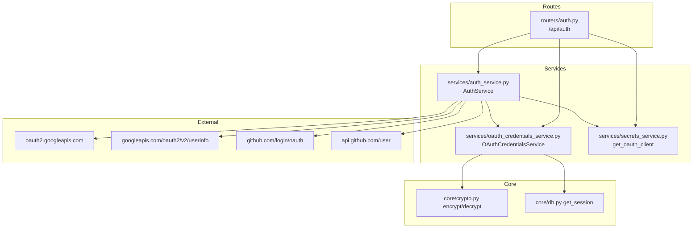
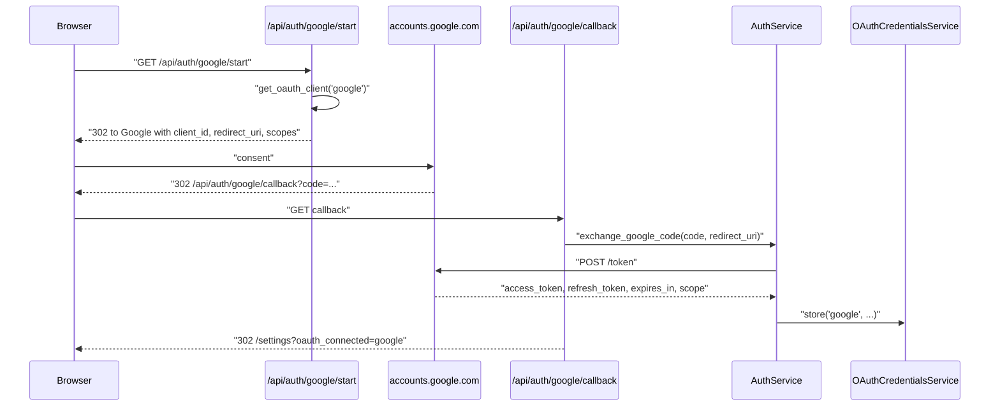
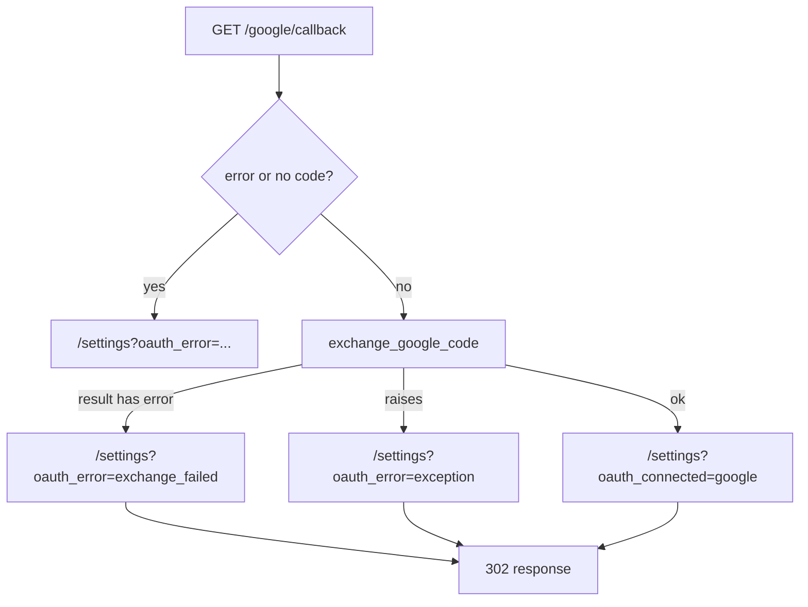
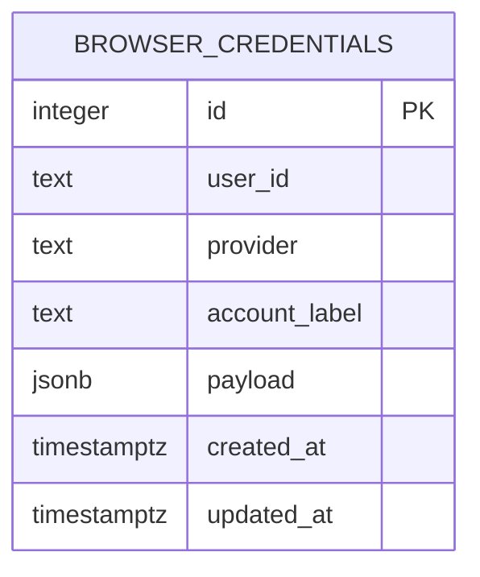

# Authentication and security

The auth router has two jobs. It completes OAuth code exchanges for Google and GitHub, and it owns the browser-driven connect flow that redirects back to the console settings page. It is mounted at `/api/auth` from `routers/auth.py`.

Tokens are not returned to API clients after connection. `AuthService` stores them encrypted in `browser_credentials`, and `OAuthCredentialsService` hands a valid access token to the rest of the backend, refreshing Google tokens when they are close to expiry.

Key capabilities:
- Google authorization code exchange with scopes for Gmail, Calendar and YouTube
- GitHub authorization code exchange with `read:user`, `user:email` and `repo`
- Server-side Google token refresh
- Connection status, listing and disconnect
- Browser redirect flow with `oauth_connected` and `oauth_error` outcomes
- No bearer auth on API routes, and a CORS policy limited to the extension and localhost

## Repository layout



## Building blocks

- `routers/auth.py`: eleven routes, module-level `auth_service = AuthService()` and `creds = get_oauth_credentials_service()`, plus `_redirect_uri`.
- `services/auth_service.py`: `exchange_google_code`, `refresh_google_token`, `exchange_github_code`, and credential lookup through `SecretsService.get_oauth_client`.
- `services/oauth_credentials_service.py`: `store`, `status`, `list_all`, `delete`, `get_access_token`, `_is_expired`, `_refresh_google`, `_public`, plus `NeedsReauth` and `resolve_google_token_optional`.

Scopes are fixed in the router:

- `GOOGLE_SCOPES`: `openid`, `email`, `profile`, `https://www.googleapis.com/auth/gmail.readonly`, `https://www.googleapis.com/auth/gmail.send`, `https://www.googleapis.com/auth/calendar`, `https://www.googleapis.com/auth/youtube.readonly`.
- `GITHUB_SCOPES`: `read:user`, `user:email`, `repo`.
- `DASHBOARD_SETTINGS = "/settings"`, the redirect target for the browser flow.

## How it fits together

There are two entry styles. The extension posts an authorization code it obtained itself. The console uses `/google/start` and `/github/start`, which build the provider URL and let the provider redirect back to a backend callback.



The callback always redirects, even on failure. A missing code or a provider `error` query value becomes `/settings?oauth_error=<error or missing_code>`. A failed exchange becomes `?oauth_error=exchange_failed`, and an exception becomes `?oauth_error=exception`. The HTTP status of the callback is always a 302, so the console reads the query string, not the status.



## Code exchange endpoints

### POST /api/auth/exchange-code

Body `GoogleExchangeRequest`: `code`, `redirect_uri`. Calls `AuthService.exchange_google_code`.

Success response:

```json
{"status": "ok", "provider": "google", "user": {"id": "...", "email": "...", "name": "...", "picture": "..."}}
```

The service posts to `https://oauth2.googleapis.com/token` with `grant_type=authorization_code`, a 10 second timeout, and the client id and secret from `SecretsService.get_oauth_client("google")`. It then fetches `https://www.googleapis.com/oauth2/v2/userinfo` to label the credential row. A userinfo failure is logged and ignored.

Status codes:
- Upstream non-200: the handler raises `HTTPException(status_code=result["status_code"], detail=result)`, so the provider's status becomes the API status. Detail is the object `{"error": "Token exchange failed", "details": ..., "status_code": ...}`.
- Missing `GOOGLE_CLIENT_SECRET`: `ValueError`, mapped to 500.
- Any other exception: 500 with `str(exc)`.
- 422 for a body missing `code` or `redirect_uri`.

### POST /api/auth/refresh-token

Body `GoogleRefreshRequest`: `refresh_token`. Legacy route kept during migration. The backend now refreshes automatically. It posts to Google with `grant_type=refresh_token` and returns the raw token JSON on success, or the error object with the upstream status code.

### POST /api/auth/github/exchange-code

Body `GitHubExchangeRequest`: `code`. Posts to `https://github.com/login/oauth/access_token` with `Accept: application/json`. If the token response contains `error`, it returns `{"error": error_description}` with status 400 through the same branch. Otherwise it fetches `https://api.github.com/user` and stores the credential with `account_email` set to email or login.

Success response has `provider: "github"` and `user` with `id`, `login`, `email`, `name` and `picture` (avatar URL). GitHub scopes are split on commas, unlike Google's space separated list.

## Token storage and refresh

`OAuthCredentialsService.store` writes one `browser_credentials` row per `(user, provider)` with this payload:

| Key | Content |
| --- | --- |
| `access_token` | encrypted access token |
| `refresh_token` | encrypted refresh token, or empty string |
| `expires_at` | ISO timestamp computed from `expires_in`, or null |
| `scopes` | list of granted scopes |
| `account_email` | profile email or login |
| `status` | `active` |
| `last_refreshed_at` | ISO timestamp |

On update, a missing new refresh token keeps the stored one, which matches Google's behavior of issuing a refresh token only on first consent.

`_public` is the only shape that leaves the service: `provider`, `account_email`, `status`, `scopes`, `expires_at`, `last_refreshed_at` and `connected_at`. No ciphertext, no token.



`get_access_token` canonicalises the provider, loads the row, and raises `NeedsReauth(provider, "not_connected")` when absent or `NeedsReauth(provider)` when the payload status is `needs_reauth`. `_is_expired` treats a token as expired 60 seconds before `expires_at`. Google tokens are refreshed by `_refresh_google`. GitHub and any other provider return the stored token without refreshing.

A failed Google refresh sets `status: "needs_reauth"` on the row before raising, so later calls fail fast until the user reconnects.

## Status and disconnect endpoints

| Method | Path | Response |
| --- | --- | --- |
| GET | `/api/auth/status` | `{"connections": [public rows]}` |
| GET | `/api/auth/status/{provider}` | one public row |
| DELETE | `/api/auth/connections/{provider}` | `{"status": "disconnected", "provider": ...}` |
| GET | `/api/auth/health` | `{"status": "ok", "message": "Auth service running"}` |

Provider names are aliases. `gmail`, `calendar`, `youtube` and `google-search` all resolve to the `google` row through `PROVIDER_ALIASES`, so `GET /status/gmail` reports the Google connection.

A missing row on `GET /status/{provider}` returns 404 with `{"code": "not_connected", "provider": provider}`. A failed delete returns the same 404 shape.

## Start and callback endpoints

| Method | Path | Behaviour |
| --- | --- | --- |
| GET | `/google/start` | 302 to Google with `response_type=code`, `access_type=offline`, `prompt=consent`, `include_granted_scopes=true` |
| GET | `/google/callback` | Exchanges `code`, redirects to settings with a result marker |
| GET | `/github/start` | 302 to GitHub with the repo scopes |
| GET | `/github/callback` | Exchanges `code`, redirects to settings with a result marker |

`_redirect_uri` builds `{request.base_url}/api/auth/{provider}/callback`, so the redirect URI depends on the host the browser used. Behind a proxy, the forwarded scheme and host must be configured, or Google will reject the URI as a mismatch.

`/google/start` and `/github/start` return 400 when the client id is not configured. They read the client id from the database first and env second, through `SecretsService.get_oauth_client`.

## Security posture

- API routes have no bearer auth. Identity is the `user_id` query parameter, which defaults to `"default"` and is not verified. Treat the backend as a local service.
- OAuth tokens never travel to clients after the exchange. Status routes return metadata only.
- Tokens at rest are encrypted with `core/crypto.py` before they enter the JSONB payload.
- `CORS_ORIGINS` defaults to empty. The regex allows extension schemes and localhost, and `allow_credentials` is false, so a random web page cannot read localhost responses.
- The callback redirect carries only a result marker in the query string, not a token or code.
- The GitHub token is passed to git through environment config, not argv or the clone URL, in `_auth_env` inside the repo agent.

## Dependencies

`routers/auth.py` depends on `AuthService`, `OAuthCredentialsService`, `SecretsService` and `RedirectResponse`. `AuthService` uses synchronous `requests` for provider calls. `OAuthCredentialsService` uses `core/crypto.py` and `core/db.py`, with rows in Postgres `browser_credentials`.

External packages: `fastapi>=0.115.0`, `pydantic>=2.9.0`, `requests>=2.32.3`, `sqlalchemy[asyncio]>=2.0`, `pycryptodome>=3.23.0`.

`AuthService` uses synchronous `requests` calls inside async handlers. A slow provider blocks the event loop for up to the 10 second timeout on that worker. Everything else in the token path uses the stored row and only calls Google when refreshing.

## Performance

- Provider calls time out at 10 seconds in `AuthService` and in `_refresh_google`.
- Refresh happens on demand, not on a schedule. Each consumer call checks `expires_at` and refreshes once. Concurrent calls can each attempt a refresh because there is no lock around the row.
- `GET /status` reads every credential row for the user and decrypts nothing. `_public` copies stored metadata only.
- Encrypted values never leave the service, so status reads are cheap and safe to poll.
- The userinfo and profile calls are best effort and add one extra round trip to each exchange.

## Troubleshooting

- `redirect_uri_mismatch` from Google: the callback URL derived from `request.base_url` differs from the one registered for the OAuth client. Use the same host and scheme in the browser, or add the URL in the Google console.
- Exchange returns the provider's status code, often 400, with `Token exchange failed`: the code was already used, expired, or the redirect URI does not match the one used for the authorize request.
- `GOOGLE_CLIENT_SECRET is not configured`: neither the database OAuth client nor env has a secret. Set it through `PUT /api/integrations/oauth-clients/google` or `GOOGLE_CLIENT_SECRET`.
- Gmail and Calendar calls return 401 `needs_reauth`: the stored Google refresh failed and the row is marked `needs_reauth`. Reconnect Google. `resolve_google_token_optional` will return null until then.
- A Google connection exists but `GET /status/gmail` returns 404: provider aliasing covers `gmail`, so this usually means the stored provider really is absent, not an alias bug.
- Refresh token lost after reconnecting: check the row payload. `store` preserves an existing refresh token only when the new token response omits one.
- Callback lands on `/settings?oauth_error=exception`: read the server log. The router logs the traceback with `logger.exception` for both providers.

## Appendix

### Implementation examples
- Encrypted store: `OAuthCredentialsService.store` calls `encrypt` on access and refresh tokens before writing JSONB.
- Expiry check: `_is_expired` returns true when `expires_at <= now + 60s`. An unparseable timestamp is treated as expired.
- Optional token: `resolve_google_token_optional()` returns `None` on `NeedsReauth` and logs unexpected errors.
- Disconnect: `OAuthCredentialsService.delete` canonicalises the provider and returns `False` when no row exists.

### Source files
- `routers/auth.py`
- `services/auth_service.py`
- `services/oauth_credentials_service.py`
- `services/secrets_service.py`
