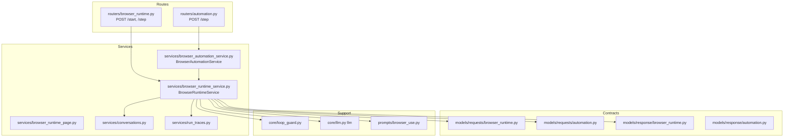
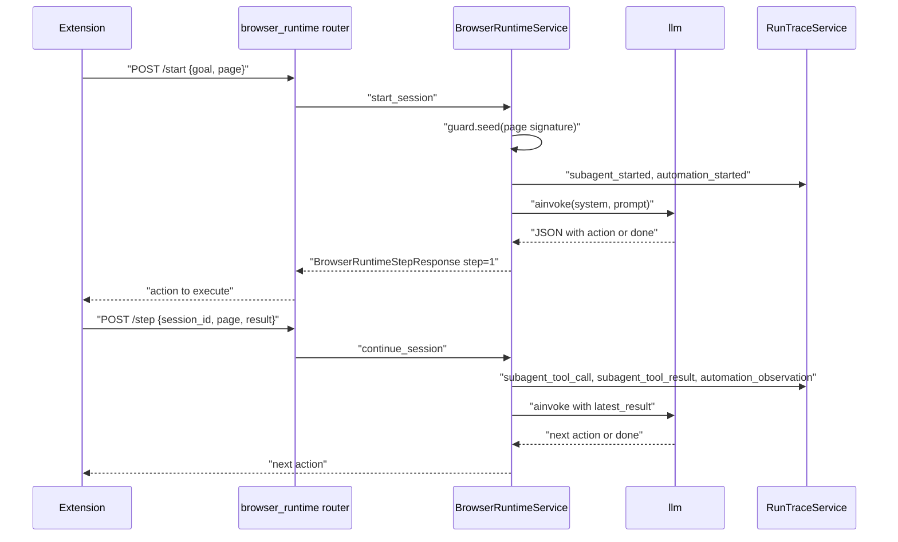
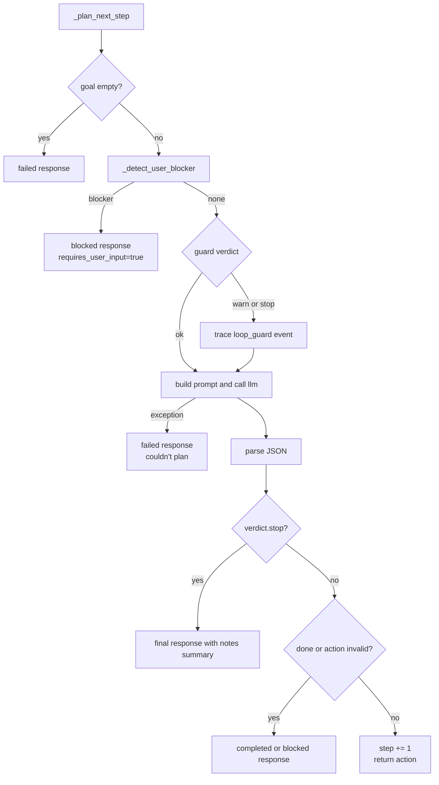

# Browser runtime API

The browser runtime plans one action at a time. A client posts a goal and a page snapshot, the backend asks the selected model for the single next action, and the client executes it and posts the result plus the new page back. There is no persistent browser connection on this path. HTTP is the loop.

Two route groups share the same engine:
- `/api/browser/runtime` from `routers/browser_runtime.py` is the current interface, with `start` and `step`.
- `/api/browser/automation/step` from `routers/automation.py` is a compatibility shim that maps `run_id` onto a runtime session id.

Key capabilities:
- One planned action per step, validated against a fixed action set
- Page snapshots with interactive elements, media state and an optional screenshot
- Blocker detection for captcha, login and permission prompts
- A loop guard that stops repeats, cycles and no progress
- Optional conversation and run trace persistence
- An eight step cap on the compatibility route

## Repository layout

## Building blocks

- `routers/browser_runtime.py`: `start_browser_runtime` and `continue_browser_runtime`. Both return `BrowserRuntimeStepResponse` and depend on `get_service()`.
- `routers/automation.py`: `automation_step`, returning `AutomationStepResponse`.
- `services/browser_runtime_service.py`: `BrowserRuntimeService`, a class with a class-level `_sessions: dict[str, BrowserRuntimeSession]` and `allowed_actions` of `NAVIGATE`, `OPEN_TAB`, `CLICK`, `TYPE`, `KEY_PRESS`, `HOVER`, `SCROLL`, `WAIT`, `MEDIA_CONTROL`.
- `BrowserRuntimeSession` dataclass: `session_id`, `goal`, `max_steps`, `persist`, `conversation_id`, `client_id`, `trace_run_id`, `trace`, `created_at`, `step`, `recent_history`, `notes`, `guard`.
- `services/browser_automation_service.py`: `plan_step` translates the legacy shape and sets `max_steps = 8`.
- `services/browser_runtime_page.py`: `build_page_snapshot_from_dom`, used by the generate-script route to turn posted DOM data into a `PageSnapshot`.

## Request and response models

`BrowserRuntimeStartRequest`:

| Field | Type | Default | Meaning |
| --- | --- | --- | --- |
| `goal` | str | required | What the user wants done |
| `page` | `PageSnapshot` | empty snapshot | Current page observation |
| `max_steps` | int or null | null, then env | Optional cap, minimum 1 |
| `context` | dict | `{}` | Extra context passed to the planner and stored in run metadata |
| `conversation_id` | str or null | null | Reuse an existing conversation when persisting |
| `client_id` | str | `browser-extension` | Client label |
| `persist` | bool | false | Create conversation, user message and run trace |

`BrowserRuntimeStepRequest`: `session_id` (required), `page`, and `result`, an optional `ActionExecutionResult`.

`PageSnapshot`: `url`, `title`, `visible_text`, `active_element` (`ElementSnapshot`), `interactive` (list of `ElementSnapshot`), `media` (`MediaSnapshot`), `screenshot`. `ElementSnapshot` carries `selector`, `tag`, `role`, `text`, `aria_label`, `placeholder`, `id`, `name`, `href`, `input_type`, `value`, `clickable` and `visible`. `MediaSnapshot` carries `has_video`, `paused`, `muted`, `volume`, `current_time` and `duration`.

`BrowserAction`: `type` plus optional `selector`, `text`, `role`, `value`, `url`, `active`, `key`, `command`, `direction`, `amount`, `ms` and `description`.

`ActionExecutionResult`: `action`, `success`, optional `error`, optional `verification` (`VerificationResult` with `passed`, `expected`, `actual`), and optional `before` and `after` page snapshots.

`BrowserRuntimeStepResponse`:

| Field | Type | Meaning |
| --- | --- | --- |
| `session_id` | str | `brt_<hex>` |
| `step` | int | Incremented after an action is returned |
| `done` | bool | True when the run ended |
| `status` | str | `running`, `completed`, `blocked` or `failed` |
| `message` | str | Planner message or blocker text |
| `action` | `BrowserAction` or null | The one action to execute |
| `expected_state` | str or null | What the planner expects after the action |
| `verification` | str or null | How the client can verify it |
| `reason` | str | Why the run ended or why this action |
| `requires_user_input` | bool | True for captcha, login and permission blockers |
| `conversation_id` | str or null | Set when `persist` was true |
| `run_id` | str or null | Trace run id when persisting |
| `loop_check` | dict or null | `{status, signal, reason}` when the guard warned |

## How it fits together

`start_session` creates the session, seeds the loop guard with the page signature, optionally creates tracking rows, records a start event, and plans step 1. `continue_session` looks up the session by id, records the action result as a tool call, updates progress and history, and plans the next step.

The planner call always sends a system prompt from `get_runtime_system_prompt()` and a JSON-ish payload from `build_runtime_prompt_payload(goal, step, session_state, current_page, latest_result, extra_context)`. The session state includes the last four history entries, accumulated notes (capped at 40), the guard hint and a finish-now reason.

When `page.screenshot` is present it is sent as an image part alongside the text prompt. Before sending, `_serialise_page` drops the screenshot, truncates `visible_text` to 5,000 characters and keeps at most 80 interactive elements.

## Session lifecycle

Sessions live in process memory. Restarting the backend loses every open session, and a `step` call for a lost session returns 404 because `continue_session` raises `ValueError` and the router maps it. `_final_response` pops the session before writing the completion events, so a client cannot continue after any terminal status. It also completes the run trace when persistence was on: an assistant message is added to the conversation and `complete_run` uses `failed` for a failed status and `completed` otherwise. A blocked run is recorded as completed because the assistant did produce a message.

## Blocker detection

`_detect_user_blocker` lowercases the page title, visible text and the first 40 interactive element texts, then checks three conditions:

- Captcha text (`captcha`, `i'm not a robot`, `i am not a robot`) always blocks.
- A visible password input blocks unless the goal itself mentions `login`, `log in`, `sign in`, `password` or `otp`.
- Permission text (`browser permission`, `allow notifications`, `permission request`) blocks.

Blocked responses keep the session's step count and set `requires_user_input=true`, so the client can ask the user to act and start a new session afterwards.

## Loop guard

`session.guard` is a `LoopGuard(kind="browser action")`. `_record_progress` sends it the action signature, the page signature, the success flag and a human label. A `WAIT` action gets the current step count appended to its signature so waiting on a loading page is not treated as a repeated call, though it still counts as no progress.

The guard has three jobs here:
- `verdict.hint` goes into the prompt as `loop_check` when the guard only warns.
- `verdict.stop` ends the loop and the response summarizes `session.notes`.
- `response.loop_check` carries `{status, signal, reason}` to the client.

## Automation compatibility route

`POST /api/browser/automation/step` maps `AutomationStepRequest` onto the same engine.

| Input | Use |
| --- | --- |
| `run_id` | Passed as `session_id` to `continue_session` when set |
| `goal` | Used to start a session when `run_id` is absent |
| `step` | Echoed by the service in the response through the runtime step |
| `page` | Forwarded |
| `previous_results` | Only the last entry is forwarded as `result` |

`AutomationStepResponse` has no `session_id`. It reuses `run_id` for the session id and wraps the single action in `actions`.

## Dependencies

`BrowserRuntimeService` builds a fresh instance per HTTP request through `Depends(get_service)`, but sessions survive because the store is a class attribute. It depends on `core/llm.py` for the model, `prompts/browser_use.py` for the prompt, `core/loop_guard.py` for the guard, `ConversationService` and `RunTraceService` for persistence, and the request models under `models/requests` and `models/response`.

The `llm` proxy honours the per-request model bound by `RequestModelMiddleware`, so `X-Agentic-Provider` and `X-Agentic-Model` change the planner model for that request.

## Performance

- Each step is one model call. There is no batching across sessions.
- Prompt size is bounded: 5,000 characters of visible text, 80 interactive elements, last four history entries, last 40 notes at 300 characters each.
- `recent_history` keeps only the last six action results.
- The planner supports image input. Sending a screenshot increases tokens and latency, and only the current page screenshot is sent, not the before and after snapshots.
- With `persist=true` every step writes several rows: conversation read, tool call, tool result, observation event, plan event. Use `persist=false` for high-frequency automation.
- When `max_steps` is omitted the service reads `BROWSER_RUNTIME_MAX_STEPS` through `env_max_steps`. The loop guard, not the step count, normally ends runs.

## Troubleshooting

- 404 `Unknown browser runtime session: ...` on `/step`: the session ended or the backend restarted. Start a new session. The id is not persisted.
- 400 `goal is required` on `/start`: `goal.strip()` was empty.
- Response has `done=true` and `status=blocked` without a captcha on screen: a visible password field was found and the goal did not mention login terms. Include the login intent in the goal, or have the user sign in first.
- The planner keeps choosing an action the client rejects: the runtime silently drops unknown action types in `_parse_action` and treats the step as finished (`action is None`). Check the model output against the `allowed_actions` set.
- A long run ends with "I stopped here because I was going in circles": the loop guard stopped it. `loop_check` and the run's `loop_guard` event carry the signal and reason.
- `run_id` is null in the response despite `persist=true`: `_prepare_tracking` failed or never ran. Persistence requires a working Postgres and conversation service.
- The action executes twice: `continue_session` expects the page and result of the previous action. Reposting the same `step` request with the same result replays the tool call in the trace, though the planner sees the page again.

## Appendix

### Implementation examples
- Start handler: `start_browser_runtime` raises 400 on blank goal, 500 on exception, returns the service response.
- Step handler: maps `ValueError` to 404 and `HTTPException` through unchanged.
- Action validation: `_parse_action` uppercases `type`, checks `allowed_actions`, and constructs `BrowserAction`.
- JSON parsing: `_extract_json` reads the first JSON object with `json.JSONDecoder().raw_decode`, tolerating trailing text.
- Tracking: `_prepare_tracking` creates the conversation, user message and `RunTraceService` run with `entrypoint="browser_runtime"`.

### Source files
- `routers/browser_runtime.py`
- `routers/automation.py`
- `models/requests/browser_runtime.py`
- `models/response/browser_runtime.py`
- `models/requests/automation.py`
- `models/response/automation.py`
- `services/browser_runtime_service.py`
- `services/browser_automation_service.py`
