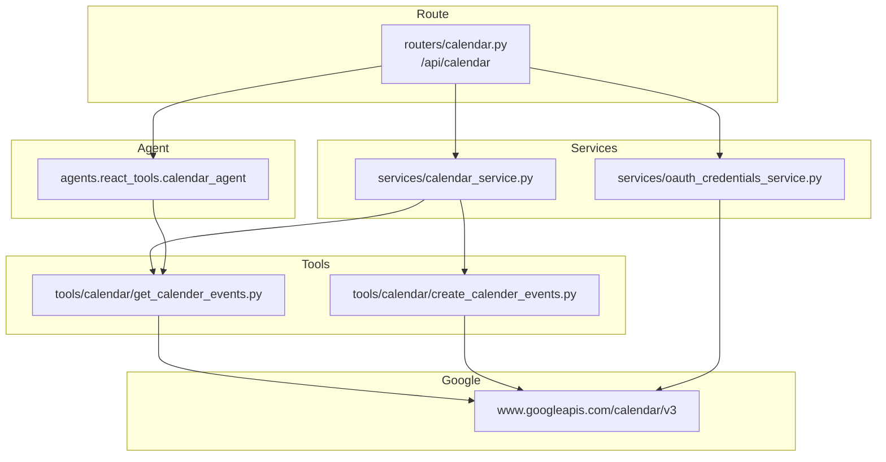
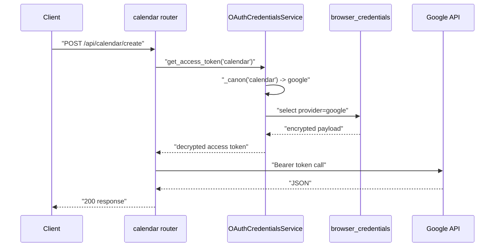
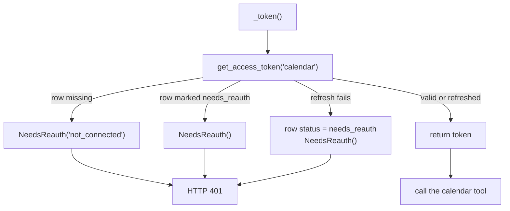
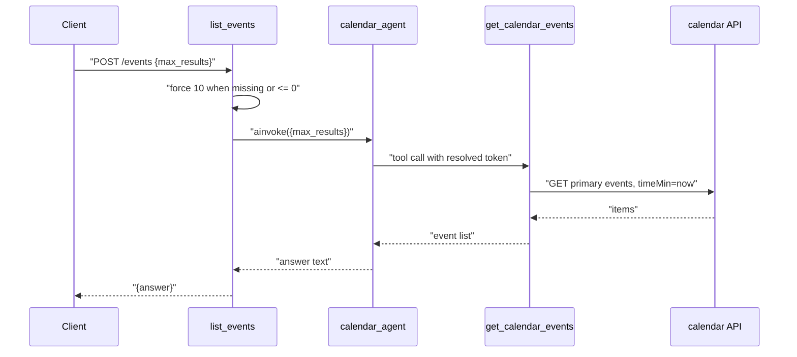
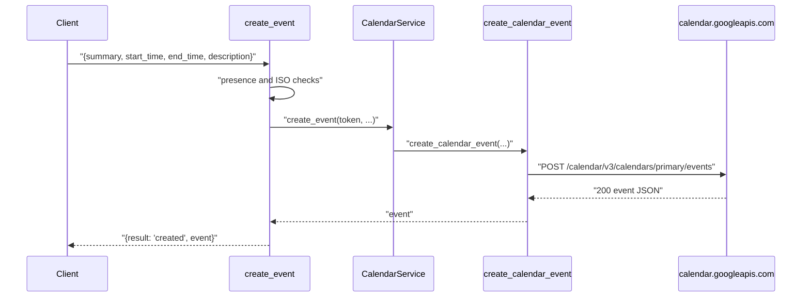
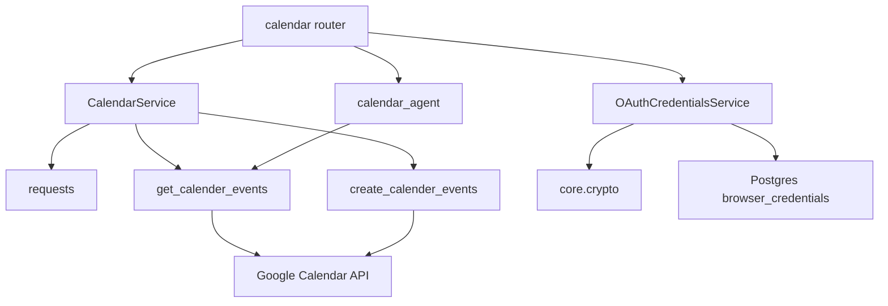

# Calendar integration API

The calendar routes read and write Google Calendar on behalf of the connected user. There are two endpoints: one lists upcoming events through an agent, the other creates an event from ISO 8601 start and end times. It is mounted at `/api/calendar` from `routers/calendar.py`.

Both routes depend on the stored Google OAuth credential, and the list route can fall back to a connected Composio Google Calendar account. They never accept an access token in the request body. Gmail and Google Search are documented on [Gmail integration API](Gmail%20Integration%20API) and [Search integration API](Search%20Integration%20API).

Key capabilities:
- List upcoming events through the calendar agent
- Create an event with a summary, description and time window
- Server-side OAuth token resolution and refresh
- Structured 401 responses when Google needs reauthorization
- A 10 event default, forced when `max_results` is missing or not positive

## Repository layout

## Building blocks

- `routers/calendar.py`: `_token()` resolves a `calendar` token, `_is_isoformat` checks the timestamps, and `list_events` and `create_event` are the two handlers.
- `services/calendar_service.py`: thin wrappers over the two Calendar tools.
- `tools/calendar/get_calender_events.py`: `get_calendar_events`.
- `tools/calendar/create_calender_events.py`: `create_calendar_event`.
- `agents.react_tools.calendar_agent`: the agent used by `POST /events`.

Request models are declared inline in the router:

| Model | Fields |
| --- | --- |
| `EventsRequest` | `max_results` default 10 |
| `CreateEventRequest` | `summary`, `start_time`, `end_time`, `description` default `Created via API` |

## How it fits together

The create route resolves a token through `OAuthCredentialsService.get_access_token` with the sub-provider name `calendar`. Aliases map that name to the single Google row. A refresh failure or absent connection raises `NeedsReauth`, which the router converts to 401.

The list route does not call `_token()` or `CalendarService`. It invokes `calendar_agent`, whose tool uses a Google token when one is available and otherwise tries a connected Composio Google Calendar account. The tool clamps `max_results` to 1 through 25, and the route forces 10 before that.

The 401 body is always `{"code": "needs_reauth", "provider": "google", "reason": e.reason}`, with `reason` either `not_connected` or the default `needs_reauth`.

## List events

`POST /api/calendar/events` takes `{"max_results": int}`. `max_results` is forced to 10 when it is missing or not positive.

The handler does not use `CalendarService`. It invokes `calendar_agent.ainvoke({"max_results": max_results})` and returns the agent's answer string as `{"answer": ...}`. The shape of that string depends on the agent tool, not on `get_calendar_events` directly. Expect prose, not a JSON event array.

`get_calendar_events(access_token, max_results)` requests the primary calendar with:

- `singleEvents=true`
- `orderBy=startTime`
- `timeMin` set to the current UTC time
- an 8 second timeout

It returns the raw `items` list. Because `timeMin` is now, the route lists upcoming events only.

The agent path can take several model steps. The raw tool path is a single HTTP call, which is why the direct tool exists.

## Create event

`POST /api/calendar/create` takes `CreateEventRequest`. The handler validates three things before any network call:

- `summary`, `start_time` and `end_time` must be present, else 400 `summary, start_time and end_time are required`.
- Both times must parse with `datetime.fromisoformat`, else 400 `start_time and end_time must be valid ISO 8601 strings`.
- The token must resolve, else 401.

The tool sends `summary`, `description`, and `start` and `end` objects with `dateTime` and `timeZone: "UTC"` to `POST https://www.googleapis.com/calendar/v3/calendars/primary/events`, with a 10 second timeout. A non-200 raises `Failed to create event: <status> <text>`.

A successful response is `{"result": "created", "event": {...}}` where `event` is the Google API response body. The route always sends `timeZone: "UTC"`, so a local time string is interpreted as UTC.

## Error handling

Every route catches `HTTPException` and re-raises it, then converts any other exception to 500 with `str(e)`.

| Status | Cause |
| --- | --- |
| 400 | Missing `summary`, `start_time` or `end_time` |
| 400 | A timestamp that `datetime.fromisoformat` rejects |
| 401 | `NeedsReauth`, with the structured detail |
| 422 | The body does not match the request model |
| 500 | Any tool or Google API failure |

## Dependencies

External packages: `fastapi>=0.115.0`, `pydantic>=2.9.0`, `requests>=2.32.3` and `langchain>=0.3.27` for the agent tools.

## Performance

- Listing through the agent can take several model steps. There is no cap in this route.
- Event creation is one Google HTTP call with a 10 second timeout.
- Listing uses an 8 second timeout.
- Tokens are refreshed on demand, not on a schedule. A refresh adds one round trip before the Calendar call.
- No response caching anywhere. Every call hits Google.

## Troubleshooting

- 401 with `code: needs_reauth`: connect Google in Settings, or fix the OAuth client credentials. `get_access_token` marks the row `needs_reauth` after a failed refresh.
- `unsupported_grant_type` or `invalid_grant` in the log during a call: the stored refresh token was revoked. Reconnect Google.
- `/events` returns prose instead of an event list: it is an agent answer, not `get_calendar_events` output. Use the tool or the agent's own formatting if you need structure.
- Event creation fails with 400 from Google while the local validation passed: check the time zone. The tool always sends `timeZone: "UTC"` with the supplied `dateTime`.
- `start_time and end_time must be valid ISO 8601 strings` on a value that looks fine: `datetime.fromisoformat` in the running Python version is strict about some offsets and `Z` suffixes. Send `YYYY-MM-DDTHH:MM:SS` or a full `+00:00` offset.
- A 500 with a Google error body: the tool raises on any non-200 and the router relays `str(e)`. Check the connected account's calendar permissions.

## Appendix

### Implementation examples
- Token dependency: `_token()` catches `NeedsReauth` and raises a 401 with the structured detail.
- ISO check: `_is_isoformat` calls `datetime.fromisoformat(s)` inside a try block.
- Calendar window: `timeMin=datetime.datetime.utcnow().isoformat() + "Z"` in `get_calender_events.py`.
- Event payload: `{"summary", "description", "start": {"dateTime", "timeZone": "UTC"}, "end": {...}}`.
- Default description: `description: str = "Created via API"` in `CreateEventRequest`.

### Source files
- `routers/calendar.py`
- `services/calendar_service.py`
- `tools/calendar/get_calender_events.py`
- `tools/calendar/create_calender_events.py`
