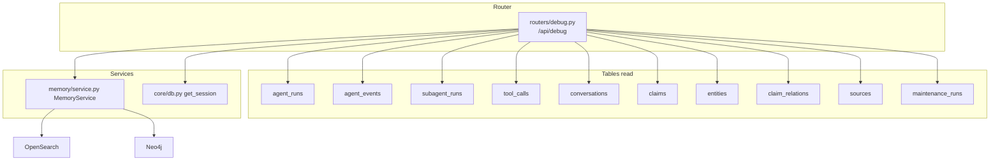
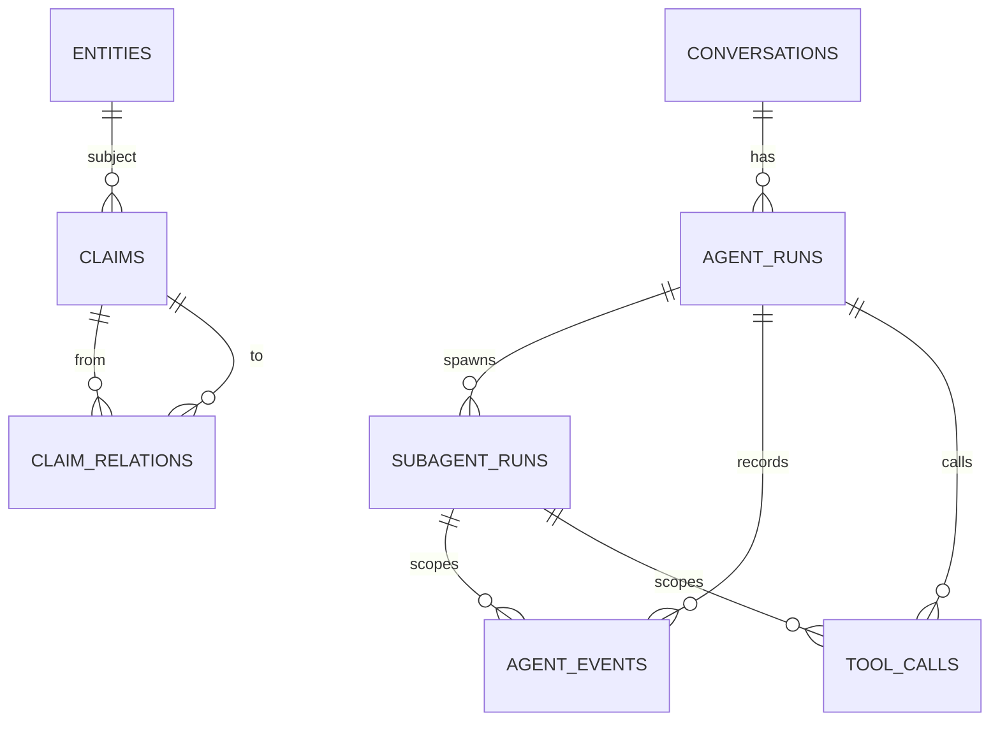
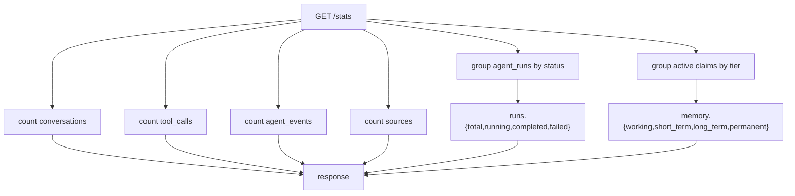
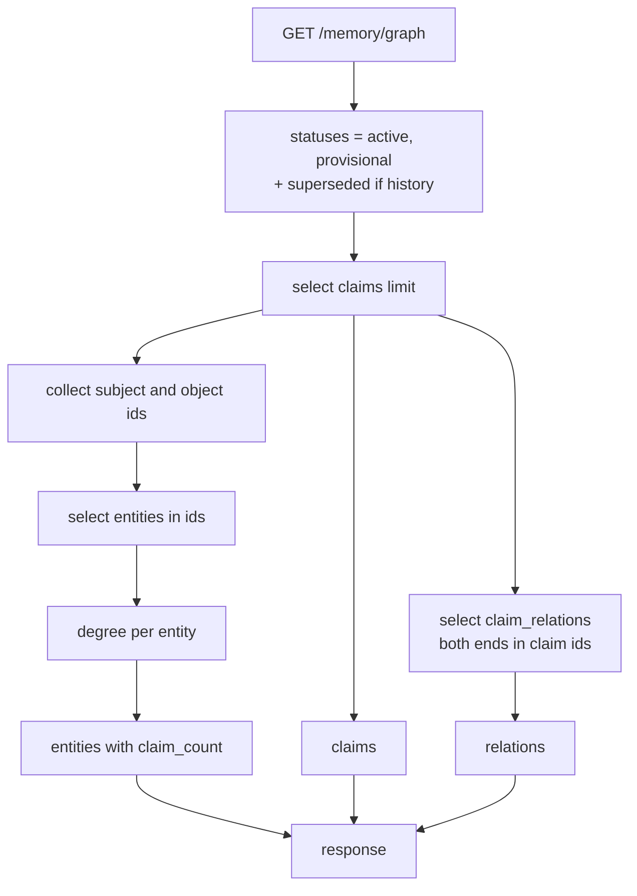

# Debug and observability API

The debug router is the read side of the console. It reads the same Postgres tables the chat and memory systems write: run traces, conversations, claims, sources and maintenance history. It is mounted at `/api/debug` from `routers/debug.py` and has no authentication.

One route is not read-only. `POST /api/debug/memory/clear` deletes durable memory from all three stores through `MemoryService.clear_all()`.

Key capabilities:
- Aggregate counts for runs, conversations, tool calls, events and claims by tier
- A daily timeseries of runs and tool calls
- Paginated run lists and a full run detail with subagents and tool calls
- Raw agent events for a run
- Memory statistics, claim listing and a graph built from Postgres
- Maintenance run history

## Repository layout



## Building blocks

- `routers/debug.py`: ten routes, all querying through `get_session()` except `clear_memory`, which delegates to `MemoryService`.
- `services/run_traces.py`: the write path behind `agent_runs`, `subagent_runs`, `tool_calls` and `agent_events`. The debug router reads the same models directly.
- `models/db/app.py`: `AgentRun`, `AgentEvent`, `SubagentRun`, `ToolCall`, `Conversation`.
- `models/db/memory.py`: `ClaimORM`, `EntityORM`, `ClaimRelationORM`, `SourceORM`, `MaintenanceRunORM`.



## Endpoints

| Method | Path | Handler | Query | Response |
| --- | --- | --- | --- | --- |
| GET | `/api/debug/stats` | `get_stats` | none | counts object |
| GET | `/api/debug/timeseries` | `get_timeseries` | `days` default 30, max 90 | list of day buckets |
| GET | `/api/debug/runs` | `list_runs` | `status`, `limit` max 200, `offset` | list of runs |
| GET | `/api/debug/runs/{run_id}` | `get_run` | path | run with subagents and tools |
| GET | `/api/debug/runs/{run_id}/events` | `get_run_events` | `limit` default 500, max 2000 | list of events |
| GET | `/api/debug/memory/stats` | `memory_stats` | none | tier, class, confidence, source counts |
| GET | `/api/debug/memory/claims` | `list_claims` | `tier`, `status` default `active`, `limit` max 200, `offset` | list of claims |
| GET | `/api/debug/memory/graph` | `memory_graph` | `history` bool, `limit` default 400, max 2000 | entities, claims, relations |
| POST | `/api/debug/memory/clear` | `clear_memory` | none | per-store delete counts |
| GET | `/api/debug/maintenance` | `maintenance_history` | `limit` default 20, max 100 | list of maintenance runs |

Status codes: 200 for reads, 404 `Run not found` for an unknown run id, 422 for a query above the declared maximum, 500 for a database error (uncaught). `POST /memory/clear` returns 200 even when one store fails, because `clear_all` reports `partial` instead of raising.

## How it fits together

The debug router reads Postgres directly through `get_session()`. It does not call the conversation or trace services for reads. It selects the same models those services write. The one exception is `POST /memory/clear`, which delegates to `MemoryService.clear_all()` because clearing spans three stores.

## Stats and timeseries

`GET /stats` runs six aggregate queries and returns:

```json
{
  "runs": {"total": 0, "running": 0, "completed": 0, "failed": 0},
  "conversations": 0,
  "tool_calls": 0,
  "events": 0,
  "memory": {
    "total_active": 0,
    "working": 0,
    "short_term": 0,
    "long_term": 0,
    "permanent": 0,
    "sources": 0
  }
}
```

Run counts come from `GROUP BY agent_runs.status`. Only the three known keys are copied into the response, so a future status is counted in `total` but has no named field. Memory tier counts only include `claims.status = "active"`.



`GET /timeseries?days=30` selects run counts grouped by `cast(started_at, Date)` since the cutoff, and tool call counts grouped the same way. It then generates one bucket per day with `runs` and `tool_calls`, defaulting to zero.

The query also computes `completed` and `failed` sums, but the response builder never reads them, so both fields are absent from the output. The bucket loop starts at `cutoff + 1 day` and runs `days` times, which can leave the oldest partial day out and include a day after the cutoff window.

## Run endpoints

`GET /runs` returns runs ordered by `started_at` descending with `limit` and `offset`. Each row includes `run_id`, `conversation_id`, `entrypoint`, `status`, a `final_answer` truncated to 200 characters, `error`, timestamps and `duration_s` computed as `completed_at - started_at` when completed.

`GET /runs/{run_id}` returns one run plus:

- `subagents`: ordered by `started_at` ascending, with `subagent_run_id`, `name`, `task`, `status`, `result` and timestamps.
- `tool_calls`: ordered by `started_at` ascending, with `tool_call_id`, `tool_name`, `status`, `args`, `error`, timestamps and `duration_s` per call.

The top-level answer is not truncated here. An unknown id raises `HTTPException(404, "Run not found")`, imported inside the handler.

`GET /runs/{run_id}/events` returns raw `agent_events` rows ordered by `created_at` ascending, capped by `limit` (default 500, max 2000). It does not 404 for an unknown run. It returns an empty list.

## Memory inspection

`GET /memory/stats` returns:
- `by_tier_status`: `{tier, status, count}` for every combination present.
- `by_class`: `{class, count}` for active claims.
- `avg_confidence`: average confidence over active claims, `0.0` when null.
- `sources_by_type`: `{type, count}`.

`GET /memory/claims` filters by `status` (default `active`) and optional `tier`, orders by `created_at` descending, and returns the scoring fields the promotion and decay jobs use: `confidence`, `trust_score`, `access_count`, `retrieval_hit_count`, `support_count`, `contradiction_count`, `user_confirmed`, `valid_from`, `valid_to`.

`GET /memory/graph` builds the graph from Postgres, not Neo4j. It selects claims with status `active` or `provisional`, adds `superseded` when `history=true`, takes at most `limit` rows, then loads the referenced entities and the claim relations where both ends are in the selected set.

The response:
- `entities`: `entity_id`, `name`, `type`, `aliases`, `description`, `claim_count`.
- `claims`: id, text, segment, tier, status, class, confidence, predicate, subject and object ids, object literal, `created_at` and `valid_to`.
- `relations`: `{from, to, type}` for `SUPERSEDES` and `CONTRADICTS` edges.



`POST /memory/clear` calls `MemoryService.clear_all()` with no confirmation parameter. It deletes memory tables in dependency order, clears the three OpenSearch indices and detaches every Neo4j node. The response is `{"status": "ok" | "partial", "postgres": {...}, "opensearch": {...}, "neo4j": {"nodes_deleted": n}, "warnings": [...]}`.

## Maintenance history

`GET /maintenance` reads `maintenance_runs` ordered by `started_at` descending, capped at 100. Each row has `run_id`, `run_type`, `status`, `claims_reviewed`, `claims_updated`, `claims_archived`, `started_at` and `finished_at`. The same data is available at `/api/memory/maintenance/history` with a different default limit.

## Dependencies

The router depends on `core/db.py get_session`, the models in `models/db/app.py` and `models/db/memory.py`, and `MemoryService.clear_all` for the one write route. Clearing touches Postgres, OpenSearch and Neo4j. Reads touch Postgres only.

External packages: `fastapi>=0.115.0`, `sqlalchemy[asyncio]>=2.0`, `asyncpg>=0.29`.

## Performance

- `GET /stats` runs six queries per call. It is cheap on indexed columns but is not cached.
- `GET /timeseries` scans `agent_runs` and `tool_calls` by `started_at` over up to 90 days, using the descending indexes on those columns.
- Run list caps at 200. Events cap at 2,000. Claims cap at 200. Graph caps at 2,000 claims.
- `GET /runs/{id}` does three queries regardless of child count, then serializes every subagent and tool call. A supervisor run can return hundreds of tool rows in one response.
- `GET /memory/graph` loads every claim in the window plus their entities and relations. The `limit` bounds claims, not response size.
- `POST /memory/clear` is O(rows) in Postgres and issues a delete-by-query and a full graph delete. It is the slowest route in the backend.

## Troubleshooting

- `GET /timeseries` misses today or includes a day before the cutoff: buckets are generated from `cutoff + 1 day` for `days` iterations rather than from actual query rows. Treat the first and last buckets as approximate.
- `completed` and `failed` are missing from timeseries rows even though the SQL selects them: the response builder only copies `day`, `runs` and `tool_calls`.
- Run detail shows `duration_s: null` for a completed run: `completed_at` was never written, which usually means `RunTraceService.complete_run` did not run.
- `POST /memory/clear` returns `status: partial`: OpenSearch or Neo4j was unreachable. Postgres is already cleared. Fix the store and run it again.
- `GET /memory/graph` omits a claim that exists: the default status filter excludes `superseded` and `archived`. Pass `history=true` for superseded claims.
- The console shows no events for a run but the chat had output: token deltas are streamed live and deliberately not recorded. Only non-delta events reach `agent_events`.
- A 404 from `/runs/{id}` in the console after a chat: the run id came from a `conversation` SSE frame, which is only emitted when a run row was created. If persistence failed, use the conversation endpoints instead.

## Appendix

### Implementation examples
- Tier rollup: `claims_by_tier = {row.tier: row.n for row in claim_tiers}` in `get_stats`.
- Run ordering: `order_by(AgentRun.started_at.desc()).limit(limit).offset(offset)`.
- Event cap: `Query(500, le=2000)` on `get_run_events`.
- Graph statuses: `["active", "provisional"] + (["superseded"] if history else [])`.
- Clear delegation: `return await MemoryService().clear_all()`.

### Source files
- `routers/debug.py`
- `services/run_traces.py`
- `models/db/app.py`
