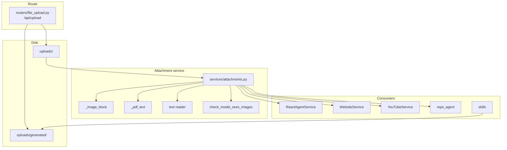
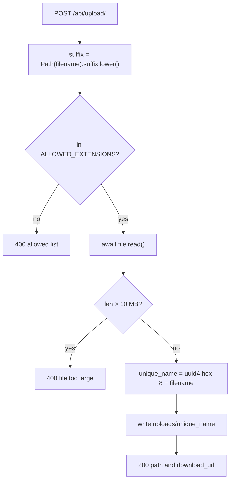
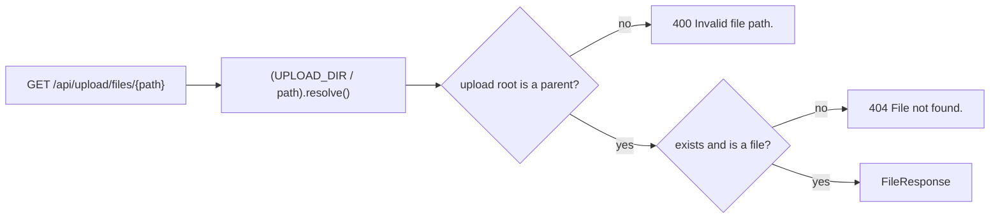
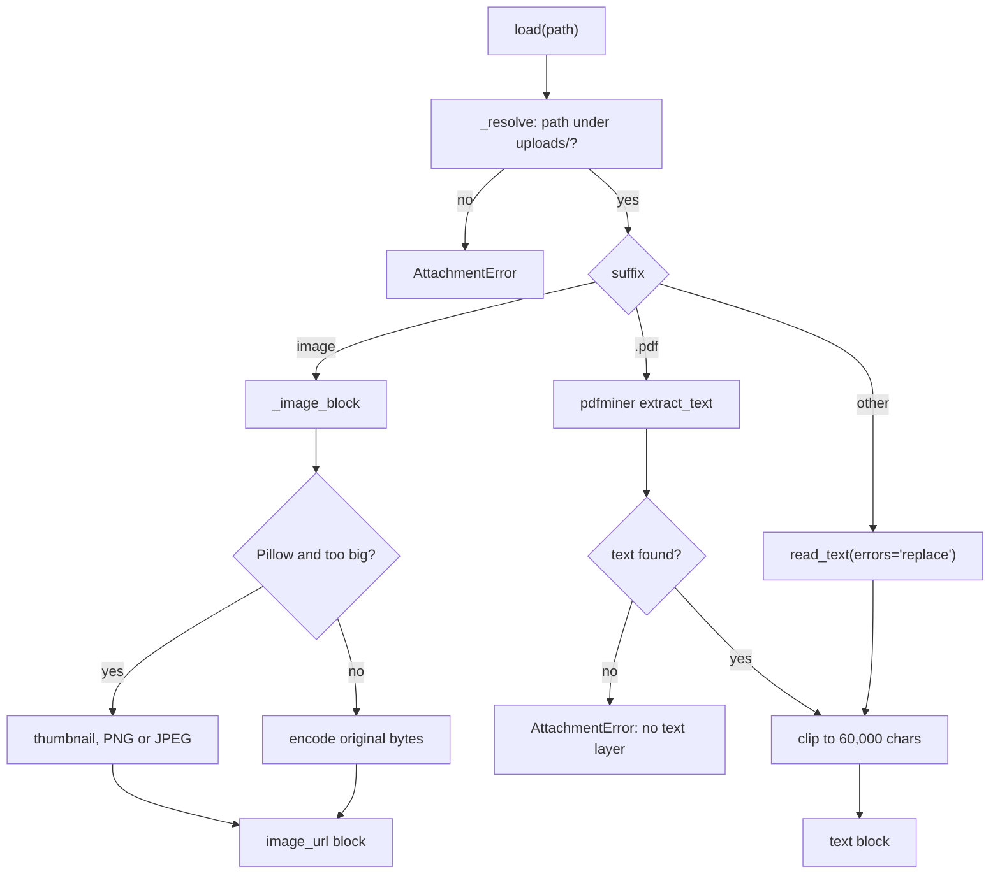
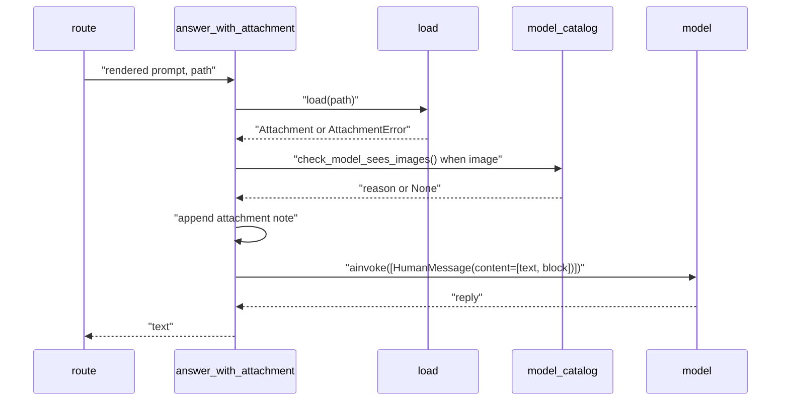
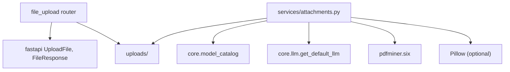

# File upload API

The upload routes store one file and serve it back by name. They are mounted at `/api/upload` from `routers/file_upload.py`. Other routes accept the returned `path` as `attached_file_path`, and `services/attachments.py` turns that file into something the chat model can read.

The store is a plain directory, `uploads/`, with a `generated/` subfolder for skill output. There is no database row per file.

Key capabilities:
- Multipart upload with an extension allowlist
- A 10 MB size cap
- A download route that refuses path escapes
- Image files sent as image blocks
- Text, code and PDF files sent as text
- Image downscaling before it reaches a model

## Repository layout

## Building blocks

- `routers/file_upload.py`: `upload_file`, `download_file`, plus `ALLOWED_EXTENSIONS`, `UPLOAD_DIR`, `GENERATED_DIR` and `MAX_FILE_SIZE`. Both directories are created at import time.
- `services/attachments.py`: `AttachmentError`, `Attachment`, `load`, `user_content`, `answer_with_attachment`, `check_model_sees_images`, and the limits `MAX_IMAGE_BYTES`, `MAX_IMAGE_SIDE` and `MAX_TEXT_CHARS`.
- `uploads/`: the only directory the upload and attachment code will read. `services/attachments.py` defines its own `UPLOAD_DIR` instead of importing the router, to keep services free of router imports.

Allowed extensions:

| Group | Extensions |
| --- | --- |
| Images | `.png`, `.jpg`, `.jpeg`, `.gif`, `.webp`, `.svg` |
| Documents | `.pdf`, `.txt`, `.md`, `.csv`, `.json`, `.xml` |
| Code | `.py`, `.js`, `.ts`, `.html`, `.css`, `.java`, `.c`, `.cpp`, `.go`, `.rs` |

## Upload

`POST /api/upload/` takes a multipart body with one `file` field.

The handler lowercases the suffix, checks it against `ALLOWED_EXTENSIONS`, reads the whole body, checks `MAX_FILE_SIZE` (10 MB), and writes `uploads/<8 hex>_<original name>`.

Rejections:

- Unknown extension: 400 listing the allowed set.
- Body over 10 MB: 400 `File too large. Maximum size is 10 MB.`
- A multipart part with no filename: the suffix is empty, so the rejection is `File type '' is not allowed`.

A successful response has `ok`, `filename`, `saved_as`, `path`, `download_url`, `size` and `content_type`. `download_url` is `/api/upload/files/<saved_as>`.

## Download

`GET /api/upload/files/{file_path:path}` serves any file under `uploads/`, including `generated/` output from skills.

It resolves `(UPLOAD_DIR / file_path).resolve()` and checks that the uploads root is a parent or the path itself. An escape attempt returns 400 `Invalid file path.`. A missing file returns 404 `File not found.`. The response is a `FileResponse` with the file name as the download name.

The `:path` converter is what lets a nested path such as `generated/report.md` through. A path outside the root is rejected after resolution, so `../` does not escape.

## Turning a file into model input

`services/attachments.py` is the bridge between a stored file and a chat prompt. `load(path)` resolves the path, refuses anything outside `uploads/`, and picks a representation by suffix.

| Kind | Extensions | Block |
| --- | --- | --- |
| Image | `.png`, `.jpg`, `.jpeg`, `.gif`, `.webp` | `{"type": "image_url", "image_url": {"url": "data:<mime>;base64,..."}}` |
| PDF | `.pdf` | Text block from `pdfminer.high_level.extract_text` |
| Text | everything else | Text block with the file contents in a fenced block |

`_display_name` removes the 8 hex upload prefix, so the model sees the original name. A path outside the root raises `AttachmentError("Attachments must be uploaded through /api/upload first.")`. A path that no longer exists raises an error naming the file.

Images are read as bytes and base64 encoded. If Pillow is available and the image is over `MAX_IMAGE_BYTES` (3.5 MB) or over `MAX_IMAGE_SIDE` (2048 px), the image is thumbnailed. A transparent image is saved as PNG. Everything else is converted to RGB and saved as JPEG at quality 85. Animated images are left alone. If Pillow is missing or the file is odd, the original bytes are sent and the failure is logged at debug level.

Text and PDF content is clipped at `MAX_TEXT_CHARS` (60,000 characters). When a file is longer, the block ends with `[cut at 60000 of N characters]` so the model knows the context was truncated. A scanned PDF with no text layer raises an error asking for the pages as images.

## Using an attachment in a route

`answer_with_attachment(prompt_text, path)` is the one-call path used by website, YouTube and other routes when `attached_file_path` is set.

1. `load(path)` runs. An `AttachmentError` becomes a user-facing string, not an exception.
2. If the file is an image, `check_model_sees_images()` asks `core.model_catalog.model_info` whether the picked model accepts image input. A model that cannot read images returns a message naming the model and suggesting a Gemini, GPT or Claude model.
3. The prompt gets a note that the file is part of the data to answer from.
4. `get_default_llm().client.ainvoke` runs with `user_content(prompt_text, attachment)`, which is a text block with the question followed by the file block.
5. A list-shaped response is flattened to text and stripped.

`user_content` uses the question as the intro, or `Describe the attached file <name>.` when the question is blank, and appends `(Attached image: <name>)` for images.

## Dependencies

External packages: `fastapi>=0.115.0`, `python-multipart` for the form, `Pillow` for image resizing, `pdfminer.six` for PDF text, and `langchain-core` for the message types.

## Performance

- Upload reads the whole file into memory before the size check and before writing, so peak memory is at least the file size.
- Download resolves and stats the path, then streams through `FileResponse`.
- Images over the limits are decoded, thumbnailed and re-encoded in process. That is CPU work on the request path.
- Text attachments are read whole and then clipped, so a large log file is in memory before the clip.
- PDF extraction runs in process and can be slow on a large document.

## Troubleshooting

- `Invalid file path.` on download: the resolved path escaped `uploads/`. Use the `download_url` returned by upload.
- Upload rejected with `File type '' is not allowed`: the multipart part had no filename. Send a filename with the part.
- A generated skill file is missing from download: the prompt tells the model to save under `uploads/generated/`. If the model wrote elsewhere, the download route cannot reach it because it is outside the root.
- `Attachments must be uploaded through /api/upload first.`: the `attached_file_path` is absolute and outside `uploads/`, or a relative path climbed out. Pass the exact `path` from the upload response.
- `Attachment <name> no longer exists. Attach it again.`: the file was deleted or the uploads directory was cleaned.
- `has no text layer (a scanned PDF?)`: `pdfminer` found no text. Attach page images instead.
- The model says it cannot read the image: `check_model_sees_images` returned a reason. Pick a vision-capable model or attach the content as text.

## Appendix

### Implementation examples
- Upload naming: `unique_name = f"{uuid.uuid4().hex[:8]}_{file.filename}"`.
- Download guard: `if upload_root not in requested.parents and requested != upload_root`.
- Attachment guard: `if root not in resolved.parents`.
- Display name: `path.name.partition("_")` with an 8 character stem check.
- Image cap: `MAX_IMAGE_BYTES = 3_500_000` and `MAX_IMAGE_SIDE = 2048`.
- Text cap: `MAX_TEXT_CHARS = 60_000`.

### Source files
- `routers/file_upload.py`
- `services/attachments.py`
