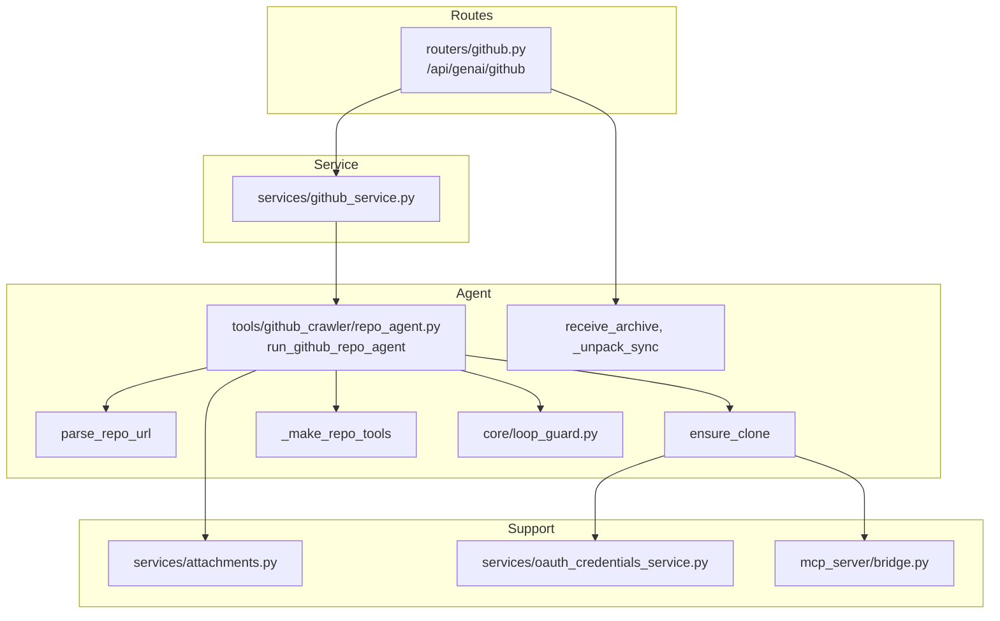
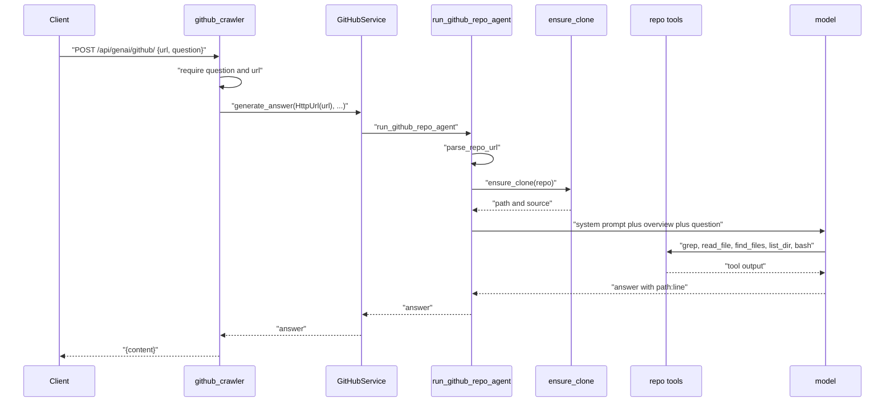
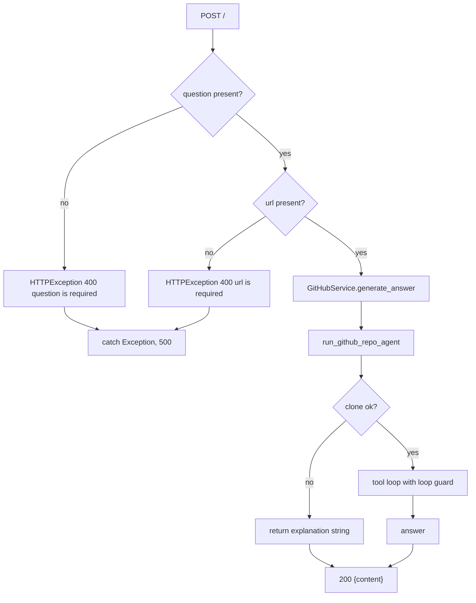
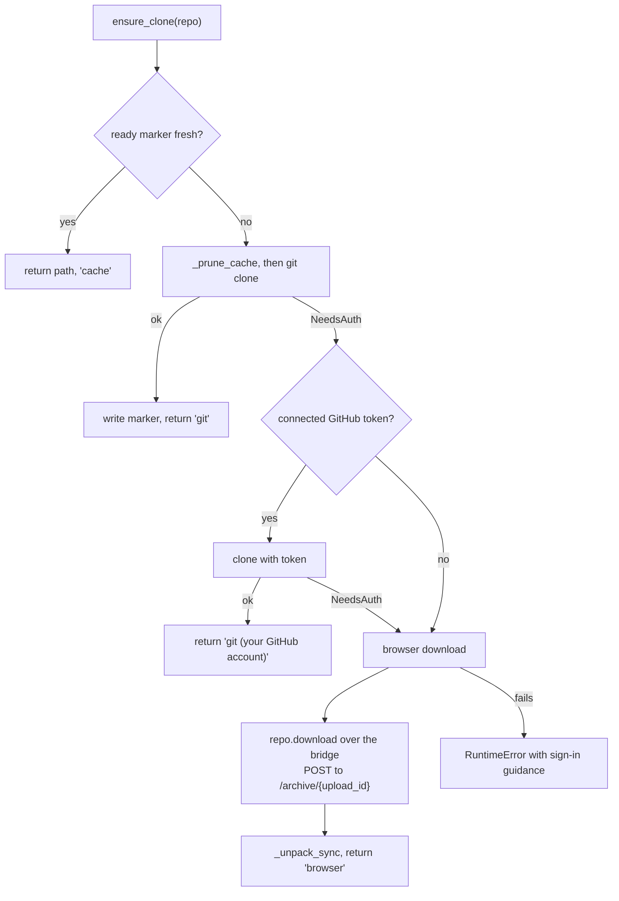
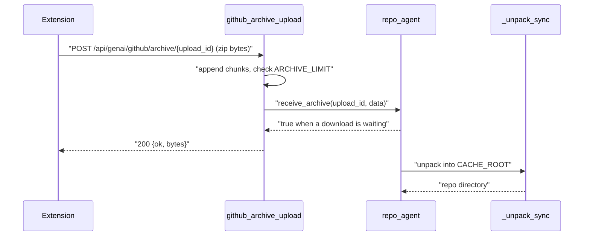

# GitHub integration API

The GitHub routes answer questions about a repository. The backend clones the repo into a temp directory and lets a tool-calling agent search it with grep, file reads and read-only shell commands until it can answer with `path:line` citations. There is no vector index and no pre-chunked code.

The routes are mounted at `/api/genai/github` from `routers/github.py`. The agent lives in `tools/github_crawler/repo_agent.py`.

Key capabilities:
- Any GitHub URL shape, including repo root, tree, blob, commit and `owner/repo`
- A cached clone with a 30 minute TTL
- A private repo path through the connected GitHub account or the browser's own session
- A zip archive upload channel for repos the backend cannot clone
- A read-only shell, so repository content cannot execute
- A loop guard that stops a run stuck in circles

## Repository layout

## Building blocks

- `routers/github.py`: `github_crawler` for `POST /` and `github_archive_upload` for `POST /archive/{upload_id}`.
- `services/github_service.py`: `GitHubService.generate_answer`, which calls `run_github_repo_agent` and turns an exception into an error string.
- `tools/github_crawler/repo_agent.py`: `parse_repo_url`, `RepoRef`, `ensure_clone`, `receive_archive`, `_unpack_sync`, `check_command`, `_make_repo_tools` and `run_github_repo_agent`.
- `core/loop_guard.py`: `LoopGuard`, with `env_max_steps("GITHUB_AGENT_MAX_TOOL_CALLS")` as the step cap.
- `services/attachments.py`: loads an optional file into the agent's first message.

`GitHubRequest` fields: `url` as `HttpUrl`, `question`, `chat_history`, `attached_file_path`.

Constants that shape the run:

| Constant | Value | Meaning |
| --- | --- | --- |
| `CACHE_ROOT` | `$TMPDIR/agentic-browser/repos` | where clones live |
| `CACHE_TTL` | 30 minutes | cache freshness window |
| `CLONE_TIMEOUT` | 180 seconds | git clone and browser download timeout |
| `OUTPUT_LIMIT` | 16,000 characters | tool output clip |
| `READ_LINES` | 250 | default file read window |
| `ARCHIVE_LIMIT` | 300 MB | zip upload cap |
| `UNPACKED_LIMIT` | 1.5 GB | unpacked archive cap |

## How it fits together

The route validates `question` and `url`, then calls `GitHubService.generate_answer`. The service delegates to `run_github_repo_agent`, which parses the URL, ensures a clone, builds the system prompt with an overview, and runs the model and tool loop.

The route catches every exception, including its own 400 `HTTPException`, and converts it to 500 with `str(e)`. A missing `question` or `url` therefore surfaces as 500, not 400, and the detail keeps the original message.

## URL parsing and cloning

`parse_repo_url` accepts a plain `owner/repo`, a full GitHub URL, or another git host with at least two path segments.

| URL shape | Result |
| --- | --- |
| `owner/repo` | `https://github.com/owner/repo.git` |
| `/tree/<ref>/<dir>` | same repo, `ref` and `focus` set |
| `/blob/<ref>/<file>` | same repo, `ref` and `focus` set |
| `/commit/<sha>` | same repo, `ref` set to the commit |
| another host with two path parts | cloned as given |

`RepoRef.cache_key` sanitises `slug@ref` to a directory name. `ensure_clone` takes an `asyncio.Lock` per cache key, reuses a clone when its `.ready` marker is younger than 30 minutes, and prunes old entries otherwise.

When git asks for credentials, `ensure_clone` tries the connected GitHub account first through `_github_token()`, which reads `get_access_token("github")`. The token goes to git through `GIT_CONFIG_*` environment variables, never argv, the URL or `.git/config`. If that fails, the browser extension downloads the repo zip with the browser's GitHub session.

## Repository tools

`_make_repo_tools` builds five tools over the clone root:

| Tool | Purpose |
| --- | --- |
| `grep` | ripgrep search with glob, context and case options |
| `read_file` | line window, default 250 lines |
| `find_files` | glob over paths |
| `list_dir` | shallow directory tree, depth 1 to 4 |
| `bash` | read-only shell command in the repo root |

`bash` is not a free shell. `check_command` rejects `; & > < $`, backticks and `||`, allows pipes, and restricts each segment to the `ALLOWED` program set. `git` is limited to `GIT_READ` subcommands such as `log`, `show`, `blame`, `grep`, `diff` and `ls-files`. `sed` may only print line ranges, so `sed -i` is refused. Arguments that point outside the repo are refused, including absolute paths, `~` and `..`.

Tool output is clipped at `OUTPUT_LIMIT` with a note telling the model to narrow the search.

## Archive upload

`POST /api/genai/github/archive/{upload_id}` is how the browser sends a private repo zip. The route has no JSON body. It streams the request body, adds each chunk, and raises 413 `Archive over 300 MB.` when `ARCHIVE_LIMIT` is exceeded.

`receive_archive(upload_id, data)` returns false when no download is waiting for that id, which becomes 404 `No repo download is waiting for this upload.` On success the response is `{"ok": true, "bytes": n}`.

`_unpack_sync` strips the `<repo>-<sha>/` wrapper, skips directories and symlinks, rejects `../` entries, enforces `UNPACKED_LIMIT`, and renames the temp directory into place. There is no git history in this path, so `git log`, `blame` and `show` do not work, and the system prompt says so.

## The answer loop

`run_github_repo_agent` loads an optional attachment first. An image is checked against the picked model, and a refusal returns immediately as the answer.

The system prompt carries the slug, the ref note, a focus note when the URL named a file or folder, and a repository overview from `_overview`. Chat history is folded into the user message as up to the last 8 entries, each clipped to 1,500 characters.

The loop calls the model with tools bound. Each tool call becomes a `ToolMessage`. The loop guard records the call, the output and the success flag. A warning appends the guard hint as a human message. A stop appends a final instruction to answer from what was found, calls the model once without tools, and breaks.

## Dependencies

The route depends on `GitHubService`, which calls `run_github_repo_agent`. The agent uses `core/llm.py` for the model, `core/loop_guard.py`, `services/attachments.py`, the OAuth credential service for private clones, and `mcp_server/bridge.py` for browser downloads. It shells out to `git`, uses `rg` when installed, and unpacks zips with `zipfile`.

External packages: `fastapi>=0.115.0`, `pydantic>=2.9.0`, `langchain-core`, and `requests` through the GitHub token path.

## Performance

- A cold clone can take up to `CLONE_TIMEOUT` (180 s). A warm cache hit returns in milliseconds.
- A browser zip download waits up to `CLONE_TIMEOUT` for the bridge call and then up to 10 seconds for the upload future.
- There is no step cap on the agent. `LoopGuard` with `GITHUB_AGENT_MAX_TOOL_CALLS` normally ends a run that repeats.
- Each tool call is a round trip to the model. A broad question can mean dozens of calls.
- `OUTPUT_LIMIT` and `READ_LINES` keep one tool result from filling the context window.
- Clones are pruned on each cache miss. The directory is chmod `0700` because private code lands there.

## Troubleshooting

- GitHub route returns 500 for a missing `question` or `url`: the handler wraps its own `HTTPException` in the broad `except Exception` and re-raises as 500. Check `detail` for the original message.
- `... is private or doesn't exist`: both the connected account and the browser session failed. Sign in to github.com in the browser that runs the extension, or connect GitHub in Settings.
- The answer says git history is unavailable: the repo came in as a zip through the browser, so there is no `.git` directory. Ask about file contents instead of `git log`.
- The clone times out: the repo is large or the network is slow. Raise `CLONE_TIMEOUT` or ask about a subtree through a `/tree/<ref>/<dir>` URL.
- `Archive over 300 MB.`: the zip exceeded `ARCHIVE_LIMIT`. A large repo needs a direct clone, not the browser path.
- A tool call is refused with `Paths must stay inside the repository`: the model used an absolute path, `~` or `..`. The guard is doing its job.
- The agent stops with a note about going in circles: the loop guard hit its patience or step cap. Ask a narrower question or cite the file to inspect.
- `No repo download is waiting for this upload.`: the upload id expired or the bridge call failed. Retry the question from the start so a new download id is created.

## Appendix

### Implementation examples
- URL parse: `parse_repo_url` builds `RepoRef(clone_url, slug, ref, focus)`.
- Cache key: `re.sub(r"[^A-Za-z0-9._-]+", "_", f"{self.slug}@{self.ref or 'HEAD'}")`.
- Token env: `_auth_env` sets `GIT_CONFIG_KEY_0` to an `http.https://github.com/.extraheader` value.
- Shell guard: `check_command` returns a reason string or `None`.
- Archive return: `{"ok": True, "bytes": len(data)}`.

### Source files
- `routers/github.py`
- `services/github_service.py`
- `tools/github_crawler/repo_agent.py`
- `services/attachments.py`
- `core/loop_guard.py`
