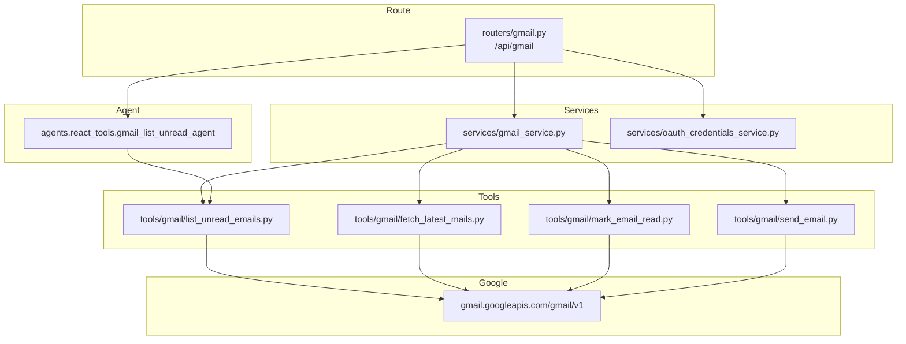
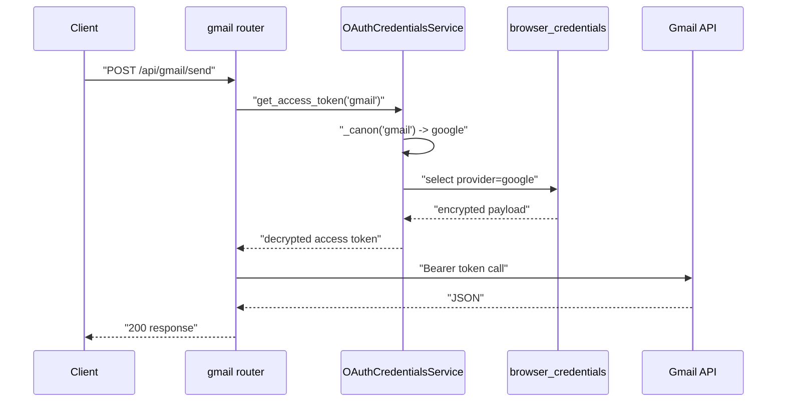
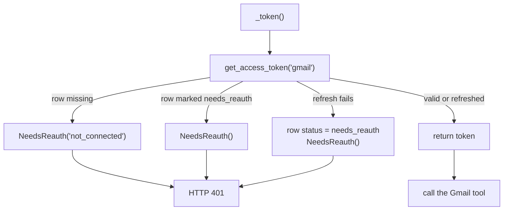
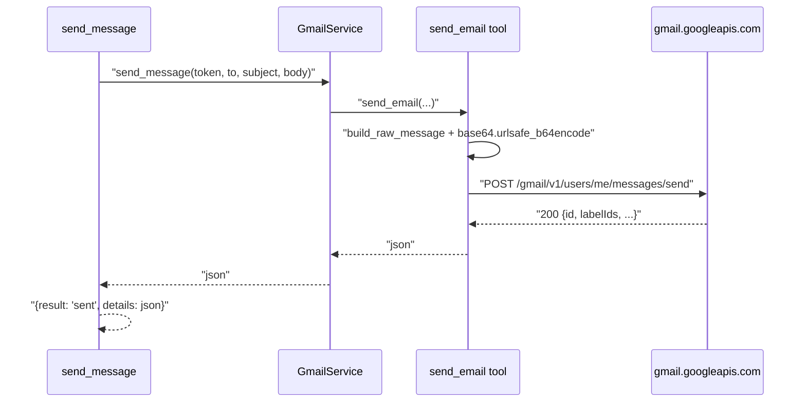
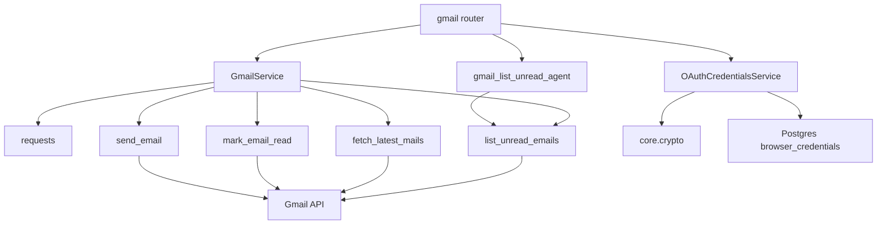

# Gmail integration API

The Gmail routes read and send mail on behalf of the connected Google account. There are four endpoints: list unread mail, fetch the latest inbox mail, mark one message read, and send a plain text message. The group is mounted at `/api/gmail` from `routers/gmail.py`.

Every route depends on the stored Google OAuth credential, and `/unread` can fall back to a Composio Gmail account when no token is connected. No route accepts an access token in the request body. Calendar and Google Search are documented on [Calendar integration API](Calendar%20Integration%20API) and [Search integration API](Search%20Integration%20API).

Key capabilities:
- List unread mail through an agent tool
- Fetch the latest inbox messages with subject, sender and date metadata
- Mark a message read
- Send plain text mail
- Structured 401 responses when Google needs reauthorization

## Repository layout

## Building blocks

- `routers/gmail.py`: `_token()` resolves a `gmail` token, `get_gmail_service()` builds `GmailService`, and four handlers: `list_unread_messages`, `fetch_latest`, `mark_message_read`, `send_message`.
- `services/gmail_service.py`: wrappers over the four Gmail tools.
- `tools/gmail/list_unread_emails.py`: `list_unread`.
- `tools/gmail/fetch_latest_mails.py`: `get_latest_emails`.
- `tools/gmail/mark_email_read.py`: `mark_read`.
- `tools/gmail/send_email.py`: `build_raw_message`, `send_email`.
- `agents.react_tools.gmail_list_unread_agent`: the agent used by `POST /unread`.

Request models are declared inline in the router:

| Model | Fields |
| --- | --- |
| `UnreadRequest` | `max_results` default 10 |
| `LatestRequest` | `max_results` default 5 |
| `MarkReadRequest` | `message_id` required |
| `SendEmailRequest` | `to`, `subject`, `body` default empty |

## How it fits together

The three direct routes resolve a token through `OAuthCredentialsService.get_access_token` with the sub-provider name `gmail`. Aliases map that name to the single Google row. A refresh failure or absent connection raises `NeedsReauth`, which the router converts to 401.

`/unread` does not call `GmailService` or `_token()`. It invokes `gmail_list_unread_agent`, whose tool uses a Google token when one is available and otherwise tries a connected Composio Gmail account. The route returns the tool's text as `{"answer": answer}`. `list_unread` output is wrapped as `{"unread_messages": [...]}`, and a Composio or tool failure becomes an error string with status 200.

The 401 body is always `{"code": "needs_reauth", "provider": "google", "reason": e.reason}`, with `reason` either `not_connected` or the default `needs_reauth`.

## Endpoints

| Method | Path | Handler | Body | Response |
| --- | --- | --- | --- | --- |
| POST | `/api/gmail/unread` | `list_unread_messages` | `{"max_results"}` | `{"answer": ...}` |
| POST | `/api/gmail/latest` | `fetch_latest` | `{"max_results"}` | `{"messages": [...]}` |
| POST | `/api/gmail/mark_read` | `mark_message_read` | `{"message_id"}` | `{"result": "ok", "details": ...}` |
| POST | `/api/gmail/send` | `send_message` | `{"to", "subject", "body"}` | `{"result": "sent", "details": ...}` |

`max_results` is forced to 10 when missing or not positive on `/unread`, and to 5 on `/latest`.

`/mark_read` rejects an empty `message_id` with 400. `/send` rejects a missing `to` or `subject` with 400. `body` may be empty.

Every route catches `HTTPException` and re-raises it, then converts any other exception to 500 with `str(e)`.

### Tool behaviour

`list_unread(access_token, max_results)` calls `GET https://gmail.googleapis.com/gmail/v1/users/me/messages` with `q=is:unread` and `maxResults`, then fetches each message with `format=metadata` and `metadataHeaders` Subject, From and Date. Each request has an 8 second timeout. A message fetch failure is skipped, not raised. The returned dicts have `id`, `snippet`, and whichever of `subject`, `from`, `date` were present.

`get_latest_emails(access_token, max_results)` lists the inbox with `labelIds: ["INBOX"]` and `q=is:inbox`, then fetches each message with an 8 second timeout. It returns the message metadata list that `/latest` wraps in `{"messages": [...]}`.

`mark_read(access_token, message_id)` posts to the modify endpoint to remove the `UNREAD` label, with an 8 second timeout.

`send_email(access_token, to_addr, subject, body_text)` builds a message with `To`, `Subject` and `Content-Type: text/plain; charset=utf-8` headers, base64url encodes it, and posts `{"raw": raw}` to `messages/send` with an 8 second timeout. A non-200 raises `Failed to send message: <status> <text>`.

## Error handling

| Status | Cause |
| --- | --- |
| 400 | Empty `message_id` on `/mark_read` |
| 400 | Missing `to` or `subject` on `/send` |
| 401 | `NeedsReauth`, with the structured detail |
| 422 | The body does not match the request model |
| 500 | Any Gmail API or tool failure, with `str(e)` |

## Dependencies

External packages: `fastapi>=0.115.0`, `pydantic>=2.9.0`, `requests>=2.32.3` and `langchain>=0.3.27` for the agent tools.

## Performance

- Unread is one list call plus one metadata call per message, so `max_results=10` can be 11 HTTP requests. There is no batch endpoint and no pagination beyond `maxResults`.
- All Gmail HTTP calls use 8 second timeouts.
- `/unread` runs an agent, which can take several model steps. `/latest`, `/mark_read` and `/send` are single calls.
- `list_unread` and the other tools run synchronously inside the async handler, so they occupy the event loop for the duration of the HTTP calls.
- No response caching anywhere. Every call hits Google.

## Troubleshooting

- 401 with `code: needs_reauth`: connect Google in Settings, or fix the OAuth client credentials. `get_access_token` marks the row `needs_reauth` after a failed refresh.
- `unsupported_grant_type` or `invalid_grant` in the log during a call: the stored refresh token was revoked. Reconnect Google.
- `/unread` returns prose instead of a message list: it is an agent answer, not `list_unread` output. Use `/latest` for structured messages.
- `mark_read` returns 500 with a Gmail 404: the `message_id` is not in the connected account.
- Sending mail from a different address than expected: the Gmail API sends as the authenticated user. The tool does not set a `From` header.
- `File type` or upload errors are unrelated to this route: attachments go through [File upload API](File%20Upload%20API) first.
- A 500 with a Google quota message: the project hit a Gmail API quota. Check the Google Cloud console for the OAuth client's project.

## Appendix

### Implementation examples
- Token dependency: `_token()` catches `NeedsReauth` and raises a 401 with the structured detail.
- Raw message: `build_raw_message` in `tools/gmail/send_email.py`.
- Unread query: `params = {"maxResults": max_results, "q": "is:unread"}` in `list_unread_emails.py`.
- Latest query: `params = {"maxResults": max_results, "labelIds": ["INBOX"], "q": "is:inbox"}`.
- Default clamps: `max_results if request.max_results and request.max_results > 0 else 10` on `/unread`, and `else 5` on `/latest`.

### Source files
- `routers/gmail.py`
- `services/gmail_service.py`
- `tools/gmail/list_unread_emails.py`
- `tools/gmail/fetch_latest_mails.py`
- `tools/gmail/mark_email_read.py`
- `tools/gmail/send_email.py`
