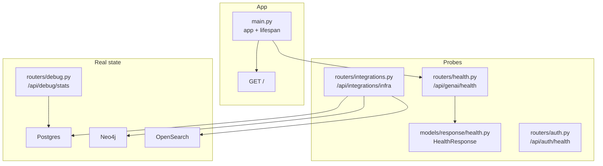
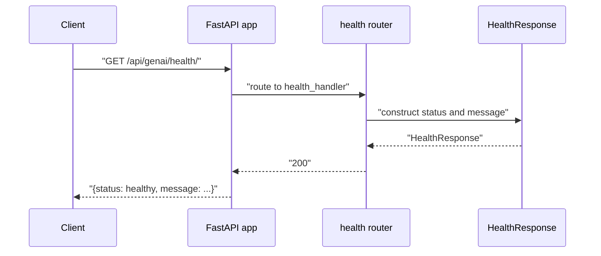
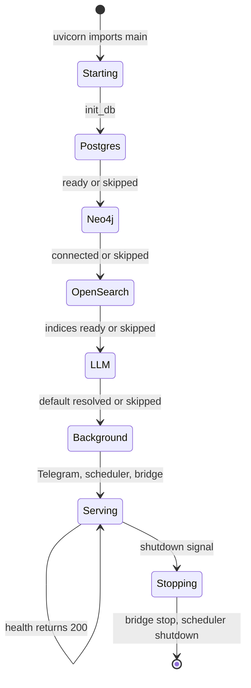
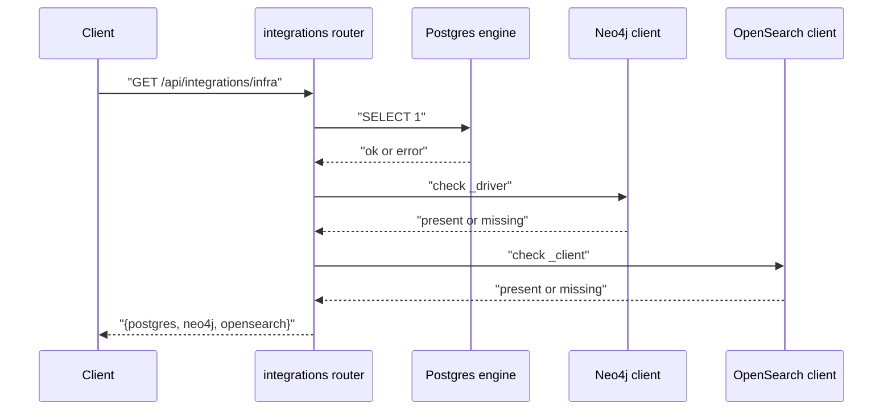
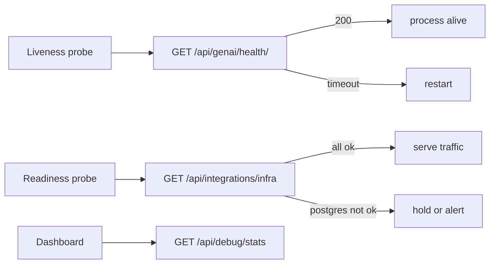

# Health and monitoring API

The backend has one dedicated health route, `GET /api/genai/health/`. It returns a fixed healthy payload and does no dependency checks. That makes it a process liveness probe, not a readiness probe.

This page covers that route, the startup work behind it, and the other endpoints you can poll when you want real state. Deep run, memory and maintenance inspection lives on [Debug and observability API](Debug%20and%20Observability%20API).

Key capabilities:
- A static liveness response with no I/O
- Startup logs that say which stores connected
- An infrastructure probe with real Postgres, Neo4j and OpenSearch checks
- An auth-only health route
- Run counters through the debug router
- A root route with the app name and version

## Repository layout



## Building blocks

- `routers/health.py`: an `APIRouter` with one handler, `health_handler`, decorated `@router.get("/", response_model=HealthResponse)`.
- `models/response/health.py`: `HealthResponse` with `status` and `message`, both strings.
- `main.py`: mounts the router with `app.include_router(health_router, prefix="/api/genai/health")`.
- `routers/integrations.py`: `infra`, which calls `_infra_status()`.
- `routers/auth.py`: `health`, a static auth service response.
- `routers/debug.py`: `get_stats`, the run and memory counters.

## The health route

`GET /api/genai/health/` has no authentication, no body and no dependencies.

The handler constructs the response directly:

```python
HealthResponse(
    status="healthy",
    message="Agentic Browser API is running smoothly.",
)
```

The trailing slash matters. The router declares `@router.get("/")` and the mount prefix is `/api/genai/health`, so the full path is `/api/genai/health/`. A request to `/api/genai/health` without the slash usually redirects, depending on the client.



Typical response:

```json
{
  "status": "healthy",
  "message": "Agentic Browser API is running smoothly."
}
```

The handler performs no database query, no external request and no disk read. It stays 200 even when Postgres, Neo4j and OpenSearch are down, because the app starts in a degraded mode. For a real readiness signal, use the infra route or the debug stats route.

## Startup and liveness

`lifespan` in `main.py` connects the stores and starts background work. Each block is wrapped so a failure logs a warning and startup continues.

| Step | Success log | Failure log |
| --- | --- | --- |
| `init_db()` | `Postgres: ready` | `Postgres init skipped` |
| Neo4j connect and constraints | `Neo4j: connected` | `Neo4j init skipped` |
| OpenSearch connect and indices | `OpenSearch: connected, indices ready` | `OpenSearch init skipped` |
| `reload_default_llm()` | `Default LLM resolved (DB override applied if present)` | `LLM default resolution skipped` |
| Telegram bot task | `Telegram bot task created.` | `Telegram bot init skipped` |
| Memory scheduler | `Memory maintenance scheduler started` | `Scheduler init skipped` |
| Browser bridge | `Browser bridge: hosting on ...` or `relaying ...` | `Browser bridge init skipped` |

The browser bridge binds `127.0.0.1:5455`. If an `agentic-mcp` process already owns the port, the backend relays instead of hosting.



A 200 from the health route proves the process is up and the event loop is serving. It does not prove a store is usable, because startup deliberately tolerates store failures.

## Infrastructure probe

`GET /api/integrations/infra` is the closer thing to a readiness check. It returns:

```json
{
  "postgres": {"ok": true},
  "neo4j": {"ok": true},
  "opensearch": {"ok": true}
}
```

Each entry can carry an `error` string instead, or in addition. The checks are:

- Postgres: `SELECT 1` on the SQLAlchemy engine.
- Neo4j: whether `_driver` is present.
- OpenSearch: whether `_client` is present.

The Neo4j and OpenSearch checks do not open a connection. A lazy client that never connected reports `ok: false` even if the store is reachable. The Postgres check is the only one that runs a query.



## Other monitoring endpoints

| Method | Path | What it tells you |
| --- | --- | --- |
| GET | `/` | app name and version |
| GET | `/api/auth/health` | static `{"status": "ok", "message": "Auth service running"}` |
| GET | `/api/integrations/status` | settings, Composio, LLM, search, PyJIIT, voice, Telegram, native tools, agents and infra in one object |
| GET | `/api/debug/stats` | run counts by status, conversation count, tool call count, event count, memory tier counts and source count |
| GET | `/api/debug/timeseries` | daily run and tool call buckets |
| GET | `/api/debug/maintenance` | recent maintenance runs |
| GET | `/api/mcp/settings` | MCP tool groups and bridge state |

`GET /api/integrations/status` is the most expensive settings read because it fans out to Composio, secrets, OAuth connections and the infra probe. Use it on demand, not on a tight loop.

`GET /api/debug/stats` is the fastest way to see whether chat is producing runs. It runs six aggregate queries and is not cached. The response shape and field names are on [Debug and observability API](Debug%20and%20Observability%20API).

## Probes and polling

For a container or process supervisor:

- Liveness: `GET /api/genai/health/`, every 10 to 30 seconds, short timeout, restart on repeated failure.
- Readiness: `GET /api/integrations/infra`, less frequent, because it runs a query.
- Dashboards: `GET /api/debug/stats` and `GET /api/debug/timeseries?days=7`.

The health route has no auth, so a probe needs no headers. The infra route and debug routes also have no auth today, but treat them as local-only because the backend binds all interfaces by default.



## Configuration

| Variable | Default | Effect |
| --- | --- | --- |
| `BACKEND_HOST` | `0.0.0.0` | bind address from `core/config.py` `backend_host` |
| `BACKEND_PORT` | `5454` | port used by `run()` and the GitHub archive callback |
| `CORS_ORIGINS` | empty | extra browser origins |

`run()` calls `uvicorn.run("main:app", host, port=port, reload=True)`. In production, disable reload or run uvicorn directly against `main:app`.

## Performance

- The health handler does no I/O and costs microseconds. It is safe to poll frequently.
- The infra probe runs one `SELECT 1` and two attribute checks. It is cheap but not free.
- Debug stats runs six queries per call. Timeseries scans `agent_runs` and `tool_calls` by `started_at`.
- Startup store connections happen once. A slow store delays readiness but not the health route, because uvicorn only starts serving after lifespan startup returns.

## Troubleshooting

- Health returns 404: check the trailing slash and the `/api/genai/health` prefix. A reverse proxy that strips `/api` will break every route, not just this one.
- Health returns 200 but chat fails: the process is alive but a store or model is down. Check `GET /api/integrations/infra` and the startup log.
- `Postgres init skipped` at startup: Postgres was unreachable. The app still serves, but conversations, runs and memory writes fail. Restart after Postgres is up.
- `infra` shows `neo4j.ok=false` while memory writes work: the check only looks for `_driver`. A lazy client that never connected reports false.
- Every store looks fine but a request 500s: read the handler detail. Most routers return `str(exc)`, and the server log has the traceback.
- The bridge log says `relaying`: another process owns `127.0.0.1:5455`. That is fine for a single MCP host, but the relayed process must be healthy too.
- A probe restarts a healthy container: the health route can be delayed by event loop starvation, not just a crash. Check for a long synchronous call such as a portal login or a large upload.

## Appendix

### Implementation examples
- Handler: `health_handler` returns `HealthResponse(status="healthy", message="Agentic Browser API is running smoothly.")`.
- Mount: `app.include_router(health_router, prefix="/api/genai/health")`.
- Root: `GET /` returns `{"name": app.title, "version": app.version}`.
- Infra: `_infra_status()` in `routers/integrations.py`.

### Source files
- `routers/health.py`
- `models/response/health.py`
- `main.py`
- `routers/integrations.py`
- `routers/debug.py`
- `routers/auth.py`
