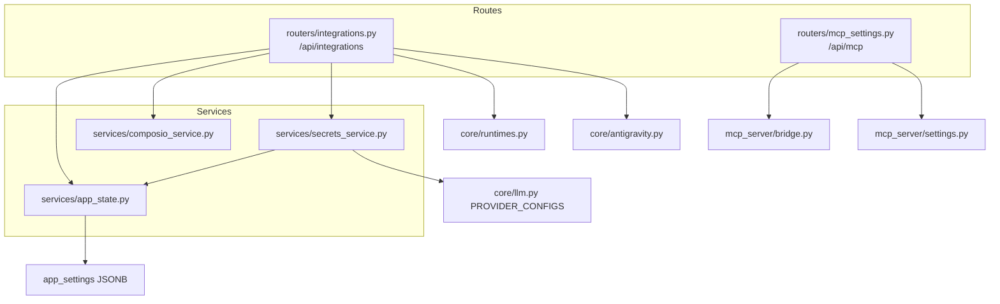
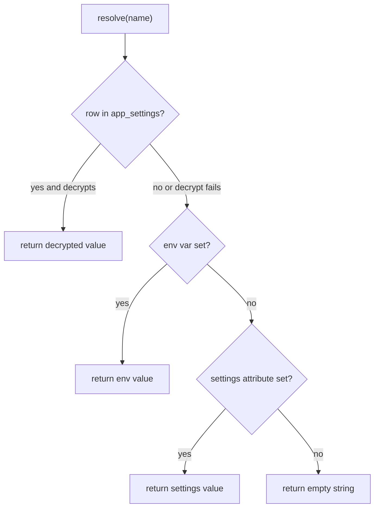
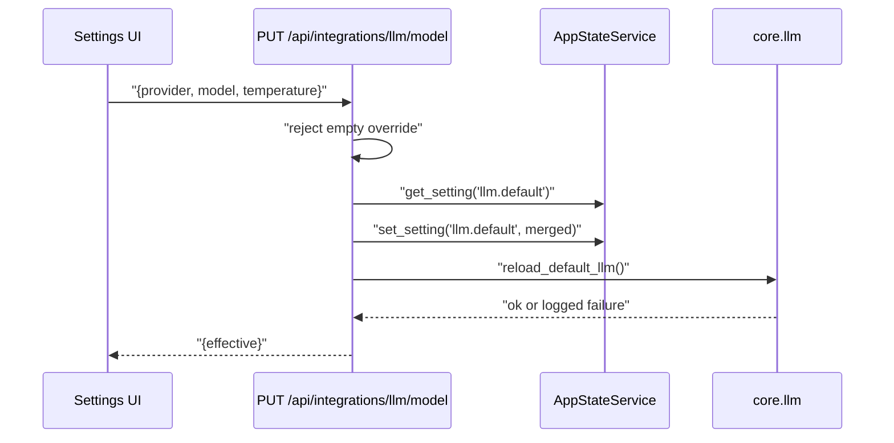

# Integrations and settings API

This route group is the settings backend for both clients. It reports what is configured, stores encrypted secrets, selects the default LLM, manages Composio connections, edits subscription runtimes, controls MCP tool groups and exposes infrastructure health. It is mounted at `/api/integrations` from `routers/integrations.py`, with the MCP routes at `/api/mcp` from `routers/mcp_settings.py`.

Most writes land in `app_settings` through `AppStateService`, encrypted where the value is a credential. Reads never return plaintext secrets. They return masked previews and a source marker of `db`, `env` or `unset`.

Key capabilities:
- Effective versus env default LLM, for chat and for chat titles
- Encrypted secret storage with env fallback
- Composio toolkit listing, connect, rename and disconnect
- Google and GitHub OAuth client credentials
- Subscription runtime configuration and Antigravity install and login
- MCP tool group settings applied live
- Compaction budget settings
- Postgres, Neo4j and OpenSearch reachability

## Repository layout

## Building blocks

- `routers/integrations.py`: 46 routes plus private helpers `_llm_env_status`, `_llm_effective`, `_voice_effective`, `_composio_status`, `_llm_secrets`, `_voice_secrets` and `_infra_status`.
- `routers/mcp_settings.py`: `_status`, `get_settings`, `put_settings`, `restart`. Settings live in a JSON file that `mcp_server/settings.py` writes under `~/.agentic-browser/`.
- `services/secrets_service.py`: `SECRET_REGISTRY` maps a public secret name to `(AppSetting key, env var, settings attribute)`. `SecretsService` implements `get_raw`, `set`, `clear`, `resolve`, `resolve_sync`, `list_status` and typed helpers for OAuth clients, Composio, PyJIIT and Telegram.
- `services/app_state.py`: `AppStateService.get_setting`, `set_setting` and `delete_setting` over `AppSetting`, keyed by `(user_id, key)`.

The setting keys used by this page are `llm.default` and `llm.chat_title` (provider, model, temperature), `voice.config`, `secrets.{name}`, `oauth_clients.{provider}`, `composio.config`, `pyjiit.credentials` and `compaction.config`. Credential-shaped values are encrypted before they are written.

## How it fits together

Settings reads resolve through `SecretsService`, which reads `AppSetting` and falls back to environment variables and `Settings` attributes. Writes encrypt the value and store it under a `secrets.*`, `oauth_clients.*` or typed key, then optionally reload the default LLM. MCP settings are the exception. They live in a JSON file owned by `mcp_server.settings` and are applied in process plus announced to connected clients.

## Status and inventory endpoints

| Method | Path | Handler | Response |
| --- | --- | --- | --- |
| GET | `/status` | `status` | composio, composio_config, llm, search, pyjiit, voice, telegram, native_tools, agents, infra |
| GET | `/agents` | `agents_list` | `{"agents": REGISTERED_AGENTS}` |
| GET | `/native` | `native_tools_list` | `{"tools": NATIVE_TOOLS}` |
| GET | `/infra` | `infra` | `{"postgres", "neo4j", "opensearch"}` with `ok` and optional `error` |
| GET | `/llm/providers` | `llm_providers` | provider name to bool |

`REGISTERED_AGENTS` lists `react_agent` (`agents.react_agent`), `while_loop_harness` (`agents.while_loop_harness`) and `browser_use` (`services.browser_runtime_service`). `NATIVE_TOOLS` lists `pyjiit`, `skills`, `voice`, `browser-use`, `website`, `google-search` and `github-crawler` with their auth mode.

`/infra` does real checks: `SELECT 1` on the SQLAlchemy engine for Postgres, and the presence of `_driver` and `_client` for Neo4j and OpenSearch. It does not open connections.

## LLM endpoints

| Method | Path | Body | Response |
| --- | --- | --- | --- |
| GET | `/llm/models` | `refresh` query | `{"default": {...}, "providers": catalog(refresh)}` |
| GET | `/llm/model` | none | `{"effective", "providers_configured", "env_default"}` |
| PUT | `/llm/model` | `LLMOverride` | `{"effective": {...}}` |
| DELETE | `/llm/model` | none | `{"effective": {...}}` |
| GET | `/llm/chat-title` | none | effective, configured providers, env default |
| PUT | `/llm/chat-title` | `ChatTitleLLMOverride` | `{"effective": {...}}` |
| DELETE | `/llm/chat-title` | none | `{"effective": {...}}` |

`LLMOverride` and `ChatTitleLLMOverride` both have `provider`, `model` and `temperature`, all optional. `PUT` rejects an empty body with 400 `At least one of provider/model/temperature is required`, merges the non-null fields into the existing setting, and calls `reload_default_llm()`. A reload failure is logged and does not fail the request.

`GET /llm/model` computes the effective value from the saved override merged over the env default. The env default uses `default_llm_provider`, `default_llm_model` or the provider's `default_model` from `PROVIDER_CONFIGS`, and `default_llm_temperature`. The `source` field is `db` when an override exists, else `env`.

## Secret endpoints

`GET /secrets` returns one row per registry entry with `name`, `env_var`, `db_set`, `env_set`, `source` and `masked`. `PUT /secrets/{name}` writes an encrypted value and reloads the default LLM. `DELETE` removes the database row, which falls back to env if present.

Status codes: 404 `{"code": "unknown_secret", "name": ...}` for a name not in `SECRET_REGISTRY`, 400 for an empty value, 200 with `{"status": "ok", "name": ...}` otherwise.

The registry covers LLM keys and base URLs (`google_api_key`, `openai_api_key`, `anthropic_api_key`, `deepseek_api_key`, `openrouter_api_key`, `opencode_api_key`, `openai_base_url`, `anthropic_base_url`, `google_base_url`, `ollama_base_url`), search and voice keys (`tavily_api_key`, `elevenlabs_api_key`, `cartesia_api_key`, `groq_api_key`, `xai_api_key`, `voice_custom_api_key`) and Telegram (`telegram_bot_token`, `telegram_allowed_users`).

`mask` keeps the first three and last four characters for values longer than eight characters. Shorter values become bullets only.

## OAuth client and connection endpoints

| Method | Path | Body | Response |
| --- | --- | --- | --- |
| GET | `/oauth` | none | `{"connections": [...]}` |
| DELETE | `/oauth/{provider}` | none | `{"status": "disconnected", "provider"}` |
| GET | `/oauth-clients` | none | `{"clients": [{provider, client_id_masked, client_secret_masked, client_id_source, client_secret_source}]}` |
| PUT | `/oauth-clients/{provider}` | `OAuthClientPayload` | `{"status": "ok", "provider"}` |
| DELETE | `/oauth-clients/{provider}` | none | `{"status": "ok", "provider"}` |

`OAuthClientPayload` has `client_id` and `client_secret`, both optional. At least one is required, otherwise 400. Only `google` and `github` are accepted. Anything else is 404 `{"code": "unknown_provider"}`. Values are encrypted individually, and setting only one field preserves the other.

`DELETE /oauth/{provider}` calls `OAuthCredentialsService.delete`, which canonicalises aliases first. `gmail`, `calendar`, `youtube` and `google-search` all map to `google`. A missing row returns 404 `{"code": "not_connected", "provider": ...}`.

## Composio endpoints

| Method | Path | Body | Response |
| --- | --- | --- | --- |
| GET | `/composio` | none | status object |
| GET | `/composio/toolkits` | none | `{"toolkits": [...]}` |
| GET | `/composio/toolkits/{toolkit}/tools` | none | `{"tools": [...]}` |
| POST | `/composio/connect/{toolkit}` | none | authorization payload |
| DELETE | `/composio/{connected_account_id}` | none | `{"status": "disconnected", "id"}` |
| POST | `/composio/connections/{connected_account_id}/rename` | `{"alias": str}` | `{"status": "ok", "id", "alias"}` |
| GET | `/composio-config` | none | masked config with sources |
| PUT | `/composio-config` | `{"api_key", "user_id"}` | `{"status": "ok"}` |
| DELETE | `/composio-config` | none | `{"status": "ok"}` |

The status object always has `configured`, `user_id`, `connected`, `toolkits`, `catalog_count` and `error`. With no API key it returns `configured=false` and `catalog_count = len(CURATED_TOOLKITS)`. When the upstream rejects the key with `Invalid API key`, the message is rewritten to explain that the Project API key is required.

Status codes: `POST /composio/connect/{toolkit}` returns 409 `composio_auth_config_required` with `setup_url` when the toolkit needs auth config in the Composio dashboard, 400 `composio_not_configured` when no key is set, and 500 for other failures. Rename rejects a blank alias with 400. Disconnect maps `ComposioNotConfigured` to 400.

## PyJIIT, voice and compaction endpoints

| Method | Path | Body | Response |
| --- | --- | --- | --- |
| GET | `/pyjiit` | none | `{"username", "password_masked", "configured"}` |
| PUT | `/pyjiit` | `{"username", "password"}` | `{"status": "ok"}` |
| DELETE | `/pyjiit` | none | `{"status": "ok"}` |
| PUT | `/voice` | `VoiceConfig` | `{"effective": {...}}` |
| DELETE | `/voice` | none | `{"effective": {...}}` |
| GET | `/compaction` | none | `{"settings", "budget_tokens"}` |
| PUT | `/compaction` | arbitrary dict | `{"settings", "budget_tokens"}` |

`PUT /pyjiit` needs at least one of username or password, otherwise 400. `VoiceConfig` defaults: `stt_mode="transcribe"`, `stt_provider="whisper_local"`, `stt_model="tiny"`, `stt_cleanup=false`, `stt_fallback_local=true`, `one_pass_provider="google"`, `one_pass_model="gemini-3.8-flash"`, `tts_provider="cartesia"`, `tts_voice="9fb269e7-70fe-4cbe-aa3f-28bdb67e3e84"`, `auto_submit=false`, `auto_speak=false`.

Voice writes merge into `voice.config`, and null fields are dropped before the merge. There is no POST voice route, only PUT and DELETE.

## Runtime endpoints

| Method | Path | Body | Response |
| --- | --- | --- | --- |
| GET | `/runtimes` | none | `{"runtimes": [...]}` each with `status` |
| PUT | `/runtimes/{runtime_id}` | arbitrary dict | runtime view |
| POST | `/runtimes` | `{label, command, args}` | runtime view |
| DELETE | `/runtimes/{runtime_id}` | none | `{"ok": true}` |
| POST | `/runtimes/{runtime_id}/test` | none | `runtimes.test_runtime` result |
| GET | `/runtimes/antigravity/runtime` | none | `antigravity.overview(...)` |
| POST | `/runtimes/antigravity/install` | none | install result |
| POST | `/runtimes/antigravity/login` | none | `{"url": str}` |
| POST | `/runtimes/antigravity/login/code` | `{"code": str}` | `{"ok": true}` |
| POST | `/runtimes/antigravity/use-t3-login` | none | runtime view |

`POST /runtimes` derives an id from the label with `re.sub(r"[^a-z0-9]+", "-", label.lower())`, appends `-2` while the id exists, and accepts `args` as a list or a shell string split with `shlex.split`. Missing label or command is 400.

`PUT /runtimes/{id}` returns 404 for an unknown id. `DELETE` returns 400 for a preset runtime (`Built-in runtimes can be turned off, not removed`). Antigravity install and login return 502 when the download or login helper fails. Login without a resolvable binary is 400, finish-login failure is 400, and a missing T3 profile is 404.

## MCP settings endpoints

| Method | Path | Body | Response |
| --- | --- | --- | --- |
| GET | `/api/mcp/settings` | none | status object |
| PUT | `/api/mcp/settings` | `McpSettingsUpdate` | status object |
| POST | `/api/mcp/restart` | none | status object |

`McpSettingsUpdate` fields: `browser_tools` bool, `memory_tools` bool, `browser_mode` one of `all`, `execute`, `plain`. Nulls are excluded before saving.

The status object contains `settings`, `enabled_tools`, `all_tools` split into `browser` and `memory`, `bridge` with `role` (`host` or `relay`), `url`, `mcp_url` and connected `browsers`, `settings_file`, and `notified_sessions`.

`PUT` saves the file, calls `apply_settings(current)` to rebuild this process's tool list, then `notify_tools_changed()` so connected MCP clients re-list tools. `POST /restart` re-reads the file and does the same without writing.

## Dependencies

The integrations router depends on `SecretsService`, `AppStateService`, `OAuthCredentialsService`, `composio_service`, `core.compaction`, `core.runtimes`, `core.antigravity` and `core.model_catalog`. Secrets use `core.crypto` and land in Postgres `app_settings`. The MCP router depends on `mcp_server.settings`, `mcp_server.bridge` and `mcp_server.server`.

External packages: `fastapi>=0.115.0`, `pydantic>=2.9.0`, `sqlalchemy[asyncio]>=2.0`, `pycryptodome>=3.23.0` through `core/crypto.py`, and `composio>=0.8.0`.

## Performance

- `GET /status` fans out to Composio, secrets listing, OAuth connections and an infra probe. It is the most expensive settings read.
- `GET /llm/models` calls `core.model_catalog.catalog(refresh)`, which is network backed unless cached. Pass `refresh=false` for routine opens.

## Troubleshooting

- `PUT /secrets/{name}` returns 404 for a key the UI lists: the name must match a key in `SECRET_REGISTRY`, not the env var name. Use `google_api_key`, not `GOOGLE_API_KEY`.
- A secret appears set but requests fail: `resolve()` prefers the database value. Clear the row to fall back to env, or overwrite it with the correct value.
- `GET /infra` shows `neo4j.ok=false` while memory writes work: the check only tests whether `_driver` exists. A lazy client that never connected reports false.
- `DELETE /runtimes/{id}` returns 400: the id is a preset. Disable it through `PUT` instead.
- MCP settings saved but tools unchanged in another client: that process re-reads the file on a watcher with a short delay. `POST /api/mcp/restart` only affects the process serving the request.
- Voice settings do not apply: `PUT /voice` drops null fields, so sending `null` cannot clear a value. Send an empty string or delete the whole `voice.config` with `DELETE /voice`.

## Appendix

### Implementation examples
- Effective LLM: `_llm_effective` merges `AppStateService.get_setting("llm.default")` over `_llm_default_from_env`.
- OAuth client read: `SecretsService.get_oauth_client` decrypts DB fields then falls back to `google_oauth_client_id`, `google_client_secret`, `github_client_id`, `github_client_secret`.
- MCP apply: `apply_settings` and `notify_tools_changed` imported from `mcp_server.server`.

### Source files
- `routers/integrations.py`
- `routers/mcp_settings.py`
- `services/app_state.py`
- `services/secrets_service.py`
