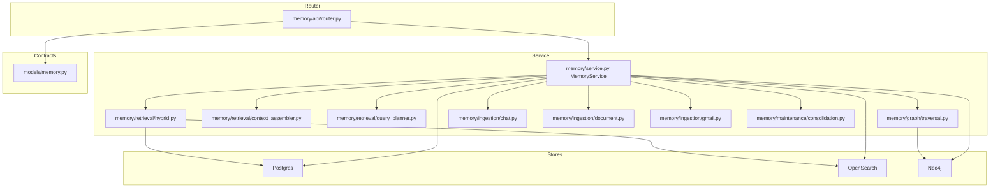
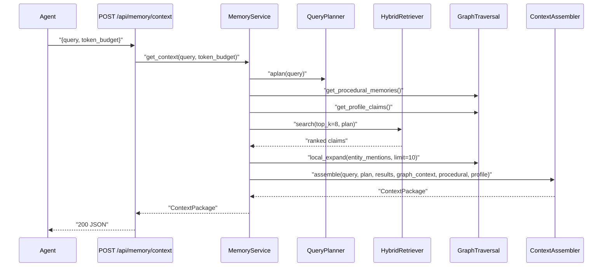
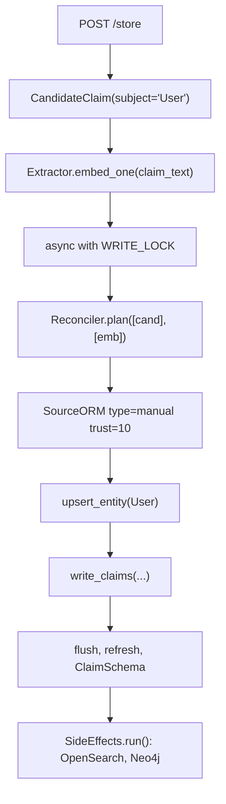

# Memory API

The memory router exposes the long-term memory system as HTTP. It is mounted at `/api/memory` from `memory/api/router.py` and served by a process-wide `MemoryService` singleton created lazily by `get_service()`.

The routes fall into five groups: retrieval, claims, graph and timeline, ingestion, and maintenance. Ingestion routes return immediately and run in FastAPI background tasks, so a 200 with `{"status": "queued"}` means accepted, not finished.

Key capabilities:
- Hybrid search over active claims, with optional provisional and history results
- Token-budgeted context packages for agent prompts
- Document fact search over artifacts and related claims
- Direct claim writes that go through the same reconcile step as chat ingestion
- Forget and clear operations across Postgres, OpenSearch and Neo4j
- Chat, document, profile, Composio and Gmail ingestion
- Maintenance triggers and history

## Repository layout

## Building blocks

- `memory/api/router.py`: the `APIRouter(tags=["memory"])` and one handler per route. `get_service()` caches a single `MemoryService`.
- `memory/service.py`: `MemoryService` composes `HybridRetriever`, `ContextAssembler`, `QueryPlanner`, `GraphTraversal`, `ConsolidationRunner`, `ChatIngestionPipeline` and `DocumentIngestionPipeline` in `__init__`.
- `models/memory.py`: every request and response model, plus enums for source type, memory class, tier, segment, claim status, entity type, evidence type, feedback kind, query type and relation type.

Request models used by the routes:

| Model | Fields |
| --- | --- |
| `MemorySearchRequest` | `query`, `top_k` 1 to 50 default 10, `tier_filter`, `segment_filter`, `memory_class_filter`, `include_provisional`, `time_range_start`, `time_range_end` |
| `DocumentFactSearchRequest` | `query`, `top_k` 1 to 50 default 10, `source_types`, `include_claims` default true |
| `StoreClaimRequest` | `claim_text`, `memory_class`, `segment`, `predicate`, `subject_name`, `object_literal`, `tier`, `confidence`, `base_importance`, `user_confirmed` |
| `UpdateClaimRequest` | `claim_text`, `status`, `confidence`, `base_importance`, `tier`, `user_confirmed`, `valid_to` |
| `ForgetRequest` | `claim_ids`, `entity_ids`, `source_ids`, `pattern` |
| `GraphExpandRequest` | `entity_id`, `entity_name`, `hops` 1 to 4 default 2, `edge_types`, `limit` 1 to 200 default 50 |
| `TimelineRequest` | `entity_name`, `topic`, `start`, `end`, `limit` 1 to 100 default 20 |

## Retrieval endpoints

| Method | Path | Handler | Body | Response |
| --- | --- | --- | --- | --- |
| POST | `/api/memory/search` | `memory_search` | `MemorySearchRequest` | list of `MemorySearchResult` |
| POST | `/api/memory/context` | `get_context` | `{"query", "token_budget"}` | `ContextPackage` |
| POST | `/api/memory/documents/facts` | `document_facts` | `DocumentFactSearchRequest` | list of `DocumentFactResult` |
| GET | `/api/memory/explain/{claim_id}` | `explain_claim` | path | claim plus up to ten evidence rows |
| GET | `/api/memory/profile` | `get_profile` | none | `{"profile_summary": str}` |

`POST /context` reads a plain dict, defaults `token_budget` to 3000 and rejects a missing query with 400 `query is required`. `POST /search` returns a list, not an envelope.

`MemorySearchResult` has `claim` (`ClaimSchema`), `score` rounded to four decimals, optional `subject_entity` and `object_entity`, and `evidence_count`. `ContextPackage` has `procedural_memories`, `semantic_facts` (search results), `graph_context` (dicts), `source_evidence` (artifacts), `profile_summary`, `profile_claims`, `total_tokens_estimate` and `query_type`.

`GET /explain/{claim_id}` returns `{"claim": {...}, "evidence": [{"evidence_type", "confidence", "source_id"}]}`. An unknown claim id returns `{"error": "Claim not found"}` with status 200, and a non-UUID string raises during `uuid.UUID` parsing and becomes 500.

The three lookups (plan, procedural memories, profile claims) run with `asyncio.gather`, so context assembly costs one plan call and one search in the common case.

## Tool endpoints

These three routes exist so the MCP server, which cannot import the backend, gets the same behavior as the agent's `recall_memory` and `write_memory` tools.

| Method | Path | Body | Response |
| --- | --- | --- | --- |
| POST | `/api/memory/tools/recall` | `query`, `top_k`, `include_provisional` | `{"text": str}` |
| POST | `/api/memory/tools/write` | `content`, `segment`, `importance`, `confidence` | `{"text": str}` |
| POST | `/api/memory/tools/documents` | `query`, `top_k` | `{"text": str}` |

`recall` and `documents` reject a blank query with 400 and clamp `top_k` to 1 through 20. `write` rejects blank content with 400, defaults `importance` to 0.6 and `confidence` to 0.75, and forwards to `tools.memory._write_memory`.

## Claim write endpoints

| Method | Path | Handler | Body | Response |
| --- | --- | --- | --- | --- |
| POST | `/api/memory/store` | `store_claim` | `StoreClaimRequest` | claim dump |
| PATCH | `/api/memory/claims/{claim_id}` | `update_claim` | `UpdateClaimRequest` | claim dump |
| POST | `/api/memory/confirm/{claim_id}` | `confirm_claim` | none | claim dump |
| POST | `/api/memory/forget` | `forget` | `ForgetRequest` | delete counts |
| POST | `/api/memory/clear` | `clear_memory` | none | per-store counts and warnings |

`store_claim` does not insert directly. It builds a `CandidateClaim` with `subject_name="User"` and predicate defaulting to `IS`, embeds the text, takes the global `WRITE_LOCK`, and calls `_store_reconciled`. That path creates a manual `SourceORM` with `trust_level=10`, upserts the `User` entity, runs the `Reconciler`, writes the claim and evidence, and runs side effects after commit.

`PATCH /claims/{id}` maps a `ValueError` from the service to 404 with the message. Every other failure becomes 500. The service updates only the fields present on the request, then tries to mirror the patch into OpenSearch and swallows index errors. `confirm_claim` is sugar for `user_confirmed=true` plus `status=active`.

`forget` returns `{"deleted_claims", "deleted_entities", "redacted_artifacts"}`. A `pattern` search is escaped for LIKE wildcards, limited to 100 claims, and excludes rows already marked deleted. Every matched claim is marked `deleted` in Postgres, its OpenSearch document is removed and its Neo4j claim node is deleted. Chat artifacts behind those claims are rewritten to `[forgotten]` and removed from the artifact index.

`clear` deletes in dependency order: feedback events, retrieval log, claim relations, evidence, claims, entities, artifacts, sources, maintenance runs. Then it clears the three OpenSearch indices and detaches every Neo4j node. A store that fails adds a warning and the top-level status becomes `partial`.

Status codes: 200 on success, 500 for any exception. `store` and `update` do not return 400 for invalid enum values. Pydantic rejects those with 422 before the handler runs.

## Feedback endpoints

| Method | Path | Body | Response |
| --- | --- | --- | --- |
| POST | `/api/memory/feedback` | `claim_id`, `kind`, `comment` | `{"status": "recorded"}` |
| POST | `/api/memory/mark-used` | `{"claim_ids": [...]}` | `{"status": "ok"}` |

`feedback` writes a `FeedbackEventORM` row and adjusts the claim. Thumbs up or confirmed raise `retrieval_hit_count` and multiply confidence by 1.05 capped at 1.0. Thumbs down multiply trust by 0.9 and confidence by 0.85. Explicit correction multiply trust by 0.7 and confidence by 0.6. The new scores are mirrored into OpenSearch. `mark-used` increments `retrieval_hit_count` and moves `last_accessed_at` for each id, which is the signal promotion and decay read.

## Graph and timeline endpoints

| Method | Path | Body | Response |
| --- | --- | --- | --- |
| POST | `/api/memory/graph/expand` | `GraphExpandRequest` | `GraphExpandResult` |
| POST | `/api/memory/timeline` | `TimelineRequest` | list of claim dumps |

`graph_expand` resolves an entity name directly, or looks up `entity_id` in Postgres first, then calls `GraphTraversal.local_expand` with the requested hops, edge types and limit. The result has `seed_entity`, `nodes`, `edges` and `claims`.

`timeline` calls `GraphTraversal.timeline`, which filters claims by entity or topic and a date window. `limit` is capped at 100 by the model.

## Ingestion endpoints

| Method | Path | Handler | Input | Response |
| --- | --- | --- | --- | --- |
| POST | `/api/memory/ingest/chat` | `ingest_chat` | `IngestChatRequest` | `{"status": "queued"}` |
| POST | `/api/memory/ingest/document` | `ingest_document` | multipart file, `trust_level`, `source_type`, `title`, `external_id` | `{"status", "filename"}` |
| POST | `/api/memory/ingest/profile` | `ingest_profile` | `IngestProfileRequest` | `{"status", "sources"}` |
| POST | `/api/memory/ingest/profile/document` | `ingest_profile_document` | multipart file, `source_type`, `trust_level`, `title`, `external_id` | `{"status", "filename", "source_type"}` |
| POST | `/api/memory/ingest/profile/composio/linkedin/me` | `ingest_composio_linkedin_me` | `IngestComposioLinkedInRequest` | `ComposioProfileResult` |
| POST | `/api/memory/ingest/profile/composio/aeroleads/linkedin` | `ingest_composio_aeroleads_linkedin` | `IngestComposioAeroLeadsRequest` | `ComposioProfileResult` |
| POST | `/api/memory/ingest/gmail` | `ingest_gmail` | `{"credentials", "user_email", "max_threads"}` | `{"status": "queued"}` |

Uploads are read fully into memory before the background task is scheduled. Document upload defaults to `trust_level=7`. Profile document upload defaults to `SourceType.PROFILE_DOCUMENT` and `trust_level=8`.

`_parse_source_type` raises 400 with the allowed values when a `source_type` form value is not a `SourceType`. Gmail ingestion requires `user_email` and defaults `max_threads` to 50. Its result is logged, never returned.

The two Composio routes are synchronous. They fetch the profile through Composio, stringify it, optionally ingest it, and return `ComposioProfileResult` with `toolkit`, `tool_name`, `source_type`, `raw_text` and optional `ingestion`. A failure returns 500.

## Maintenance endpoints

| Method | Path | Body | Response |
| --- | --- | --- | --- |
| POST | `/api/memory/maintenance/run` | `{"run_type"}` | `{"status": "queued", "run_type"}` |
| GET | `/api/memory/maintenance/history` | `limit` query, default 20 | list of run records |

`run_type` must be one of `micro_reflection`, `hourly`, `nightly`, `weekly`, otherwise 400 `Invalid run_type`. The background task calls `MemoryService.run_maintenance`, which dispatches to the matching `ConsolidationRunner` method.

History reads `MaintenanceRunORM` ordered by `started_at` descending and returns `run_id`, `run_type`, `status`, `claims_reviewed`, `claims_updated`, `claims_archived`, `started_at` and `finished_at`.

## Dependencies

The router depends on `MemoryService` and `tools/memory.py`. The service uses `core/db.py`, the OpenSearch and Neo4j clients under `core/clients`, `memory/embeddings.py`, `memory/ingestion/reconcile.py` and `memory/ingestion/writer.py`. Postgres holds the relational rows, OpenSearch the lexical index, and Neo4j the graph.

External packages: `fastapi>=0.115.0`, `pydantic>=2.9.0`, `sqlalchemy[asyncio]>=2.0`, `opensearch-py>=2.6`, `neo4j>=5.20` and `numpy>=1.26` for cosine math in the retriever.

## Performance

- `search` clamps `top_k` to 50 and the retriever requests `max(top_k * 3, 15)` candidates from OpenSearch before scoring.
- `context` default budget is 3000 tokens. The chat service calls the same path with 1200.

## Troubleshooting

- `POST /context` returns 500 with a missing table error: memory tables are created by `init_db()` at startup. If Postgres was down, the lifespan logs `Postgres init skipped` and continues. Restart after Postgres is reachable.
- Search returns nothing for a keyword: relevance has a floor (`MIN_RELEVANCE`) and a relative cutoff. Bare keywords are expanded into a question only in `vector_query`, and BM25 still uses the raw query.
- `forget` leaves text visible in chat: only artifacts of type `chat_turn` linked through evidence are redacted. Artifacts without an evidence link keep their text.

## Appendix

### Implementation examples
- Service singleton: `get_service()` in `memory/api/router.py`.
- Context assembly: `MemoryService.get_context` gathers plan, procedural and profile lookups, then calls `ContextAssembler(total_token_budget=...)`.
- Direct write: `MemoryService.store_claim` builds a `GateResult(GateDecision.STORE_AUTO, ...)` so the manual write skips gating but still reconciles.

### Source files
- `memory/api/router.py`
- `memory/service.py`
- `models/memory.py`
