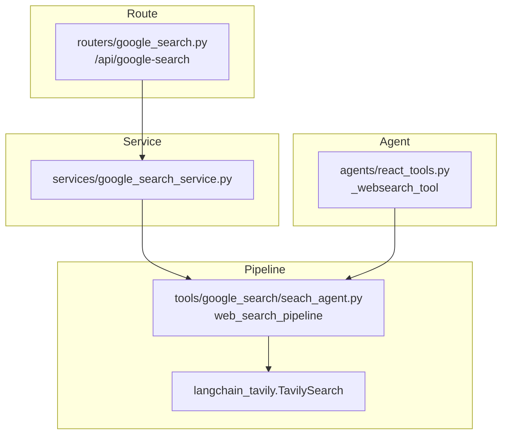
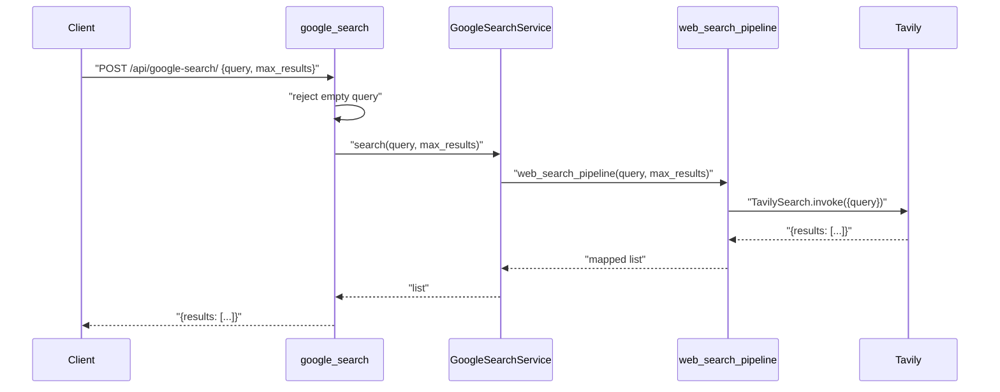
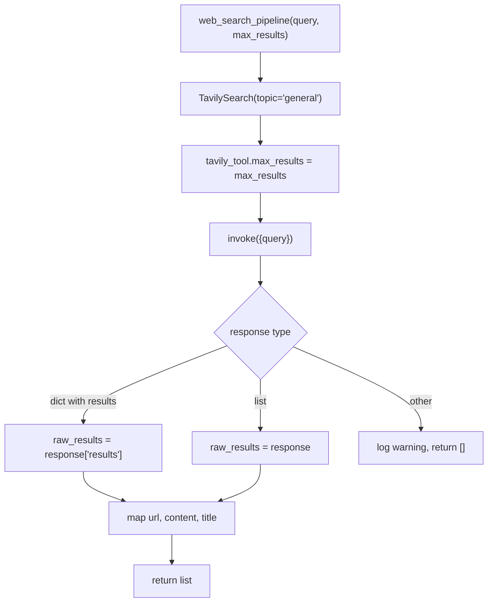
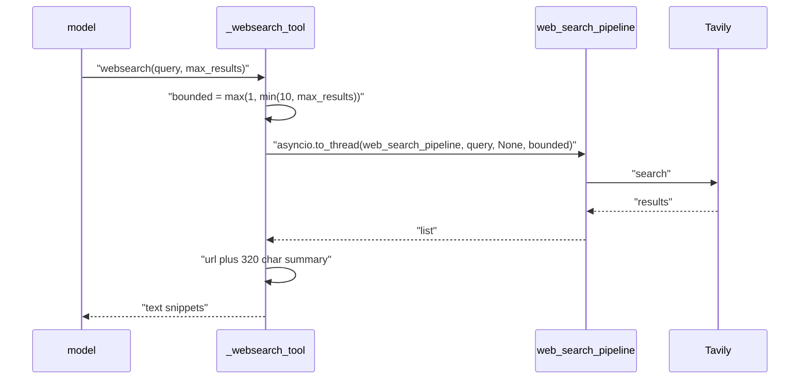
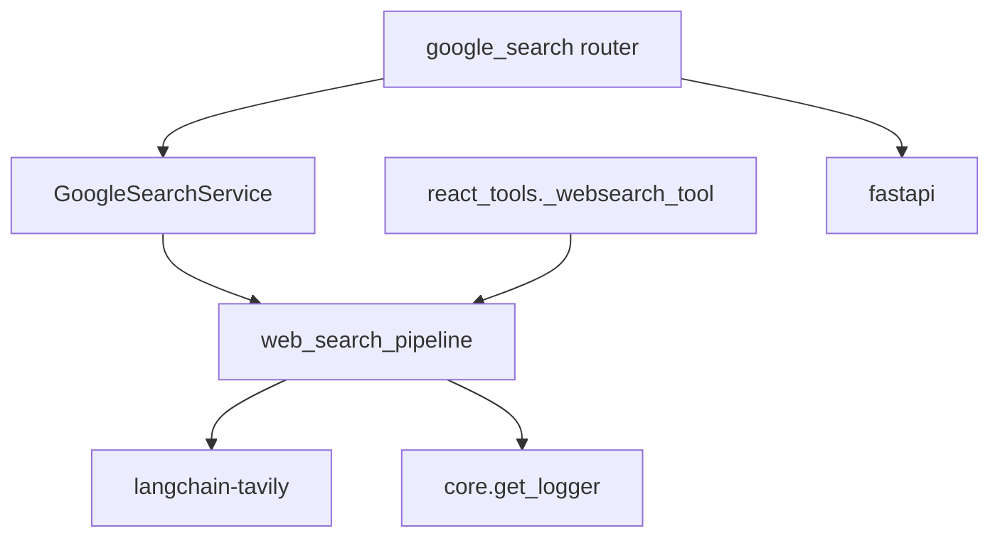

# Search integration API

The search route runs a server-side web search and returns the result list. It does not touch the user's Google account, even though it is called "google search". The handler is in `routers/google_search.py` and is mounted at `/api/google-search`.

The same pipeline powers the agent's `websearch` tool, so the HTTP route and the chat tool see the same results.

Key capabilities:
- One POST route with a query and a result count
- A Tavily-backed search pipeline
- Result objects with `url`, `md_body_content` and `title`
- A default of 5 results and no route-level cap
- Shared behaviour with the agent's web search tool

## Repository layout



## Building blocks

- `routers/google_search.py`: `SearchRequest` and the `google_search` handler, plus `get_google_search_service`.
- `services/google_search_service.py`: `GoogleSearchService.search`, which logs the query and delegates to `web_search_pipeline`.
- `tools/google_search/seach_agent.py`: `web_search_pipeline(query, search_url=None, max_results=5)`, the pipeline shared with the agent.
- `agents/react_tools.py`: `_websearch_tool` calls the same pipeline through `asyncio.to_thread` and formats snippets for the model.

`SearchRequest` has two fields:

| Field | Type | Default | Notes |
| --- | --- | --- | --- |
| `query` | str | required | Empty string returns 400 `query is required` |
| `max_results` | int | 5 | Passed to Tavily as `max_results` |

## How it fits together

The route is synchronous work behind an async handler. `GoogleSearchService.search` calls `web_search_pipeline` directly, so the event loop is occupied for the duration of the Tavily call.



`web_search_pipeline` accepts the response in two shapes. A dict with a `results` key is unpacked, and a bare list is used as is. Each entry is mapped to:

```json
{
  "url": "https://example.com",
  "md_body_content": "page content from Tavily",
  "title": "result title"
}
```

Tavily calls its content field `content`. The pipeline renames it to `md_body_content`, which is the name the agent tool and the older callers expect.



## Endpoint

`POST /api/google-search/` takes `SearchRequest` and returns `{"results": [...]}`.

| Status | Cause |
| --- | --- |
| 200 | A result list, possibly empty |
| 400 | `query` is empty |
| 422 | The body does not match `SearchRequest` |
| 500 | An exception escaped the service |

An empty query check happens before the pipeline. A missing `max_results` uses 5. The route does not cap the value, so a large number is passed straight to Tavily.

The pipeline itself catches exceptions, logs them with `logger.exception`, and returns an empty list. That means a Tavily failure usually arrives as a 200 with `{"results": []}`, not a 500. The 500 branch is for failures outside that catch, such as an import error or a failure in the service wrapper.

## Using it from an agent

`_websearch_tool` in `agents/react_tools.py` is the model-facing version of the same search:

- It clamps `max_results` to 1 through 10 with `max(1, min(10, max_results))`.
- It calls the synchronous pipeline through `asyncio.to_thread`, so the agent loop is not blocked.
- It returns `No web results were found.` when the list is empty.
- It formats each result as `URL: <url>` plus a `Summary:` line, truncating `md_body_content` to 320 characters.



The HTTP route does no formatting. Callers receive the raw mapped list.

## Dependencies



External packages: `fastapi>=0.115.0`, `pydantic>=2.9.0` and `langchain-tavily>=0.2.14`. The pipeline also relies on the Tavily API key resolved by the LLM and search settings, which is stored through [Integrations and settings API](Integrations%20and%20Settings%20API).

## Performance

- One Tavily call per request. `max_results` controls the response size directly.
- The pipeline is synchronous and the route calls it without a thread offload, so it blocks the worker for the call duration.
- The agent path uses `asyncio.to_thread` and clamps to 10 results, so a chat turn is bounded more tightly than the HTTP route.
- No caching. Repeated identical queries hit Tavily again.

## Troubleshooting

- `{"results": []}` with status 200: the pipeline caught an error or Tavily found nothing. Check the server log for `An error occurred during Tavily search` and confirm the Tavily key in settings.
- 400 `query is required`: the `query` field is empty. Whitespace is not stripped before the check, so `" "` passes.
- 500: the failure happened outside the pipeline catch. Usually an import error or a missing dependency in the deployed image.
- Results have empty `md_body_content`: Tavily returned no `content` for that result. The pipeline uses `res.get("content", "")`, so the key exists with an empty string.
- A very large `max_results` is slow: the HTTP route does not cap it. The agent tool caps at 10.
- The name says Google but results come from Tavily: this route is server-side search, not a Google account API. Gmail and Calendar are the account-backed routes.

## Appendix

### Implementation examples
- Handler: `google_search` rejects an empty query with `HTTPException(400, "query is required")`.
- Service call: `results = service.search(request.query, max_results=request.max_results)`.
- Pipeline clamp in the agent: `bounded = max(1, min(10, max_results))`.
- Result mapping: `{"url": res.get("url", ""), "md_body_content": res.get("content", ""), "title": res.get("title", "")}`.
- Response envelope: `{"results": results}`.

### Source files
- `routers/google_search.py`
- `services/google_search_service.py`
- `tools/google_search/seach_agent.py`
- `agents/react_tools.py`
