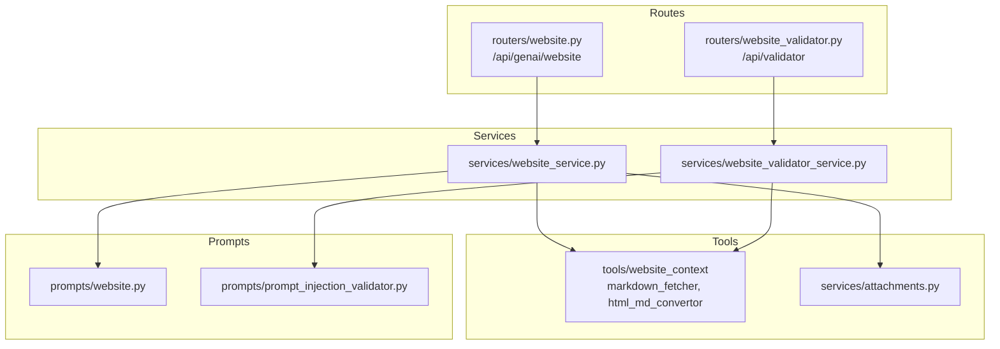
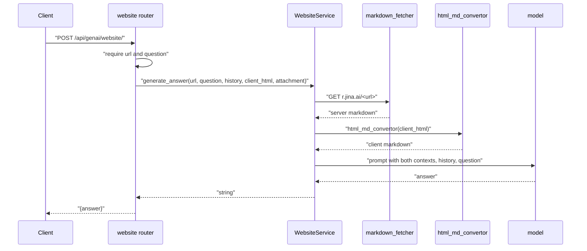
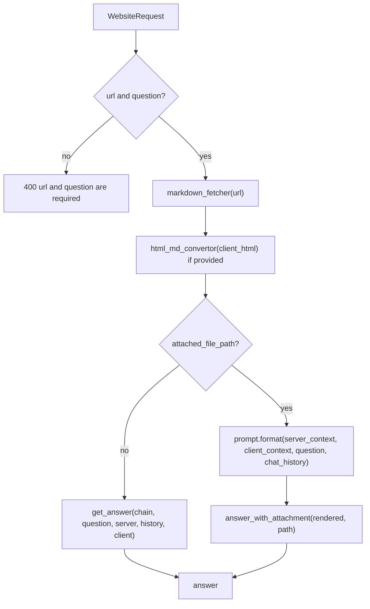
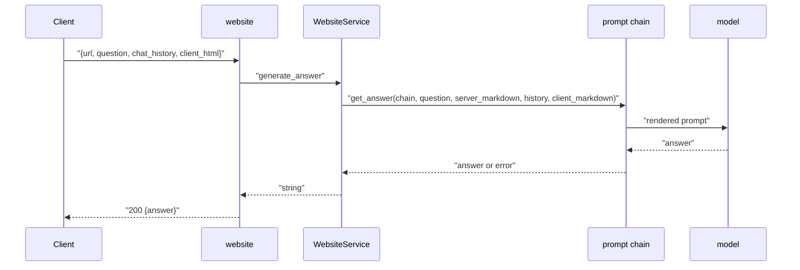
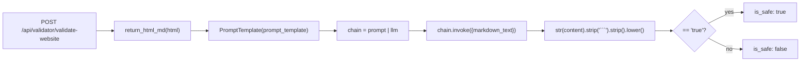
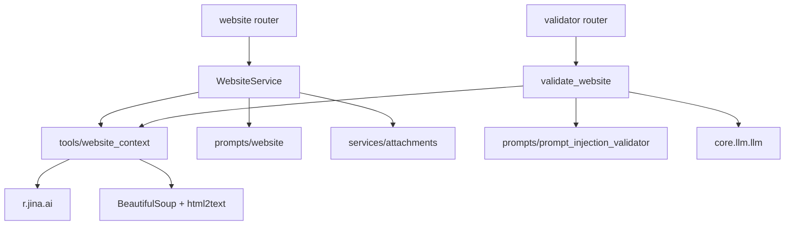

# Website processing API

The website routes answer questions about a page and check page content for prompt injection. The answer route fetches the page server side and can also take the browser's own HTML, which matters when the page is behind a login. The validator is a synchronous prompt check over submitted HTML.

The routes are mounted at `/api/genai/website` from `routers/website.py` and `/api/validator` from `routers/website_validator.py`. Both build on `tools/website_context`, which converts HTML to markdown.

Key capabilities:
- Page question answering with a server-side markdown fetch
- Client HTML fallback for authenticated or dynamic pages
- An optional attached file sent as a message part
- Prompt injection validation over submitted HTML
- A boolean `is_safe` result from a model check

## Repository layout



## Building blocks

- `routers/website.py`: `WebsiteRequest` validation, the `website` handler, and `get_website_service`.
- `services/website_service.py`: `WebsiteService.generate_answer` and its prompt chain.
- `tools/website_context/request_md.py`: `return_markdown`, exported as `markdown_fetcher`. It requests `https://r.jina.ai/<url>` and returns the response text.
- `tools/website_context/html_md.py`: `return_html_md`, exported as `html_md_convertor`. It parses HTML with BeautifulSoup, picks the body, prettifies, and runs `html2text`.
- `routers/website_validator.py`: `validate_website_endpoint`, a plain `def` handler.
- `services/website_validator_service.py`: `WebsiteValidatorRequest` (`html`), `WebsiteValidatorResponse` (`is_safe`), and `validate_website`.
- `prompts/website.py`: `prompt`, `get_chain`, `get_answer`.
- `prompts/prompt_injection_validator.py`: `prompt_template`.

`WebsiteRequest` fields:

| Field | Type | Default | Notes |
| --- | --- | --- | --- |
| `url` | str | required | Empty returns 400 |
| `question` | str | required | Empty returns 400 |
| `chat_history` | list[dict] | `[]` | Flattened to `role: content` lines |
| `client_html` | str or null | null | Raw page HTML from the extension |
| `attached_file_path` | str or null | null | A path returned by the upload route |

## How it fits together

`WebsiteService.generate_answer` always fetches server markdown first. If `client_html` is present it also converts that, so the prompt can compare what the server sees with what the browser sees. The two contexts are rendered into one prompt.



When `attached_file_path` is set, the service renders the same prompt and then calls `services.attachments.answer_with_attachment(rendered, path)`. The model sees the page context in the prompt and the file as a message part.



## Website endpoint

`POST /api/genai/website/` takes `WebsiteRequest` and returns `{"answer": str}`.

| Status | Cause |
| --- | --- |
| 200 | An answer, or the service's apology string |
| 400 | `url` or `question` is empty |
| 422 | The body does not match `WebsiteRequest` |
| 500 | An exception escaped the service catch |

The handler checks the values after Pydantic validation, so `url=""` and `question=""` reach the 400 branch. It catches `HTTPException` and re-raises it. Any other exception becomes 500 with `Internal server error \n<exception>`.

`WebsiteService.generate_answer` has its own broad catch. It logs and returns `I apologize, but I encountered an error processing your question. Please try again.` with status 200. A 500 from this route therefore means the failure happened outside that catch.



## Validator endpoint

`POST /api/validator/validate-website` takes `{"html": str}` and returns `{"is_safe": bool}`.

The handler is a plain `def`, so FastAPI runs it in the threadpool. `validate_website` does three things:

1. Converts the HTML to markdown with `return_html_md`.
2. Builds a `PromptTemplate` from `prompt_template` with the `markdown_text` variable and pipes it into `llm`.
3. Strips backticks and whitespace from the model's content, lowercases it, and compares it to the string `"true"`.

There is no try/except. An LLM error becomes a 500 from FastAPI, and a model answer that is not exactly `true` becomes `is_safe: false`.



The check is an LLM judgement, not a parser. A page with no injection but unusual formatting can still come back unsafe if the model does not answer exactly `true`.

## Dependencies



External packages: `fastapi>=0.115.0`, `pydantic>=2.9.0`, `requests>=2.32.3`, `beautifulsoup4`, `html2text` and `langchain>=0.3.27` for the validator chain.

## Performance

- The server fetch to `r.jina.ai` happens inside the request and has no explicit timeout in `return_markdown`.
- HTML conversion is in process and runs over the whole document.
- The prompt carries both server and client context, so a large page costs tokens twice.
- The validator makes one model call per payload after converting the whole document to markdown.
- The validator is sync and runs in the threadpool, so it does not block the event loop.

## Troubleshooting

- Answers ignore the live DOM: `client_html` must be sent. The server fetch uses `markdown_fetcher(url)` and may see a different page than the logged-in browser.
- A 500 with `Internal server error`: the service catch did not handle it. Check the server log for the traceback.
- A 200 with the apology string: `WebsiteService` caught the error. The usual causes are a failed Jina fetch or a model error.
- The server markdown starts with `Error fetching content from`: `requests` failed in `return_markdown` and the tool returned the error as text. The model may treat it as page content.
- `is_safe: false` on a benign page: the model did not answer exactly `true`. Run the same HTML through the prompt and inspect the raw content.
- Validator returns 500: the LLM call raised. Check the model configuration and key in [Integrations and settings API](Integrations%20and%20Settings%20API).
- An attached file is refused: `answer_with_attachment` only reads paths under `uploads/`. Upload the file through [File upload API](File%20Upload%20API) first.

## Appendix

### Implementation examples
- Server fetch: `markdown_fetcher = return_markdown`, which requests `https://r.jina.ai/` plus the URL.
- Client conversion: `html_md_convertor = return_html_md`, which runs `html2text.html2text` on the prettified body.
- Attachment prompt: `prompt.format(server_context, client_context, question, chat_history)` then `answer_with_attachment`.
- Validator comparison: `str(result.content).strip("```").strip().lower() == "true"`.
- Response model: `WebsiteValidatorResponse(is_safe=is_safe)`.

### Source files
- `routers/website.py`
- `routers/website_validator.py`
- `services/website_service.py`
- `services/website_validator_service.py`
- `tools/website_context/__init__.py`
- `tools/website_context/request_md.py`
- `tools/website_context/html_md.py`
