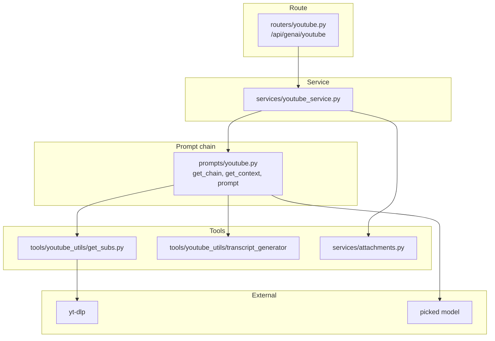
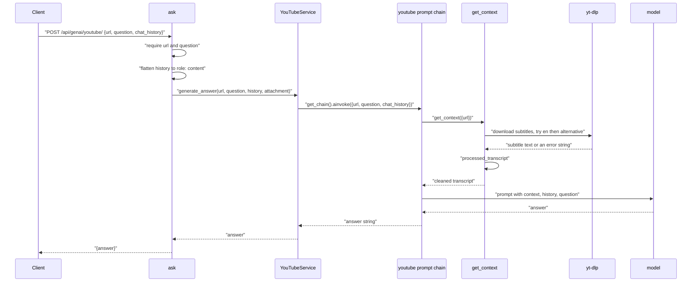
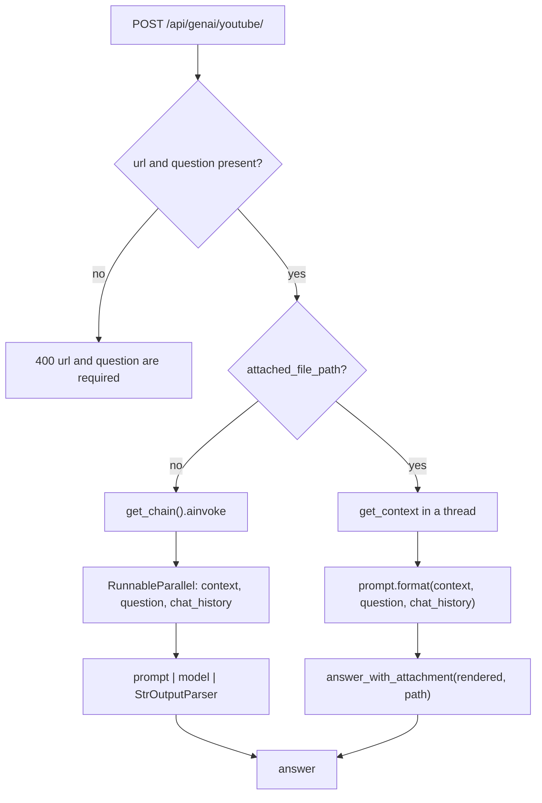
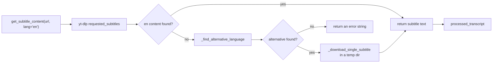
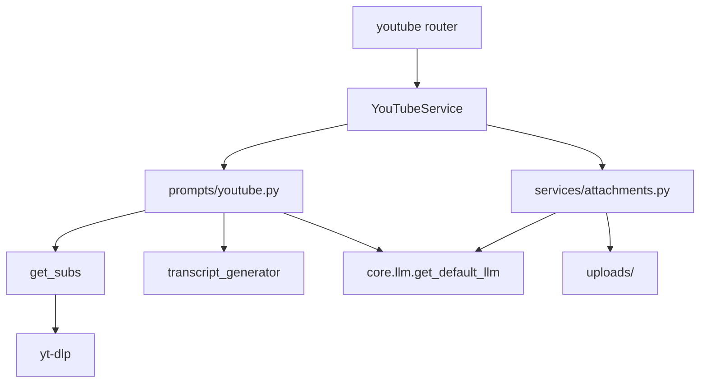

# YouTube integration API

The YouTube route answers questions about a video. The service fetches the video's subtitles, cleans them into a transcript, and sends the transcript plus the question through a prompt chain. It is mounted at `/api/genai/youtube` from `routers/youtube.py`.

There is one endpoint, `POST /api/genai/youtube/`. It does not return video metadata, view counts or a transcript as separate fields. Everything the model sees arrives through the prompt context.

Key capabilities:
- One question route for a YouTube URL
- Subtitle download through `yt-dlp`, with an alternative language retry
- Transcript cleanup that removes timestamps, SRT markup and repeated sentences
- Chat history flattened into the prompt
- An optional attached file sent as a message part
- An apology string instead of a raised error when the chain fails

## Repository layout

## Building blocks

- `routers/youtube.py`: `AskRequest` validation, history flattening, the `ask` handler, and `get_youtube_service`.
- `services/youtube_service.py`: `YouTubeService.generate_answer`.
- `prompts/youtube.py`: `fetch_transcript`, `get_context`, `prompt`, `get_chain`, `get_answer`.
- `tools/youtube_utils/get_subs.py`: `get_subtitle_content(video_url, lang="en")`, which runs `yt_dlp.YoutubeDL`.
- `tools/youtube_utils/transcript_generator`: `processed_transcript`, which applies `clean_transcript`, `clean_srt_text`, `clean_timestamps_and_dedupe` and `remove_sentence_repeats`.
- `services/attachments.py`: `answer_with_attachment`, used when a file is attached.

`AskRequest` fields:

| Field | Type | Default | Notes |
| --- | --- | --- | --- |
| `url` | str | required | The video URL |
| `question` | str | required | Empty or missing returns 400 |
| `chat_history` | list[dict] | `[]` | Flattened to `role: content` lines |
| `attached_file_path` | str or null | null | A path returned by the upload route |

## How it fits together

`ask` validates `url` and `question`, flattens the history, and calls `service.generate_answer(url, question, chat_history_str, attached_file_path)`. The service has two paths: the normal chain, and the attachment path.

The chain is built per request with `get_chain()`. That matters because the chain holds a model client resolved at call time, so the model picker and the per-request headers apply. The old module-level chain kept the model from import time.

## Transcript handling

`fetch_transcript` calls `get_subtitle_content(video_url)` and checks the return value against known error strings:

- `Video unavailable.`
- `Subtitles not available for the specified language.`
- `Subtitles were requested but could not be retrieved from file.`
- `Subtitles not available for the specified language or download failed.`

It also treats strings starting with `Error downloading subtitles:` or `An unexpected error occurred while fetching subtitles:` as errors. A real transcript goes through `processed_transcript`. An error or empty value becomes an empty context string, and the prompt is told to answer `Data not available.` when the context does not cover the question.

`get_subtitle_content` asks for English first, then finds another available language from the `yt-dlp` info dict and makes one more request. It catches `yt_dlp.utils.DownloadError` and returns a readable error string rather than raising.

## Attachment path

When `attached_file_path` is set, the service does not use `get_chain`. It calls `get_context` through `asyncio.to_thread`, renders the same prompt with `prompt.format(context=transcript, question=question, chat_history=chat_history)`, then calls `answer_with_attachment(rendered, attached_file_path)`.

`answer_with_attachment` loads the file from `uploads/`, sends images as an `image_url` block and text or PDF files as text, and makes one model call with the rendered prompt. It returns a user-facing message instead of raising when the file is missing or the model cannot read images.

## Error handling

| Status | Cause |
| --- | --- |
| 200 | An answer, or the service's apology string |
| 400 | `url` or `question` is empty |
| 422 | The body does not match `AskRequest` |
| 500 | An exception escaped the router's own catch |

`YouTubeService.generate_answer` catches exceptions from the chain and returns `I apologize, but I encountered an error processing your question about the video. Please try again.` with status 200. The router only sees a 500 if its own code raises before or outside that call.

## Dependencies

External packages: `fastapi>=0.115.0`, `pydantic>=2.9.0`, `langchain>=0.3.27` and `yt-dlp>=2026.3.3`.

## Performance

- The transcript download happens inside the request. A large or slow video delays the response.
- The normal chain awaits `ainvoke`, so the event loop is free during the model call.
- The attachment path runs transcript extraction in a thread, then makes one model call.
- Transcript cleanup happens in process and is linear in transcript length.
- There is no transcript cache. Asking two questions about the same video downloads the subtitles twice.

## Troubleshooting

- Empty or "Data not available" answers: the subtitle fetch failed. Check the `yt-dlp` log line and the error string returned by `get_subtitle_content`. A video with no captions and no auto-generated track has no transcript to use.
- `Subtitles not available for the specified language.` in the log: English was missing and no alternative language was found. The route still returns 200 with the model's fallback answer.
- The model answers about the wrong video: the URL was accepted but `yt-dlp` resolved a different id. Check `extract_video_id` and the URL shape.
- An answer ignores an attached file: the attachment path skips the chain and sends the file as a message part. Confirm the path came from `/api/upload` and still exists under `uploads/`.
- A slow first response: `yt-dlp` is fetching the page and subtitles. Subsequent questions re-fetch and are equally slow.
- The answer is an apology with status 200: the service caught a chain or model error. Read the server log for `Error generating answer with LLM`.
- A 400 on a body that looks complete: the handler checks the values after Pydantic, so `url=""` or `question=""` reaches the 400 branch.

## Appendix

### Implementation examples
- History flattening: `chat_history_str += f"{role}: {content}\n"` in `routers/youtube.py`.
- Per-request chain: `response = await get_chain().ainvoke({"url": url, "question": question, "chat_history": chat_history})`.
- Known errors: `known_error_messages` and `known_error_prefixes` in `prompts/youtube.py`.
- Attachment render: `prompt.format(context=transcript, question=question, chat_history=chat_history)`.
- Apology string: returned by `YouTubeService.generate_answer` in the `except` branch.

### Source files
- `routers/youtube.py`
- `services/youtube_service.py`
- `prompts/youtube.py`
- `tools/youtube_utils/get_subs.py`
- `tools/youtube_utils/transcript_generator/__init__.py`
- `services/attachments.py`
