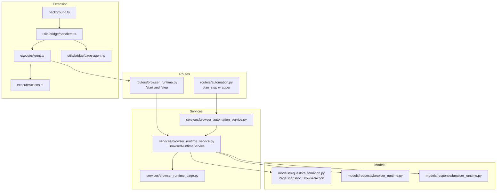
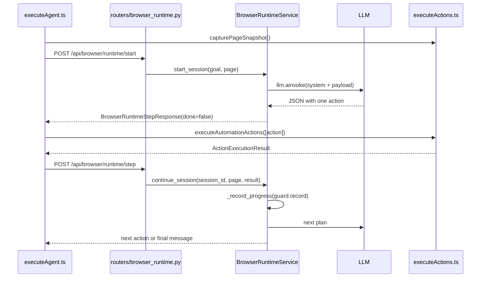
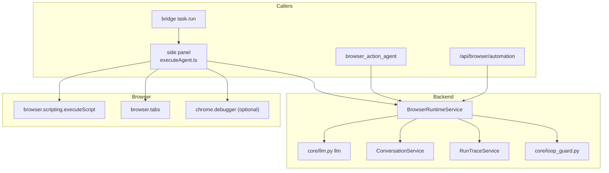
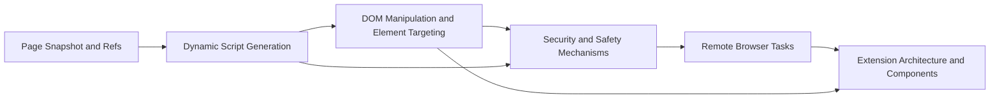

# Browser automation

Browser automation in this project is a loop between a planner and a real Chrome tab. The backend plans exactly one action per request, the extension executes it against the live page, and the extension posts the resulting page snapshot and `ActionExecutionResult` back. `services/browser_runtime_service.py` owns the session state and the planner call, `clients/browser-extension/entrypoints/utils/executeActions.ts` owns execution, and `core/loop_guard.py` decides when the loop is going in circles.

The side panel drives the loop itself through `/api/browser/runtime/start` and `/api/browser/runtime/step`. Other clients (Telegram, the debug console, any MCP client) have no executor, so they call `browser_task`, which reaches the extension's `task.run` bridge method and runs the same loop inside the service worker.

Key capabilities:
- One action per model turn, with `done`, `message`, `expected_state`, `verification`, and `notes` in the reply.
- A page snapshot built in the page: accessibility roles, refs such as `[ref=e12]`, visible text, and media state.
- Login, captcha, and permission walls detected before planning, returned as `status="blocked"` with `requires_user_input=True`.
- Progress-based loop protection instead of a hard step cap.
- Remote tasks from the bridge, Telegram, or the console that reuse the same planner.
- An extension layer that handles both tab control and DOM actions through `browser.scripting`.

## Pages in this folder

| Page | What it covers |
| --- | --- |
| [Dynamic Script Generation](Dynamic%20Script%20Generation) | The runtime planner: sessions, prompt payload, JSON parsing, notes, tracing. |
| [DOM Manipulation and Element Targeting](DOM%20Manipulation%20and%20Element%20Targeting) | The action executor: selectors, refs, typing, clicks, verification. |
| [Page Snapshot and Refs](Page%20Snapshot%20and%20Refs) | The in-page outline: roles, visibility, ref lifetime, frame stitching. |
| [Security and Safety Mechanisms](Security%20and%20Safety%20Mechanisms) | The loop guard signals and the captcha, login, and permission blockers. |
| [Remote Browser Tasks](Remote%20Browser%20Tasks) | `browser_task`, the bridge transport, `task.run`, and the worker loop. |
| [Extension Architecture and Components](Extension%20Architecture%20and%20Components) | WXT entrypoints, runtime messages, the bridge client, permissions. |

## Repository layout

The route layer is thin. `routers/browser_runtime.py` exposes the two POST handlers. The service layer holds the session dict, prompt assembly, JSON parsing, and trace writes. The extension side is split between the executor, the message worker, and the bridge handlers.

## How the loop is split

The sequence is the same for a side-panel run and a remote run, only the caller differs.

A remote run replaces the first and last participant with `runRemoteBrowserTask`, which posts the same requests from the service worker. The planner cannot tell the difference, and the action vocabulary is identical.

## Shared concepts

- `PageSnapshot`: `url`, `title`, `visible_text`, `active_element`, `interactive`, `media`, `screenshot`. Defined in `models/requests/automation.py` and mirrored as a TypeScript type in `executeActions.ts`.
- `BrowserAction`: `type` plus optional `selector`, `text`, `role`, `value`, `url`, `active`, `key`, `command`, `direction`, `amount`, `ms`, and `description`.
- `ActionExecutionResult`: `action`, `success`, `error`, `verification`, `before`, `after`.
- `BrowserRuntimeStepResponse`: `session_id`, `step`, `done`, `status`, `message`, `action`, `expected_state`, `verification`, `reason`, `requires_user_input`, `conversation_id`, `run_id`, `loop_check`.
- `LoopGuard`: a per-session `record(call, outcome)` accumulator whose verdict is fed into the next prompt.

The `PageSnapshot` fields are the planner's whole view of the page. The executor fills `before` and `after` on every result, even a failed one, so the next plan sees what actually happened.

## Dependencies

Upstream callers are the two routes and the tools that start sessions (`tools/browser_use/tool.py`, `tools/remote_actions.py`). Downstream, the planner needs the configured chat model, the conversation and trace services, and Postgres when `persist` is true. The extension needs `chrome.scripting`, `chrome.tabs`, and optionally `chrome.debugger`.

## Reading order

Start with the snapshot if you need to understand what the model sees. Read the planner next, then the executor. The loop guard and the blockers explain why a run stops. The remote page explains the transport that makes the same loop available outside the side panel. The extension page explains where the code lives and how messages reach it.

## Performance

Sessions are an in-process class dict, so no database read is needed between steps. The planner sends at most 5000 characters of visible text, 80 interactive elements, four history entries, and 40 notes. Screenshots are downscaled to 1280 pixels wide at JPEG quality 0.55. The executor waits 350 ms after DOM actions and 150 ms after media actions. Remote trails keep the last 25 entries.

## Troubleshooting

- `404 Unknown browser runtime session`: the backend restarted, or `/step` was sent to a different worker process. Start a new session.
- `400 goal is required`: `start_browser_runtime` rejects a blank or whitespace goal before the service runs.
- `status="blocked"` with a captcha message: the page text contains `captcha` or `I'm not a robot`. The service refuses to plan around it.
- Planning failed with `Browser runtime planner returned no JSON object`: the model replied with prose or markdown. Check the configured model and temperature.
- An action is rejected silently as `action=None`: the type was not in `allowed_actions`, so `_parse_action` returned `None` and the run finished as blocked.
- The extension executes nothing: confirm the side panel is the caller. A non-side-panel client receives `browser_task`, not `browser_action_agent`.
- A remote task never returns: check the extension popup for bridge status and send `task.stop` before retrying.

## Appendix

### Implementation examples

- `POST /api/browser/runtime/start`: accepts `BrowserRuntimeStartRequest`, returns the first planned action or a final response.
- `POST /api/browser/runtime/step`: accepts `BrowserRuntimeStepRequest`, records progress, returns the next action.
- `BrowserRuntimeService._plan_next_step`: builds the prompt, calls `llm.ainvoke`, parses JSON, applies the guard verdict.
- `executeAutomationActions`: runs one action, captures before and after snapshots, verifies, and stops on the first failure.

### Source files

- `routers/browser_runtime.py`
- `services/browser_runtime_service.py`
- `services/browser_automation_service.py`
- `clients/browser-extension/entrypoints/utils/executeActions.ts`
- `clients/browser-extension/entrypoints/utils/bridge/page-agent.ts`
- `agents/react_tools.py`
