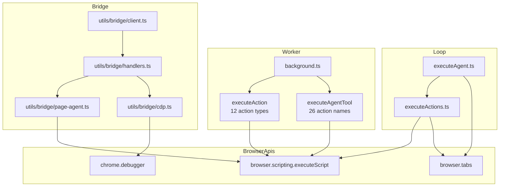
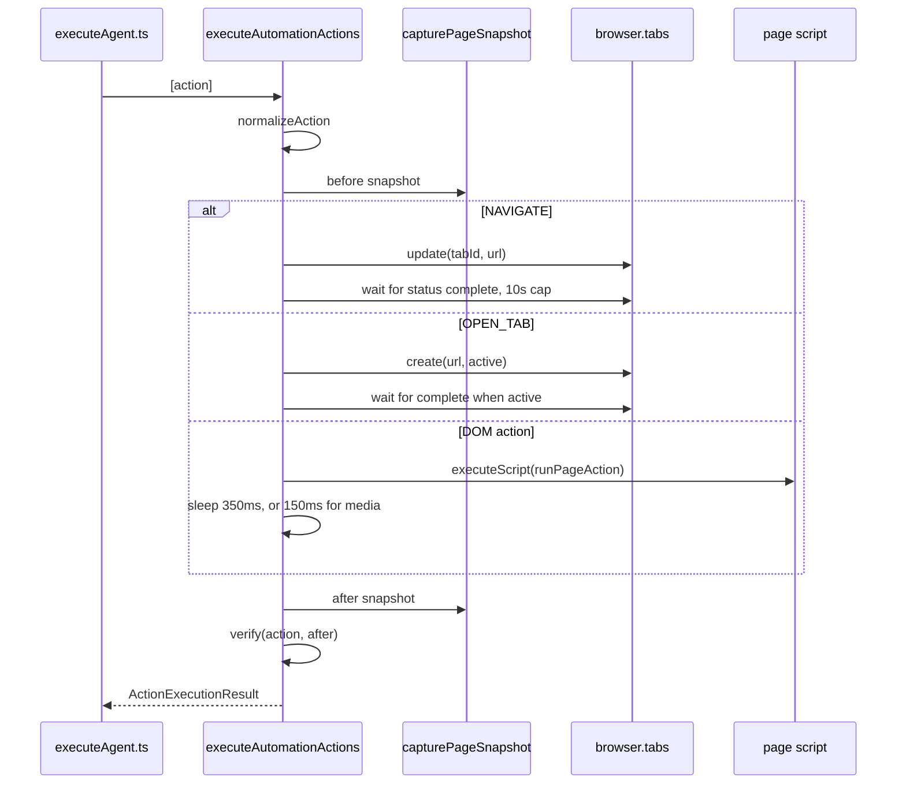
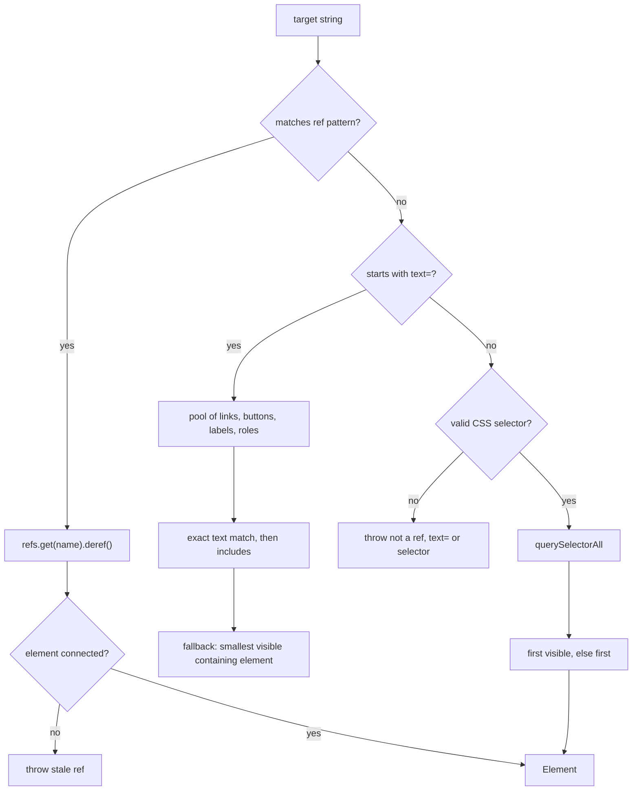
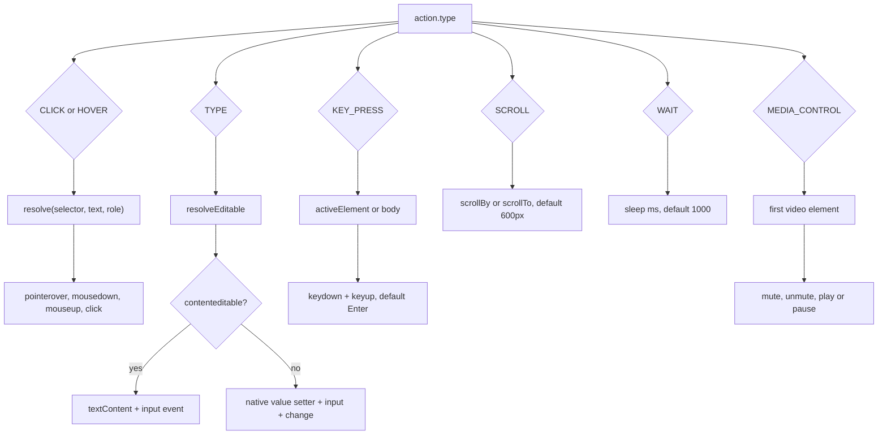
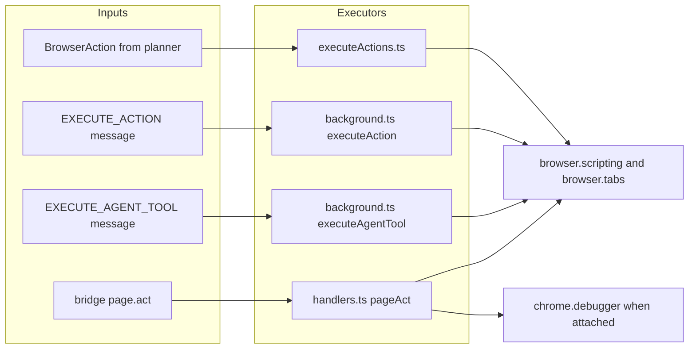

# DOM manipulation and element targeting

The extension action executor runs one planned `BrowserAction` against the active tab. It resolves a target, dispatches a synthetic user interaction, captures a fresh snapshot, and returns an `ActionExecutionResult`. The runtime loop calls `executeAutomationActions` in `clients/browser-extension/entrypoints/utils/executeActions.ts`; the service worker in `background.ts` and the bridge handlers in `utils/bridge/handlers.ts` expose overlapping operations through different entry points.

This page covers how an action finds its element and how it lands. The outline those targets come from, including refs and frames, lives in [Page Snapshot and Refs](Page%20Snapshot%20and%20Refs).

Key capabilities:
- Target resolution by CSS selector, visible text, role, or an element ref.
- Synthetic pointer, mouse, and keyboard sequences that React and similar frameworks accept.
- Typing through the native value setter, or through `textContent` for contenteditable nodes.
- Media control with state returned in the action message.
- Before and after snapshots plus verification for navigation and media.
- A stricter bridge path that uses `chrome.debugger` for trusted input.

## Repository layout

Three extension layers matter. `executeActions.ts` is the executor used by the planner loop. `background.ts` is the MV3 service worker that handles extension messages and starts the bridge. `utils/bridge/handlers.ts` translates bridge method names into page operations and prefers CDP for trusted input.

## Building blocks

- `executeActions.ts`: `normalizeAction`, `capturePageSnapshot`, `runPageAction`, `verify`, `executeAutomationActions`, and `executeBrowserActions`.
- `background.ts`: `defineBackground`, the `browser.runtime.onMessage` switch, `executeAction` for tab and DOM primitives, and `executeAgentTool` for the named agent tool set.
- `utils/bridge/handlers.ts`: the `handlers` record with `tabs.list`, `tabs.open`, `tabs.close`, `tabs.focus`, `page.snapshot`, `page.screenshot`, `page.act`, `page.evaluate`, `page.waitFor`, `page.read`, `repo.download`, `task.run`, and `task.stop`.
- `utils/bridge/cdp.ts`: `attach`, `send`, `mouseClick`, `insertText`, `pressKey`, dialog tracking, and the 90 second idle detach.
- `utils/bridge/client.ts`: the WebSocket client, hello frame, 20 second ping, and reconnect backoff capped at 30 seconds.

## How it fits together

`executeAutomationActions` takes an array, but the runtime always passes exactly one action. It snapshots the active tab, sets the page glow for actions that change the page, dispatches, waits briefly, snapshots again, verifies, and returns. Any failure stops the batch, which is safe because there is only one action.

`normalizeAction` absorbs model drift before dispatch. It uppercases `type`, copies `element` into `selector`, copies `text` into `value` for `TYPE`, and copies `time` into `ms`. This is the only compatibility layer between planner output and the page script.

## Target resolution

`runPageAction` injects a self-contained function into the tab. It resolves a target in this order: a CSS selector with optional text scoring, then a text match across clickable elements, then the first editable field for typing. The bridge path uses `find` in `page-agent.ts`, which accepts a ref, `text=Visible text`, or a CSS selector.

Refs resolve through a `WeakRef` map held in `globalThis.__agenticBrowser`. `find` treats a ref as stale when the WeakRef dereferences to nothing or `isConnected` is false, and the error text asks for a new snapshot. A frame ref keeps its `f<number>` prefix, and `frameOf` routes the action to that frame.

Selector resolution does not stop at `querySelector`. When several nodes match, the executor scores them by matching text and by visibility. Text targeting builds a pool of links, buttons, labels, and elements with an interactive role, prefers an exact normalized match, then a substring match, then the smallest visible containing element.

Before a CDP click, `geometry` scrolls the element to the center, computes the viewport point, and calls `elementFromPoint`. If another element covers the target, the result carries `covered` with a description of the blocker, except when that element is a label bound to the control. `trustedClick` then either dispatches a real mouse event at the point or falls back to `domClick` and notes the substitution.

## Page action dispatch

Clicks dispatch the full pointer and mouse sequence plus `el.click()`. Typing uses the native value setter and input and change events, or `textContent` plus an input event for contenteditable nodes. Key presses go to the active element or the body. Scroll defaults to 600 pixels, wait defaults to 1000 ms, and media control acts on the first video element.

Media control is the only action that returns state in its message: `muted`, `paused`, and `volume`. It is also the only one with a dedicated verification check, comparing `after.media.muted` to the requested command.

## Verification and failure handling

`verify` covers three cases. `MEDIA_CONTROL` with `mute` requires `after.media.muted === true`. `unmute` requires `false`. `NAVIGATE` and `OPEN_TAB` with a URL pass when the new URL starts with the requested URL or includes its hostname. Everything else returns `undefined`, leaving `success` to the dispatch result.

The result always contains `before` and `after`, even when the action failed. That gives the planner evidence of what the page looked like, which matters after a click that navigated somewhere unexpected. `executeAutomationActions` calls `setPageGlow(tabId, true)` before the action and clears it afterwards. For `NAVIGATE` it re-lights the new page briefly because the old document is gone.

## The message worker and the bridge

`background.ts` handles `EXECUTE_ACTION` and `EXECUTE_AGENT_TOOL` in addition to bridge status messages. `executeAction` supports `OPEN_TAB`, `CLOSE_TAB`, `SWITCH_TAB`, `NAVIGATE`, `RELOAD_TAB`, `DUPLICATE_TAB`, `CLICK`, `TYPE`, `SCROLL`, `WAIT`, `SELECT`, and `EXECUTE_SCRIPT`. Its selector helper understands `:has-text("...")` and XPath in addition to CSS. `executeAgentTool` exposes 26 named operations, from `GET_PAGE_INFO` and `EXTRACT_DOM` through `GET_COOKIES`, `SET_LOCAL_STORAGE`, `GO_BACK`, and `FIND_ELEMENTS`.

The bridge path is stricter and more capable. `handlers.ts` resolves the tab, rejects restricted URLs with `RESTRICTED`, runs `page-agent.ts` in the page, and uses CDP for trusted clicks, typing, and key chords when `chrome.debugger` is available. `page.act` also supports `dialog` for an open JavaScript dialog, and `page.waitFor` polls through the page agent's `probe` op.

## Dependencies

The executor is browser-only TypeScript with no backend import. It depends on the WXT `browser` namespace, the page glow helper, and, on the bridge path, the CDP wrapper and the page agent. The service worker also imports the bridge client, which imports the handlers, so every bridge method is loaded when the worker starts. `wxt` and `@wxt-dev/module-react` are declared in `clients/browser-extension/package.json`; the manifest permissions are configured in `wxt.config.ts`. The executor assumes `scripting`, `tabs`, `storage`, and `debugger` access.

## Performance

DOM actions have a fixed settle delay: 350 ms normally, 150 ms for media. `waitForTabComplete` resolves on the `complete` status or after 10 seconds, so a slow page cannot block the loop forever. Bridge page operations time out at 10 seconds by default, and a subframe snapshot gets 4 seconds. `page.act` clamps its timeout to 120 seconds. The page snapshot caps interactive elements at 80 and visible text at 5000 characters. CDP sessions detach after 90 seconds idle.

## Troubleshooting

- `Element not found: ...`: the selector did not match, and the text fallback found nothing visible. Re-snapshot and use a fresh selector or ref.
- A click does nothing on a React page: the page listens for trusted events. Use the bridge path so `trustedClick` can use `chrome.debugger`, or check whether an overlay is intercepting the click.
- Typed text disappears: the framework ignored the value setter. `runPageAction` dispatches `input` and `change`; some editors need real key events through CDP `Input.insertText`.
- `chrome://` page returns an empty snapshot: `capturePageSnapshot` short-circuits restricted URLs and returns no elements by design.
- `No active tab found`: `getActiveTab` queried `active: true, currentWindow: true` and got nothing. Focus a normal window.
- A bridge click reports "covered by ...": an overlay or sticky header sits above the target. The executor used a DOM click and noted it.
- A screenshot is null: `captureVisibleTab` failed, often because the tab is not visible. The bridge falls back to `Page.captureScreenshot` for background tabs when the debugger is available.

## Appendix

### Implementation examples

- `executeAutomationActions([action])`: the runtime entry point, returns an array of one result.
- `capturePageSnapshot()`: builds `PageSnapshot` in the page and adds a downscaled screenshot.
- `runPageAction(tabId, action)`: executes the action switch inside the tab.
- `verify(action, after)`: media and navigation checks only.
- `background.ts handleExecuteAction(payload)`: normalises aliases, resolves the target tab, calls `executeAction`.
- `handlers.ts pageAct(p)`: action switch for the bridge, including `dialog`.

### Source files

- `clients/browser-extension/entrypoints/utils/executeActions.ts`
- `clients/browser-extension/entrypoints/background.ts`
- `clients/browser-extension/entrypoints/utils/bridge/handlers.ts`
- `clients/browser-extension/entrypoints/utils/bridge/page-agent.ts`
- `clients/browser-extension/entrypoints/utils/bridge/cdp.ts`
