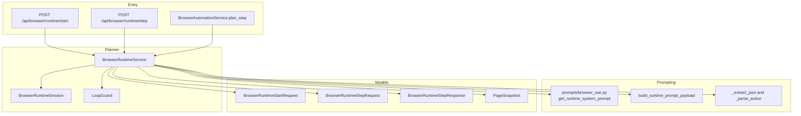
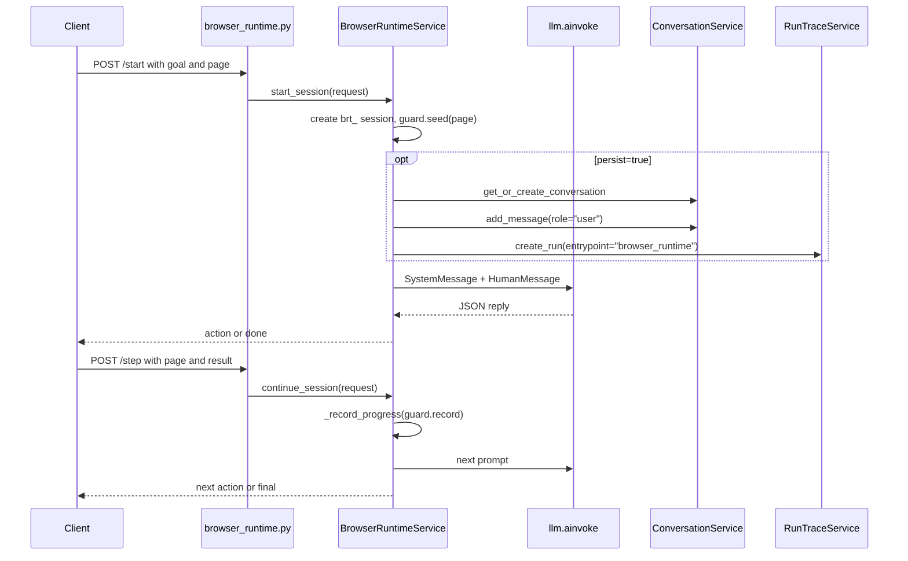
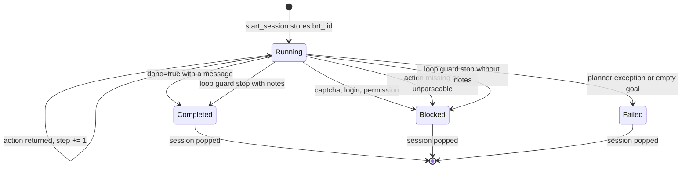
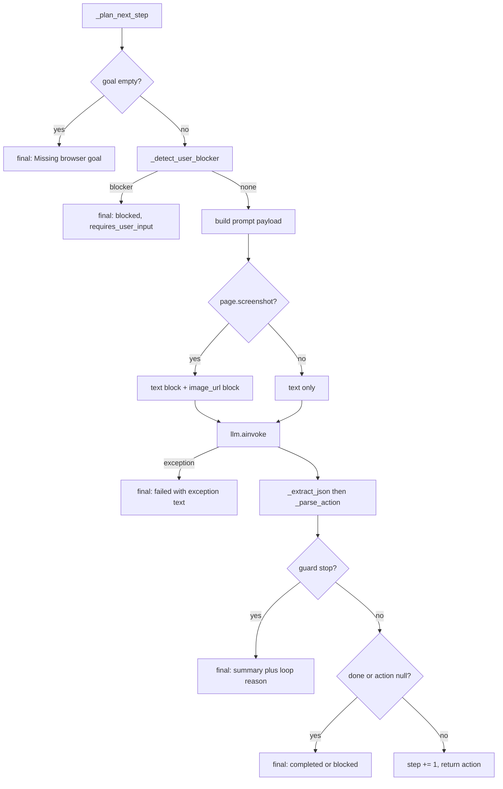
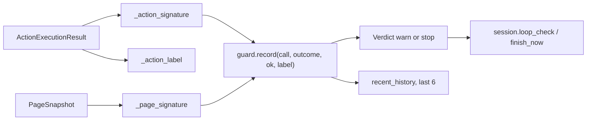
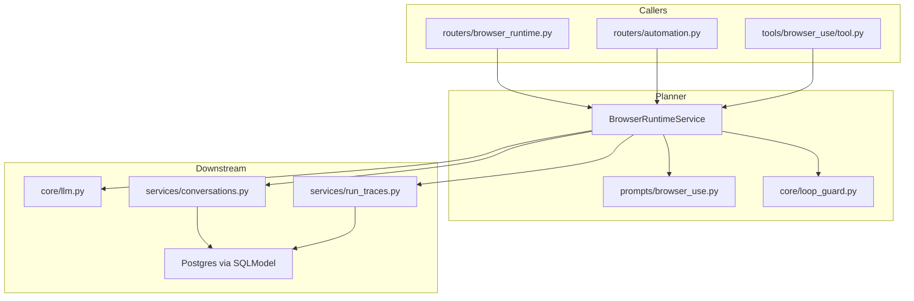

# Dynamic script generation

Dynamic script generation now means one action per model turn. The old service generated a whole JSON plan up front. The runtime planner in `services/browser_runtime_service.py` instead receives the current page and the last result, asks the model for exactly one `BrowserAction`, and lets the extension execute it before planning again. The "script" is a single typed action, not free-form code.

Two routes drive it: `POST /api/browser/runtime/start` and `POST /api/browser/runtime/step`. The side panel calls them directly. Remote clients go through `browser_task`, which is covered in [Remote Browser Tasks](Remote%20Browser%20Tasks). The action executor is covered in [DOM Manipulation and Element Targeting](DOM%20Manipulation%20and%20Element%20Targeting).

Key capabilities:
- One action per model call, with an explicit `done` flag.
- Session state with recent history, copied notes, and a `LoopGuard`.
- Screenshot support: the current page image is attached to the model message when present.
- Blocker detection for captchas, login forms, and permission prompts before any planning.
- Optional conversation and run-trace persistence.
- A bounded prompt: 5000 characters of text, 80 interactive elements, four history entries, and 40 notes.

## Repository layout

The route layer is thin. `routers/browser_runtime.py` exposes two POST handlers and maps `ValueError` on `/step` to a 404. The service layer holds the session dict, prompt assembly, JSON parsing, and trace writes. The old automation service is a thin adapter over the same class.

## Building blocks

- `services/browser_runtime_service.py`: `BrowserRuntimeService` with `start_session`, `continue_session`, `_plan_next_step`, `_final_response`, and the tracking helpers.
- `BrowserRuntimeSession`: dataclass holding `session_id`, `goal`, `max_steps`, `persist`, `conversation_id`, `client_id`, `trace_run_id`, `trace`, `step`, `recent_history`, `notes`, and `guard`.
- `allowed_actions`: the set `NAVIGATE`, `OPEN_TAB`, `CLICK`, `TYPE`, `KEY_PRESS`, `HOVER`, `SCROLL`, `WAIT`, `MEDIA_CONTROL`. Anything else is dropped by `_parse_action`.
- `prompts/browser_use.py`: `runtime_system_prompt_str` states the JSON shape and rules; `build_runtime_prompt_payload` serialises goal, step, session state, current page, latest result, and extra context.
- `models/requests/browser_runtime.py`: `BrowserRuntimeStartRequest` and `BrowserRuntimeStepRequest`.
- `models/response/browser_runtime.py`: `BrowserRuntimeStepResponse`, including `loop_check`.
- `services/browser_runtime_page.py`: `build_page_snapshot_from_dom` converts a client DOM payload into `PageSnapshot` for the tool wrapper.

## How it fits together

`start_session` mints an id with the `brt_` prefix, seeds the guard with the starting page signature, optionally prepares persistence, stores the session, records two trace events, and plans. Every later call goes through `continue_session`, which records the executed action, updates progress, records the observation, and plans again.

## Session lifecycle

A session exists only in the class dict `BrowserRuntimeService._sessions`. `_final_response` removes it before it writes the assistant message and completes the run. A process restart loses every open session, and `/step` then returns 404.

`max_steps` comes from the request or `env_max_steps("BROWSER_RUNTIME_MAX_STEPS")`. An unset or zero environment value means no cap, and `request.max_steps` defaults to `None` with `ge=1` when supplied. The cap is copied into `session.guard.max_steps`, so the guard emits a `max_steps` stop if it is reached.

## Prompt and response contract

The system prompt fixes the action vocabulary and the JSON keys. The user message is a JSON document, not prose: `goal`, `step`, `session`, `current_page`, `latest_result`, `extra_context`. The current page is serialised without its screenshot, with `visible_text` cut to 5000 characters and `interactive` cut to 80 entries.

`_extract_json` finds the first `{` and uses `json.JSONDecoder().raw_decode`, so trailing text or a second object does not break parsing. The parsed reply may carry `notes`, a list of short facts. The service strips each note, keeps it under 300 characters, avoids duplicates, and retains the last 40. Notes are the long-lived memory that survives pages the browser has already left.

The response carries `session_id`, `step`, `done`, `status`, `message`, `action`, `expected_state`, `verification`, `reason`, `requires_user_input`, `conversation_id`, `run_id`, and `loop_check`. The extension uses `action` for execution and the rest for its work log.

## Progress and tracing

`_record_progress` is called on every `/step` that carries a result. It fingerprints the action, suffixes the call with the step count when the action is `WAIT` (a wait on an unchanged page is normal during loading, but still counts as no progress), and records `(call, page_signature, ok)`. The page signature uses the first 600 characters of visible text, the first 12 interactive elements, and media state.

When `persist` is true, `_prepare_tracking` creates or reuses a conversation titled with the first 60 characters of the goal, stores the user message, and creates a run through `RunTraceService.create_run` with `entrypoint="browser_runtime"` and metadata containing the goal, session id, and `context["source"]`. The service records `subagent_started`, `automation_started`, `automation_plan`, `automation_observation`, `loop_guard`, `subagent_completed`, and `final`. Only `status="failed"` marks the run failed; `blocked` still completes the run.

## Dependencies

The planner is called by the runtime routes, the legacy automation route, and `browser_action_agent` in `tools/browser_use/tool.py`. It reads the configured model through the `llm` proxy in `core/llm.py`, which resolves a per-request pick or the saved default.

Pinned packages from `pyproject.toml`: `langchain>=0.3.27`, `langgraph>=1.0.1`, `pydantic>=2.9.0`, and `fastapi>=0.115.0`. The planner itself uses only `langchain_core.messages` and the local models, so it carries no provider-specific code.

## Performance

Each step makes exactly one chat completion. The prompt is bounded on four axes: 5000 characters of text, 80 interactive elements, four history entries, and 40 notes of 300 characters. The screenshot, when included, is a data URL already downscaled by the extension. Sessions cost no I/O until `persist` is on, and then each step writes only when a trace exists. `_response_payload` adds an `actions` array to the trace copy without mutating the stored response.

## Troubleshooting

- `Missing browser goal`: `start_session` was reached with an empty goal. The route normally rejects this with 400 first.
- `I couldn't plan a reliable next browser action`: `llm.ainvoke` or JSON extraction raised. The exception text lands in `reason` and in the trace.
- The planner returns `done=true` immediately: the prompt tells the model to finish if the page already satisfies the goal. Check the page snapshot for a stale title or empty `visible_text`.
- Every action is dropped: the model used an action outside `allowed_actions`, or `action` was not a dict. Read the `Skipping invalid browser runtime action` log line.
- A login wall is reported while the goal is a normal search: the page has a visible password field and the goal does not contain a login term. See [Security and Safety Mechanisms](Security%20and%20Safety%20Mechanisms) for the exact blocker rules.
- `404 Unknown browser runtime session`: the session was popped by `_final_response` or lost on restart.
- Notes are missing from the final answer: the model omitted `notes`, or the notes exceeded the last 40 and were trimmed.

## Appendix

### Implementation examples

- `BrowserRuntimeService.start_session(request)`: creates the session, seeds the guard, and plans the first step.
- `BrowserRuntimeService.continue_session(request)`: raises `ValueError` for an unknown id, which the route maps to 404.
- `BrowserRuntimeService._plan_next_step(session, page, latest_result, extra_context)`: the whole planning contract in one method.
- `BrowserRuntimeService._final_response(session, message, reason, status, requires_user_input=False)`: pops, traces, persists, and returns.
- `build_runtime_prompt_payload(...)`: returns `json.dumps` of the six top-level keys.
- `get_runtime_system_prompt()`: returns the stripped system prompt, including the `finish_now` and `loop_check` instructions.

### Source files

- `services/browser_runtime_service.py`
- `prompts/browser_use.py`
- `models/requests/automation.py`
- `models/requests/browser_runtime.py`
- `models/response/browser_runtime.py`
- `tools/browser_use/tool.py`
