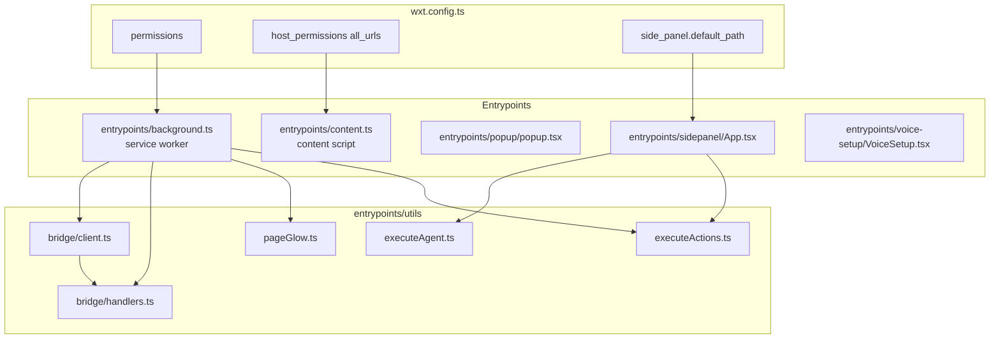
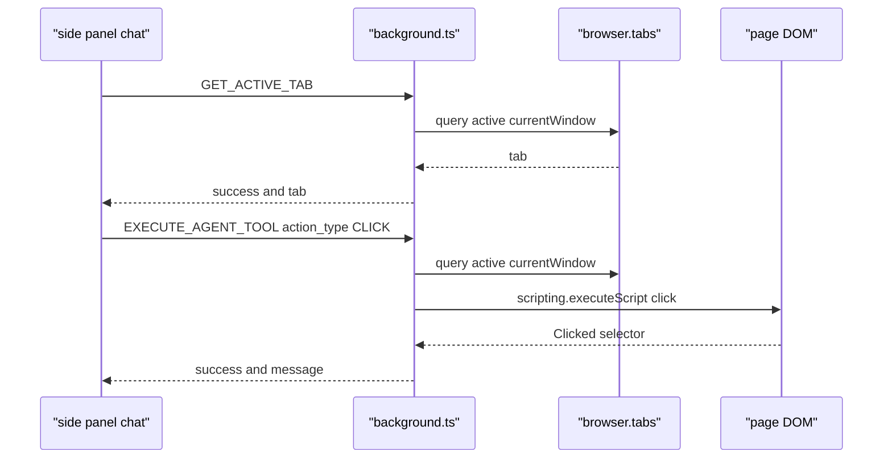
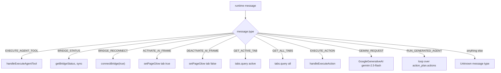
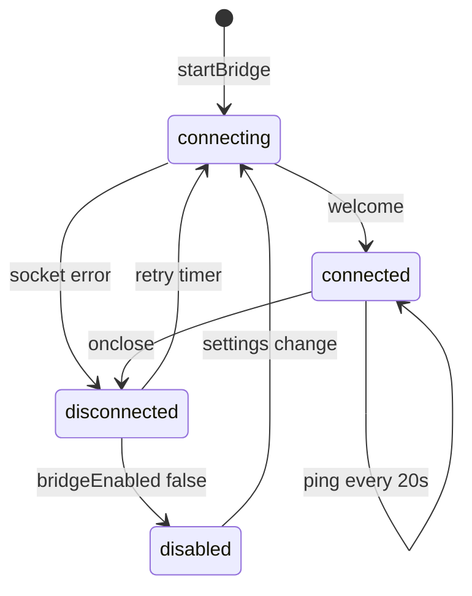
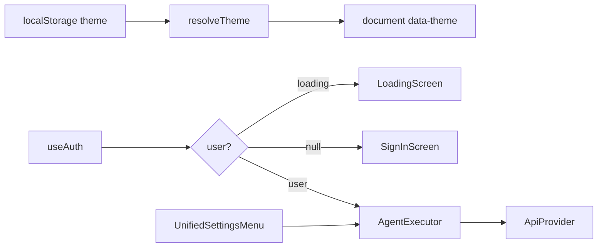
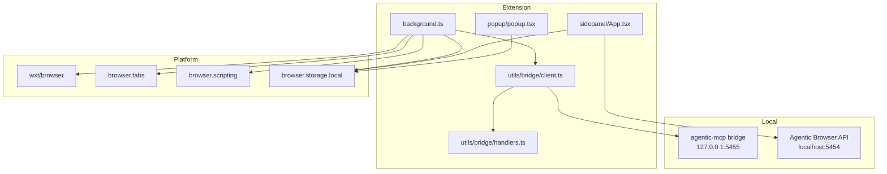

# Extension architecture and components

`clients/browser-extension` is a WXT project with five entrypoints. The background service worker owns the local bridge socket, executes browser actions, tracks tabs for the popup, and answers every runtime message. The side panel is the main UI. The popup is a tab switcher, the content script carries page overlay code, and the voice setup page asks for microphone permission once.

This page covers how those pieces connect and where automation enters. The action-level detail, including target resolution and verification, is in [DOM Manipulation and Element Targeting](DOM%20Manipulation%20and%20Element%20Targeting). The planner that feeds the executor is in [Dynamic Script Generation](Dynamic%20Script%20Generation).

Key capabilities:
- An MV3 service worker with a runtime message router and a bridge WebSocket to the local `agentic-mcp` process.
- An action executor for tab control and DOM work through `browser.scripting.executeScript`.
- A side panel auth gate with theme resolution and chat hooks.
- A bridge request table for tabs, snapshots, actions, evaluation, screenshots, repo downloads, and remote tasks.
- Tab inventory in `browser.storage.local` for the popup.

## Repository layout

WXT discovers entrypoints by folder. `background.ts` and `content.ts` are top-level scripts, while `popup/`, `sidepanel/`, and `voice-setup/` each own an HTML file and a React mount. `entrypoints/utils/` holds shared browser code, including `bridge/client.ts` and `bridge/handlers.ts`.

## Building blocks

- `wxt.config.ts`: WXT and the MV3 manifest. Permissions include `activeTab`, `tabs`, `storage`, `scripting`, `identity`, `sidePanel`, `webNavigation`, `webRequest`, `cookies`, `bookmarks`, `history`, `downloads`, `microphone`, `debugger`, `alarms`, and `tabGroups`. Host access is `<all_urls>`.
- `entrypoints/background.ts`: defines the worker, starts the bridge, sets `openPanelOnActionClick`, creates the `open-popup` context menu, routes messages, and implements `executeAction`, `executeAgentTool`, and `storeTabsInfo`.
- `entrypoints/content.ts`: matches `<all_urls>`, keeps `aiFrame` and `glowOverlay` references, exposes `removeAIFrame()` and a keyword-based `performAction()`. The overlay builder and runtime listener are commented out, so the script currently loads and logs.
- `entrypoints/popup/popup.tsx`: lists tabs for the current window, with a filter and a bridge status pill. "Open assistant" calls `browser.sidePanel.open({ windowId })`.
- `entrypoints/sidepanel/App.tsx`: theme resolution, `useAuth`, `useTabManagement`, `useWebSocket`, and the settings sheet.
- `entrypoints/voice-setup/VoiceSetup.tsx`: requests `getUserMedia` audio, stops the tracks, and reports success or a `NotAllowedError` message.

## How it fits together

The side panel does not talk to tabs directly. It calls background helpers with `browser.runtime.sendMessage`, the worker resolves a target tab, injects a function with `browser.scripting.executeScript`, and the resolved value travels back as the message response. Messages that do async work return `true` from the listener to keep the channel open.

The content script is deliberately thin. `createAIFrame` and the `runtime.onMessage` listener are commented out, leaving `removeAIFrame`, `findElement`, and `performAction`. `performAction` matches keywords: play or pause a `<video>`, click a matching button, fill the first text input, scroll by 500 px, or return page info. Automation that matters goes through the worker's injected functions, not the content script.

## The runtime message bus

`browser.runtime.onMessage` in `background.ts` checks `message.type` in order. `EXECUTE_AGENT_TOOL` is handled first because it is the hot path from the agent. Every handler wraps its work in `.then(sendResponse).catch(...)` and returns `{ success: false, error }` on failure. An unknown type logs the available list and responds with `Unknown message type`. `BRIDGE_STATUS` and the unknown-type branch return `false`, since no async work is pending.

`RUN_GENERATED_AGENT` still exists for generated action plans. It runs actions in sequence, keeps going after a failure, and returns `{ success: allSucceeded, message, results }`. `GEMINI_REQUEST` imports `@google/generative-ai` dynamically so the SDK stays out of the worker startup path.

## The action executor

`handleExecuteAction` normalises the payload before dispatch. It accepts either `payload.action` or the payload itself, uppercases `action.type`, aliases `element` to `selector` and `text` to `value`, and resolves a tab id from `payload.tabId`, `action.tabId`, or the active tab. Only `OPEN_TAB` may run with no tab, which is represented as `-1`. Tab actions go to `browser.tabs` calls; DOM actions go through `browser.scripting.executeScript` with a function that supports `:has-text()`, `xpath=`, and CSS selectors. `EXECUTE_SCRIPT` wraps `new Function(action.script)` and `WAIT` sleeps `action.time` or 1000 ms.

`executeAgentTool` is the richer path used by the agent. It resolves the active tab, switches on `actionType`, and calls one helper per tool: `getPageInfo`, `extractDomStructure`, `clickElement`, `typeText`, `fillFormFields`, `selectDropdownOption`, `waitForElement`, `scrollPage`, `openNewTab`, `closeCurrentTab`, `switchTab`, `navigateToUrl`, `getAllTabs`, `takeScreenshot`, `getElementText`, `getElementAttributes`, `executeCustomScript`, `getCookies`, `setCookie`, `getLocalStorage`, `setLocalStorage`, `hoverElement`, `reloadTab`, `goBack`, `goForward`, and `findElements`. An unknown name returns `Unknown tool: <name>`.

`waitForElement` polls every 100 ms until `params.timeout` (default 10000 ms) for `exists`, `visible`, or `hidden`. `getCookies` keeps auth-looking names capped at 10, otherwise the first 5 cookies. The planner loop does not use this path; it calls `executeAutomationActions` with one typed action.

## The bridge client

`utils/bridge/client.ts` connects to `ws://127.0.0.1:5455/bridge/ws` (`DEFAULT_BRIDGE_URL`). The socket exists so MCP clients can drive the browser while the service worker stays awake. On open it sends a `hello` with browser brand and version, extension version and id, and capabilities `tabs`, `snapshot`, `act`, `evaluate`, `screenshot`, plus `cdp` when available. It pings every 20 seconds (`PING_MS`). An alarm named `agentic-bridge-keepalive` fires every 0.5 minutes to reconnect after the worker sleeps.

Incoming `request` messages carry `{ id, method, params }`. `handleRequest` looks up `handlers[msg.method]`, sets the action badge to `RUN`, and replies `{ type: "response", id, result }` or `{ type: "response", id, error }`. Unknown methods fail with `Unknown bridge method <name>. Update the extension.` The handler table covers `tabs.list`, `tabs.open`, `tabs.close`, `tabs.focus`, `page.snapshot`, `page.screenshot`, `page.act`, `page.evaluate`, `page.waitFor`, `page.read`, `repo.download`, `task.run`, and `task.stop`.

`setStatus` writes `BridgeStatus` to `browser.storage.local` under `bridgeStatus`, and the popup subscribes to that key. A close code of 4403 means the bridge rejected this extension (check `AGENTIC_BROWSER_EXTENSION_IDS`). Retries start at 1 second and double to a 30 second cap.

## Side panel mount

`entrypoints/sidepanel/App.tsx` is the auth gate. It reads `theme` from `localStorage`, sets `data-theme` on `<html>`, and follows `prefers-color-scheme` while the preference is `system`. `useAuth` chooses between `LoadingScreen`, `SignInScreen`, and `AgentExecutor`, which wraps chat hooks in `ApiProvider` with `localStorage.baseUrl || VITE_API_URL`.

`App` also keeps a `geminiApiKey` in `browser.storage.local` for the legacy `GEMINI_REQUEST` path and listens for storage changes. Conversation stats come from `wsClient.getStats()` when the socket is connected; otherwise the panel calls `/api/genai/health/` and keeps zeroed counters.

## Popup and voice setup

The popup lists tabs in the current window and refreshes on `tabs.onUpdated`, `onRemoved`, `onActivated`, and `onCreated`. Filtering is client side over `title` and `url`; Enter focuses the first match, Escape clears the field.

The voice setup page asks for microphone permission, stops every track, and shows success or the browser error. It is a one-time permission page, not part of the automation loop.

## Dependencies

`wxt` supplies `defineBackground`, `defineContentScript`, and `wxt/browser`, which normalises `chrome.*` and `browser.*`. `@wxt-dev/module-react` wires the React plugin, and `wxt prepare` on postinstall creates the `.wxt/` types that `tsc --noEmit` needs. The side panel also uses `@agentic-browser/shared`, React 19, TanStack Query, Radix select, and `socket.io-client`.

## Performance

The bridge ping every 20 seconds keeps the MV3 worker alive on Chrome 116 and later, and the 0.5 minute alarm is the fallback wakeup (`utils/bridge/client.ts`). `executeAction` waits for navigation `complete` with a 10 second timeout and for a reload with 5 seconds. `waitForElement` polls every 100 ms instead of observing the DOM. Tab inventory is written on four tab events plus startup, not on a timer. The executor's own settle delays are 350 ms for DOM actions and 150 ms for media.

## Troubleshooting

- The popup shows "MCP waiting": the bridge socket is closed and retrying. Run `agentic-mcp serve` or let the MCP client start it.
- Close code 4403: the extension id is not in `AGENTIC_BROWSER_EXTENSION_IDS`. Add the id and restart the bridge.
- `Element not found: <selector>`: a DOM helper could not resolve the selector. Use an id, `name`, `aria-label`, or `:has-text()`.
- The content script seems idle: the overlay and message listener are commented out in `content.ts`. Use the side panel or bridge actions instead.
- `Unknown message type`: the caller sent a type the worker does not route. Check the list in the worker log.
- Bridge method fails with "Update the extension": the worker's handler table is older than the caller. Reload the unpacked extension.

## Appendix

### Implementation examples

- Worker startup and panel behavior: `defineBackground` in `background.ts`.
- Action normalisation: `handleExecuteAction`, `executeAction`.
- Tool dispatch table: `executeAgentTool`.
- Bridge handshake and retry: `connectBridge`, `scheduleRetry`, `startBridge`.
- Popup side panel open: `openPanel` in `popup.tsx`.

### Source files

- `clients/browser-extension/wxt.config.ts`
- `clients/browser-extension/entrypoints/background.ts`
- `clients/browser-extension/entrypoints/content.ts`
- `clients/browser-extension/entrypoints/popup/popup.tsx`
- `clients/browser-extension/entrypoints/sidepanel/App.tsx`
- `clients/browser-extension/entrypoints/voice-setup/VoiceSetup.tsx`
