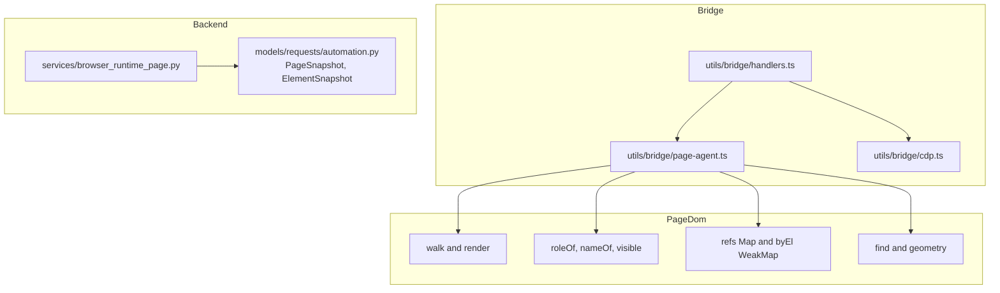
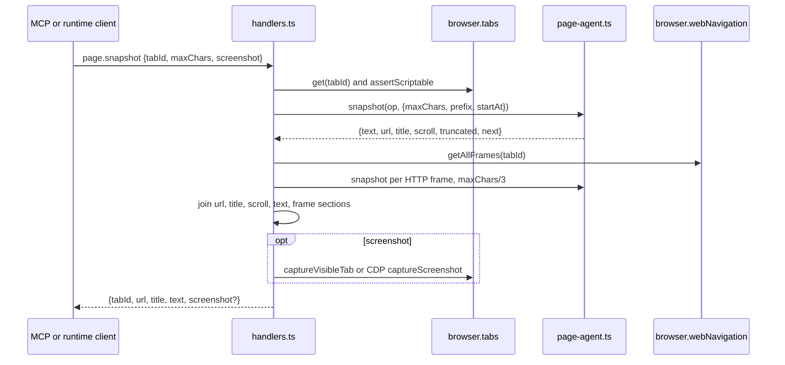
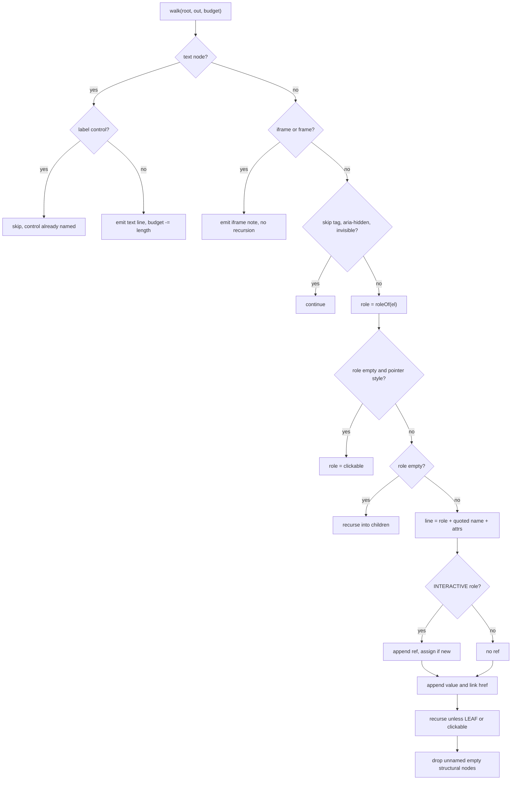
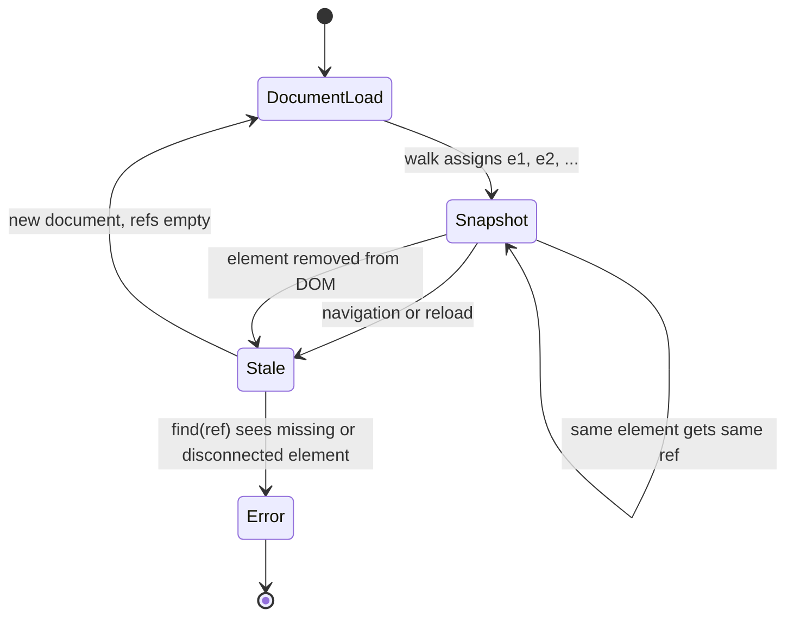
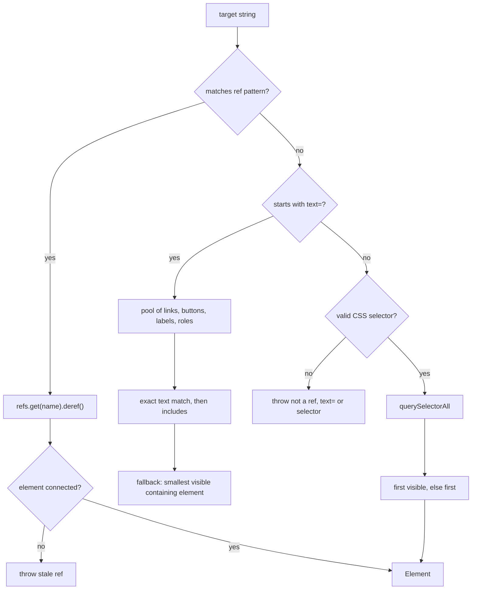
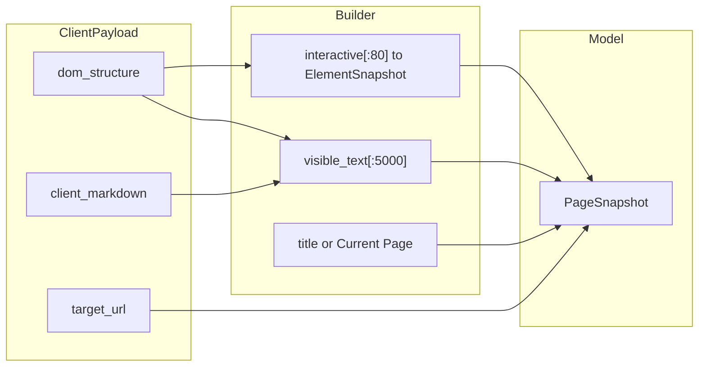
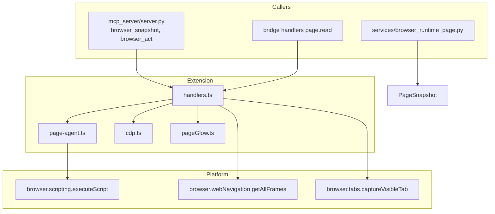

# Page snapshot and refs

A page snapshot is a compact text outline of what a user can see and operate, with a stable ref attached to every interactive element. `clients/browser-extension/entrypoints/utils/bridge/page-agent.ts` builds it inside the page, `utils/bridge/handlers.ts` stitches frames together and adds tab metadata, and `services/browser_runtime_page.py` converts a client DOM payload into the backend's `PageSnapshot` model for the planner.

Refs are the contract between looking and acting. A snapshot line such as `button "Sign in" [ref=e12]` can be passed back as `target="e12"` to a click, type, or check. A navigation destroys the document and the ref map with it, so old refs fail instead of hitting whatever element now occupies the same place.

Key capabilities:
- Accessibility roles inferred from tags, input types, and explicit `role` attributes.
- Refs allocated only to interactive roles, with a per-frame prefix such as `f12e5`.
- Visibility checks that respect CSS, `aria-hidden`, and `display: contents`.
- A character budget for the outline, defaulting to 25000.
- Selector, text, and ref targets resolved by one `find` function.
- Frame stitching for up to eight HTTP subframes.

## Repository layout

The in-page agent is deliberately self-contained because `executeScript` serialises the function source. The handler layer owns frames, tabs, screenshots, and timeouts. The backend builder is a separate, smaller path used by `browser_action_agent`.

## Building blocks

- `page-agent.ts`: exports `PageOp` and `pageAgent(op, args)`, which returns `{ok: true, v}` or `{ok: false, e}`.
- Ref state: `globalThis.__agenticBrowser` holds `{refs: Map<string, WeakRef<Element>>, byEl: WeakMap<Element, string>, next: number}`.
- `roleOf`: explicit role first, then `INPUT_ROLES` for inputs, then `IMPLICIT` for tags. A `section` with an accessible name becomes `region`; contenteditable becomes `textbox`; an SVG with a label becomes `img`.
- `nameOf`: `aria-labelledby`, `aria-label`, associated labels, button value, placeholder, image alt, then text content.
- `visible`: `checkVisibility({checkOpacity, checkVisibilityCSS})` when available, with a `display: contents` exception, otherwise computed style checks.
- `handlers.ts`: `snapshotFrame`, `pageSnapshot`, `frameOf`, `refCounters`, and the `page.act` router that sends frame refs to the right frame.

## How it fits together

`pageSnapshot` resolves the tab, rejects restricted URLs, clamps `maxChars` between 2000 and 100000, snapshots the main frame, then adds sections for up to eight HTTP subframes. Each frame keeps its own ref counter, so a ref is unique within the page even when several documents contribute lines.

The returned text always begins with `url:`, `title:`, and a scroll line such as `scroll 0,0 of 0,7400; viewport 1440x900`. A truncated outline appends a note telling the caller to scroll, raise `max_chars`, or use evaluate. An open JavaScript dialog appends a line saying to answer it with `action=dialog`.

## How the outline is built

The walker starts at `document.body`, descends through child nodes, and skips `script`, `style`, `noscript`, `template`, `head`, `meta`, and `link`. It does not descend into an `iframe` or `frame`; it emits a note pointing at the frame sections. It skips invisible elements and anything with `aria-hidden="true"`. Text nodes become `text: ...` lines. Elements with no role are transparent: the walker recurses into them without emitting a line.

The character budget is global across the walk. Every emitted line subtracts its length, and the walk returns as soon as the budget reaches zero. The result reports `truncated: budget.n <= 0`, `refs: lines.length`, and `next: state.next` so the handler can continue numbering on a later snapshot. `attrs` adds state that matters for acting: `[checked]`, `[disabled]`, `[expanded]` or `[collapsed]`, `[selected]`, `[pressed]`, `[required]`, and `[level=N]` for headings. `valueOf` adds the current value for selects, text inputs, and contenteditable nodes, and masks passwords with up to 12 bullets.

## Ref lifetime

Refs are assigned the first time an interactive element appears in a snapshot. `refFor` checks the `byEl` WeakMap, allocates `prefix + "e" + next` when absent, and stores a WeakRef in the forward map. Repeated snapshots are stable while the document lives. A frame snapshot uses a prefix such as `f3`, producing refs like `f3e7`.

`find` treats a ref as stale when the WeakRef dereferences to nothing or `isConnected` is false. The error text is `Ref e12 is stale or unknown. Take a new snapshot and use a ref from it.` The MCP instructions therefore tell callers to take a new snapshot after navigation. The `startAt` argument seeds `next` for a frame. `handlers.ts` keeps `refCounters` keyed by `tabId:frameId` and passes the previous `next` on the following call, so refs from earlier snapshots do not collide with new ones.

## Target resolution

`page.act` accepts a ref, `text=Visible text`, or a CSS selector. `frameOf` extracts the frame number from a ref and defaults to frame 0 for everything else. The same target string then reaches `find` in the selected frame.

Before a CDP click, `geometry` scrolls the element to the center, computes the viewport point, and calls `elementFromPoint`. If another element covers the target, the result carries `covered` with a description of the blocker, except when that element is a label bound to the control. `trustedClick` then either dispatches a real mouse event at the point or falls back to `domClick`.

## Backend snapshot builder

`services/browser_runtime_page.py` serves the planner path where the client sends DOM data rather than the page agent. It maps up to 80 `interactive` entries into `ElementSnapshot`, accepting both snake_case and camelCase fields (`aria_label` or `ariaLabel`, `input_type` or `type`). `visible_text` prefers `client_markdown` truncated to 5000 characters, then `dom_structure["visible_text"]`. The title defaults to `Current Page`.

## Dependencies

The page agent imports nothing. That is a hard requirement, not a style choice: `browser.scripting.executeScript` serialises the function body, so any outer reference would be undefined in the page. The handler layer imports `browser` from `wxt/browser`, the CDP wrapper, and the page agent.

## Performance

The default outline budget is 25000 characters, shared across the whole document walk. Main frame snapshots time out at 10 seconds in `runPage`, subframes at 4 seconds, and `page.snapshot` splits `maxChars` three ways for frames. Subframes are limited to eight, must be HTTP or HTTPS, and must cover at least 120 by 60 pixels. `page.read` truncates at 50000 characters. Active tab screenshots are captured at JPEG quality 70, then downscaled to 1280 pixels wide; background tabs need CDP.

## Troubleshooting

- `Ref e12 is stale or unknown`: the document changed or the element was removed. Take a new snapshot.
- A snapshot line is missing an expected button: the element failed the visibility or clickability test, or it sits inside a shadow root the walker did not enter. The walker does enter `shadowRoot` when a host has a role.
- `No element with text "..."`: `text=` matched nothing visible in the clickable pool or among containing elements. Try a CSS selector or a fresh ref.
- A click reports the target is covered: an overlay, sticky header, or cookie banner occupies the center point. Close it or use a different target.
- The snapshot is empty for a PDF or viewer: the document has no DOM outline the walker recognises. Use `page.screenshot` instead.
- Frame refs are not resolving: the ref must keep its `f<number>` prefix. `frameOf` routes on it; stripping the prefix sends the action to frame 0.

## Appendix

### Implementation examples

- `pageAgent("snapshot", {maxChars, prefix, startAt})`: returns the outline, scroll position, truncation flag, and next ref number.
- `pageAgent("resolve", {target})`: returns geometry, description, coverage, and editability.
- `handlers.snapshotFrame(tabId, frameId, maxChars)`: one frame plus its ref counter update.
- `build_page_snapshot_from_dom(dom_structure, target_url, client_markdown)`: backend conversion used by `browser_action_agent`.

### Source files

- `clients/browser-extension/entrypoints/utils/bridge/page-agent.ts`
- `clients/browser-extension/entrypoints/utils/bridge/handlers.ts`
- `services/browser_runtime_page.py`
- `models/requests/automation.py`
