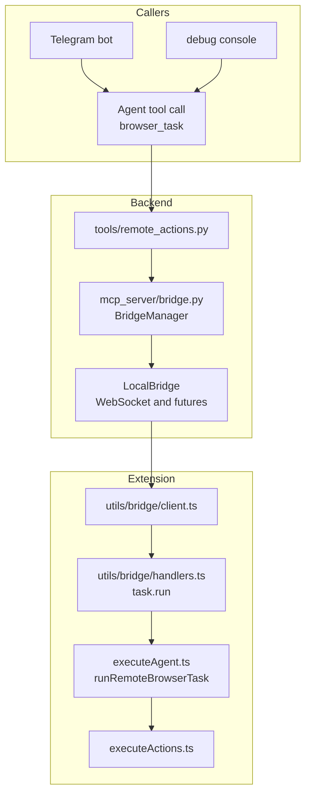
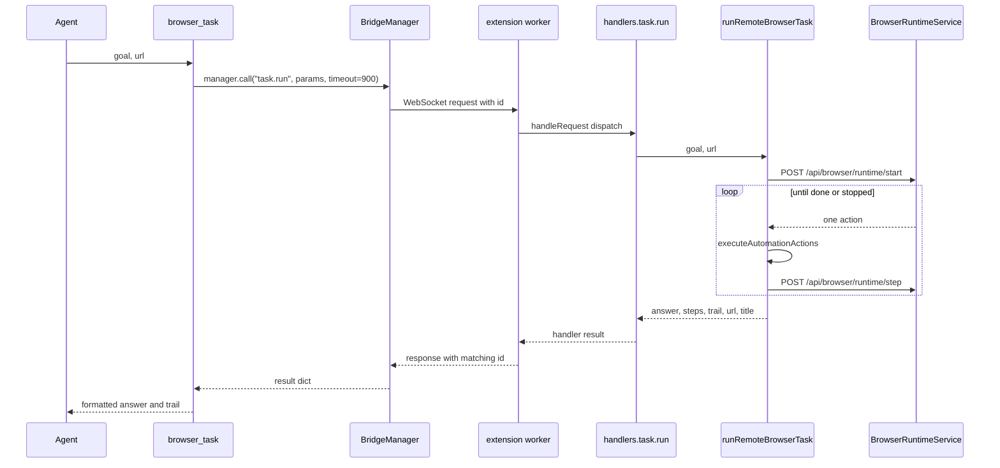
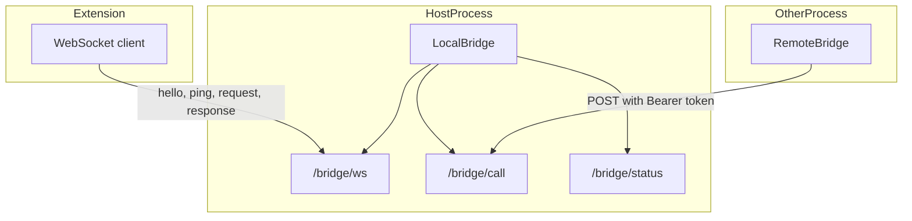
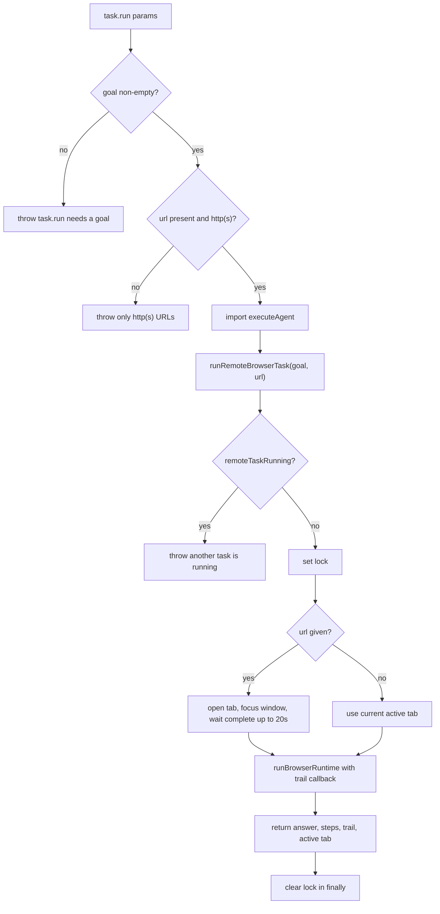
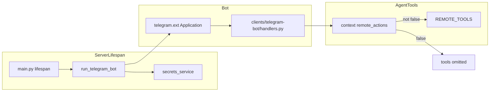
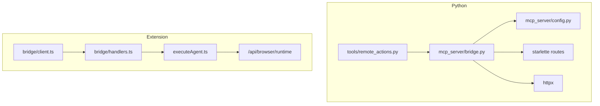

# Remote browser tasks

A remote browser task is a full browser runtime run started by something other than the side panel. Telegram, the debug console, or any MCP client calls the `browser_task` tool. The backend sends `task.run` over the local bridge, the extension's service worker receives it, and `runRemoteBrowserTask` in `executeAgent.ts` runs the same start and step planner loop the side panel uses.

The result travels back as a bridge response: the planner's final answer, the number of steps, a short trail, and the tab where the run ended. This is how an agent on a phone can ask the user's desktop browser to check a price, open a dashboard, or fill a form while the user's logins remain in place.

Key capabilities:- One tool, `browser_task`, with a complete goal and an optional starting URL.
- The same planner and executor as the side panel, not a second implementation.
- A 15 minute tool timeout and a 30 minute ceiling in the bridge.
- A concurrency lock that refuses a second remote task while one is running.
- A trail of actions and loop warnings for the caller.
- Telegram browser work gated by the `remote_actions` context flag.

## Repository layout

The tool layer lives in `tools/remote_actions.py`. The transport lives in `mcp_server/bridge.py`. The extension side is split between the bridge handler that validates the request, the service worker that owns the socket, and the runtime loop that executes actions.

## Building blocks

- `tools/remote_actions.py`: `BrowserTaskInput` with `goal` and optional `url`, `_browser_task`, `browser_task_tool`, and `REMOTE_TOOLS`.
- `mcp_server/bridge.py`: `BrowserConnection`, `LocalBridge`, `RemoteBridge`, `BridgeManager`, `manager`, `BridgeError`, and `BridgeUnavailable`.
- `clients/browser-extension/entrypoints/utils/bridge/client.ts`: `connectBridge`, `startBridge`, `handleRequest`, and the hello and ping protocol.
- `utils/bridge/handlers.ts`: `taskRun` and `task.stop` in the `handlers` record.
- `executeAgent.ts`: `runRemoteBrowserTask`, `runBrowserRuntime`, `stopBrowserRuntime`, and the `remoteTaskRunning` lock.
- `services/telegram_bot_runner.py`: starts the bot as an asyncio task in the API server lifespan.

## How it fits together

The call path crosses three processes: the agent process, the bridge host, and the browser extension. Any of them can be the same Python process, because `BridgeManager` decides at startup whether it owns the port or relays to whoever does.

`_browser_task` imports `manager` lazily to avoid a circular import at module load. It catches `BridgeError` and returns `Couldn't run the browser task: ...` as tool text rather than raising, so the calling model can recover. Any other exception is logged with `logger.exception("browser_task failed")`.

The formatted result is plain text. The first line is `answer` or `The task ended without a message.` If the extension returned a `url`, the next line is `Ended on: <title> <url>`. If it returned a `trail`, the tool adds `Steps taken (<steps>):` and one bullet per item.

## Bridge transport

One process per machine binds `127.0.0.1:5455`. `BridgeManager.ensure_started` tries `_bind`; success makes it the host and starts a uvicorn server with the bridge routes and the MCP HTTP app. Failure means another process owns the port, so calls go through `RemoteBridge` to `POST /bridge/call`.

The extension connects to `/bridge/ws`, sends a `hello` frame with browser name, version, extension version, id, and capabilities, and receives `welcome` with a connection id. `LocalBridge.call` picks a connection, creates a future keyed by request id, sends `{type, id, method, params, timeout}`, and waits `timeout + 2` seconds. A response frame either resolves the future with `result` or rejects it with `BridgeError` carrying the error message.

`call_endpoint` requires `Authorization: Bearer <token>` compared with `hmac.compare_digest`. The token lives at `~/.agentic-browser/bridge-token` and is created with mode `0600` by `read_or_create_token`. A request with an `Origin` header is rejected with 403, because only local processes relay and browsers always send Origin on POST. `__browsers__` is a pseudo-method that returns the attached browser list.

If the host process dies, `RemoteBridge._post` raises `BridgeUnavailable`. `BridgeManager.call` then calls `ensure_started` again, takes the port, and retries once.

## The extension handler and the loop

`taskRun` validates two things before doing work: the goal is non-empty, and any `url` starts with `http://` or `https://`. It then dynamically imports `runRemoteBrowserTask`, so the runtime loop is not loaded until a remote task actually starts.

`runBrowserRuntime` captures the initial page, posts to `/api/browser/runtime/start` with `persist: true`, and enters an unbounded loop. Each iteration emits `automation_plan`, executes exactly one action, emits `automation_observation`, emits `automation_replan` when the action failed, and posts the `after` snapshot plus the lean result to `/step`. The trail callback records `automation_execute` actions as `TYPE: description or selector or url or value` and records loop warnings as `loop check: ...`. Only the last 25 entries are returned.

There is no step count in the loop. It ends when the planner returns `done`, when no action comes back, when the backend loop guard stops the run, or when the user presses Stop, which sets the module-level `stopRequested` flag checked at the top of each iteration. `task.stop` is the only way to interrupt a remote run from outside. It calls `stopBrowserRuntime()` and returns `{stopping: true}`. The flag is cooperative; the current action finishes before the loop notices it.

## Telegram and the remote_actions flag

`services/telegram_bot_runner.py` runs the bot inside the API server lifespan. It resolves `telegram_bot_token` through `get_secrets_service().resolve`, returns silently when no token is configured, initialises the bot store, registers handlers, and polls until cancelled. If no allowed users are configured it logs a warning and keeps browser tasks and Composio actions off until an allow list exists.

The agent side enforces that with `context["remote_actions"] is False`. `build_agent_tools` skips `REMOTE_TOOLS` entirely in that case, so `browser_task`, `composio_apps`, and `composio_action` are absent from the model's toolset rather than failing at call time.

## Dependencies

The tool depends on the bridge manager and, through it, on the extension being connected. The bridge depends on Starlette, uvicorn, and httpx. The extension depends on the runtime API being reachable at the base URL stored in extension storage, defaulting to `http://localhost:5454`.

`pyproject.toml` pins `httpx>=0.27`, `fastapi>=0.115.0`, and `mcp>=2.3.0`. The bridge host also serves MCP over HTTP at `/mcp` through `build_http_app`, so a single port carries both the extension socket and MCP clients.

## Performance

`TASK_TIMEOUT` in `tools/remote_actions.py` is 900 seconds. The bridge clamps any per-call timeout between 1 and 1800 seconds and waits two extra seconds for the reply. `LocalBridge.call` waits up to three seconds for a browser to attach before sending, which covers a service worker that Chrome suspended. The extension pings every 20 seconds to keep the worker alive and retries a dropped socket with exponential backoff from 1 second to 30 seconds. Starting a URL task waits at most 20 seconds for the tab to report `complete`.

## Troubleshooting

- `No browser is connected to the Agentic Browser bridge`: no extension socket is attached. Open Chrome with the extension installed, or check the bridge status page.
- `Browser did not answer task.run within 900s`: the task ran past the tool timeout. The extension loop may still be running; call `task.stop`.
- `Another remote browser task is still running`: the service worker holds `remoteTaskRunning`. Wait for the current run or call `task.stop`.
- `task.run only opens http(s) URLs`: the URL used another scheme. Navigation to `chrome://` pages is not allowed.
- `Bridge token missing`: no host has created `~/.agentic-browser/bridge-token`. Start the bridge with `agentic-mcp serve` or let an MCP client launch it.
- Relay returns 403 or 401: the POST carried an `Origin` header, or the token in `~/.agentic-browser/bridge-token` does not match the host's token. Use a local process and a shared state directory.
- The Telegram bot does nothing: no `telegram_bot_token` secret was configured. If it answers but refuses browser work, the chat is not on the allowed users list, so `remote_actions` is false and the tool is absent.

## Appendix

### Implementation examples

- `browser_task(goal, url=None)`: LangChain tool that calls `manager.call("task.run", ...)`.
- `handlers["task.run"]`: validation plus `runRemoteBrowserTask`.
- `runRemoteBrowserTask(goal, url)`: lock, optional tab open, trail capture, result shaping.

### Source files

- `tools/remote_actions.py`
- `mcp_server/bridge.py`
- `clients/browser-extension/entrypoints/background.ts`
- `clients/browser-extension/entrypoints/utils/bridge/handlers.ts`
- `services/telegram_bot_runner.py`
