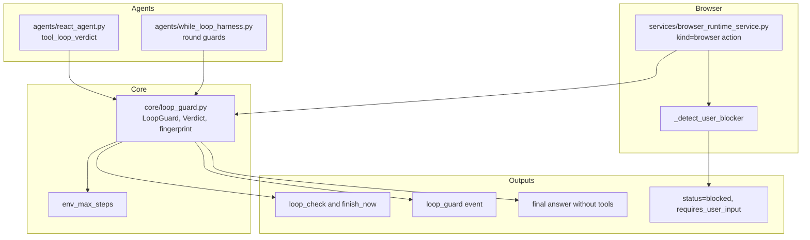
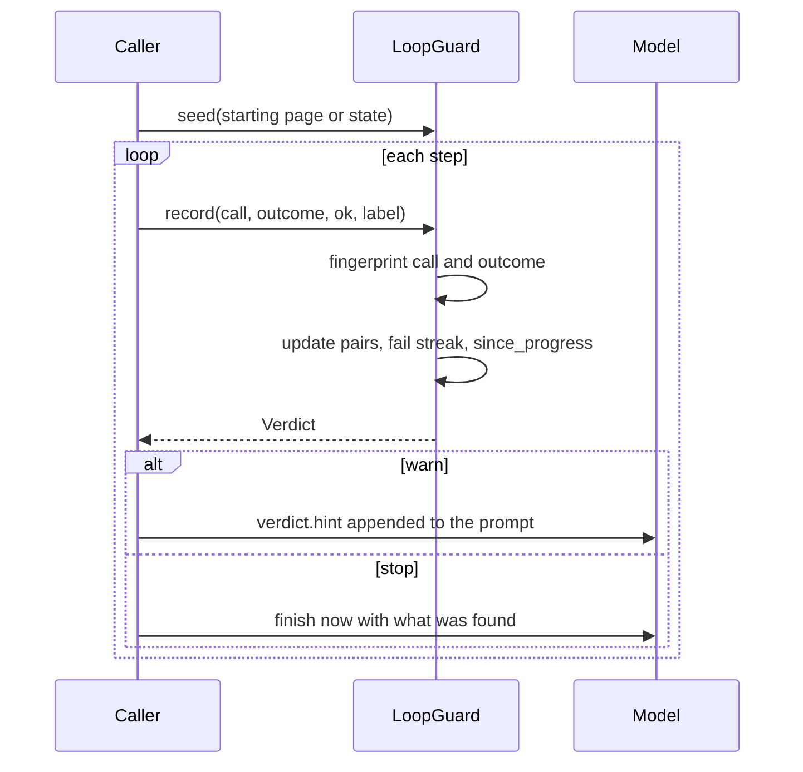
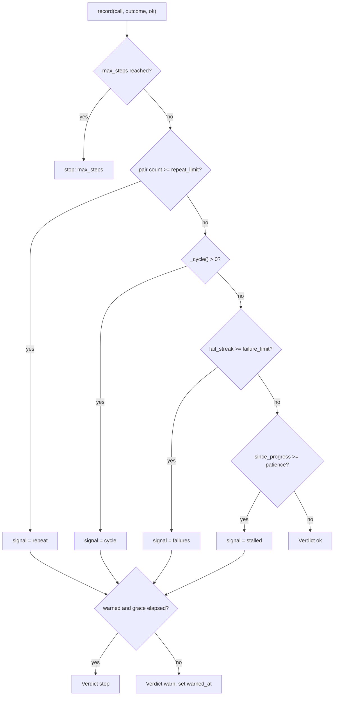
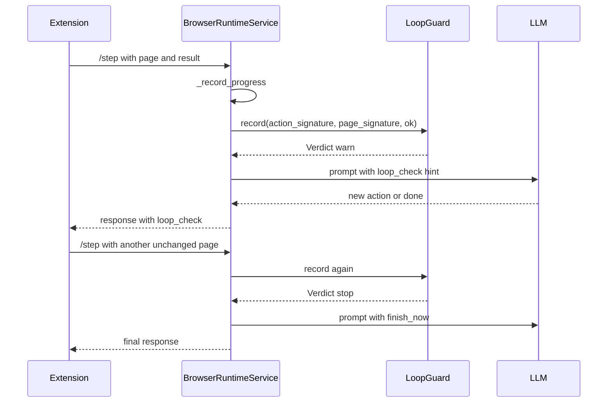
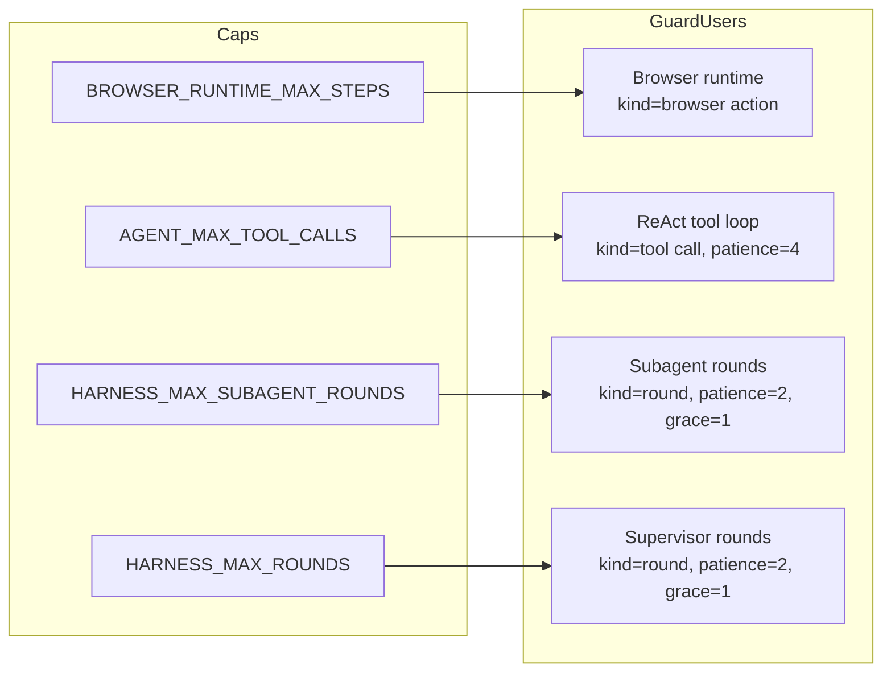
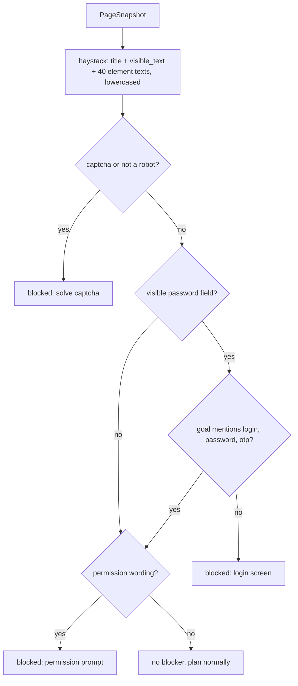

# Security and safety mechanisms

The browser loop has two safety layers that do not depend on a human watching every step. The loop guard in `core/loop_guard.py` stops runs that repeat themselves or stop making progress. The user blocker check in `services/browser_runtime_service.py` stops a run before planning when the page is asking for a captcha, a password, or a browser permission.

Both are progress and consent checks, not sandboxing. Page access is still limited by the extension's manifest, restricted URL checks in the bridge, and the action vocabulary the planner may emit. Those boundaries are described where they occur: [Page Snapshot and Refs](Page%20Snapshot%20and%20Refs) for scriptable URLs, [DOM Manipulation and Element Targeting](DOM%20Manipulation%20and%20Element%20Targeting) for executor paths, and [Dynamic Script Generation](Dynamic%20Script%20Generation) for action validation.

Key capabilities:
- Four signals with separate thresholds: `repeat`, `cycle`, `failures`, `stalled`.
- A warning phase followed by a grace period instead of a hard step cap.
- Digit masking on outcomes so clocks and counters do not look like progress.
- Replay support: `tool_loop_verdict` rebuilds state from a message list.
- Optional environment caps per loop type.
- Blocker detection from the rendered page, not from the URL alone.

## Repository layout

The guard is a standalone dataclass module with no imports from services or agents. Each caller owns its instance and decides what counts as a call and an outcome. The blocker check lives inside the planner and reads only the `PageSnapshot`.

## Building blocks

- `fingerprint(value, limit=4000, mask_digits=False)`: lowercases, optionally replaces digit runs with `#`, collapses whitespace, truncates, and returns the first 16 hex characters of a SHA-1.
- `Step`: `call`, `outcome`, `ok`, `label`.
- `Verdict`: `status` of `ok`, `warn`, or `stop`, plus `signal`, `reason`, and `hint`. `stop` and `warn` are properties, and `to_dict()` returns status, signal, and reason.
- `LoopGuard`: thresholds, history, outcome set, pair counter, progress counters, and the last verdict.
- `env_max_steps(name)`: reads an integer from the environment. Unset, zero, or unparseable means `None`.

Defaults are `patience=5`, `repeat_limit=2`, `failure_limit=3`, `grace=2`, `max_steps=None`, and `kind="step"`.

## How the guard fits together

Every step is recorded as a `(call, outcome, ok)` triple. Progress means the call succeeded and the outcome fingerprint was never seen in this run. Only progress resets the no-progress counter and clears an earlier warning.

`seed` marks the starting state as already seen, so the first action cannot claim progress just by leaving the initial page unchanged. The browser runtime seeds with `_page_signature(page)`. The agent paths do not seed, because their history already starts with the first model turn.

## The four signals

`_judge` checks signals in a fixed order and returns the first match. `max_steps` trumps everything. Then a repeated pair, then a cycle, then consecutive failures, then stalling.

`_cycle` takes the last `k` steps for `k` in 1, 2, and 3, and compares them to the preceding block of the same length. The block must also contain distinct steps, so a repeated single step is reported as a repeat rather than a one-step cycle.

`repeat` counts every occurrence of the same `(call, outcome)` pair across the run. `repeat_limit=2` means the second identical result warns. `failures` counts consecutive `ok=false` records. `stalled` counts consecutive non-progress records, whether the calls failed or returned a page state already seen.

## Verdict lifecycle

The first signal records `_warned_at`. The guard keeps returning warnings while the signal persists, and turns the verdict into a stop once `grace` steps have passed since that first warning. Any progress clears `_warned_at`, so a long run that keeps learning something can continue. The `reason` strings name the loop kind, for example `The same browser action (click #submit) gave the same result 2 times.` The `hint` is written for the model: `You already ran ... and got this exact result. Running it again won't change it.` Browser runtime hints append `Try a different approach, or if you have enough, stop and answer with what you found.`

## Wiring in the browser runtime

`BrowserRuntimeSession` creates `LoopGuard(kind="browser action")`. `start_session` sets `guard.max_steps` and calls `guard.seed(self._page_signature(request.page))`. `_record_progress` handles every result:

- `call = _action_signature(result.action)`, a sorted JSON dump of the action.
- For `WAIT`, the call gets `#<step count>` appended, so a wait never counts as a repeated call. It still counts as no progress.
- `outcome = _page_signature(page)`, built from URL, title, the first 600 characters of visible text, the first 12 interactive elements, and media state.
- `ok = result.success`.

The planner then reads `session.guard.verdict`. A warning becomes `session.loop_check` in the prompt payload and `loop_check` in the response. A stop becomes `session.finish_now` in the payload and ends the run after one final model call that summarises findings. Notes copied from earlier pages are used as the fallback summary.

## Wiring in the agents

`agents/react_agent.py` exposes `tool_loop_verdict(messages)`. It creates `LoopGuard(kind="tool call", patience=4, max_steps=env_max_steps("AGENT_MAX_TOOL_CALLS"))`, maps each `AIMessage.tool_calls` entry by id, then records one step per `ToolMessage` using the tool name, arguments, and content. It runs on every `agent` node invocation, so the guard is rebuilt from history rather than stored on the graph state.

In `_agent_node`, a warning appends the hint as a `HumanMessage`. A stop skips the tool-bound model and calls the plain client with a message telling it to answer with what it found. A `loop_guard` custom event is dispatched for streamed runs.

`agents/while_loop_harness.py` uses two guards. Each `SubAgentRunner` has a round guard with `patience=2`, `grace=1`, and `max_steps=env_max_steps("HARNESS_MAX_SUBAGENT_ROUNDS")`. It records `"completion round"` against the sorted tool outputs as the outcome, so a round only progresses when it produced new tool output. The `SupervisorHarness` has its own round guard with `max_steps=env_max_steps("HARNESS_MAX_ROUNDS")` and records the draft answer with `ok = score > best_score`.

LangGraph still requires a recursion limit. `RECURSION_LIMIT = 2000` in `react_agent.py` is that outer bound, chosen so a progressing run will not reach it. It is a safety net, not the intended stop condition.

## User blockers

`_detect_user_blocker` builds one lowercase haystack from the page title, visible text, and the text of the first 40 interactive elements. A captcha phrase stops the run. A visible password field stops it unless the goal itself mentions `login`, `log in`, `sign in`, `password`, or `otp`. Permission language such as `browser permission`, `allow notifications`, or `permission request` also stops it.

This check is deliberately about the rendered page, not the URL. A header "Log in" link on an otherwise usable page does not trigger it, because only a visible `input_type="password"` counts.

A blocked run ends immediately with `status="blocked"` and `requires_user_input=True`. No model call is made, so the blocker cannot be argued away by the model. The final message tells the user what to solve, and the session is popped like any other final response.

## Dependencies

The guard module imports only the standard library: `hashlib`, `json`, `re`, `collections.Counter`, `dataclasses`, and `typing`. That keeps it usable from the browser runtime, both agent graphs, and tests without pulling in LLM or database code. The blocker check uses only the `PageSnapshot` fields and the goal string.

## Performance

Fingerprinting is O(length) over at most 4000 characters and allocates one SHA-1 hash. Pair counting is a `Counter` keyed by two 16-character strings. The outcome set grows with distinct outcomes, which is bounded by the run length. Cycle detection scans at most six recent steps. Replay in `tool_loop_verdict` walks the whole message list on each model turn, so its cost grows with conversation length; trimming from `services/compaction.py` keeps that bounded.

## Troubleshooting

- A run stops early with `stalled` at five steps: the page signature is not changing. Check whether the action actually did anything, and whether the extension returned a fresh `after` snapshot.
- A legitimate refresh is flagged as a repeat: navigation back to an identical page produces the same signature. Use a different route or accept the warning and let the model change approach.
- Waits never warn as repeats: this is intentional in `_record_progress`, but repeated waits still accumulate `since_progress` and can trigger `stalled`.
- `max_steps` stops a long but productive run: `BROWSER_RUNTIME_MAX_STEPS`, `AGENT_MAX_TOOL_CALLS`, `HARNESS_MAX_ROUNDS`, or `HARNESS_MAX_SUBAGENT_ROUNDS` is set. Remove it or raise it.
- A stop leaves the user with a bare refusal: the browser runtime only returns `completed` when a summary exists. Check that `message` or `notes` contains findings.
- Subagent rounds stop immediately: the round guard compares sorted tool outputs, so a round that only rephrases text counts as no progress. Give the subagent a task that needs new tool calls.
- The guard never fires: the caller may be recording a constant outcome, or not recording at all. Each record needs a real call and the state that came back.
- A normal search is blocked as a login wall: the page has a visible password field and the goal does not contain a login term. Rephrase the goal or handle the login manually.

## Appendix

### Implementation examples

- `LoopGuard.record(call, outcome, ok=True, label="")`: returns the current `Verdict`.
- `LoopGuard.seed(outcome)`: marks the starting state as seen with digits masked.
- `Verdict.to_dict()`: `{"status": ..., "signal": ..., "reason": ...}` for traces and responses.
- `env_max_steps("AGENT_MAX_TOOL_CALLS")`: optional cap, `None` when unset or zero.
- `tool_loop_verdict(messages)`: replay helper used by both the ReAct agent and subagents.
- `_cycle()`: detects blocks of length one, two, or three at the end of the history.
- `_detect_user_blocker(page, goal)`: returns the blocker message, or `None`.

### Source files

- `core/loop_guard.py`
- `agents/react_agent.py`
- `agents/while_loop_harness.py`
- `services/browser_runtime_service.py`
