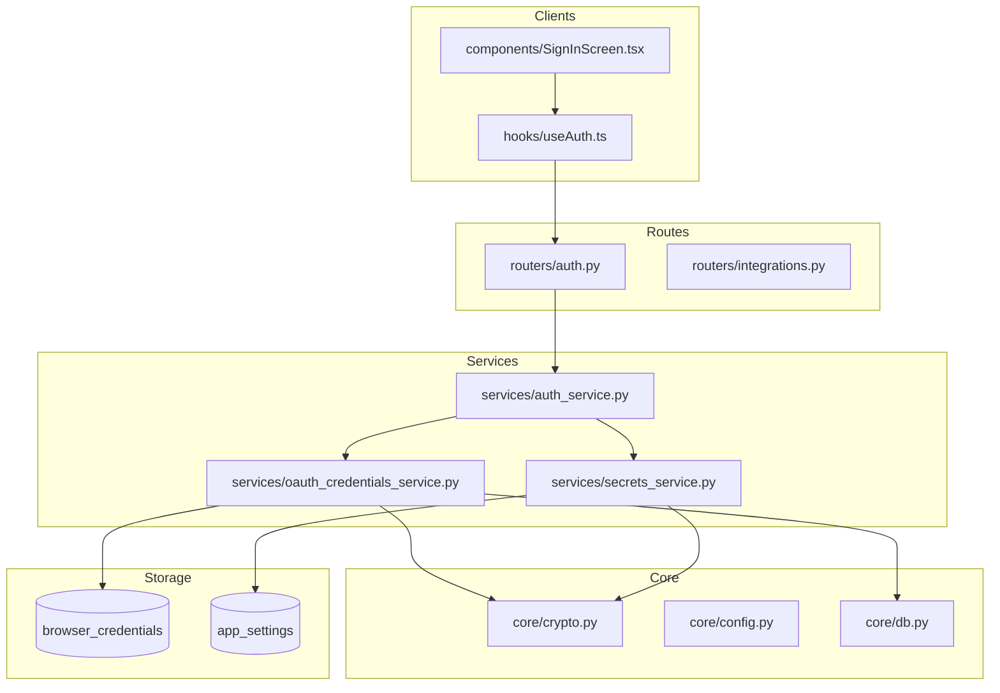
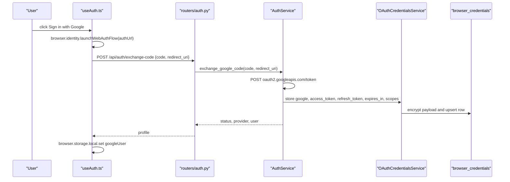
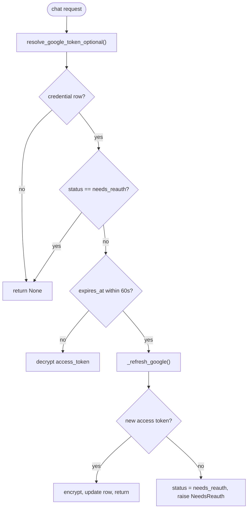
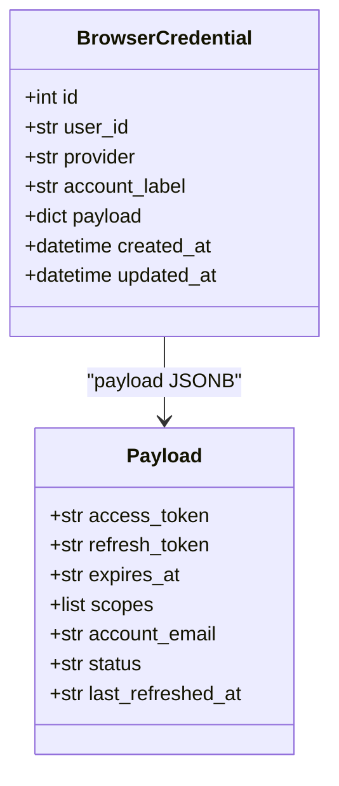
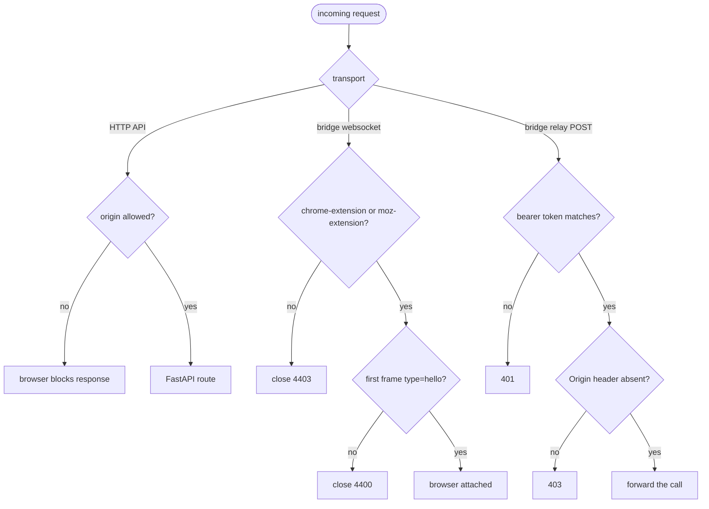
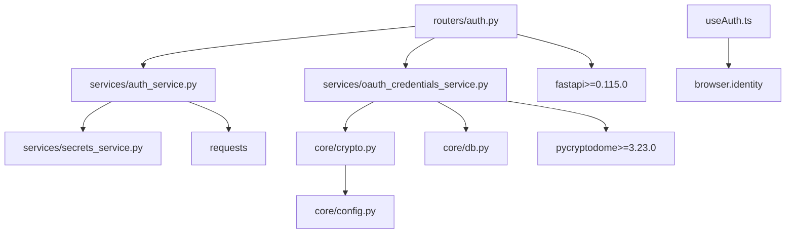

# Authentication system

Agentic Browser has no accounts, sessions or roles. It is a single-user tool that stores OAuth credentials for one implicit user (`default`) in Postgres, refreshes them on demand, and encrypts the payload with AES-GCM. The extension keeps only display data in `browser.storage.local`; tokens never live in the browser.

Authorization is enforced by origin, not by identity: the API has no bearer auth, CORS admits only extension and localhost origins, and the MCP bridge requires a file-backed token for relay calls.

Key capabilities:
- Google and GitHub OAuth flows, web and extension initiated.
- Encrypted credential rows with automatic refresh.
- Provider aliasing so Gmail, Calendar and YouTube share one Google token.
- Reauthentication signalling through `NeedsReauth`.
- CORS and bridge-token checks as the access boundary.
- Optional Telegram allow list for remote actions.

## Repository layout

## Building blocks

- `routers/auth.py`: six exchange routes, status routes, disconnect, health, plus redirect-based `/google/start`, `/google/callback`, `/github/start` and `/github/callback` for the console.
- `services/auth_service.py`: posts authorization codes to Google and GitHub, fetches the Google profile, and hands the token bundle to the credential store.
- `services/oauth_credentials_service.py`: owns the `browser_credentials` table, canonicalises provider aliases, refreshes expired Google tokens, and returns public rows with no secrets.
- `services/secrets_service.py`: stores API keys and OAuth client ids/secrets in `app_settings` under `secrets.*` and `oauth_clients.*`. This is where the client secret comes from during exchange and refresh.
- `core/crypto.py`: AES-GCM encrypt and decrypt with a 32-byte key from `OAUTH_ENCRYPTION_KEY` or a generated local file.
- `clients/browser-extension/entrypoints/sidepanel/hooks/useAuth.ts`: launches `browser.identity.launchWebAuthFlow`, posts the code to the backend, and stores a profile object locally.
- `clients/browser-extension/entrypoints/sidepanel/components/SignInScreen.tsx`: the first-run screen with Google and GitHub buttons.

## How it fits together

There are two entry paths. The extension gets a code through `browser.identity` and posts it to `/api/auth/exchange-code`. The console redirects the whole tab to `/api/auth/google/start`, Google returns to `/api/auth/google/callback`, and the backend redirects to `/settings?oauth_connected=google`.

The request path later resolves tokens lazily. `routers/react_agent.py` calls `resolve_google_token_optional()` on every chat request; the credential service decrypts the access token, refreshes it when it expires within 60 seconds, and returns `None` if the connection is gone.

## OAuth providers and scopes

| Provider | Scopes | Used for |
| --- | --- | --- |
| Google | `openid`, `email`, `profile`, `gmail.readonly`, `gmail.send`, `calendar`, `youtube.readonly` | sign-in, Gmail, Calendar, YouTube |
| GitHub | `read:user`, `user:email`, `repo` | private repository access in the GitHub agent |

The extension requests a wider Gmail scope set than the backend start route: `gmail.modify` and `gmail.labels` are added in `useAuth.ts`. The exchange accepts whatever Google grants and stores the returned `scope` string.

Provider aliases in `services/oauth_credentials_service.py` map `gmail`, `calendar`, `youtube` and `google-search` to the single `google` row. `github` stays separate.

## Credential storage and encryption

Each row in `browser_credentials` is unique on `(user_id, provider)` and stores:

- `access_token` and `refresh_token`, each AES-GCM encrypted as `base64(nonce || ciphertext || tag)`.
- `expires_at` as an ISO timestamp.
- `scopes`, `account_email`, `status`, `last_refreshed_at`.

`core/crypto.py` resolves the key in this order: `OAUTH_ENCRYPTION_KEY` from settings or env, then `.oauth_encryption_key` beside `main.py`, which it creates with mode 0600. The key must decode to 32 bytes.

`_public()` never returns token fields. Status endpoints expose provider, account email, status, scopes, expiry and timestamps.

## Route guards and access boundaries

The backend has no per-user auth middleware. Access is constrained by three mechanisms:

1. CORS in `main.py` uses `allow_origin_regex` for `chrome-extension://`, `moz-extension://`, `localhost` and `127.0.0.1`, plus extra origins from `CORS_ORIGINS`. Credentials are disabled.
2. The MCP bridge only accepts WebSocket connections from extension origins, optionally restricted by `AGENTIC_BROWSER_EXTENSION_IDS`. `/bridge/call` requires `Authorization: Bearer <token>` and rejects requests that carry an `Origin` header.
3. The Telegram bot checks `TELEGRAM_ALLOWED_USERS` before it allows browser tasks or Composio actions. With no allow list it answers questions only.

## Disconnect and logout

`DELETE /api/auth/connections/{provider}` removes the encrypted row. The extension's `handleLogout()` calls that route with `google`, then clears `googleUser` from local storage. Other clients can call `DELETE /api/integrations/oauth/{provider}`.

GitHub tokens do not expire by default. The credential service returns the stored token without refresh.

## Dependencies

## Performance

- Token refresh is lazy and only happens when the stored expiry is within 60 seconds. There is no background refresher.
- Exchange and refresh calls use a 10 second timeout (`requests.post(..., timeout=10)`).
- Credential lookups are one indexed query per provider per request. No cache sits in front of the row; the database pool is shared with the rest of the backend.
- AES-GCM encryption runs per field on store and per read on token resolution. The key is cached with `lru_cache(maxsize=1)`.

## Security considerations

- The stored profile in `browser.storage.local` is display data. Deleting it does not revoke the server credential, and copying it to another extension does not grant API access.
- The API has no login. Binding `BACKEND_HOST` to `127.0.0.1` is the practical control on a shared network.
- The relay token lives at `~/.agentic-browser/bridge-token` with mode 0600. Any local process that can read the file can relay browser calls.
- `OAUTH_ENCRYPTION_KEY` must be stable. Rotating it makes every stored token undecryptable, and the user has to sign in again.

## Troubleshooting

- `GOOGLE_CLIENT_SECRET is not configured`: no client secret in the secret store. Add it in Settings > Connections, or set `GOOGLE_CLIENT_SECRET`.
- `redirect_uri_mismatch` from Google: the extension's identity redirect URL differs from the one registered for the OAuth client. Register `https://<extension-id>.chromiumapp.org/` for the extension client.
- Login succeeds but Gmail tools say no token: the agent resolves the `google` row, and the row may be marked `needs_reauth` after a failed refresh. Disconnect and sign in again.
- Status says connected after a backend wipe: the extension trusts the local `googleUser` object but also calls `/api/auth/status`; a missing row sets `Server credentials missing`. Sign in again.
- GitHub sign-in appears to work without a browser prompt: `handleGitHubLogin()` in `useAuth.ts` currently fabricates a demo user and does not perform the OAuth exchange. Real GitHub access comes from the console flow or `/api/auth/github/exchange-code`.
- Console OAuth redirects to `/settings?oauth_error=...`: read the query value. `missing_code` means consent was cancelled; `exchange_failed` means the code or client secret was rejected.
- Bridge relay returns 401: the caller is not using the token from `~/.agentic-browser/bridge-token`, or the file was regenerated by a new host process.
- Bridge relay returns 403: a browser sent the POST. Only local processes may relay.

## Appendix

### Implementation examples
- Extension exchange: `POST /api/auth/exchange-code` with `{code, redirect_uri}`, handled by `exchange_google_code`.
- Console start: `GET /api/auth/google/start`, redirects to Google with `access_type=offline` and `prompt=consent`.
- Status: `GET /api/auth/status` returns `{connections: [...]}` from `OAuthCredentialsService.list_all()`.
- Disconnect: `DELETE /api/auth/connections/google` calls `OAuthCredentialsService.delete("google")`.
- Token resolution: `resolve_google_token_optional()` in `services/oauth_credentials_service.py`.

### Source files
- `routers/auth.py`
- `services/auth_service.py`
- `services/oauth_credentials_service.py`
- `services/secrets_service.py`
- `core/crypto.py`
- `core/config.py`
- `clients/browser-extension/entrypoints/sidepanel/hooks/useAuth.ts`
- `clients/browser-extension/entrypoints/sidepanel/components/SignInScreen.tsx`
