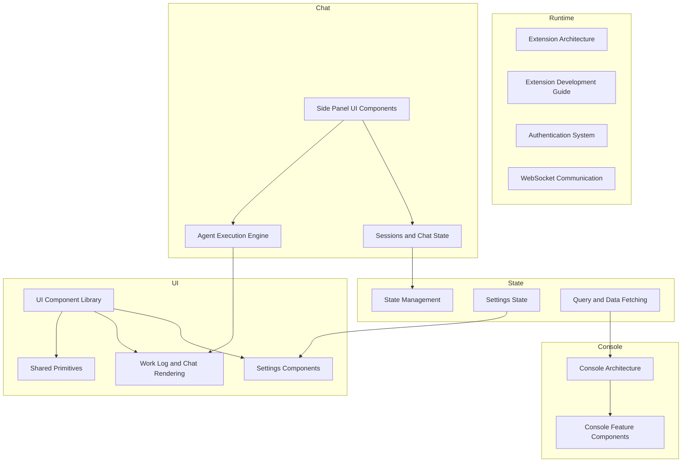
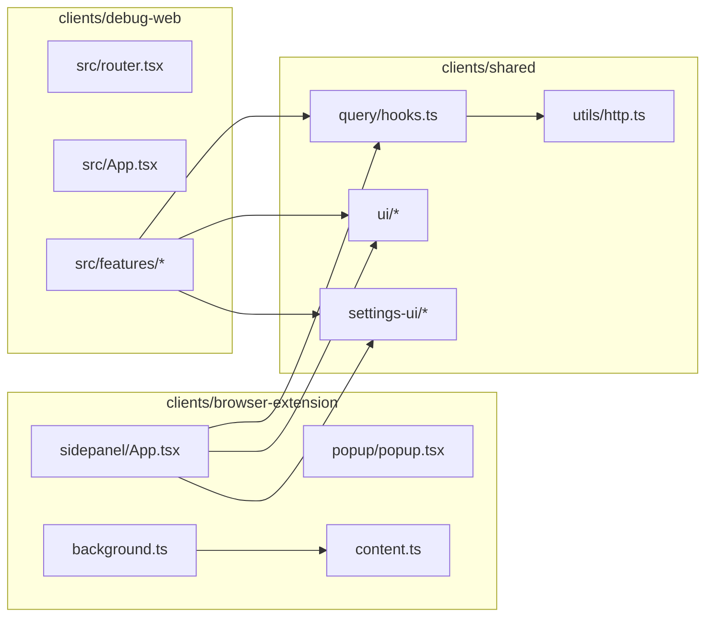
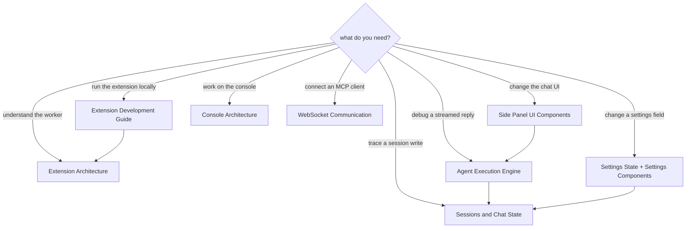
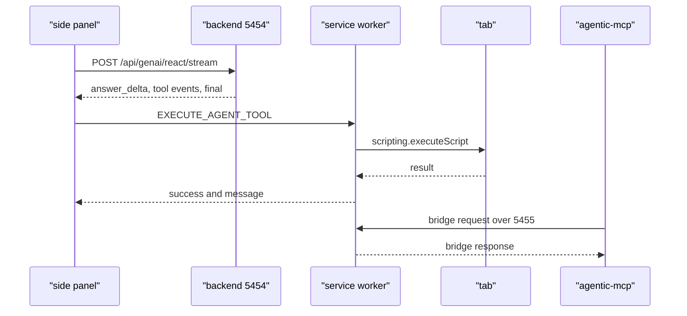

# Browser extension

This folder covers the front end of Agentic Browser: the WXT extension that puts an agent in the side panel, and the Vite console used to inspect runs, memory and settings. The pages here follow the code from the manifest and service worker through the chat UI, the state layer and the shared component library.

Key capabilities:
- A side panel chat with sessions, streaming replies, attachments and a work log.
- A service worker that owns the local bridge socket and runs browser actions on request.
- Google OAuth sign in, with tokens kept server side.
- Shared query hooks and UI primitives used by both the extension and the console.
- An operator console for runs, memory claims, the knowledge graph and maintenance.

## Folder map

## Pages

| Page | What it covers |
| --- | --- |
| `Browser Extension.md` | This index: the folder scope, reading paths and page list. |
| `Extension Architecture.md` | Five entrypoints, the runtime message bus, the action executor and the bridge client. |
| `Extension Development Guide.md` | Local build loop, manifest and permissions, scripts, loading unpacked and testing messages. |
| `Side Panel UI Components.md` | Chat shell, composer, message list, auth screens and the settings sheet. |
| `Agent Execution Engine.md` | SSE framing, event vocabulary, client reducers and the work log for a run. |
| `WebSocket Communication.md` | Bridge WebSocket frames, relay endpoints, the handler map and reconnect behavior. |
| `Authentication System.md` | OAuth flows, encrypted credentials, token refresh and the access boundaries. |
| `State Management.md` | How session, auth, settings and server state are split and owned. |
| `Sessions and Chat State.md` | `useSessions`, `useAgentRun`, session types, persistence and mentions. |
| `Settings State.md` | The settings sheet, integrations query, mutation refresh and model section. |
| `Query and Data Fetching.md` | Query keys, factories, polling intervals and the HTTP client. |
| `UI Component Library.md` | Shared primitives, work log, markdown and console components. |
| `Shared Primitives.md` | Button, Card, Pill, Select, Segmented, Skeleton, Stat and Timeline. |
| `Work Log and Chat Rendering.md` | `WorkLog` states, tool rows and the markdown pipeline. |
| `Settings Components.md` | Section shells, rows, modals, secret editors and backend sections. |
| `Console Architecture.md` | Routes, shell navigation, dashboard, runs and memory pages. |
| `Console Feature Components.md` | Overview, run detail, memory graph and diagnostics components. |

## How the pieces connect

The side panel and the console share the `clients/shared` package. The extension adds the browser specific layers: the worker, the content script, the bridge client and the panel hooks. The console adds routes and pages.

## Reading paths

Different questions need different pages. These paths keep the first read short.

A practical order for a new contributor: `Extension Development Guide.md` to get a panel open, `Extension Architecture.md` for the runtime boundaries, then `Side Panel UI Components.md` and `Sessions and Chat State.md` before touching chat code. The console pages are independent of the extension build and can be read on their own.

## Runtime at a glance

The side panel posts chat turns over HTTP, streams server-sent events back, and sends browser work to the worker. MCP clients reach the same worker through the local bridge.

## Repository layout

The front end lives in three packages under `clients/`:

- `clients/browser-extension`: the WXT MV3 extension. Entry points in `entrypoints/`, bridge and agent utilities in `entrypoints/utils/`, chat in `entrypoints/sidepanel/chat/`.
- `clients/debug-web`: the Vite console. Routes in `src/router.tsx`, pages in `src/features/`, console-only API methods in `src/lib/api.ts`.
- `clients/shared`: the shared package. Query hooks, the HTTP client, UI primitives, settings screens, the markdown renderer and the agent event reducer.

`pnpm-workspace.yaml` lists `clients/*`, so each package resolves the others through `workspace:*`.

## Conventions used in this folder

- Route and file paths are written from the repository root, for example `clients/browser-extension/entrypoints/background.ts`.
- Mermaid diagrams show call direction and ownership, not every file.
- Each page ends with implementation examples and the source files it was written from.
- Error strings and UI labels are quoted exactly as they appear in code.

## Related folders

- `Getting Started.md` covers the installer, backend and first run.
- `Configuration Management.md` covers environment variables and settings precedence.
- `Data Models and Schemas` covers the persisted rows behind sessions and credentials.
- `API Server` covers the routes the panel calls.
- `Troubleshooting and FAQ.md` covers failures that span the front end and the backend.

## Appendix

### Implementation examples
- Workspace packages, `pnpm-workspace.yaml`.
- Extension manifest, `clients/browser-extension/wxt.config.ts`.
- Console routes, `clients/debug-web/src/router.tsx`.
- Shared provider, `clients/shared/src/query/provider.tsx`.

### Source files
- `pnpm-workspace.yaml`
- `clients/browser-extension/wxt.config.ts`
- `clients/browser-extension/entrypoints/background.ts`
- `clients/debug-web/src/router.tsx`
- `clients/shared/src/query/hooks.ts`
