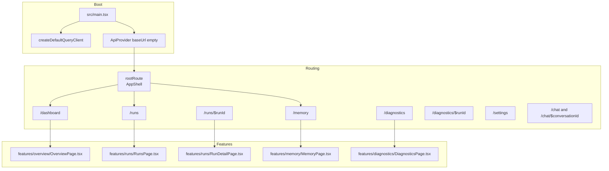
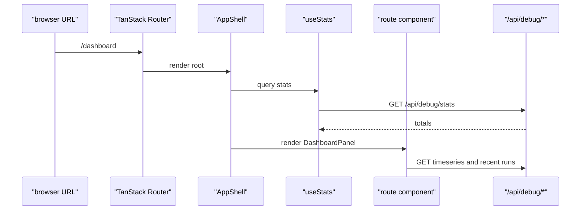
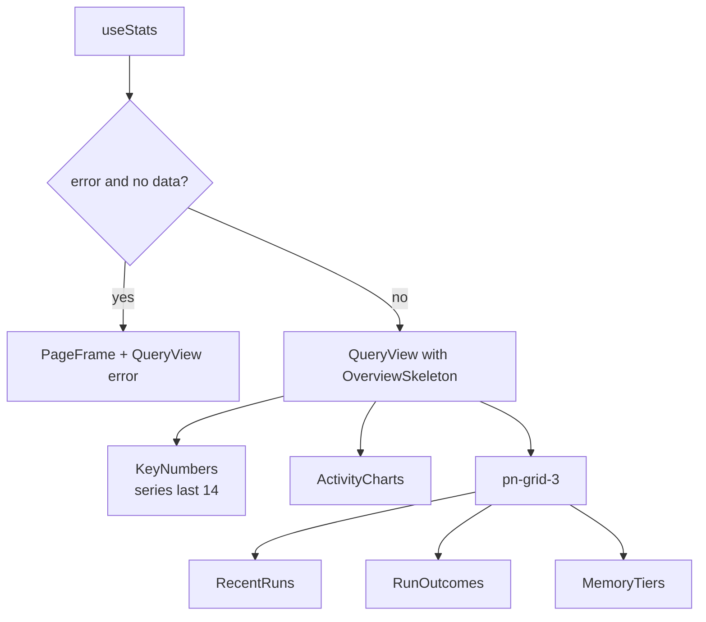
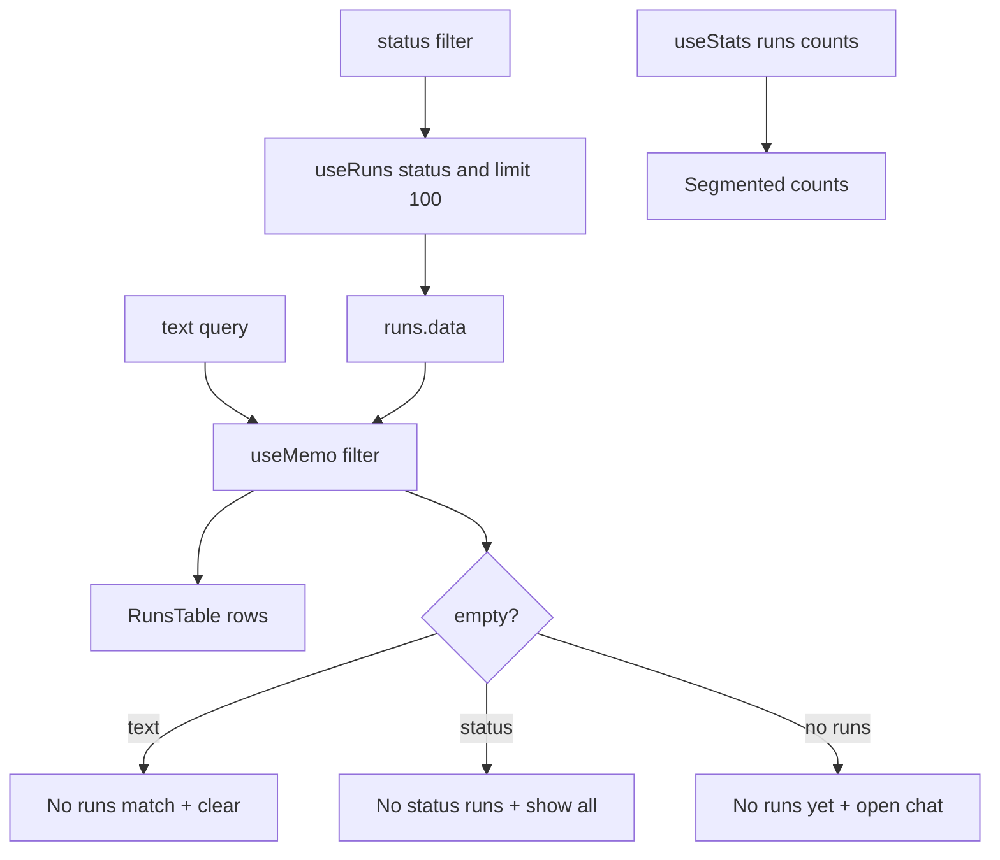
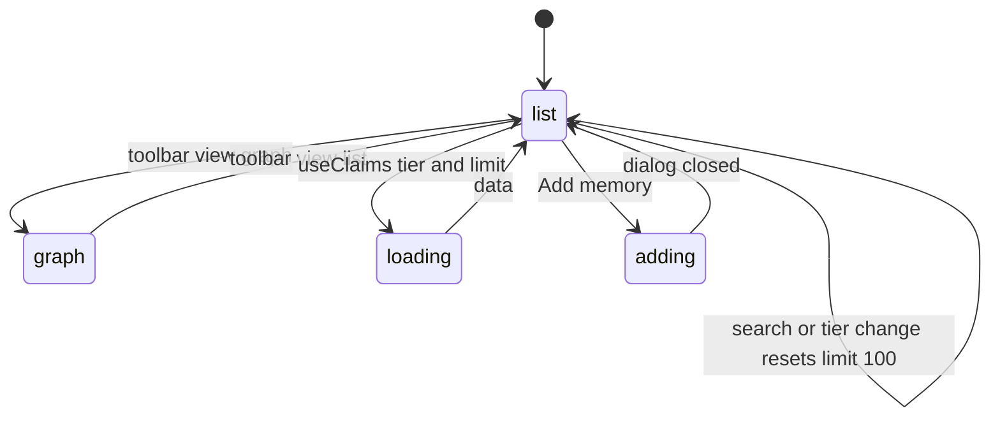
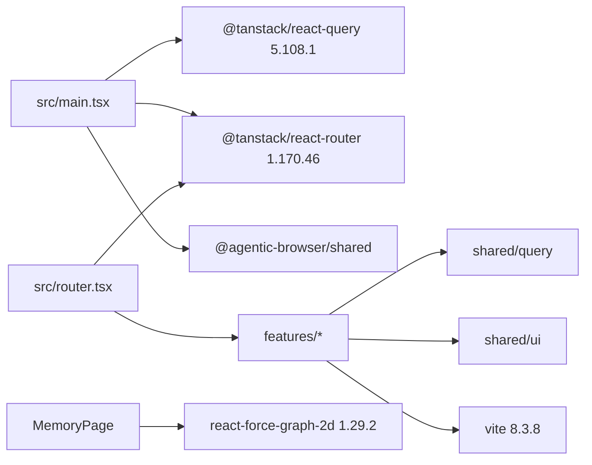

# Console architecture

`clients/debug-web` is the operator console. It is a Vite app with TanStack Router for pages and TanStack Query for data. `AppShell` renders the sidebar, backend status and telemetry. The pages under `src/features/` show the dashboard, the run list and detail, memory claims and the knowledge graph, maintenance runs, chat and settings.

Key capabilities:
- Route tree built with `createRoute`, no generated route file.
- Sidebar grouped into Operate, Inspect and Configure, with Alt+1..6 jumps.
- A single backend health signal from `useStats`, shown as online, degraded or offline.
- Pages that own their own filters and pagination, with skeletons and empty states from the shared UI package.

## Repository layout

`src/main.tsx` creates the query client, wraps the router in `ApiProvider` with an empty base URL, and lets the Vite proxy forward `/api`. `src/router.tsx` imports each page component and registers it on the root route. `src/App.tsx` is the root component, so it renders on every page.

## Building blocks

- `src/main.tsx`: mounts React in StrictMode, provides the query client and `ApiProvider baseUrl=""`, and imports `shared/theme.css`, `styles.css` and `shell.css`.
- `src/router.tsx`: `createRootRoute({ component: AppShell })`, an index route that throws `redirect({ to: "/dashboard" })`, and one route per page. The router uses `defaultPreload: "intent"`.
- `src/App.tsx`: `AppShell`. Owns the sidebar, keyboard shortcuts, theme toggle and top bar telemetry. `NAV` is exported and drives both the links and the title.
- `src/features/overview/OverviewPage.tsx`: `DashboardPanel`, which combines stats and a 30 day timeseries.
- `src/features/runs/RunsPage.tsx`: `RunsPanel`, the filterable run list.
- `src/features/memory/MemoryPage.tsx`: `MemoryPage`, list and graph views over memory claims, exported as `MemoryPanel` for the router.

## How it fits together

`AppShell` reads the current path with `useRouterState`, finds the matching `NAV` item, and renders its label as the page title. The `<Outlet />` sits in a container whose padding and overflow come from that item's `contentStyle`, so Chat and Settings can fill the viewport while Overview scrolls normally.

## Navigation and shell state

`NAV` has six entries. Chat and Agent runs are Operate. Overview, Memory and Diagnostics are Inspect. Settings is Configure. Each item carries an icon from `@agentic-browser/shared/icons`, a path and an optional `contentStyle`.

| Id | Path | Group | Content style |
| --- | --- | --- | --- |
| `chat` | `/chat` | Operate | no padding, hidden overflow |
| `runs` | `/runs` | Operate | default |
| `dashboard` | `/dashboard` | Inspect | `24px 28px`, auto overflow |
| `memory` | `/memory` | Inspect | default |
| `maintenance` | `/diagnostics` | Inspect | default |
| `settings` | `/settings` | Configure | no padding, hidden overflow |

Keyboard handling is one window listener. Alt plus `Digit1` through `Digit6` navigates to `NAV[n-1].path`. Alt plus backslash toggles the collapsed sidebar, persisted as `nav-collapsed` in `localStorage`. The listener ignores events with Meta or Control held.

The backend pill has four states. `isSuccess` means online. An error whose message has no three digit status means nothing is listening, so the pill says `backend offline`. An error with a status means the API responded but failed, so the pill says `backend degraded`. Before the first result the pill says `connecting`. The error message becomes the pill title.

The top bar shows Runs total, Live runs, Memories and Sources from `useStats`. A live run count also appears as a pulsing badge on the Agent runs nav item.

## Dashboard page

`DashboardPanel` calls `useStats()` and `useTimeseries(30)`. If stats failed and there is no cached data, it renders a `PageFrame` with a `QueryView` that has no skeleton and an empty render function, which surfaces the error state. On success it renders `KeyNumbers` (with the last 14 timeseries buckets), `ActivityCharts`, then a three column section with `RecentRuns`, `RunOutcomes` and `MemoryTiers`.

## Runs page

`RunsPanel` keeps a status filter (`all`, `running`, `completed`, `failed`) and a text query. It requests 100 runs with `useRuns({ status, limit: 100 })` and reads counts from `useStats().data.runs`. Text filtering happens in the browser over `run_id`, `entrypoint`, `final_answer`, `error` and `conversation_id`.

The `Segmented` options show `counts.total`, `counts.running`, `counts.completed` and `counts.failed`. The toolbar count reads `latest 100` when the result length equals the limit, otherwise `<n> shown`. `QueryView` chooses between the skeleton, an empty state and the table, so the page never renders a blank body.

## Memory page

`MemoryPage` has two views. The list view requests claims with an optional tier and a limit that starts at 100 and can grow to 200, the documented cap of the claims endpoint. Search filters `claim_text`, `segment` and `memory_class` on the client. The graph view is a lazy import of `graph/GraphView`, receives the tier and search, and is wrapped in `Suspense` with a `StateView` fallback.

`onMore` is passed to `ClaimList` only when the loaded count reached the limit and the limit is below 200, so the "more" control disappears at the cap. `AddMemoryDialog` is mounted at the page root and toggled by `adding`. `MemoryToolbar` owns the view switch, tier select, search field and add button. `TierBar` summarizes tiers above the list.

## Routes outside the mapped pages

`router.tsx` also registers `/runs/$runId` (`RunDetailPanel`), `/diagnostics/$runId` (`MaintenanceDetailPanel`), `/settings` (`SettingsPanel`) and `/chat` plus `/chat/$conversationId` (`ChatPanel`). The chat route has no dedicated nav item of its own beyond `chat`, and the detail routes rely on `useParams` rather than route loaders.

## Dependencies

The console depends on React 19.3.1, TanStack Query and TanStack Router, plus `react-force-graph-2d` for the memory graph. `@agentic-browser/shared` is a `workspace:*` dependency, so query hooks and UI primitives are the same source the extension uses. Vite serves the dev app and proxies `/api` to the backend.

## Performance

- `defaultPreload: "intent"` starts loading a route's code on hover or focus.
- Query defaults come from `createDefaultQueryClient`: `staleTime: 5_000`, `retry: 1`, refetch on window focus.
- `useStats` and `useRuns` poll every 4s, `useTimeseries` and memory stats every 30s, and run detail only while the run status is `running`.
- `GraphView` is a lazy route-level import, so the force graph bundle loads only when the memory graph is opened.
- Runs are capped at 100 per request, and claims at 200, which bounds the DOM and payload on both pages.

## Troubleshooting

- Symptom: every page shows the backend offline state. Cause: `/api` is not reachable. Fix: start the backend on 5454 or check the Vite proxy config.
- Symptom: `/` renders an empty page. Cause: the index route only redirects. Fix: navigate to `/dashboard`; the redirect should happen automatically.
- Symptom: sidebar count badge never appears. Cause: no run has status `running`. Fix: start a run and wait for the next 4s stats poll.
- Symptom: Memory graph is blank. Cause: `data.claims` is empty, so `GraphView` renders "No memories to draw". Fix: ingest a conversation or add a memory.
- Symptom: run list shows fewer rows than expected. Cause: the request is capped at 100 and the text filter runs after the fetch. Fix: narrow the status filter or search for a specific run id.

## Appendix

### Implementation examples
- Route registration and index redirect, `router.tsx`.
- Nav model and keyboard shortcuts, `NAV` and the keydown effect in `App.tsx`.
- Backend state triage, `unreachable` and `degraded` in `AppShell`.
- Dashboard composition, `DashboardPanel`.
- Runs filter and empty states, `RunsPanel`.
- Claims pagination cap, `PAGE` and `MAX` in `MemoryPage`.

### Source files
- `clients/debug-web/src/App.tsx`
- `clients/debug-web/src/router.tsx`
- `clients/debug-web/src/features/overview/OverviewPage.tsx`
- `clients/debug-web/src/features/runs/RunsPage.tsx`
- `clients/debug-web/src/features/memory/MemoryPage.tsx`
