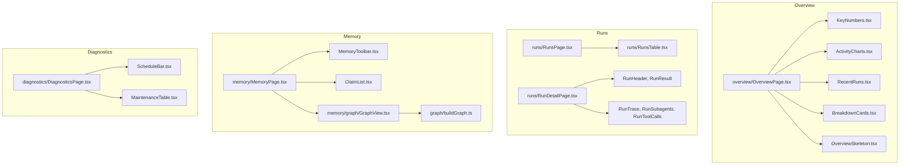
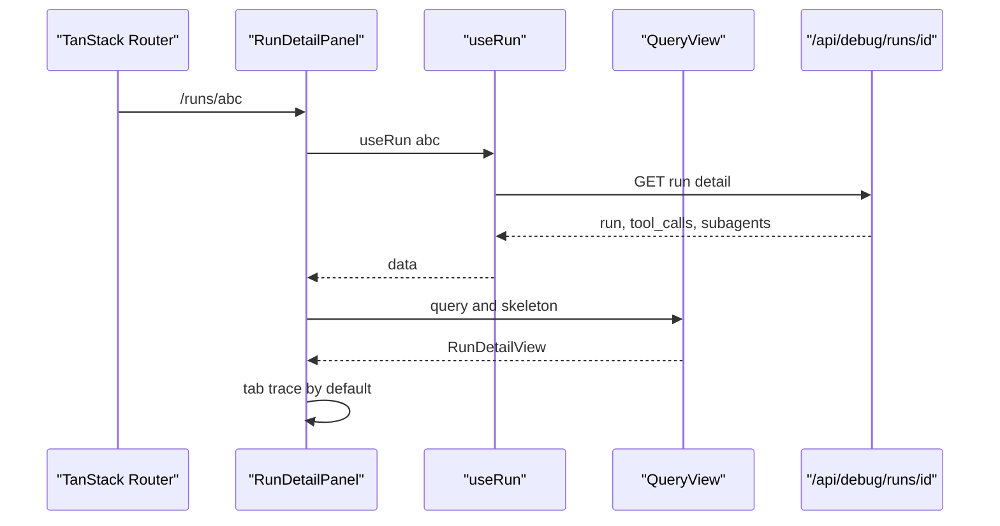
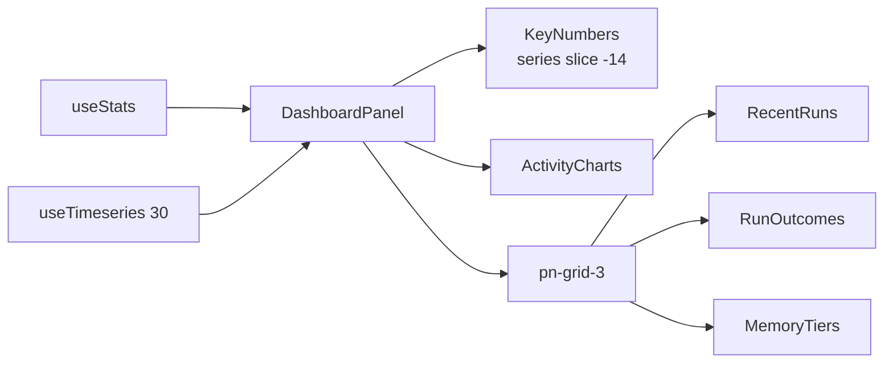
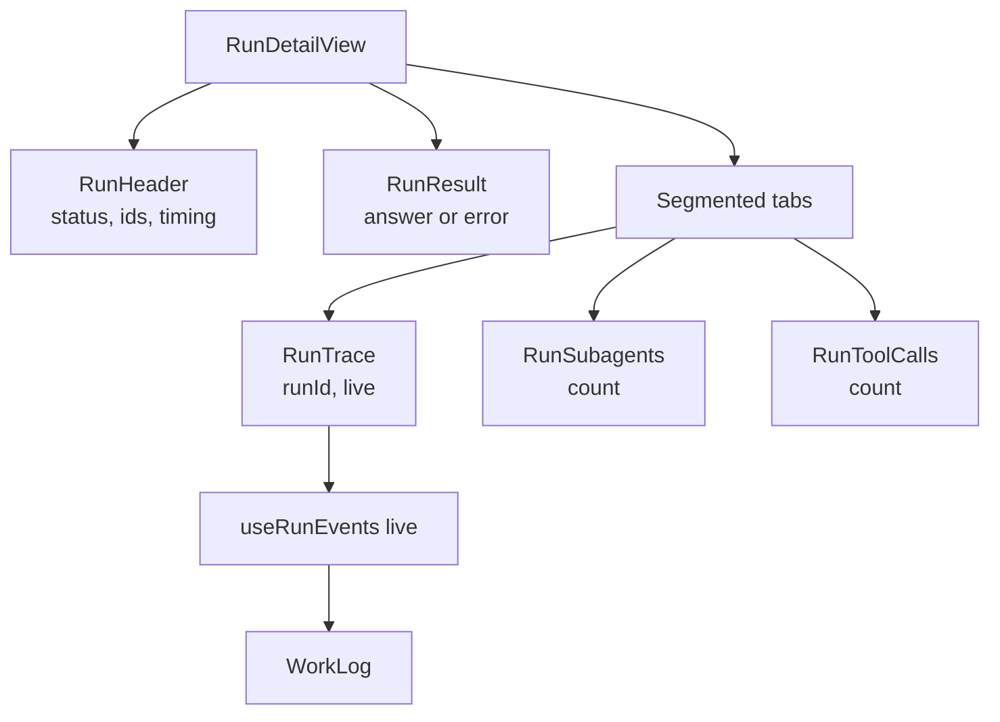
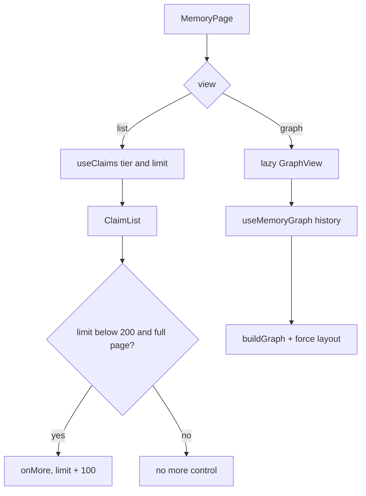
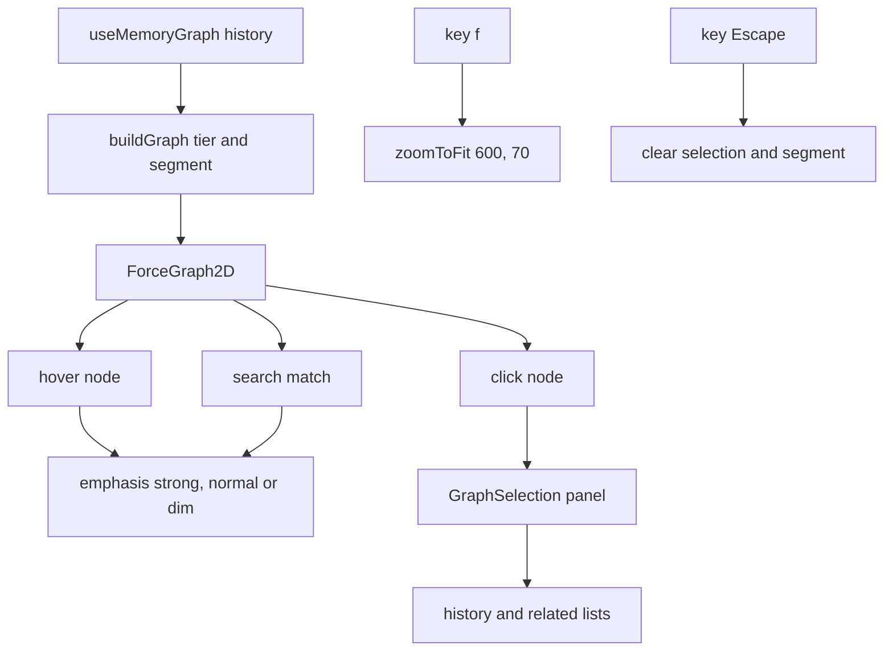
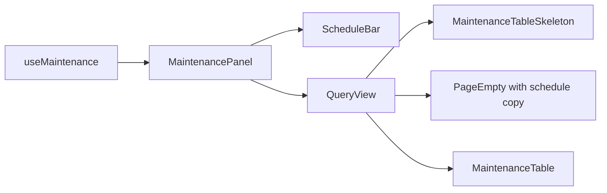
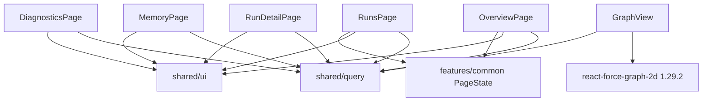

# Console feature components

The console pages under `clients/debug-web/src/features` are thin containers around shared query hooks and local UI. Overview composes stat cards and charts. Runs filters a table and opens a detail view with tabs. Memory switches between a claim list and a force directed graph. Diagnostics lists maintenance runs. Each page owns its own layout; shared behaviour stays in `shared/query` and `shared/ui`.

Key capabilities:
- Overview reads one stats query and one timeseries query.
- Runs filters client side after a 100 row request.
- Run detail splits trace, subagents and tool calls into tabs.
- Memory graph supports search, tier filter, history edges and selection.
- Diagnostics reflects the backend maintenance schedule.

## Repository layout

## Building blocks

- `overview/OverviewPage.tsx`: `DashboardPanel`, the dashboard entry.
- `runs/RunsPage.tsx`: `RunsPanel`, the list with status and text filters.
- `runs/RunDetailPage.tsx`: `RunDetailPanel`, which reads `runId` from the route and renders `RunDetailView`.
- `memory/MemoryPage.tsx`: `MemoryPage`, exported as `MemoryPanel`.
- `memory/graph/GraphView.tsx`: the default export loaded lazily by `MemoryPage`. It renders the force graph and selection panel.
- `diagnostics/DiagnosticsPage.tsx`: `MaintenancePanel`, the maintenance list.

## How it fits together

Every page follows the same pattern: call a query hook, branch on its state, then render a body. `QueryView` centralises the loading, error and empty branches, so a page supplies a skeleton and an empty node and gets consistent behaviour.

## Overview

`DashboardPanel` checks for the one case `QueryView` cannot cover: an error with no cached data. In that case it renders `PageFrame` with a `QueryView` that has no skeleton, which shows the error state at page level. Otherwise it renders `KeyNumbers` with the last 14 timeseries buckets, `ActivityCharts`, then a three column grid.

`KeyNumbers` receives `stats` and `series`, which may be `undefined` while the timeseries loads. `RunOutcomes` and `MemoryTiers` receive only `stats`, so they render as soon as the stats query resolves.

## Runs list and detail

`RunsPanel` keeps `status` and `text` in local state and asks for 100 runs. The status filter is sent to the server; the text filter runs on the returned rows over `run_id`, `entrypoint`, `final_answer`, `error` and `conversation_id`. The `Segmented` control labels each status with its count from `useStats`.

`RunDetailPanel` reads `runId` with `useParams({ from: "/runs/$runId" })` and calls `useRun(runId)`. When the query failed and there is no cached run, it renders the error at page level. On success, `RunDetailView` opens the trace tab.

A run is live when `run.status === "running"`, and that same flag drives `RunTrace` polling at 1.5s. The subagent and tool call tabs read arrays already present on the run detail response, so switching tabs does not refetch.

## Memory list

`MemoryPage` requests claims with a tier and a limit. The tier select resets the limit to 100, and `onMore` appends another 100 up to 200, the endpoint cap. Search is client side over `claim_text`, `segment` and `memory_class`.

## Memory graph

`GraphView` loads `useMemoryGraph(history)` and draws only when `data.claims` is non-empty. `buildGraph(data, { tier, segment })` produces nodes for entities and claims and links for subject, object, supersedes and contradicts relations.

The canvas keeps `segment`, `hovered` and `selectedId` in state. `focus` is the hovered node or the selected node. `neighbours` is built once per graph from the link list, and `focusSet` combines the focus with its neighbours. Search builds a set of matching node ids. `emphasis` returns `strong` for links touching the focus, `normal` for search matches and `dim` for everything else.

Force tuning happens in an effect after each graph change. Entity nodes repel with `-140 - size * 6` and a max distance of 260; claim nodes use `-18`. Link distance is 16 for `supersedes` and `contradicts`, 70 for `object`, and `30 + source.size` otherwise. Strength is 0.18 for object, 0.8 for subject and 0.5 for the rest.

`ForceGraph2D` uses `cooldownTicks={160}` and `d3VelocityDecay={0.35}`. Object links are dashed `[2, 3]`, contradiction links `[4, 3]`, and arrows appear for `supersedes` and `object`. Clicking centers the node over 500ms. The engine fits the view on stop only while nothing is selected.

Keyboard handling ignores events from inputs and textareas. `f` fits the graph and Escape clears the selection and segment, then fits. The legend lists segments and filters to one when clicked. A hovered claim shows a small tooltip unless it is already selected.

## Diagnostics

`MaintenancePanel` calls `useMaintenance()` and renders `ScheduleBar` above a table. The empty state explains the schedule: consolidates hourly, nightly at 03:00 and weekly on Sundays, with the first run after the backend has been up for an hour.

## Dependencies

The features import the router only for `Link` and `useParams`. Every network call goes through `@agentic-browser/shared/query` with the console's empty base URL. `react-force-graph-2d` is imported only by the lazy graph route.

## Performance

- `useStats` and `useRuns` poll at 4s, `useRun` at 1.5s only while running, `useMaintenance` at 30s.
- `useTimeseries(30)` polls at 30s, so the dashboard charts do not churn.
- `RunsPage` fetches at most 100 rows and filters them in memory; `MemoryPage` fetches at most 200 claims.
- `GraphView` builds neighbours in a single pass per graph and memoises `byId`, `segments` and `matches`.

## Troubleshooting

- Symptom: dashboard is blank with a backend error. Cause: `stats.isError` and no cached data, so the page deliberately drops the skeleton. Fix: start the backend and retry.
- Symptom: run detail stops updating. Cause: the run status is no longer `running`, so `refetchInterval` returns false. Fix: reload the run or open the trace once the backend marks it complete.
- Symptom: graph is a hairball. Cause: too many claims with no tier filter. Fix: pick a tier, search for a name, or click a node to focus its neighbours.
- Symptom: diagnostics list is empty. Cause: no maintenance run has completed yet. Fix: wait for the hourly job or trigger maintenance from the backend.

## Appendix

### Implementation examples
- Error-first dashboard branch, `DashboardPanel`.
- Text filtering, `filtered` in `RunsPanel`.
- Route param read, `useParams` in `RunDetailPanel`.
- Claim cap and more control, `PAGE` and `MAX` in `MemoryPage`.
- Force tuning and selection, `Canvas` in `GraphView`.

### Source files
- `clients/debug-web/src/features/overview/OverviewPage.tsx`
- `clients/debug-web/src/features/runs/RunsPage.tsx`
- `clients/debug-web/src/features/runs/RunDetailPage.tsx`
- `clients/debug-web/src/features/memory/MemoryPage.tsx`
- `clients/debug-web/src/features/memory/graph/GraphView.tsx`
- `clients/debug-web/src/features/diagnostics/DiagnosticsPage.tsx`
