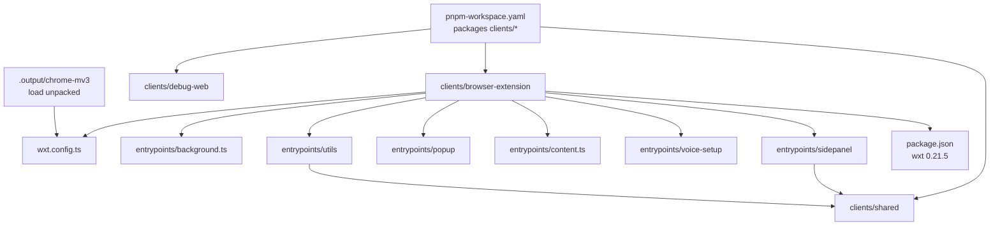
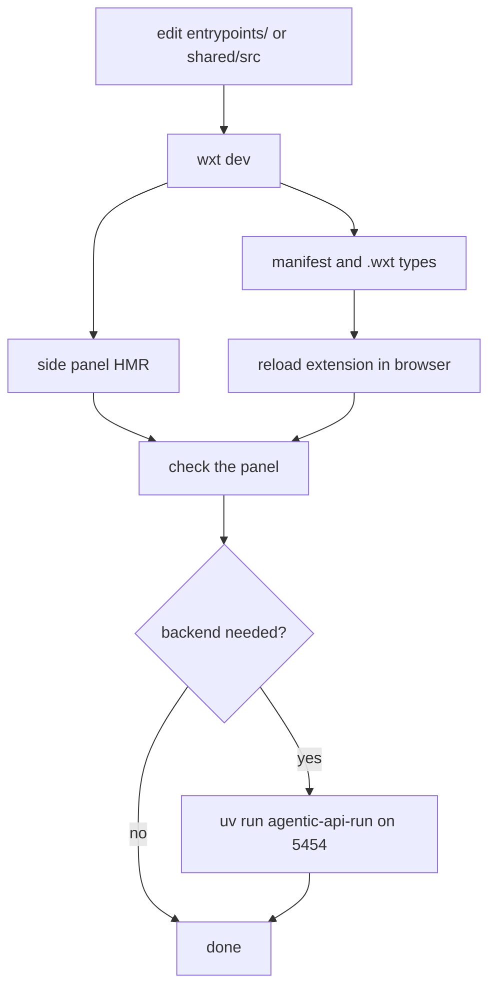
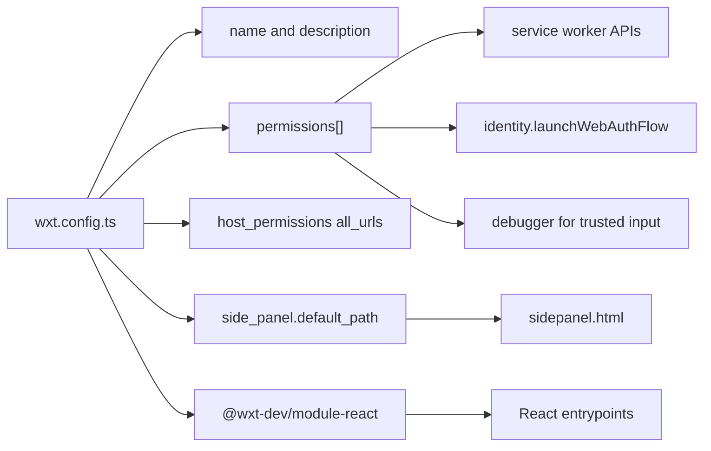
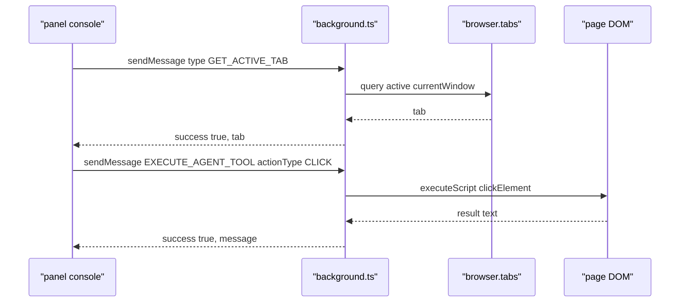
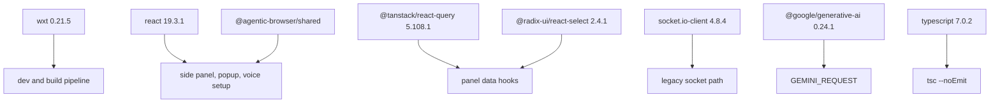

# Extension development guide

The extension is a WXT project in `clients/browser-extension`, inside the pnpm workspace. `pnpm dev:extension` starts a dev build that reloads the side panel as you edit. `pnpm build:extension` writes a loadable folder to `.output/chrome-mv3`. This page covers the local loop: prerequisites, scripts, manifest changes, entrypoint layout and how to test the runtime messages without publishing anything.

Key capabilities:
- One pnpm workspace command per target: dev, build, zip, Firefox and typecheck.
- WXT regenerates the manifest and `.wxt/` types from `wxt.config.ts`, so permissions are code, not JSON to hand-edit.
- The side panel imports the shared package from source through `workspace:*`, so UI and query changes hot reload too.
- A message bus you can exercise from the panel console while the worker is attached.

## Repository layout

The root `pnpm-workspace.yaml` lists `clients/*`. The extension package depends on `@agentic-browser/shared` as a workspace package, so edits under `clients/shared/src` are picked up by the extension dev server.



Contributor-facing folders:
- `entrypoints/`: one folder per HTML surface, plus `background.ts` and `content.ts`.
- `entrypoints/sidepanel/chat/`: the chat shell, composer, message list and hooks.
- `entrypoints/sidepanel/components/`: settings sheet, sign in, loading and bridge status.
- `entrypoints/utils/`: agent execution, action execution, command parsing, bridge client and model choice.
- `public/`: icons that WXT copies into the build.

## Prerequisites

| Tool | Version | Used for |
| --- | --- | --- |
| Node | 20 or newer | WXT and Vite builds |
| pnpm | `9.0.0` (`packageManager`) | workspace install and scripts |
| Chrome, Brave, Edge, Arc or another Chromium fork | current | loading the unpacked build |

The backend is separate. For panel work that only touches layout, you can skip it, but the chat needs the API at `http://localhost:5454` or whatever `localStorage.baseUrl` points at. Firefox support is a separate build target and not the default dev loop.

## Install and build

```sh
pnpm install
pnpm dev:extension        # WXT dev build with reload
pnpm build:extension      # .output/chrome-mv3
pnpm build:extension:firefox
pnpm typecheck:extension  # tsc --noEmit via the compile script
```

The scripts in the root `package.json` filter by package name, so each one is a thin wrapper:

| Script | Runs |
| --- | --- |
| `dev:extension` | `pnpm --filter @agentic-browser/browser-extension dev` |
| `build:extension` | `wxt build` in the extension package |
| `build:extension:firefox` | `wxt build -b firefox` |
| `zip:extension` | `wxt zip` |
| `typecheck:extension` | `tsc --noEmit` |
| `dev:debug` | the console, useful for backend settings |

`postinstall` runs `wxt prepare`, which creates `.wxt/` and the generated types. If `tsc` complains about missing `wxt/browser` types after a fresh clone, run `pnpm install` before anything else.

## How it fits together

WXT watches `entrypoints/` and `wxt.config.ts`. A change to a React file rebuilds the side panel bundle; a change to `wxt.config.ts` regenerates the manifest and usually needs an extension reload. The browser keeps the old service worker until you press reload on the extensions page.



Loading the build:
1. Open `chrome://extensions`.
2. Turn on developer mode.
3. Choose Load unpacked and pick `clients/browser-extension/.output/chrome-mv3`. Do not pick the source folder.
4. Open the side panel from the toolbar. The popup also has an "Open assistant" button that calls `browser.sidePanel.open({ windowId })`.

## Manifest and permissions

`wxt.config.ts` holds the whole manifest. The permissions array names every API the worker or panel uses, including `activeTab`, `tabs`, `storage`, `scripting`, `identity`, `sidePanel`, `webNavigation`, `webRequest`, `cookies`, `bookmarks`, `history`, `clipboardWrite`, `clipboardRead`, `notifications`, `downloads`, `microphone`, `audioCapture`, `contextMenus`, `debugger`, `alarms` and `tabGroups`. Host access is `<all_urls>`, and `side_panel.default_path` is `sidepanel.html`.



Adding a permission is a one line change. If a new API fails with "not available" in the worker, check the array before adding a polyfill. Removing a permission is riskier: `debugger` is what lets the bridge use trusted clicks, and `identity` is what makes the sign in flow work.

## Adding an entrypoint

WXT treats a folder with an `index.html` as a page. To add one, create `entrypoints/<name>/index.html` and `main.tsx` that mounts React into the root element. To add a script, place `<name>.ts` at the top level of `entrypoints/` and default-export `defineContentScript` or `defineBackground`.

Entry points currently in the build:

| Entrypoint | Kind | Purpose |
| --- | --- | --- |
| `background.ts` | background | bridge, messages, actions, tab inventory |
| `content.ts` | content script | page helpers and overlay references |
| `sidepanel/` | page | chat and settings |
| `popup/` | page | tab list and side panel launch |
| `voice-setup/` | page | microphone permission check |

The side panel mount is `entrypoints/sidepanel/main.tsx`, which renders `App` inside `QueryClientProvider`. Import `@agentic-browser/shared/theme.css` there before `App.css` and `chat.css`, so page rules can override tokens without redefining them.

The same folder also holds `entrypoints/sidepanel/index.tsx`, which calls `createShadowRootUi` with the name `ai-assistant-sidebar`, mounts `App` into the shadow root, and unmounts on remove. Treat it as a separate surface from the side panel HTML: a change that must appear in both needs to be tested in both places. The side panel page itself is `index.html`, which loads `main.tsx` and `theme-boot.js`.

## Testing runtime messages

Every panel to worker call is `browser.runtime.sendMessage`. The worker's listener returns `true` for async handlers, so a promise on the caller side resolves when `sendResponse` runs. To try one, open the side panel devtools console and send a message with the same shape the panel uses.



Two rules keep this predictable:
- Return `true` only when the handler will call `sendResponse` later. A sync branch that returns `false` closes the channel immediately.
- Keep responses small. A page snapshot can be large; the bridge path clips payloads, and the message path should do the same.

When a new message type is added, extend the `switch` in `background.ts` and the caller in the same change. An unknown type only logs the list and responds with `Unknown message type`, so a typo looks like a silent failure in the panel.

## Working with the shared package

`clients/shared` exports `./ui`, `./query`, `./icons`, `./settings-ui`, `./agent` and `./markdown`. The extension imports those entrypoints, never `src/` internals. If a component needs a prop only the panel uses, add it to the shared component as optional rather than forking the file. The console mounts the same `WorkLog`, `BackendSettings` and query hooks, so a fork doubles the maintenance.

Model choice is panel-only state and lives in `entrypoints/utils/modelChoice.ts`. Theme is also local. Anything stored in Postgres goes through the settings library.

## Firefox build

`pnpm build:extension:firefox` emits `firefox-mv2`. The manifest is generated from the same `wxt.config.ts`, so permissions and the side panel path carry over. `browser.identity`, `browser.storage` and `browser.scripting` are normalised by `wxt/browser`. The bridge origin check accepts `moz-extension://` as well as `chrome-extension://`, but `AGENTIC_BROWSER_EXTENSION_IDS` may need the Firefox id added before the socket stays open.

## Dependencies



`wxt` is the only build tool. There is no separate webpack or Vite config in the package. `@wxt-dev/module-react` adds the React plugin, and `wxt prepare` is what keeps the generated types in sync with the manifest.

## Troubleshooting

- Symptom: changes to `wxt.config.ts` do nothing. Cause: the browser still has the old manifest. Fix: reload the extension on `chrome://extensions`.
- Symptom: `Cannot find module 'wxt/browser'`. Cause: `.wxt/` was never generated. Fix: run `pnpm install`, which triggers `wxt prepare`.
- Symptom: the side panel opens blank. Cause: the build was loaded from the source folder, or the panel bundle failed. Fix: load `.output/chrome-mv3` and check the panel console for the first error.
- Symptom: a runtime message resolves `undefined`. Cause: the handler returned before `sendResponse`, or the type did not match. Fix: return `true` for async work and check the worker console for `Unknown message type`.
- Symptom: styles look unstyled in the panel. Cause: `theme.css` was not imported before the panel CSS. Fix: import it first in `main.tsx`.
- Symptom: hot reload stops after a worker edit. Cause: MV3 workers do not hot reload. Fix: press reload on the extensions page.
- Symptom: `pnpm typecheck:extension` fails on shared code. Cause: the shared package changed shape and the extension still uses the old prop. Fix: update the call site or make the prop optional in shared.

## Appendix

### Implementation examples
- Root scripts, `package.json` `scripts`.
- Manifest and permissions, `wxt.config.ts`.
- Panel mount and provider, `entrypoints/sidepanel/main.tsx`.
- Runtime listener, `browser.runtime.onMessage` in `background.ts`.
- Model choice persistence, `loadModelChoice` and `saveModelChoice`.

### Source files
- `package.json`
- `pnpm-workspace.yaml`
- `clients/browser-extension/package.json`
- `clients/browser-extension/wxt.config.ts`
- `clients/browser-extension/entrypoints/sidepanel/main.tsx`
- `clients/browser-extension/entrypoints/background.ts`
