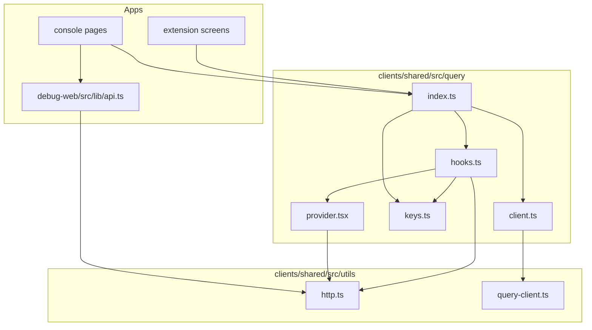
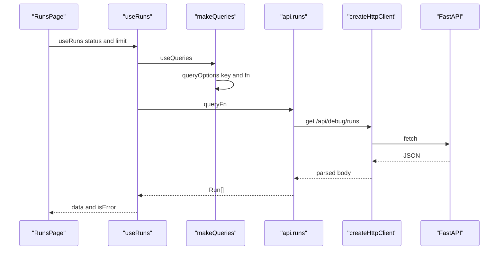
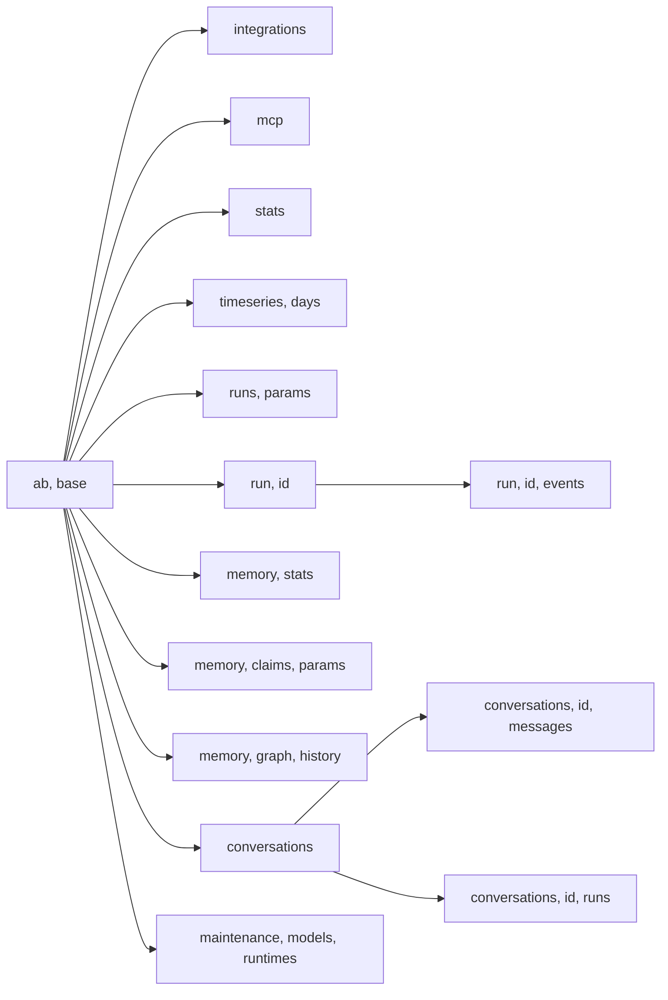
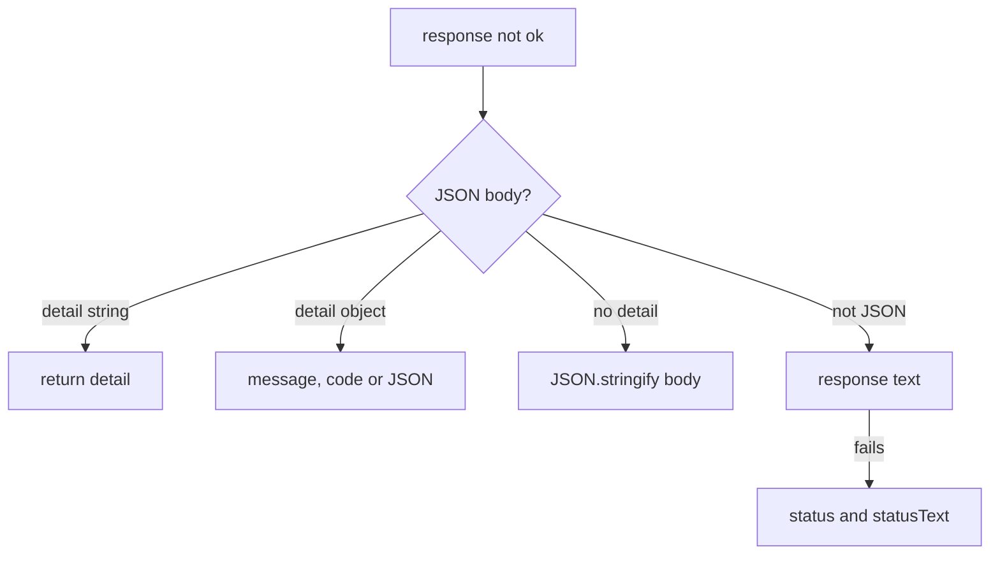
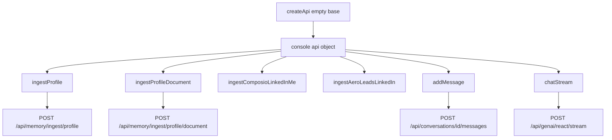
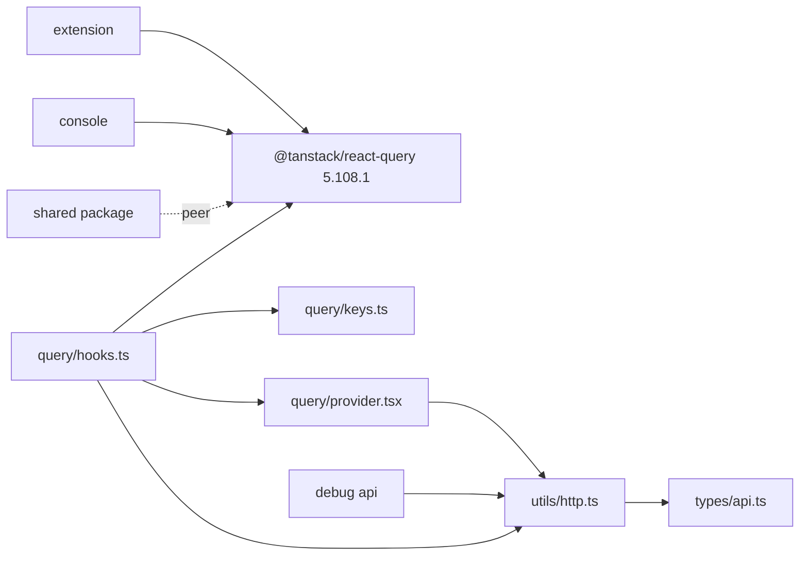

# Query and data fetching

`clients/shared/src/query` is the data layer for both apps. `keys.ts` names every cache entry, `hooks.ts` builds query factories and typed hooks, `provider.tsx` supplies the base URL and API object, and `utils/http.ts` implements the fetch client. The console adds a few endpoints in `clients/debug-web/src/lib/api.ts` without forking the shared client.

Key capabilities:
- Query keys include the base URL, so two backends never share a cache.
- One `Api` object with every REST method, created from a base URL resolver.
- Polling intervals tuned per endpoint, from 1.5s for a live run to 30s for timeseries.
- `keepPreviousData` on list queries so filters do not flash an empty table.

## Repository layout

## Building blocks

- `query/client.ts`: re-exports `createDefaultQueryClient` from `utils/query-client.ts`. Defaults are `retry: 1`, `staleTime: 5_000` and `refetchOnWindowFocus: true`.
- `query/keys.ts`: `queryKeys` with `all(base)` as `["ab", base]` and one builder per resource. `sharedQueryKeys` is a deprecated alias for two keys.
- `query/provider.tsx`: `ApiProvider` memoises `{ baseUrl, api }` from `createApi(() => baseUrl)`. `useApi()` throws when the provider is missing.
- `query/hooks.ts`: `makeQueries(base, api)` returns `queryOptions` factories, `useQueries()` binds them to the current provider, and each `useStats`, `useRuns` and similar hook calls `useQuery` on the right factory.
- `utils/http.ts`: `createHttpClient`, `createApi`, `readError` and the `Api` type.
- `debug-web/src/lib/api.ts`: the console-only extension of the shared client.

## How it fits together

A component calls a hook. The hook asks `useQueries()` for factories bound to the current `ApiProvider`, then hands the options to `useQuery`. `queryFn` calls a method on `api`, which resolves the base URL at call time and runs `fetch`.

## Query keys

Every key starts with `["ab", base]`. Resource builders append a name, and parameterised builders append the parameters object, so a new status filter is a new cache entry rather than a mutation of the old one.

Memory keys group under `"memory"` so a future invalidation can target the whole subtree. Conversation keys group under `"conversations"`. The `settings-ui` hook relies on this shape and invalidates only `integrations`.

## Polling intervals

`LIVE` is 4000ms and `SLOW` is 30000ms in `hooks.ts`. Values below come from the `refetchInterval` option on each factory.

| Query | Interval | Notes |
| --- | --- | --- |
| `stats` | 4s | Dashboard and shell telemetry. |
| `runs` | 4s | Keeps previous data while a filter changes. |
| `run` | 1.5s | Only while `status === "running"`, otherwise off. |
| `runEvents` | 1.5s | Only when the caller passes `live`. |
| `integrations` | 8s | Settings status. |
| `mcpStatus` | 8s | Defined in `McpSection`, not `makeQueries`. |
| `timeseries` | 30s | 30 day series. |
| `memoryStats` | 30s | Tier totals. |
| `maintenance` | 30s | Maintenance run list. |
| `claims`, `memoryGraph` | none | Refetch on demand, keep previous data. |
| `conversations`, `messages` | none | Loaded when a chat opens. |

`useMessages` and `useConversationRuns` add `enabled: !!id`, so an empty route param does not fire a request to `/api/conversations//messages`.

## The HTTP client

`withBase(base, path)` returns absolute URLs unchanged, returns the path when the base is empty, and otherwise strips a trailing slash from the base and adds a leading slash to the path. `createHttpClient` exposes `get`, `post`, `put` and `del`, all generic over the response type.

`get` throws `${res.status} ${res.statusText}` without reading the body. The other verbs call `readError`, which tries JSON first: a string `detail` is returned as is, an object `detail` yields `message`, `code` or the JSON text. If JSON parsing fails it returns the response text, then the status line. That is why the console can tell a missing backend from a 500: only a server response produces a status code in the message.

`qs()` drops `null`, `undefined` and empty string values, then builds a query string with `URLSearchParams`. This lets callers pass optional filters without branching at every call site.

`createApi` covers integrations and secrets, LLM and chat-title settings, runtimes and Antigravity, compaction, voice, MCP, Composio, sessions, memory, debug stats, runs, timeseries, claims, maintenance and conversations. Methods that return an envelope unwrap it, for example `conversations()` returns `data.conversations ?? []`.

## Console extensions

`clients/debug-web/src/lib/api.ts` starts from the shared client with an empty base, because Vite proxies `/api`. It spreads `shared` and adds memory ingestion and chat streaming.

`chatStream` reads the response body with `getReader()`, decodes with `TextDecoder`, keeps an incomplete line in a buffer, splits on newlines, and parses lines starting with `data: `. Partial JSON is ignored by a `try` block, which is expected because a chunk can split a JSON object. `addMessage` posts `client_id: "debug-app"`; `chatStream` posts `client_id: "console"` and an empty `chat_history`, since the backend loads history from `conversation_id`.

## Dependencies

`@tanstack/react-query` is a real dependency in both apps and a peer dependency in `clients/shared`. `clients/shared/package.json` exports `./query`, `./api` and the rest of the public surface, so consumers never import `src/` internals.

## Performance

- `staleTime: 5_000` dedupes the burst of identical queries when several components mount at once.
- `keepPreviousData` on `runs`, `claims` and `memoryGraph` avoids a skeleton flash when a filter or tier changes.
- `run` and `runEvents` stop polling as soon as a run is no longer `running`.
- The MCP query polls at 8s only while `McpSection` is mounted, because the query lives in that component.
- `get` does not parse an error body, which keeps the hot read path small.

## Troubleshooting

- Symptom: `useApi must be used inside <ApiProvider>`. Cause: a hook or settings component rendered above the provider. Fix: mount `ApiProvider` at the app root, as `main.tsx` and `AgentExecutor` do.
- Symptom: the console requests `http://localhost:5454://api/...`. Cause: a base URL already ending in a path was combined twice. Fix: pass either a full URL or an empty base, not both.
- Symptom: a write succeeds but the screen still shows old data. Cause: the mutation did not invalidate its key. Fix: use `useSettingsMutation` or call `invalidateQueries` with the right `queryKeys` builder.
- Symptom: a list flashes empty while typing. Cause: the query key changed and no placeholder was configured. Fix: add `keepPreviousData` to the factory.
- Symptom: the console gets HTML in an error. Cause: the request hit a dev server or a proxy error page. Fix: check the Vite proxy target and the backend port.

## Appendix

### Implementation examples
- Default client options, `createDefaultQueryClient`.
- Key builders, `queryKeys` in `keys.ts`.
- Provider context, `ApiProvider` and `useApi`.
- Query factories and intervals, `makeQueries` and `LIVE` / `SLOW`.
- URL join and error text, `withBase` and `readError`.
- Console streaming, `chatStream` in `lib/api.ts`.

### Source files
- `clients/shared/src/query/client.ts`
- `clients/shared/src/query/hooks.ts`
- `clients/shared/src/query/keys.ts`
- `clients/shared/src/query/provider.tsx`
- `clients/shared/src/utils/http.ts`
- `clients/debug-web/src/lib/api.ts`
