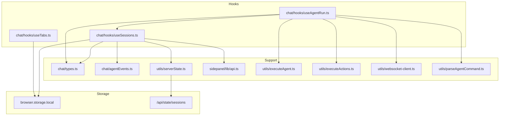
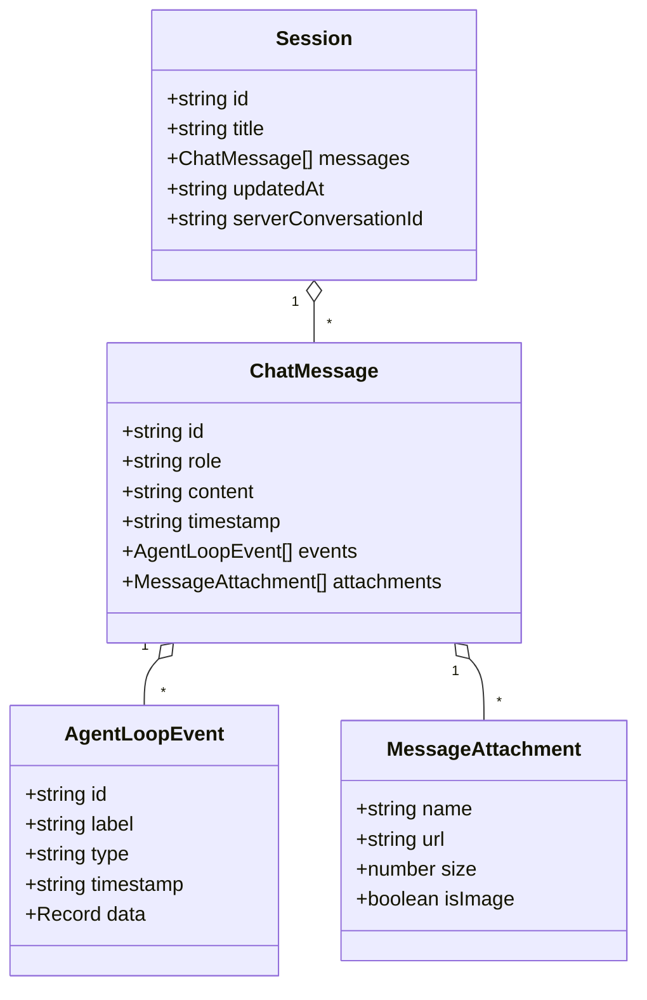
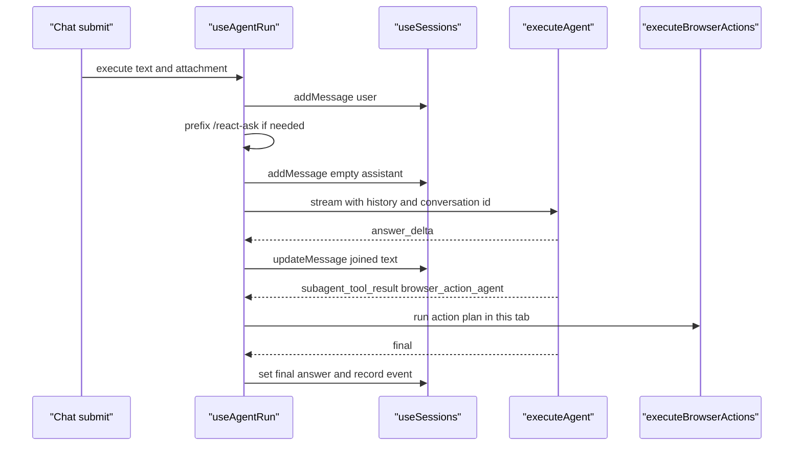
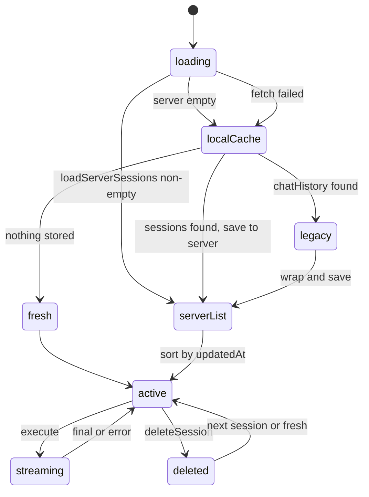
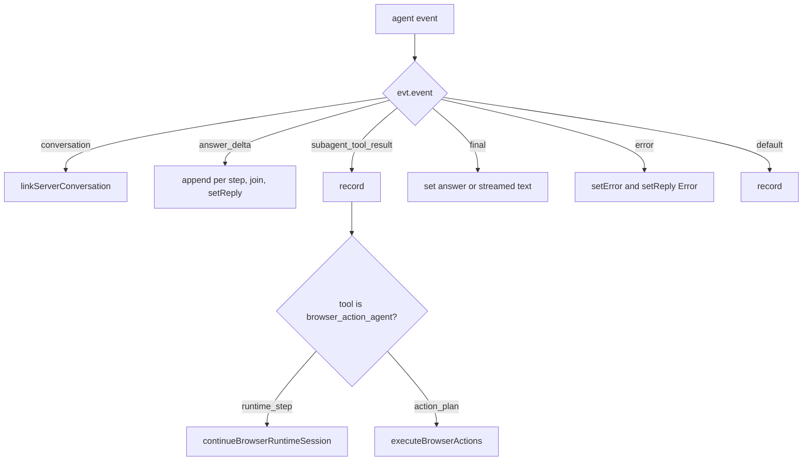
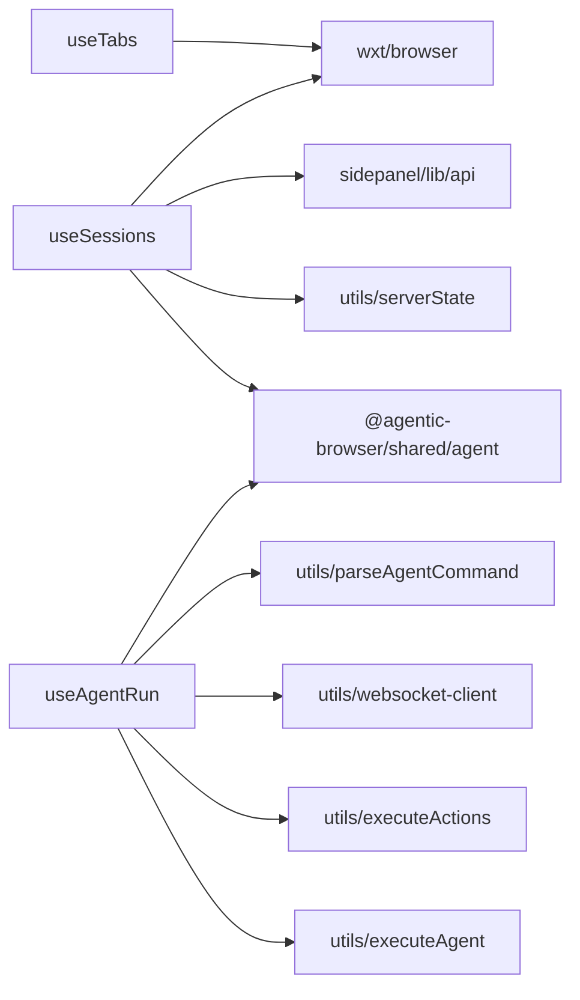

# Sessions and chat state

`useSessions` owns the chat list and the active thread. `useAgentRun` owns one in-flight run: it appends the user message, streams agent events into the assistant reply, executes browser action plans in the current tab, and stops cleanly. `chat/types.ts` defines the stored shapes, and `useTabs` supplies open tabs for `@` mentions.

Key capabilities:
- Load order: backend, then `browser.storage.local.sessions`, then the legacy `chatHistory` key, then a new empty chat.
- Write through: every sessions change is saved to the backend and local cache.
- Answer text per model step, joined with blank lines.
- Run events stored on the reply as `AgentLoopEvent` objects for the work log.

## Repository layout

## Building blocks

- `chat/hooks/useSessions.ts`: `sessions`, `activeSessionId`, `activeMessages` and mutators `newChat`, `addMessage`, `updateMessage`, `pushAgentEvent`, `linkServerConversation`, `deleteSession`. It returns `SessionsApi`, the type `useAgentRun` consumes.
- `chat/hooks/useAgentRun.ts`: `isExecuting`, `error`, `setError`, `execute` and `stop`. It reads `sessions.activeSessionId`, `activeMessages` and `serverConversationId` once at submit time, so a streamed reply keeps writing to the session it started in.
- `chat/types.ts`: `AgentLoopEvent`, `ChatMessage`, `MessageAttachment`, `Session`, `AttachedFile`, the `isImageName` regex, `BACKEND_URL` and `newSession()`.
- `chat/hooks/useTabs.ts`: `tabs` plus `refresh`, which calls `browser.tabs.query({})`. The mention menu triggers a refresh before opening.

## Data shapes

`Session` is the persisted unit. `serverConversationId` links a local thread to a backend conversation once the `conversation` event arrives. `ChatMessage` holds optional `events` and `attachments`.

## How it fits together

Submitting a message calls `sessions.addMessage` before the network request, so the question appears immediately. Anything that does not start with `/` is prefixed with `/react-ask `. `parseAgentCommand` then chooses between the streaming HTTP path, when it returns `stage: "complete"`, and `runOverSocket`.

## Session lifecycle

On mount, `useSessions` tries the backend. A non-empty server list is adopted and sorted by `updatedAt`, newest first. Otherwise it reads `sessions` from extension storage, pushes a hit to the server, wraps a legacy `chatHistory` array in a session titled `Previous Chat`, or calls `newChat()`.

`newChat` sets `loaded.current = true`, prepends the session and selects it. `deleteSession` confirms, calls `api.deleteSession(id)` which issues `DELETE /api/state/sessions/{id}`, then removes the session. If it was active, the first remaining session becomes active; otherwise a fresh one is created. A failed delete alerts and leaves the list unchanged.

`addMessage` names a thread from its first user message: 30 characters, plus `...` when longer. Every mutation sets `updatedAt` and re-sorts with `byRecent`.

## Writing events into a reply

`pushAgentEvent` stamps an id when the event has none, using `${Date.now()}-${counter}-${random}`. It converts the stored events through `toAgentEvents`, merges with the shared `appendEvent`, and maps back with `fromAgentEvent`. `appendEvent` drops `answer_delta` and `conversation`, merges `thinking_delta` for the same step, and lets a full `thinking` block replace its streamed pieces.

Answer text is kept per model step in `answerSteps`, a `Map<number, string>`. `joined()` sorts by step, trims, drops empties and joins with two newlines, so text written before a tool call survives and steps never run together. When a `final` answer equals `RUNTIME_PLACEHOLDER` and the runtime was continued locally, the event is recorded but the placeholder is not shown.

## Stopping and errors

`stop` calls `stopBrowserRuntime()` first, because browser tasks run over HTTP and are not owned by the socket. It then calls `wsClient.stopAgent()`, clears `isExecuting` and sets `Agent execution stopped by user`.

`cleanError` rewrites HTML error pages from upstream providers: groq 500, 502 or 503, 429 rate limits, then a generic server error. The stream path records the error event, sets the reply to `Error: <message>`, and leaves the run marked failed.

## Mentions

`useTabs` keeps a `tabs` array and a `refresh` callback. `Chat` calls `tabs.refresh()` only when the last word starts with `@`, and `pickMention` replaces that word with `@<title> ` and closes the menu. There is no polling.

## Dependencies

`serverState.ts` builds URLs from `browser.storage.local.baseUrl`, `VITE_API_URL` or `http://localhost:5454`, and speaks to `/api/state/sessions` with GET and PUT. `sidepanel/lib/api.ts` creates the shared client for delete calls.

## Performance

- Sessions are saved in one PUT with the whole list, so a burst of deltas does not produce one request per token.
- `answerSteps` rebuilds the answer from a per-step map instead of re-parsing the whole text on every delta.
- Event ids use `Date.now()` plus a counter, so no crypto call is needed per token.
- `useTabs` queries tabs only when the mention menu opens, not on a timer.

## Troubleshooting

- Symptom: a reply lands in the wrong thread. Cause: a mutator was called with the current `activeSessionId` instead of the id captured at submit. Fix: pass the `sid` captured in `execute`.
- Symptom: two answers merge into one. Cause: the assistant placeholder reused an existing id. Fix: keep the `${Date.now()}-assistant` reply id unique per run.
- Symptom: the panel shows "Please enter a goal for the agent". Cause: `submit` trimmed an empty composer. Fix: type text, or use a quick action that sends one.
- Symptom: browser actions never run. Cause: the result had no `runtime_step` and no `action_plan.actions`. Fix: inspect the event payload in the log.
- Symptom: legacy history disappears. Cause: the `chatHistory` migration ran and removed the key. Fix: look for the session titled `Previous Chat`.

## Appendix

### Implementation examples
- Load and migration, `useSessions` effect.
- Title from first message, `addMessage`.
- Event ids and merge, `pushAgentEvent`.
- Stream dispatch, the `onEvent` switch in `useAgentRun`.
- Stop path, `stop` in `useAgentRun`.

### Source files
- `clients/browser-extension/entrypoints/sidepanel/chat/hooks/useSessions.ts`
- `clients/browser-extension/entrypoints/sidepanel/chat/hooks/useAgentRun.ts`
- `clients/browser-extension/entrypoints/sidepanel/chat/types.ts`
- `clients/browser-extension/entrypoints/sidepanel/chat/hooks/useTabs.ts`
