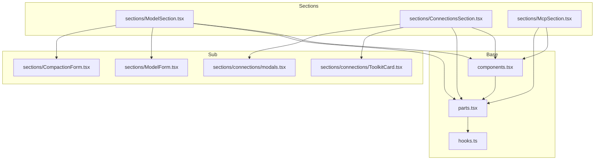
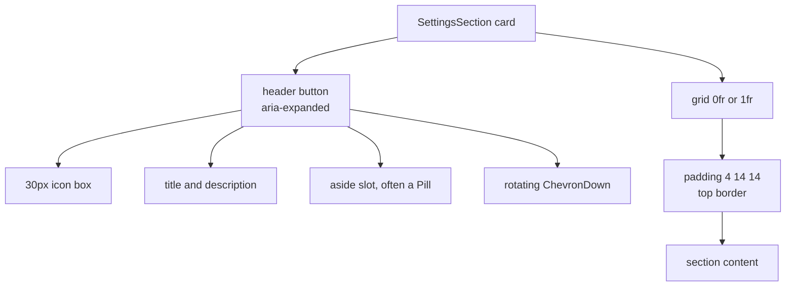
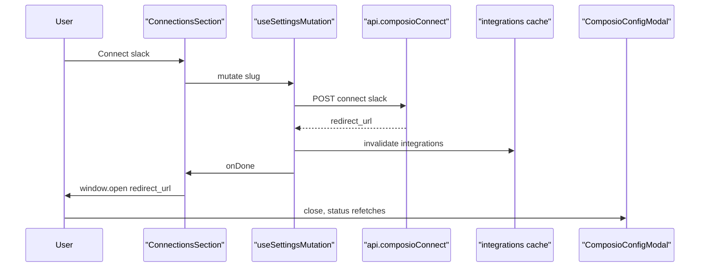
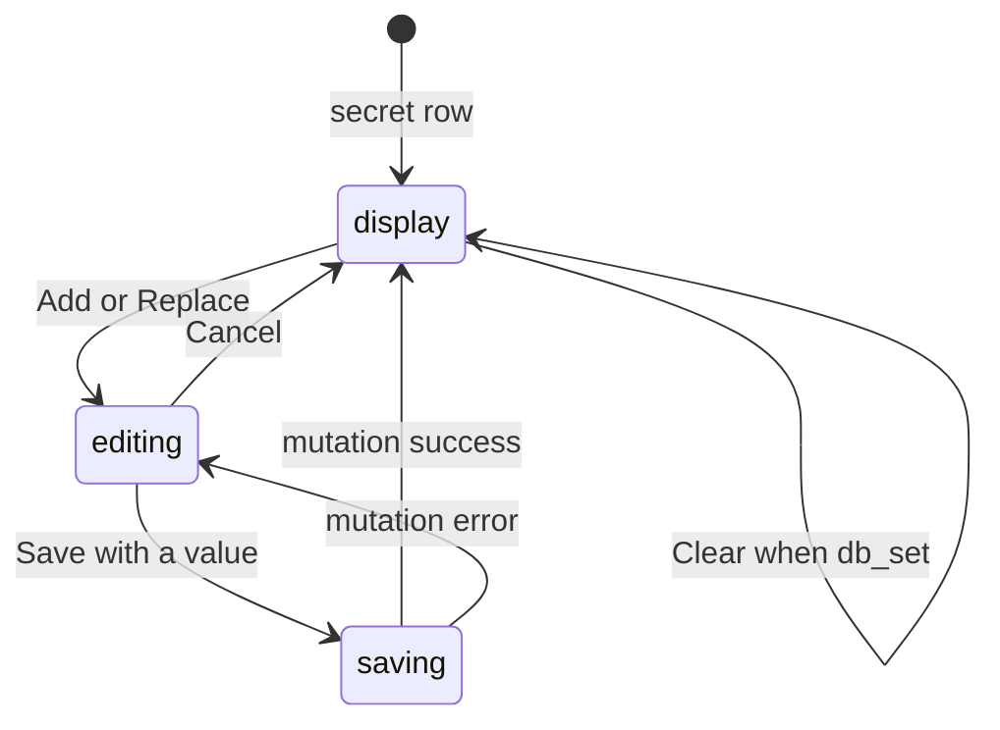
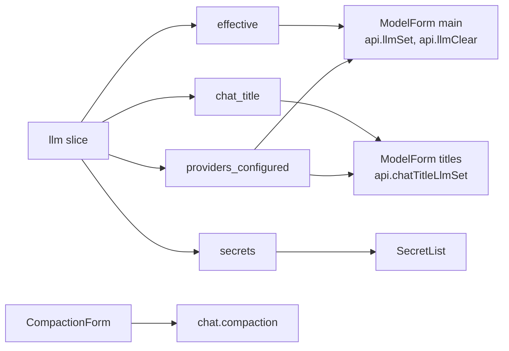
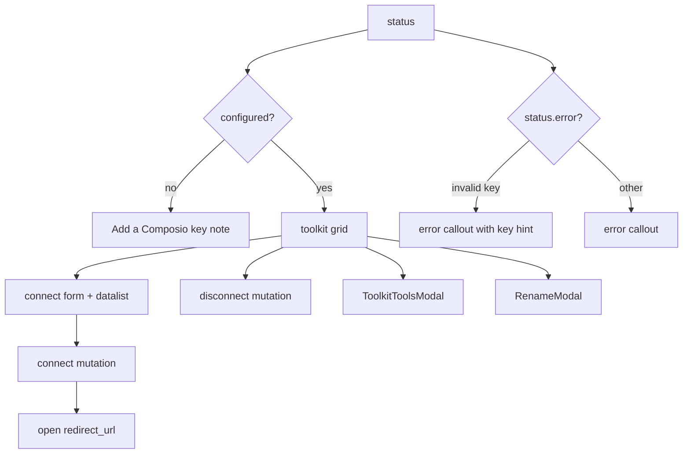
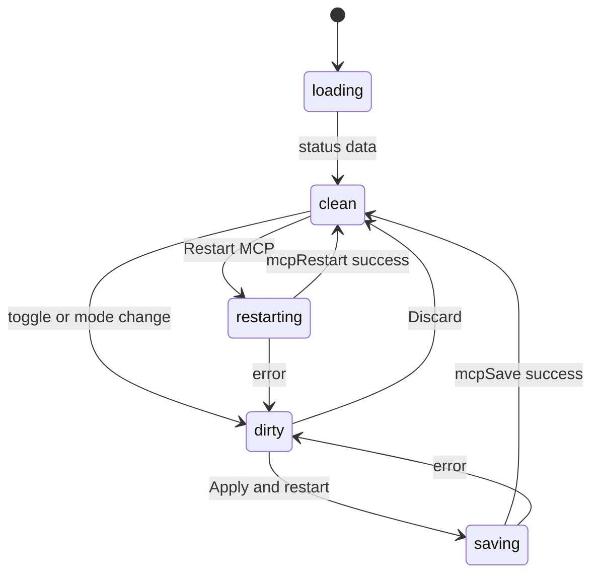
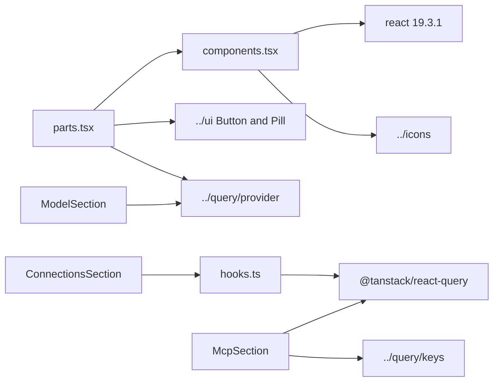

# Settings components

The settings library is a set of layout parts plus one component per backend area. `components.tsx` provides the collapsible section shell, rows, fields and modal. `parts.tsx` provides status notes, setting headers, secret editors, toggles and key lists. The section files compose those parts around one slice of `IntegrationsStatus`.

Key capabilities:
- One section shell with an animated open and close.
- Inline styles for layout primitives so page-level CSS cannot leak in.
- Consistent save feedback through `MutationNote`.
- Secret editing that shows source (`db`, `env`, `unset`) and a masked value.

## Repository layout

## Building blocks

- `components.tsx`: `SettingsStatusPill`, `SettingsSection`, `SettingsRow`, `SettingsField`, `settingsButtonStyle`, `settingsInputStyle` and `SettingsModal`.
- `parts.tsx`: `MutationNote`, `SettingHead`, `Actions`, `SecretRow`, `SecretList`, `Toggle`, `SubHeading` and `KeyList`.
- `sections/ModelSection.tsx`: model, chat title, compaction, endpoint hint and LLM secrets.
- `sections/ConnectionsSection.tsx`: Composio project config and connected toolkits.
- `sections/McpSection.tsx`: MCP tool groups, browser mode, restart and bridge status.

## How it fits together

`SettingsSection` owns open state. It renders an inline-styled card so a page rule such as the extension's `section {}` cannot change its padding. The header is a full-width button with `aria-expanded`. The body uses a CSS grid row transition from `0fr` to `1fr`, which animates height without measuring it.

`SettingsRow` lays out a name and controls on one line with `flex-wrap`, and draws a bottom border unless `noBorder`. `SettingsField` is a label, a control and an optional hint. `settingsInputStyle` and `settingsButtonStyle` are the inline twins of the class-based controls, used where a component still composes style objects.

`SettingsModal` renders a fixed overlay with a blur, a centred panel, a title and a close button. Escape closes it, and clicking the backdrop closes it while clicks inside the panel stop propagation. `zIndex` defaults to 1000 and `minWidth` is clamped to 320.

## Save feedback and secrets

`MutationNote` reads a mutation-like object and prints one line: saving with an optional label, the error message with a title attribute, or `Saved`. Sections place it next to the control that triggered the write, so there is no global toast.

`SecretRow` keeps its own edit state. In display mode it shows the name, a source pill and the masked value, plus Add or Replace and Clear. Clear appears only when `secret.db_set` is true, since an env-only value cannot be cleared from the UI. In edit mode it shows a password input whose placeholder is `New <env_var>`, a Save button disabled on empty input, and Cancel.

`SecretList` maps over the secrets array. `SettingHead` combines a strong name, an info slot, a pill and a row of mono facts. `KeyList` is the plain two column list used for services, tools, agents and MCP tool names.

## Model section

`ModelSection` receives `llm`, the LLM slice of `IntegrationsStatus`. The section description is `${provider} / ${model}` from `llm.effective`. It renders two `ModelForm` instances and a `CompactionForm`.

The endpoint hint documents `openai_base_url` ending in `/v1`, `anthropic_base_url` and `google_base_url`. When one is set, the model catalog lists that server's models instead of models.dev. The hint is informational; the fields are edited through the secrets list below it.

## Connections section

`ConnectionsSection` manages Composio. It keeps four pieces of local state: the open modal (`config` or `guide`), the connection being renamed, the toolkit being inspected, and the slug typed into the connect form. Three mutations wrap connect, disconnect and config reset.

The header pill is `invalid key` when `/invalid api key/i` matches the error, `configured` when the project key resolves, and `not set` otherwise. The description counts active connections across toolkits. Reset appears only when the config came from the database (`api_key_source === "db"` or `user_id_source === "db"`), because env values cannot be removed here.

`ToolkitCard` handles one toolkit: connections, connect, inspect, rename and disconnect. `SUGGESTED_TOOLKITS` fills a datalist for the slug input.

## MCP section

`McpSection` is self-contained. It runs its own query on `queryKeys.mcp(baseUrl)` with an 8s refetch, keeps a `draft` copy of the saved settings, and compares them field by field with `same`.

The three browser modes are `all` ("All four"), `execute` ("Code mode only") and `plain` ("No code mode"). Two toggles control `browser_tools` and `memory_tools`. With both off, the section warns that MCP clients get no tools. The primary button applies when the draft differs from the saved settings and restarts when it does not.

`done` writes the response into the query cache with `setQueryData`, resets the draft, and builds a note such as `Applied and restarted: 9 tools on, 2 clients refreshed.` The live tools list marks each tool `on` or `off` from `enabled_tools`. The bridge block shows whether this backend hosts the bridge, the `mcp_url`, and the attached browsers.

## Dependencies

Sections read the API from `useApi()` rather than receiving callbacks, which keeps props small but requires them to sit under `ApiProvider`. `useSettingsMutation` is the only shared write helper. `McpSection` bypasses it because it also seeds the MCP query cache.

## Performance

- Sections render only when their status slice exists, so a disabled integration costs nothing.
- The collapsed body still renders children but takes zero height, keeping form state alive while closed.
- `McpSection` stages edits in `draft`; typing or toggling does not hit the backend until Apply.
- `useSettingsMutation` invalidates instead of refetching, letting TanStack Query dedupe with the 8s poll.

## Troubleshooting

- Symptom: the section body does not animate. Cause: a page-level CSS rule overrode `display` on the grid. Fix: keep the inline styles on `SettingsSection` intact.
- Symptom: Save on a secret does nothing. Cause: the input is empty, so the button is disabled. Fix: type a value or press Cancel.
- Symptom: MCP Apply keeps returning to dirty. Cause: the server response differs from the draft fields compared by `same`. Fix: check `browser_tools`, `memory_tools` and `browser_mode` in the response.
- Symptom: Composio shows `invalid key`. Cause: a Sessions or MCP key was used instead of the project key. Fix: paste the project key from `platform.composio.dev/settings`.

## Appendix

### Implementation examples
- Collapsible shell, `SettingsSection`.
- Inline control styles, `settingsButtonStyle` and `settingsInputStyle`.
- Modal behaviour, `SettingsModal`.
- Secret editing, `SecretRow`.
- Model forms, `ModelSection`.
- Draft and apply, `McpSection`.

### Source files
- `clients/shared/src/settings-ui/components.tsx`
- `clients/shared/src/settings-ui/parts.tsx`
- `clients/shared/src/settings-ui/sections/ModelSection.tsx`
- `clients/shared/src/settings-ui/sections/ConnectionsSection.tsx`
- `clients/shared/src/settings-ui/sections/McpSection.tsx`
