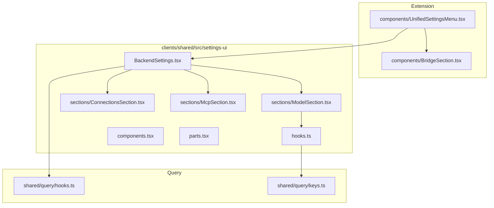
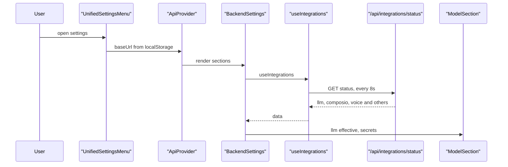
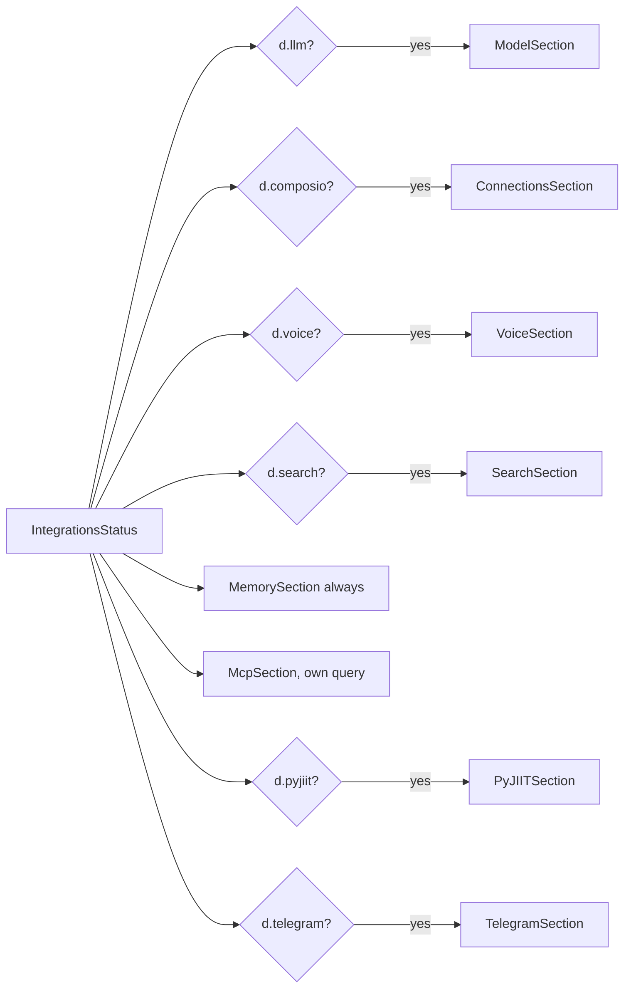
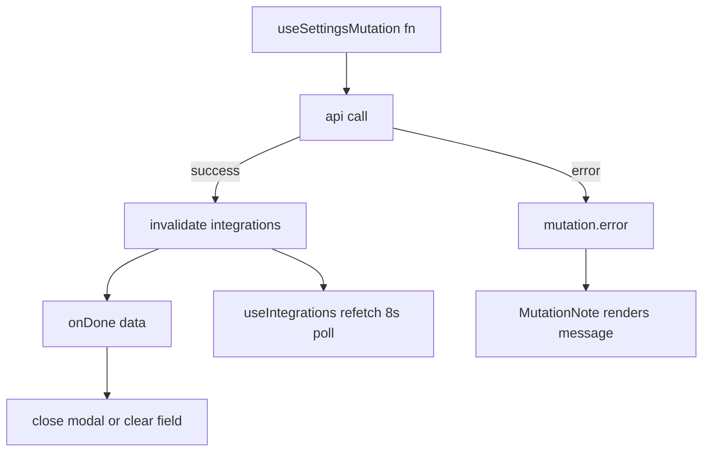
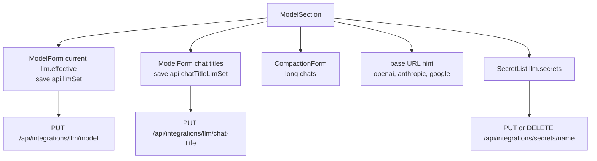
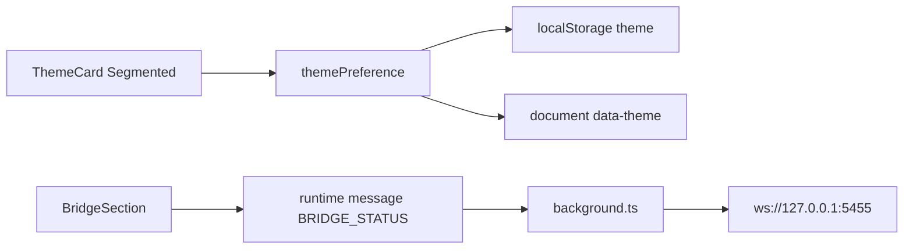
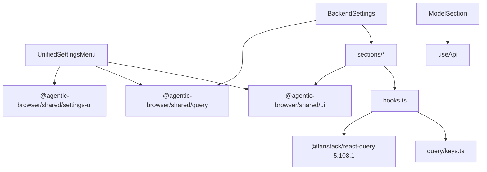

# Settings state

Settings are backend state. The extension renders a sheet with local controls for theme and the MCP bridge, then mounts the shared `BackendSettings` library for everything stored in Postgres. Each write goes through `useSettingsMutation`, which refreshes the integrations query so the rest of the sheet reflects the new server state.

Key capabilities:
- One `useIntegrations()` query feeds every backend section.
- Section ids are typed, and the side panel chooses a subset and an order.
- Writes invalidate `queryKeys.integrations(baseUrl)` on success.
- Missing status keys hide a section instead of rendering an empty card.

## Repository layout

## Building blocks

- `components/UnifiedSettingsMenu.tsx`: the sheet. `SECTIONS` is `model`, `subscriptions`, `apps`, `voice`, `search`, `memory`, `telegram`, `jiit`, `services`, `tools`, `agents`. The base URL is `localStorage.baseUrl || "http://localhost:5454"`.
- `settings-ui/hooks.ts`: `useRefreshIntegrations` and `useSettingsMutation`. The latter wraps `useMutation` and runs the refresh before the caller's `onDone`.
- `settings-ui/BackendSettings.tsx`: reads one integrations query and renders each requested section behind a guard such as `d.llm && <ModelSection ...>`.
- `settings-ui/sections/ModelSection.tsx`: the model forms, compaction form and secret list.

## How it fits together

The sheet renders `AccountCard`, then a "This browser" group, then a "Backend" group inside `ApiProvider`. `BackendSettings` shows a skeleton made of the first five requested sections while the query loads. On success it maps `sections` in order and wraps each one in `
`, which gives stable anchor ids for deep links.

If the API is down, `QueryView` renders the error with `errorHint` from the sheet: "Model, keys and connected apps live there. The MCP bridge and theme above work without it." That split is deliberate. Theme is local storage and the bridge card talks to the extension worker, so both keep working offline.

## Section ids and guards

`SettingsSectionId` has twelve values, including `mcp`, which the side panel does not render. `SETTINGS_SECTION_LABELS` supplies the human names. `render` switches on the id and returns `undefined` when its slice of the status is missing, which React skips.

`McpSection` is the exception: it does not read the integrations payload, it runs its own `useQuery` on `queryKeys.mcp(baseUrl)` with an 8s refetch, and writes through `api.mcpSave` or `api.mcpRestart`. That is why settings can restart the MCP server without reloading the whole integrations status.

## Mutation flow

`useSettingsMutation` is the standard write path. It captures `useQueryClient()` and `baseUrl` from context, then on success awaits `invalidateQueries({ queryKey: queryKeys.integrations(baseUrl) })` and calls `onDone`. Callers pass the API method and an optional completion callback.

`MutationNote` maps a mutation to one of three lines: `Saving <label>...`, the error message, or `Saved`. Sections use it next to Connect, disconnect and secret save controls so the user gets feedback without a toast system.

## Model section

`ModelSection` is the densest backend section. It renders one `SettingsSection` titled `Model` with the description `${provider} / ${model}`, then three forms and a secret list.

The first form's reset calls `api.llmClear`, the second's calls `api.chatTitleLlmClear`. Both receive `providers={llm.providers_configured}` so the provider select only offers providers with a resolved key. `SecretList` shows each secret's source (`db`, `env`, `unset`), a masked preview, and Add, Replace or Clear controls.

The paragraph under `Long chats` documents custom endpoints: `openai_base_url` must end in `/v1`, and `anthropic_base_url` and `google_base_url` point at servers that speak those APIs. When one is set, the model catalog lists that endpoint's models instead of models.dev.

## Local controls

Theme and bridge do not use the integrations query.

`ThemeCard` offers `light`, `dark` and `system` and calls `onThemeChange`. `App.tsx` owns the actual preference and applies it. `BridgeSection` lives in the extension's `components/` folder and asks the worker for status, so it can show a reconnect control even when the backend API is unreachable.

Escape closes the sheet unless another modal is open. The check is `document.querySelector("[role=dialog][aria-modal=true]:not(.sheet)")`, so a nested settings modal keeps the sheet open on its own Escape.

## Dependencies

The settings library depends on React, TanStack Query and Radix through the shared UI primitives. `@agentic-browser/settings-ui` exports the components, hooks and section ids, so the extension imports one entrypoint rather than deep paths. The console's `SettingsPanel` mounts the same `BackendSettings` with its own section list.

## Performance

- One integrations request feeds every backend section; sections do not fetch their own status, except `McpSection`.
- The query polls every 8s (`makeQueries.integrations`), slow enough to avoid noise and fast enough to show a connection made in another tab.
- Section bodies are collapsed by default and animate with `grid-template-rows` from `0fr` to `1fr`, so closed sections still render but take no height.
- `useSettingsMutation` invalidates rather than refetching directly, letting TanStack Query dedupe the refetch with the next poll.

## Troubleshooting

- Symptom: the backend group shows a retryable error. Cause: the API at `localStorage.baseUrl` is not reachable. Fix: start the backend or point the base URL at the right host.
- Symptom: a section disappears after an update. Cause: the status key it needs is missing, for example `d.telegram` after the bot was disabled. Fix: check `/api/integrations/status`.
- Symptom: a saved secret still shows `from env`. Cause: the DB value was cleared, so resolution fell through to the environment variable. Fix: set the key again or change the env var.
- Symptom: Escape closes the sheet while a child modal is open. Cause: the child modal lacks `role="dialog" aria-modal="true"`. Fix: use the shared `SettingsModal`, which sets both.
- Symptom: model select is empty. Cause: `providers_configured` has no true entries. Fix: add an API key under API keys and endpoints.

## Appendix

### Implementation examples
- Section order and labels, `SECTIONS` and `SETTINGS_SECTION_LABELS`.
- Guarded rendering, `render` in `BackendSettings`.
- Refresh after write, `useSettingsMutation`.
- Model form wiring, `ModelSection`.
- MCP settings write, `apply` in `McpSection`.

### Source files
- `clients/browser-extension/entrypoints/sidepanel/components/UnifiedSettingsMenu.tsx`
- `clients/shared/src/settings-ui/hooks.ts`
- `clients/shared/src/settings-ui/BackendSettings.tsx`
- `clients/shared/src/settings-ui/sections/ModelSection.tsx`
