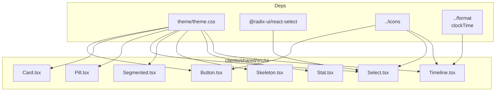
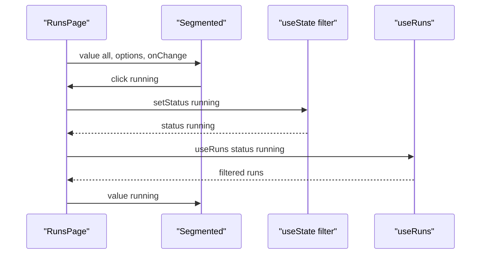
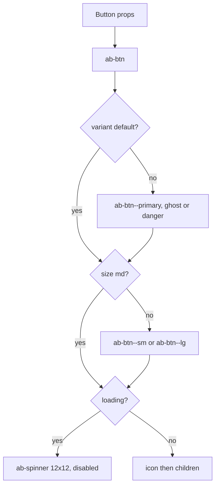
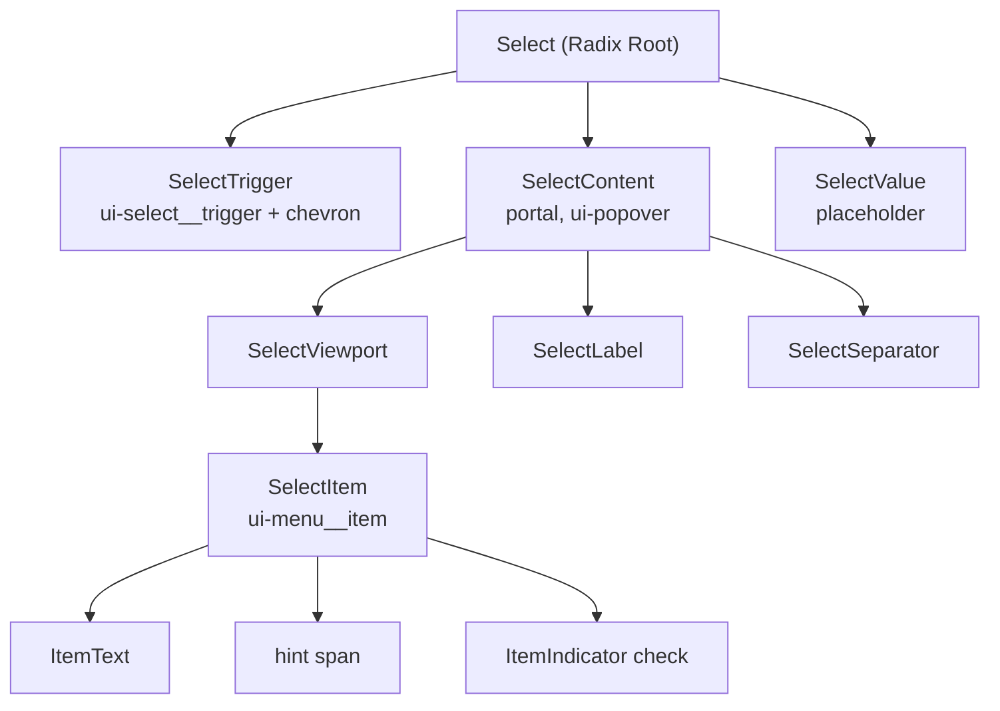
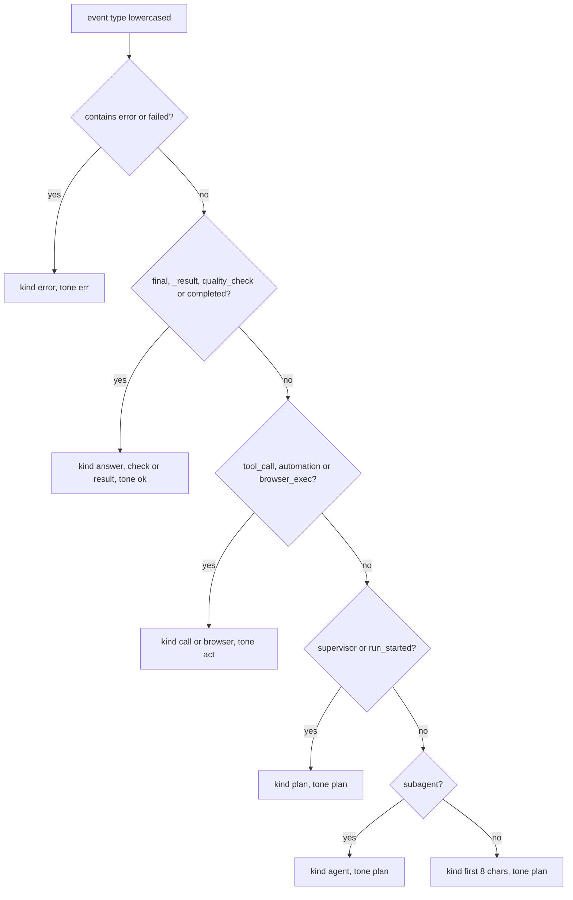
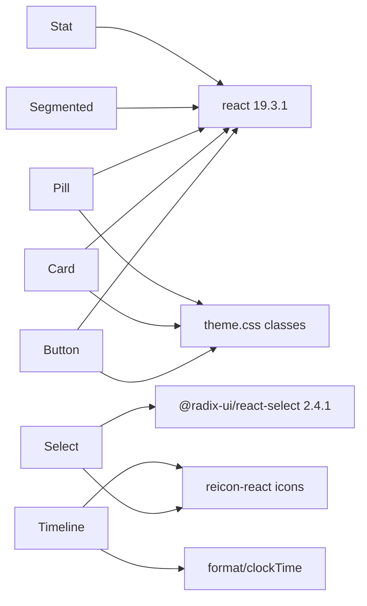

# Shared primitives

The primitives in `clients/shared/src/ui` are small, class-based components with no data fetching. `Button` and `IconButton` cover actions, `Card` is the surface, `Pill` and `StatusPill` show state, `Segmented` and `Select` handle choice, `Skeleton` covers loading, `Stat` shows a number with a sparkline, and `Timeline` renders an ordered list of steps.

Key capabilities:
- One class vocabulary (`ab-btn`, `ab-card`, `ab-pill`, `seg`, `tl`) consumed by both apps.
- Accessible roles on the interactive pieces: `radiogroup` for Segmented, Radix for Select, `aria-expanded` on expandable rows.
- Status tones derived from a single map, so a new status word has one place to land.
- Charts drawn as inline SVG with no chart library.

## Repository layout

## Building blocks

- `Button.tsx`: `Button` with `variant`, `size`, `icon` and `loading`, plus `IconButton`, which requires `label` and renders it as `aria-label` and `title`.
- `Card.tsx`: a `<section className="ab-card">` with an optional header row (`title`, `actions`) and a body that gets `card__body` padding unless `padded={false}`.
- `Pill.tsx`: `Pill`, `StatusPill` and `toneFor`. `Pill` takes `tone`, `dot` and `title`; `StatusPill` lowercases the status and looks up a tone.
- `Select.tsx`: Radix `Select` parts plus `SimpleSelect`, a value, options and onChange wrapper.
- `Segmented.tsx`: generic `Segmented<T extends string>` radio group with an optional icon and count per option.
- `Skeleton.tsx`: a single `ab-skeleton` div with width and height props.
- `Stat.tsx`: `Sparkline`, `Stat` and `StatStrip`.
- `Timeline.tsx`: `Timeline`, `TimelineStep` and `classifyEvent`.

## How it fits together

A page holds selection state and passes it down. `Segmented` and `SimpleSelect` are controlled: they render the current value and call `onChange` with the next one. Neither keeps internal state, so the page, the URL or a query key remains the source of truth.

## Buttons

`Button` composes its class list from four inputs: base `ab-btn`, variant when it is not `default`, size when it is not `md`, and `ab-btn--icon` for the icon case. A custom `className` is appended last, so callers can adjust width or margin without forking the component.

`loading` also disables the button (`disabled || loading`), so a double submit cannot fire. `IconButton` defaults to `variant="ghost"` and `size="md"`, and its `label` is mandatory, which keeps tooltips and screen reader names in sync.

## Choice controls

`Segmented` maps options to buttons with `role="radio"` inside a `role="radiogroup"` labelled by the required `label` prop. The selected option gets `is-on`; `count` renders in `seg__count`. The `sm` size class is `seg--sm`.

`SimpleSelect` wraps the Radix parts. `value={value || undefined}` lets Radix show the placeholder for an empty string. Each option can carry a `hint`, which renders at the end of the row.

`SelectContent` uses `position="popper"` and `sideOffset={6}`. The portal means the menu escapes overflow containers, which matters inside the settings sheet and the side panel. `SimpleSelect` does not expose grouping or separators; use the named parts when a menu needs sections.

## Status and numbers

`Pill` renders `ab-pill` plus `ab-pill--<tone>` unless the tone is neutral. `dot={false}` adds `ab-pill--plain`, which hides the `::before` dot. The `live` tone pulses with `ab-pulse` every 1.4s.

`Stat` is a label, a value with an optional unit, a sub line, and an optional sparkline. `Sparkline` builds a 120 unit wide viewBox, scales values to the max (or 1 when all are zero), draws an area path with a gradient and a 1.5px line. With fewer than two values it renders an empty spacer of the requested height instead of a broken path.

`Skeleton` is deliberately dumb: one div, width default `100%`, height default 12, and a style override. Loading layouts decide their own shapes.

## Timeline and event classification

`Timeline` renders an ordered list with a rail. Each step has a `kind` label, a React node `label`, an optional `at` time rendered by `clockTime`, and an optional `detail`. A step with no detail renders a disabled row, so it is not focusable but still readable.

`classifyEvent` is a display helper, not a state machine. The work log uses event names directly; the timeline uses this mapping to colour a run trace.

## Dependencies

Every file imports React types and, where needed, an icon from `clients/shared/src/icons`. `Select.tsx` is the only file with a Radix runtime dependency. `Timeline.tsx` imports `clockTime` from `../format` to render step times consistently with the console.

## Performance

- All primitives are function components with no effects except `Timeline` item expansion, so they re-render with their parent.
- `Sparkline` calls `useId()` to keep gradient ids unique without a global counter.
- `Segmented` and `Select` are controlled, which avoids a second render from internal state.
- `Skeleton` has no animation loop; the shimmer is a CSS animation, so many placeholders cost one compositor animation.
- `Timeline` renders detail only for the open item, so long traces keep a small DOM.

## Troubleshooting

- Symptom: `IconButton` has no tooltip. Cause: the label was an empty string. Fix: pass a real label; the type requires the prop but not non-empty text.
- Symptom: a select shows no placeholder. Cause: `value` is a non-empty string that is not in the options. Fix: pass `""` or `undefined` for empty.
- Symptom: a sparkline is invisible. Cause: fewer than two values, so the component returns a spacer. Fix: pass at least two points.
- Symptom: timeline rows cannot be expanded. Cause: no `detail` was provided. Fix: pass the detail node when the step has more to show.
- Symptom: a pill has no dot. Cause: `dot={false}` or a plain class. Fix: leave the default or pass a tone.

## Appendix

### Implementation examples
- Class composition, `classes` in `Button.tsx`.
- Header and body layout, `Card`.
- Tone map and lowercase status, `STATUS_TONE` and `StatusPill`.
- Controlled select, `SimpleSelect`.
- Sparkline geometry, `Sparkline` in `Stat.tsx`.
- Event mapping, `classifyEvent` in `Timeline.tsx`.

### Source files
- `clients/shared/src/ui/Button.tsx`
- `clients/shared/src/ui/Card.tsx`
- `clients/shared/src/ui/Pill.tsx`
- `clients/shared/src/ui/Select.tsx`
- `clients/shared/src/ui/Segmented.tsx`
- `clients/shared/src/ui/Skeleton.tsx`
- `clients/shared/src/ui/Stat.tsx`
- `clients/shared/src/ui/Timeline.tsx`
