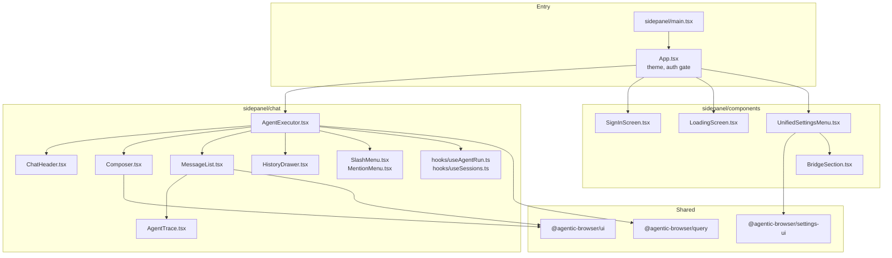
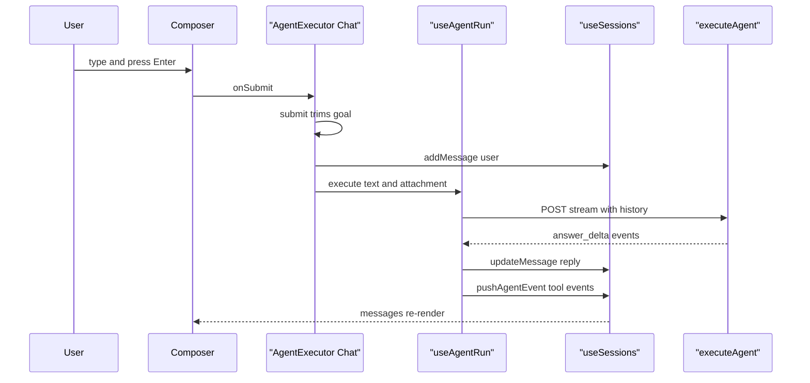
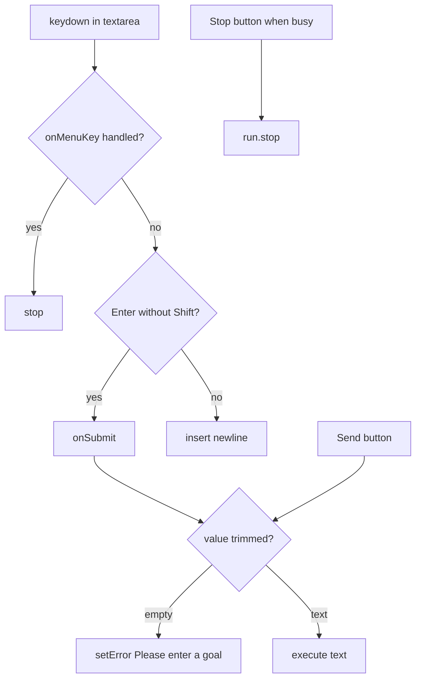
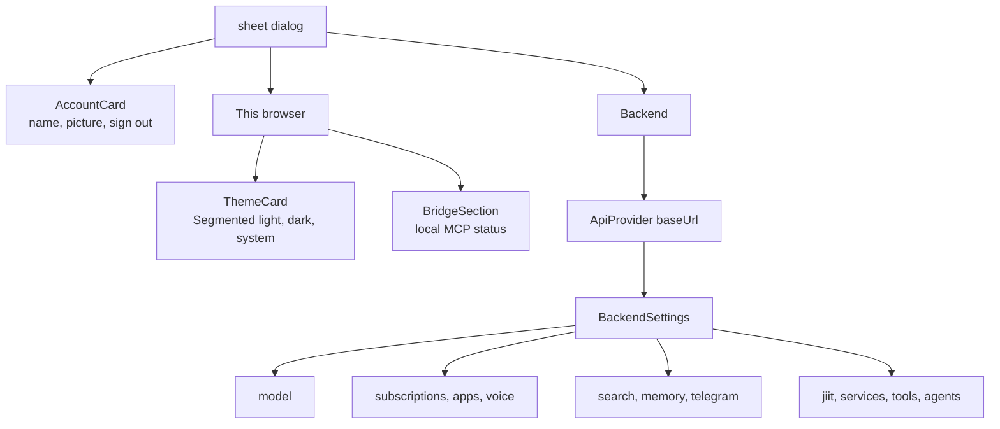
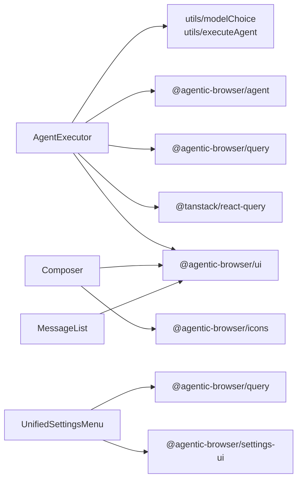

# Side panel UI components

The side panel is a React tree mounted at `entrypoints/sidepanel/index.html`. `App.tsx` owns theme and the auth gate, `AgentExecutor.tsx` owns providers and the chat shell, and the files under `chat/` and `components/` render every control the user touches. This page walks the component tree and the interactions each piece owns.

Key capabilities:
- One chat per session, with a history drawer, new chat action and delete.
- A composer with model picker, attachments, dictation, slash and mention menus.
- A settings sheet that stays partly usable offline: theme and the MCP bridge do not need the backend.
- Shared primitives from `@agentic-browser/ui` so the panel matches the console.

## Repository layout

## Building blocks

- `App.tsx`: resolves the theme, renders `LoadingScreen` while `useAuth` loads, `SignInScreen` when there is no user, and `AgentExecutor` plus `UnifiedSettingsMenu` when signed in.
- `AgentExecutor.tsx`: builds `ApiProvider` from `localStorage.baseUrl || VITE_API_URL || "http://localhost:5454"`, then renders `Chat`.
- `Chat` in `AgentExecutor.tsx`: owns the goal text, model choice, history drawer, mention menu and composer focus signal.
- `Composer.tsx`: textarea that grows from 24px to 200px, file chips, a model picker, browser action button, attach button, dictation toggle and send or stop control.
- `MessageList.tsx`: scrolls to the bottom on new messages, marks the reply currently being produced, and shows an empty `AgentTrace` while waiting for the first event.
- `UnifiedSettingsMenu.tsx`: modal sheet with account, theme, bridge and backend sections.

## How it fits together

`Chat` wires six hooks. `useSessions` owns the session list and message history. `useAgentRun` sends the command. `useSlashCommands` drives the `/` menu, `useTabs` feeds `@` mentions, `useAttachment` uploads a file, and `useSpeech` speaks replies. Submitting clears the composer, closes the menus and calls `run.execute(text, attachment.take())`.

## Chat shell

`ChatHeader` receives the session title, `busy`, the history drawer state and three callbacks: toggle history, new chat, open settings. A session titled `New Chat` is displayed as `New chat`. `HistoryDrawer` lists sessions sorted by `updatedAt`, selects one, deletes one, or starts a new chat. `EmptyState` renders quick actions when the thread is empty. A quick action whose command ends in a space fills the composer, otherwise it submits immediately.

The model picker stores its choice through `loadModelChoice` and `saveModelChoice` in `entrypoints/utils/modelChoice.ts`, so the chosen provider and model survive a panel reload. `Composer` passes the choice up through `onModelChange`.

## Composer behaviour

The textarea auto-sizes on every value change: `height = clamp(scrollHeight, 24, 200)` in pixels. Enter submits and Shift+Enter inserts a newline, but the `onMenuKey` callback runs first so slash and mention navigation can consume arrow keys, Tab, Escape and Enter. While a run is active the textarea is disabled and shows `Working on it...`, and the send button becomes a stop button that calls `run.stop`.

The file input accepts images, PDFs, text, markdown, CSV, JSON, XML, Python, JavaScript, TypeScript, HTML and CSS (`ACCEPT` in `Composer.tsx`). A selected file shows a chip with a thumbnail for images, its name and size in KB. Upload state adds a spinner chip. The browser action button wraps the current text as `/browser-action <goal>`. The command parser only knows the agents in `AGENT_MAP`, so a command it does not map to `stage: "complete"` goes over the legacy socket path.

Dictation replaces the textarea with a listening strip: a dot, the word `Listening`, and 18 animated bars with staggered delays. `useVoiceInput` receives `onTranscript`, sets the goal, focuses the composer, and submits after 300ms when auto submit is on.

## Message rendering

`MessageList` finds the last assistant message and the index of the last user message. The reply being produced is that assistant message only when it comes after the last question. Otherwise, while `busy`, the list renders a waiting article with the agent mark and an `AgentTrace` with no events, which gives the work log its "Thinking" or "Working" header before any event arrives.

The list scrolls to `scrollHeight` whenever the message count, busy flag or session id changes. `AssistantMessage` receives `live`, `playingId` and `onSpeak`. `AgentTrace` converts stored `AgentLoopEvent` items into `AgentEvent` objects and renders the shared `WorkLog` in compact mode.

## Settings sheet

`UnifiedSettingsMenu` returns `null` when closed. When open it renders a modal `role="dialog"` with `aria-modal`, and Escape closes it unless a nested dialog with `aria-modal="true"` is open. The sheet has three groups: account, "This browser" and "Backend".

The section order is the `SECTIONS` array in the component: `model`, `subscriptions`, `apps`, `voice`, `search`, `memory`, `telegram`, `jiit`, `services`, `tools`, `agents`. `mcp` exists in `SettingsSectionId` and `SETTINGS_SECTION_LABELS`, but the `SECTIONS` array has no `mcp` entry. The local bridge card covers the status that matters in the panel. The `errorHint` tells the user that model, keys and connected apps need the backend, while theme and bridge do not.

The backend base URL in the sheet is `localStorage.baseUrl || "http://localhost:5454"`, without the `VITE_API_URL` fallback used by `AgentExecutor`. If the backend is down, `BackendSettings` shows a retryable error instead of breaking the theme and bridge controls.

## Legacy panel components

A few older panel components are still exported from `components/index.ts` and used by the legacy key path or by `App`. They are not part of `BackendSettings` and do not read the integrations query.

- `CuteTextInput`: an input with a focus border, an optional password type and an Enter handler. It is reused by the legacy settings form.
- `ApiKeySection`: a Gemini key field with Save, tied to the `GEMINI_REQUEST` path in `background.ts`.
- `SettingsSection`: a collapsible legacy settings block with the API key field and a `wsClient` status dot.
- `WebSocketStatus`: a connected or disconnected indicator with a Disconnect or Reconnect button that calls `wsClient.connect()` or `wsClient.disconnect()`.
- `MemoryInitModal`: a modal that posts profile text, a LinkedIn URL or an uploaded file to `/api/memory`, one endpoint per source.

`UnifiedSettingsMenu` is the current surface for new work. The legacy pieces stay because the `geminiApiKey` path still exists in `App.tsx`. When a legacy component needs a style shared with the console, move the style into `shared/ui` rather than copying it.

## Auth screens

`SignInScreen` is the first run surface. It renders Google and GitHub buttons, the app mark, and a theme control. `handleLogin` in `useAuth` launches `browser.identity.launchWebAuthFlow`, posts the code to `/api/auth/exchange-code`, and stores `googleUser` in `browser.storage.local`. `LoadingScreen` is a minimal centered mark shown while the stored profile is read.

If the backend has no credentials for the profile, the panel still opens. The sheet shows a "Server credentials missing" state, and the model tools fail with a clear message rather than blocking the chat.

## Theme handling

`App.tsx` stores the preference under the `theme` key and writes `data-theme="dark"` or `data-theme="light"` on the document element. The preference can be `system`, in which case a `matchMedia("(prefers-color-scheme: light)")` listener updates the attribute when the OS changes. `cycleTheme` rotates dark, light, system in that order. The settings sheet's `ThemeCard` offers the same three values directly.

## Dependencies

React 19.3.1 and TanStack Query 5.108.1 come from the extension package. `@agentic-browser/shared` is a `workspace:*` dependency, and its exports `./ui`, `./query`, `./icons`, `./settings-ui` and `./agent` are the only shared surfaces this folder imports.

## Performance

- `MessageList` scrolls on a small dependency list (`messages.length`, `busy`, `sessionId`), not on every render.
- The composer auto-size writes one style property per change and does not measure when the value is unchanged.
- `AgentTrace` renders a compact `WorkLog`, and `WorkLog` re-renders once per second only while a run is live (`useNow`).
- Menus are mounted only when open: `HistoryDrawer`, `SlashMenu` and `MentionMenu` each have a conditional guard in `Chat`.
- Attachments are uploaded by `useAttachment` before submit, so the chat turn carries a path rather than file bytes.

## Troubleshooting

- Symptom: the composer does nothing on Enter. Cause: `submit` trims an empty goal and sets "Please enter a goal for the agent". Fix: type text first.
- Symptom: slash menu swallows Enter. Cause: `onMenuKey` returns true when a suggestion is selected. Fix: press Escape to close the menu, then Enter.
- Symptom: the panel shows the settings sheet and not the chat. Cause: `useAuth` set `shouldRedirectToSettings` on first run. Fix: close the sheet; `setupCompleted` is stored so it does not repeat.
- Symptom: theme does not follow the OS. Cause: the stored preference is not `system`. Fix: cycle to system in the settings sheet or the sign in screen.
- Symptom: model choice resets. Cause: the panel is running with a different origin or storage was cleared. Fix: pick the model again; the choice is saved under the extension storage used by `modelChoice.ts`.

## Appendix

### Implementation examples
- Provider and base URL, `AgentExecutor` and `backendBase`.
- Submit path, `submit` in `Chat`.
- Menu keyboard handling, `onMenuKey` in `Chat`.
- Composer growth, `MIN_HEIGHT` and `MAX_HEIGHT` effects.
- Waiting state, `liveId` and `waitingForReply` in `MessageList`.
- Settings sections, `SECTIONS` in `UnifiedSettingsMenu`.

### Source files
- `clients/browser-extension/entrypoints/sidepanel/App.tsx`
- `clients/browser-extension/entrypoints/sidepanel/AgentExecutor.tsx`
- `clients/browser-extension/entrypoints/sidepanel/chat/Composer.tsx`
- `clients/browser-extension/entrypoints/sidepanel/chat/MessageList.tsx`
- `clients/browser-extension/entrypoints/sidepanel/components/UnifiedSettingsMenu.tsx`
