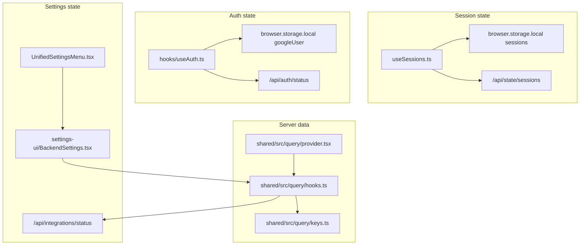
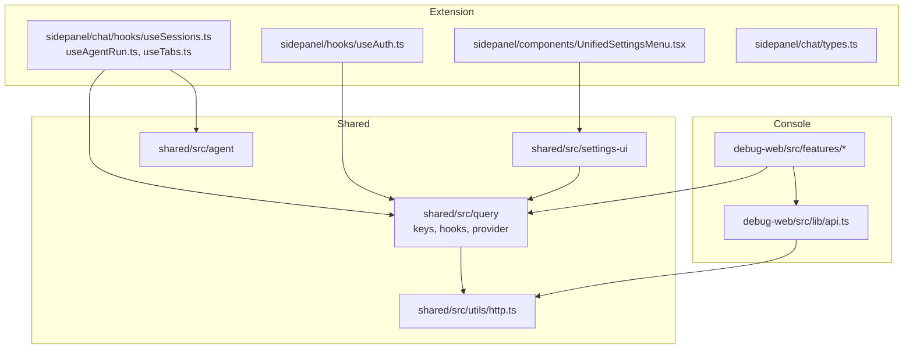
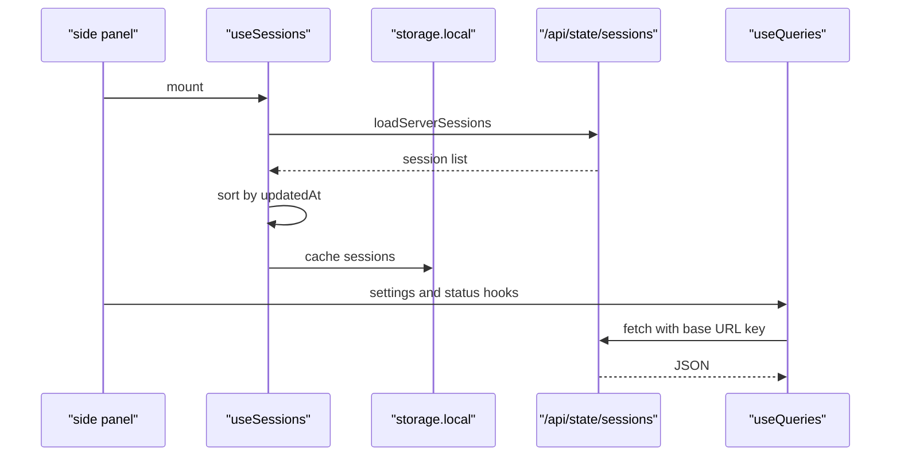
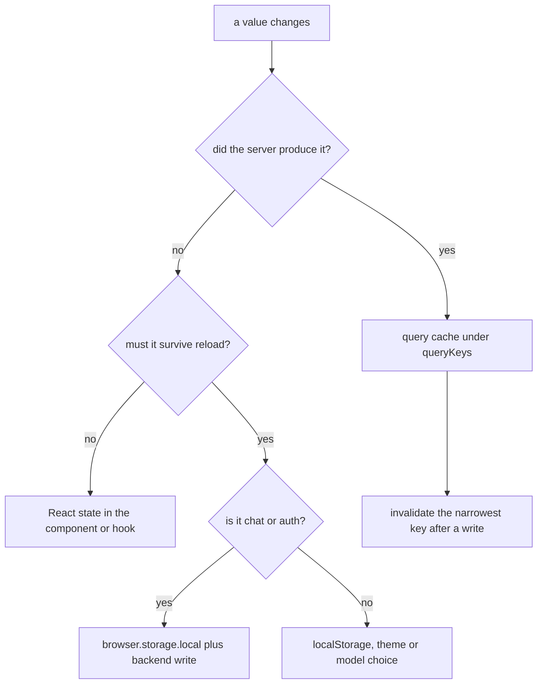
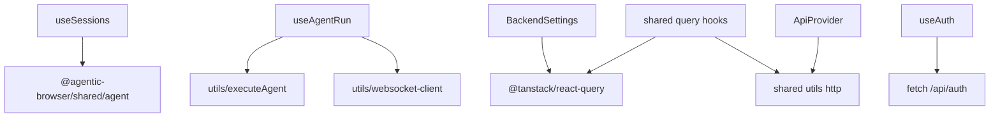

# State management

Frontend state falls into three buckets. Chat sessions are React state inside `useSessions`, persisted to the backend and mirrored to extension storage. Settings live on the backend and are read through the integrations query, with a small local layer for theme and the bridge. Server data goes through TanStack Query, with per-query polling intervals and a base URL inside every key.

Key capabilities:
- One owner per kind of state, so a value is never written from two places.
- Backend first on load, local storage as an offline cache and fallback.
- Query keys that include the base URL, so two backends never share a cache.
- Typed section ids so the panel and console can render different settings subsets.

## Repository layout

Session and auth state sit in the extension, because only the extension has a chat and a signed in profile. Server data and settings components live in the shared package so the console can reuse them.

## Building blocks

- `useSessions` and `useAgentRun` hold chat state in the extension.
- `ApiProvider` and `makeQueries` bind server data to a base URL.
- `useAuth` holds the signed in profile and token status.
- `BackendSettings` reads one integrations query for all settings.

## How it fits together

## State ownership

The rule is simple: React state owns interaction detail, query state owns anything the server returned, and extension storage owns what must survive a panel reload while the backend is unreachable.

Examples:
- Composer text, an open drawer, the selected memory node: React state, lost on reload on purpose.
- Session list, messages, agent events: `useSessions`, written through to `/api/state/sessions` and `browser.storage.local`.
- Theme and model choice: `localStorage`, read once at mount.
- Integrations status, runs, claims, stats: TanStack Query, keyed by the base URL.

## Child pages

| Page | What it covers |
| --- | --- |
| `Sessions and Chat State.md` | `useSessions`, `useAgentRun`, `ChatMessage` and `Session` types, `useTabs` for mentions. |
| `Settings State.md` | Settings sheet, backend settings query, mutation refresh and model section. |
| `Query and Data Fetching.md` | Query keys, factories, provider context, polling intervals and the HTTP client. |

## Shared concepts

- The backend is the source of truth for sessions and settings. Local storage is a cache and an offline fallback, not a second database.
- The base URL is part of every query key. `queryKeys.all(base)` is `["ab", base]`, and each key extends it.
- Mutations refresh a narrow key. `useSettingsMutation` invalidates `queryKeys.integrations(baseUrl)` after a successful write.
- React state owns interaction detail: composer text, open drawers, selected session, hovered graph node. Query state owns anything the server returned.

## Dependencies

The extension owns React 19.3.1 and TanStack Query 5.108.1. The shared package declares TanStack Query and React as peer dependencies, and exposes `./query`, `./settings-ui` and `./agent` so the extension and console import the same modules.

## Performance

- Session writes go to the server and storage on every sessions change, both fire and forget with `catch` logging, so the UI never waits on a write.
- Query polls are per hook: 4s for stats and runs, 1.5s for a running run, 8s for integrations and MCP, 30s for timeseries and maintenance.
- `staleTime: 5_000` prevents duplicate fetches when a page mounts several components that share a key.
- The session list is sorted once on adopt and on each message append, not on every render.

## Troubleshooting

- Symptom: sessions vanish after a reload. Cause: the server returned an empty list and local storage was cleared. Fix: check `/api/state/sessions` and the `sessions` storage key.
- Symptom: settings edits do not appear elsewhere. Cause: only the current page's cache was updated and the integrations key was not invalidated. Fix: use `useSettingsMutation`, which calls `invalidateQueries`.
- Symptom: `useApi must be used inside <ApiProvider>`. Cause: a query hook ran outside the provider. Fix: mount `ApiProvider` above the component tree.
- Symptom: two clients show different data. Cause: they use different base URLs, so the query keys differ by design. Fix: point both at the same backend.

## Appendix

### Implementation examples
- Session load order, `useSessions` effect.
- Auth status check, `initAuth` in `useAuth`.
- Query factories, `makeQueries` in `shared/src/query/hooks.ts`.
- Provider value, `ApiProvider` in `shared/src/query/provider.tsx`.

### Source files
- `clients/browser-extension/entrypoints/sidepanel/chat/hooks/useSessions.ts`
- `clients/browser-extension/entrypoints/sidepanel/hooks/useAuth.ts`
- `clients/shared/src/query/hooks.ts`
- `clients/shared/src/query/provider.tsx`
